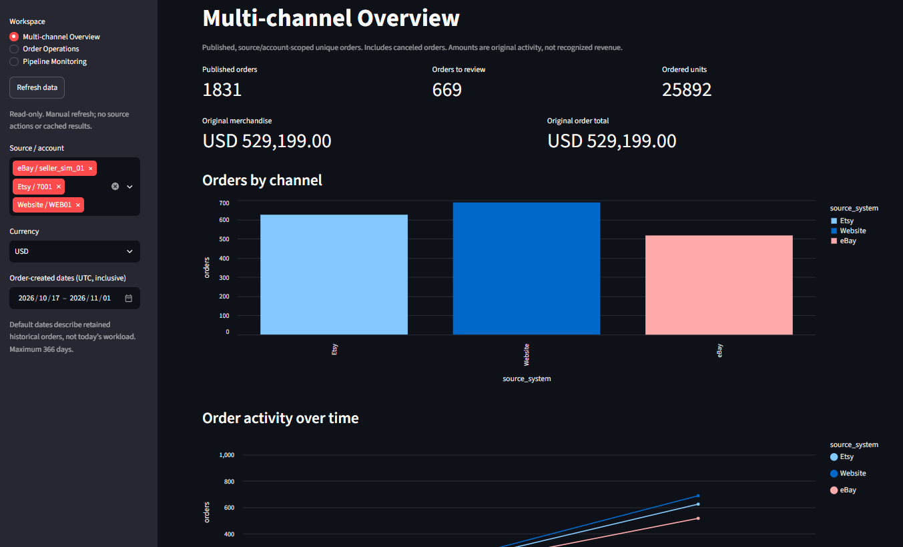
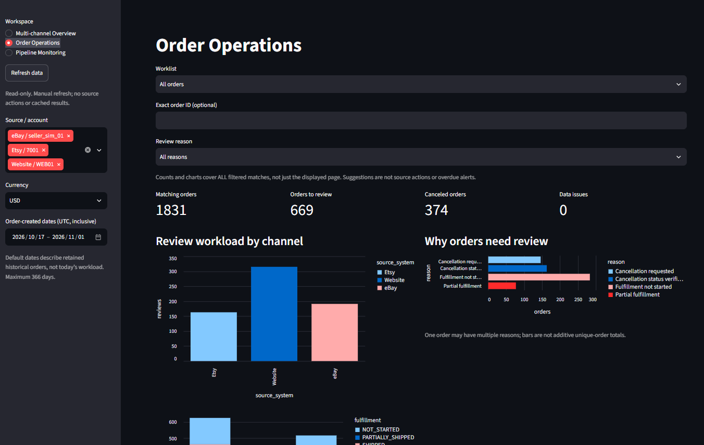
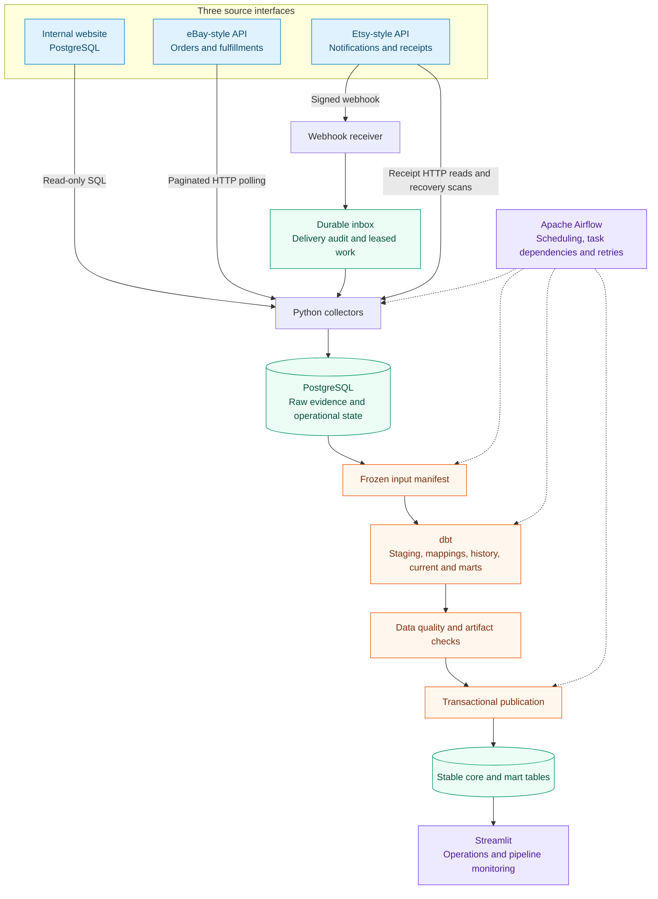

<div align="center">

# Multi-Channel Order Data Platform

### From fragmented order updates to one operational view.

A local, end-to-end Data Engineering project that brings website, eBay-style and
Etsy-style order data into a unified, auditable dataset for operations reporting.

**Python · PostgreSQL · dbt Core · Apache Airflow · Docker Compose · Streamlit**

[Dashboard](#dashboard) · [Architecture](#architecture) · [Engineering highlights](#engineering-highlights) · [Run locally](#run-locally) · [Explore the code](#explore-the-code)

</div>



## The business problem

Selling through multiple channels means working with different product codes,
order statuses and update mechanisms. A website exposes database records; one
marketplace requires API polling; another sends webhook notifications. Combining
exports alone does not explain which state is current, whether an update was
processed twice, or which orders need attention.

This project turns those separate source interfaces into one data product for an
**Operations Manager**:

- Compare order volume and review workload across channels.
- Find orders requiring cancellation review or fulfillment follow-up.
- Inspect order lines and the status changes actually observed by the pipeline.
- Trace published data back to acquisition evidence and processing runs.

The dashboard is the visible result; the core of the project is the data pipeline
that makes those views consistent and explainable.

## Dashboard

### Multi-channel Overview

The overview above brings together published orders, ordered units, original
order amounts and orders requiring review. Channel comparisons, source-created-date
activity and product charts show how each source contributes to the shared dataset.

### Order Operations

Attention cards and review-reason charts turn the integrated data into an
operational worklist. Users can filter by channel/account, dates and currency,
search an exact order ID, browse paginated results and inspect one order's
payment, fulfillment and cancellation states independently.



*Actual screenshots of the local application using synthetic data. Figures are
from that demo session, not a throughput benchmark. The report is read-only;
operational actions remain in the source systems.*

### Pipeline Monitoring

A separate technical workspace exposes execution attempts, stage durations,
retries, backlog and scheduler observations. It distinguishes source order
activity from pipeline processing time, and published business data from current
pipeline health.

## Architecture



**Clear ownership:** Python acquires and audits data; dbt owns business SQL;
Airflow orchestrates reusable commands. The webhook receiver runs independently
of DAG execution. Marketplace collectors use HTTP, not simulator storage, and
website collectors have read-only source access.

The project runs locally in Docker Compose. Source services use synthetic data
and selected eBay/Etsy-style contracts, so the demo does not require live seller
accounts. A manual seeded generator prepares varied order lifecycles; source
services expose due updates through the same SQL/HTTP interfaces used by collectors.

## Engineering highlights

| Design choice | Why it matters |
| --- | --- |
| Source/account-scoped order identity | Order IDs from different channels or sellers do not collide in the unified dataset. |
| Raw acquisition and webhook delivery audits | Repeated requests remain traceable without inflating logical order versions. |
| Independent lifecycle dimensions | Payment, fulfillment and cancellation are not collapsed into one misleading status. |
| Observed history with raw lineage | Every retained snapshot comes from acquired evidence, not an invented intermediate event. |
| Explicit product and status mappings | Channel-specific identifiers become comparable while original source values remain available. |
| Frozen batch inputs and tested publication | A build uses a declared raw manifest; stable tables change only after required validation passes. |
| Durable work, checkpoints and bounded retries | Acquisition progress and materialization progress are tracked separately. |
| Bounded, read-only reporting | Filters and keyset pagination avoid loading every order or order ID into the dashboard. |

### One order's path through the system

1. A source changes an order or sends a notification.
2. Python acquires source data and persists raw evidence and operational progress.
3. A batch freezes eligible raw inputs; dbt normalizes, maps and tests the data.
4. The publisher updates stable tables and the publication pointer in one transaction.
5. The dashboard reads a consistent published snapshot for channel comparisons,
   order review and drilldown.

Order-level money stays at order grain; line-level quantities and amounts stay
at line grain. Polling current state may skip fast intermediate changes, so the
platform preserves what was actually observed rather than manufacturing history.

## Technology stack

| Layer | Technology and responsibility |
| --- | --- |
| Acquisition | Python: read-only SQL, paginated HTTP, signature verification and receipt recovery |
| Storage | PostgreSQL: source databases, raw audits, work/checkpoints, published core and marts |
| Transformation | dbt Core + dbt-postgres: SQL models, mappings and data tests |
| Orchestration | Apache Airflow: scheduled workflows and reusable command execution |
| Reporting | Streamlit + Altair: operations workspace and pipeline charts |
| Local environment | Docker Compose: reproducible service configuration and isolated tool images |

## Run locally

Prerequisites: Python3.12 and Docker Engine with Compose. Copy `.env.example` to
`.env`, configure your local credentials, then follow the
[bootstrap and demo guide](docs/18_PORTFOLIO.md#demo-b-changing-local-sources-and-scheduled-pipelines).
The guide includes initial PostgreSQL/migration/Airflow startup; the commands
below are for an **already bootstrapped stack**:

```powershell
# Start the live source services and scheduled pipelines.
python -m tools.s02_data live-up
if ($LASTEXITCODE -ne 0) { throw 'Live startup failed' }

# Append a generated source workload. Scheduled pipelines pick up due changes.
python -m tools.s02_data generate --config tools/s02_data/config/observe_6min.json
if ($LASTEXITCODE -ne 0) { throw 'Generation failed' }

python -m tools.s02_data live-status
```

Default application URLs: **Dashboard** `http://localhost:8501` · **Airflow**
`http://localhost:8080`. Database host ports and credentials are configured in
`.env`. The generator's time window controls simulated source activity, not an
end-to-end processing deadline.

See the [operator guide](tools/s02_data/README.md) and
[generation configuration](tools/s02_data/CONFIG.md) for details.

<details>
<summary>Run the deterministic fixture checks without Docker</summary>

From the repository root:

```powershell
Push-Location fixtures/s01
try {
    python verify.py
    if ($LASTEXITCODE -ne 0) { throw 'Fixture verification failed' }
    python -m unittest -v test_tools.py
    if ($LASTEXITCODE -ne 0) { throw 'Fixture tests failed' }
} finally { Pop-Location }
```

These checks validate synthetic source fixtures, mappings, quantities, money,
fingerprints and observed-history expectations. They are offline contract checks,
separate from database/HTTP integration tests.

</details>

## Explore the code

| Start here | What to look for |
| --- | --- |
| [Source acquisition](ingestion/) | SQL/HTTP collectors, raw persistence and leased receipt work |
| [dbt project](transformations/) | Staging, source-specific normalization, current/history models and tests |
| [Batch and publication](transformation/) | Frozen inputs, validation gates and atomic stable release |
| [Airflow orchestration](orchestration/) | Scheduled DAGs, durable windows and retry coordination |
| [Dashboard](reports/) | Business filters, bounded queries, operations rules and charts |
| [Database migrations](migrations/) | Keys, constraints, operational tables and access boundaries |
| [Source generation](tools/s02_data/) | Seeded orders, lifecycle configuration and manual workload preparation |
| [Tests](tests/) | Fixture, acquisition, transformation, reporting and operational checks |

For a deeper walkthrough, see the [architecture](docs/03_ARCHITECTURE.md),
[target schema dictionary](docs/05_TARGET_SCHEMA.md) and
[source contracts](docs/02_SOURCE_CONTRACTS.md).
The [documentation map](docs/README.md) and [engineering log](docs/STATUS.md)
provide implementation context and recorded verification evidence.
