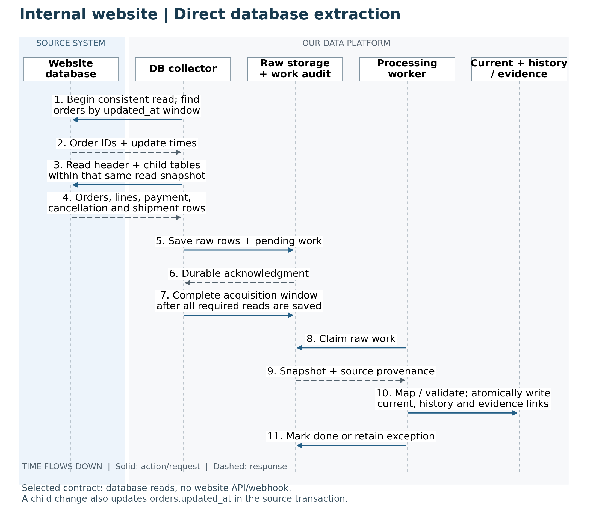
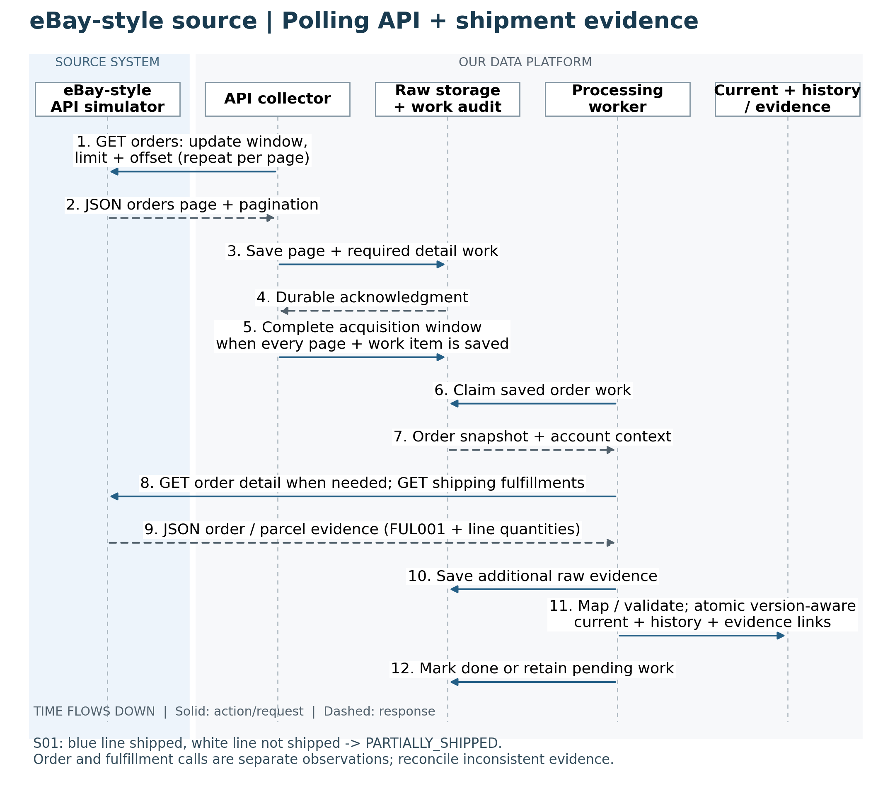
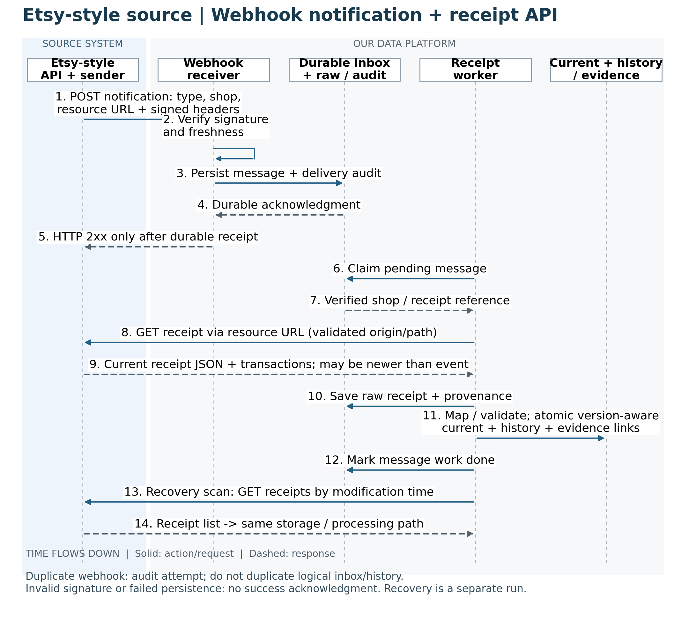

# C. Technical architecture and pipeline — DRAFT

## C1. Local implementation constraints

Start locally with controlled workloads on the available laptop: Intel i5-8250U, 12 GB RAM, SSD. No laptop benchmark has been performed. One PostgreSQL instance and one small API service are a proposed starting point, with logical separation and access controls rather than multiple heavy servers.

Develop a small scenario first, then increase order count, line count, and update count separately. Measure CPU, memory, storage, and processing time before expanding. Cloud hosting, Spark, Kafka, exact framework versions, and fixed scale targets are not committed requirements.

dbt and Airflow are required by the user (24 October 2026). Python, PostgreSQL and FastAPI are proposed supporting tools; the revised technical design is in Section C3. Exact versions and local resource use must be verified during bootstrap. Project documentation remains in English.

## C2. Source communication sequence diagrams

These are sequence diagrams: read from top to bottom. Solid arrows show actions/requests; dashed arrows show responses. The source is on the left, our data platform on the right. Lanes are logical responsibilities, not separate servers or final technology choices.

Status: planned interaction flow using the approved source contracts. On 24 October 2026 the user reported running the S01 fixture code successfully locally. This confirms a user-run offline fixture milestone; local source services, database ingestion and end-to-end pipeline execution are still the next work.

### C2.1. Internal website — direct database read

Our collector initiates a read-only, consistent read of changed orders and their child rows. Relevant source child changes also advance orders.updated_at in the same source transaction. The selected website interface uses SQL/database access, not an API or webhook.

Figure 1. Internal website: collector → source database → durable raw/work storage → processing → current/history.

The acquisition checkpoint advances only after all required source reads are durably saved and pending work is recorded. Materialization has a separate completion state. The generator changes source data; it never writes the expected warehouse answer into the pipeline.

### C2.2. eBay-style source — polling and detail APIs

Our collector initiates GET orders using lastmodifieddate and pagination. Raw pages and pending detail work are saved first. A worker retrieves order/fulfillment details when needed, preserving separate acquisition times and evidence references.

Figure 2. eBay-style API: polling pages plus order/shipping detail calls. No webhook is selected for this source.

In S01, a dated fulfillment links FUL001 to both blue units; the white line is not shipped. This supports PARTIALLY_SHIPPED. IN_PROGRESS alone is insufficient, and FULFILLED is not proof of delivery. Separate API calls are not an atomic vendor snapshot; inconsistent evidence must be reconciled.

### C2.3. Etsy-style source — webhook then receipt API

The source initiates POST to our webhook receiver. After signature/freshness validation, the receiver durably stores the message and delivery audit before sending HTTP 2xx. A separate worker calls the receipt API to obtain current order/transaction data.

Figure 3. Etsy-style source: notification pushes into our receiver; receipt retrieval and recovery scans pull from the source API.

A successful acknowledgment means the notification is stored, not that order processing is complete. Duplicate deliveries still receive an audit record without a new logical message. A receipt may already be newer than the notification: paid and shipped events can fetch the same current snapshot. Recovery scans use the same raw storage and processing path.

### C2.4. How these diagrams connect to the DE pipeline

These diagrams describe acquisition boundaries. Their processing/current/history lanes are logical responsibilities; Section C3 refines execution into Python acquisition, dbt transformation and Airflow orchestration. A worker fetching HTTP details does not also implement competing SQL transformations.

Implement the website path through raw, observed history/current, quality checks and reporting first. Then expose eBay and Etsy fixed-fixture interfaces with test-only clock/reset controls. Source services must serve source fixtures, never expected warehouse outputs. Freeze S01 source time during scheduled reads; use the execution clock for webhook freshness.

## C3. DE Implementation Contract v0.2 — DRAFT

Revised on 24 October 2026 after the user required dbt and Airflow. Business/source decisions remain approved; the storage, publication and repository design below are proposed for review. This replaces the earlier Python-only materialization proposal. No runtime implementation is claimed.

### C3.1. Scope and ownership

End product: reproducible source acquisition → durable raw → dbt staging → observed history/current → tested marts → small operations/data-health report. Python owns source access, webhook verification, raw persistence and operational state. dbt owns SQL normalization, product/status mapping, observed-version derivation, current models, marts and data tests. Airflow owns bounded workflow scheduling, dependencies and task execution. It invokes reusable commands rather than embedding transformation logic in DAG files.

The FastAPI webhook receiver remains available outside a DAG run: verify and persist before acknowledging. An acquisition worker fetches receipt/detail resources; this is separate from dbt transformation. Retain the tested fingerprint specification; any SQL implementation must pass the same fixture cases as the Python utilities.

### C3.2. Local deployment and repository

Proposed support stack: Python, PostgreSQL, FastAPI, Psycopg, dbt Core with the PostgreSQL adapter, Airflow and Docker Compose. Pin mutually compatible supported versions during bootstrap. Start with one PostgreSQL instance and separate databases/roles: website_source, marketplace_sim, data_platform and airflow_meta. Separate Airflow metadata from project raw/audit/core tables. Measure laptop resource use before choosing concurrency; no performance claim is made.

Use one public repository, proposed name multi-channel-order-platform. Suggested directories: simulator/ (state driver, API and signed sender); ingestion/ (collectors, receiver and raw/work persistence); transformations/ (dbt project, models and tests); orchestration/ (DAGs); migrations/ (source/platform DDL); fixtures/s01/; tests/; reports/; docs/; infra/ (Compose); plus README.md and .env.example.

Shared repository does not mean shared access. Marketplace ingestion uses HTTP and cannot query marketplace_sim. Website access is read-only. Only simulator/test code may read source-state controls and golden expected outputs. Keep business transformations in dbt; share only interface schemas and generic utilities where useful.

Git should contain synthetic fixtures, migrations, dbt SQL/tests, DAGs, setup commands, diagrams and a demo/status page. Exclude credentials, .env, DB volumes, runtime raw/logs and dbt artifacts. Label eBay/Etsy as local simulations. No remote repository has been created/pushed.

### C3.3. Pipeline steps and durable outputs

1. Open acquisition run — fix source/account/window bounds and record attempts. Website/eBay polling and Etsy recovery scans use independent checkpoints with the approved initial 120-second overlap.

2. Acquire — website reads consistent order/child rows; eBay saves pages and schedules detail/fulfillment requests; Etsy verifies/persists notifications before 2xx and schedules receipt fetches. Save raw and required fetch work before completing the acquisition window; record successful empty windows.

3. Retain evidence — exact HTTP bytes or a documented website extraction envelope, parsed JSONB and acquisition context. Duplicate fetches/deliveries remain auditable without creating duplicate business versions.

4. Freeze batch — record an explicit manifest of eligible committed raw IDs and mapping/transform versions. A numeric ID cutoff alone does not prove all earlier transactions committed. New arrivals wait for another batch.

5. Transform with dbt — typed staging, validation, money/time conversion, product/status mapping, distinct observed history/evidence and justified current state. Use retained observations, not simulator truth. Missing identity is quarantined; optional unresolved product mapping preserves the line with an exception.

6. Build/test marts — keys, relationships, amounts, lineage, ordering and S01 assertions. History uses every distinct retained observation, including several acquired between dbt runs; snapshotting only the latest current row cannot recover overwritten intermediate states.

7. Publish — promote only the successful tested batch, then update processing/publication state. Acquisition completion is separate. On failure retain raw/errors and show the previous successful report as stale.

8. Observe/replay — Airflow exposes task execution; ops exposes windows, freshness, backlog and exceptions. Replay uses recorded raw/versions and must reproduce output without invented historical states.

### C3.4. Proposed database schema — grain, keys and writes

Use TEXT for common source IDs, UUID for raw/run/batch IDs, TIMESTAMPTZ for UTC times, INTEGER for quantities, NUMERIC(20,6) for supported common amounts, JSONB for parsed payloads and BYTEA for original bytes. Reject unsupported amount precision/overflow visibly. Physical column constraints belong in the migration/dbt contract review; the following is the target table map.

raw.raw_records — one acquired HTTP body or website extraction envelope; append-only, PK raw_record_id. Retain run/source/account/resource context, window, status, acquired_at, exact bytes, parsed JSON, byte checksum and contract_version. Mask credential headers; preserve required local webhook verification metadata.

ops.pipeline_runs and ops.task_attempts — one run and one execution attempt, PK run_id / attempt_id. Store stage, source/account, batch_id, Airflow context, start/end, status, error and log reference. Structured logs use the same IDs plus raw/work/entity IDs.

ops.extraction_checkpoints — one source/account/stream, composite PK; completed_window_end and successful acquisition run. ops.processing_work — one fetch/detail job, PK work_id and unique dedupe_key; trigger/inbox/entity, state, cycle attempts, next_attempt_at, lease_until and error. Update checkpoints only after durable acquisition.

ops.webhook_inbox — one source/subscription/webhook-id, inbox_id PK plus that unique key; event, allowed resource/shop, first_raw_id and fetch state. ops.webhook_delivery_attempts — one delivery, delivery_id PK; inbox_id nullable for rejection, raw_id, receive time, verification and response outcomes. A duplicate still adds delivery audit.

ops.transform_batches — one immutable input batch with versions, status and test artifact references. ops.batch_inputs — PK (batch_id, raw_record_id). ops.publication_state — one active successful release per publication. ops.data_exceptions — deduplicated raw/entity/rule/processing-version issue, with reason, severity, state, run/batch/raw lineage and resolution time. Never report complete coverage while required work remains unresolved.

config.product_mapping — independent four-row S01 seed; mapping_id PK, source/account, listing/variant/SKU references, canonical_variant_id and mapping_version. Enforce exact-identifier uniqueness and detect ambiguous account-scoped SKU fallback.

stg source/resource models — typed dbt projections retaining raw_id, source values and normalized identity/money/time fields. Invalid records feed exception models; they must not silently disappear.

core.order_snapshot_history — one distinct actually observed source version per source/account/order, snapshot_id PK. Store source_updated_at, content fingerprint, first_observed_at, source/common states, supported order amounts/currency and processing versions. Mapping corrections do not create vendor events.

core.order_line_snapshot_history — one line within an observed parent snapshot, PK (snapshot_id, source_line_id). Retain product/listing/variant/SKU/title, nullable canonical mapping, quantity, supported amounts/presence semantics, currency and shipment evidence. S01 has eight archived line rows.

core.snapshot_evidence — PK (snapshot_id, raw_record_id, evidence_role), with resource fingerprint/time. Several raw resources may justify one snapshot. Equal-time conflicts and inconsistent order/fulfillment evidence remain visible and block unsupported promotion.

core.orders_current — PK (source_system, source_account_id, source_order_id), with current snapshot_id and common order fields. core.order_lines_current adds source_line_id to that key and retains purchase facts/product mapping. Keep payment/fulfillment/cancellation separate and prevent older observations replacing newer current state.

mart.order_activity_daily — creation day × source/account × currency, order count and source-reported order amount. mart.product_activity_daily adds canonical product/mapping state, ordered units and merchandise amount. mart.order_status_current groups current state dimensions; mart.source_health shows acquisition/publication, coverage, backlog and exceptions. Preserve amount grain/currency; cancellation does not erase original activity.

Next schema deliverable: extend the existing workbook with target-table columns, type/nullability, PK/FK/unique keys, source/derivation and write owner, then encode the same contract in migrations and dbt YAML/SQL. The current sheet source schemas are not the warehouse schema. Review this compact target map before expanding columns.

### C3.5. dbt build and publication boundary

M03 implementation (2026-10-26): one active website batch uses the existing
`build` schema. The lifecycle rejects another active manifest until the current
batch is published or explicitly failed. Candidate names mirror the M01 target
dictionary and the publisher replaces website rows in FK-safe order inside one
transaction. dbt artifacts are stored per batch; only complete passing model/test
results from the matching invocation may mark a batch TESTED. This serial local
implementation does not support manually concurrent dbt commands or multiple
independent build schemas yet. Mapping versions are immutable configuration
revisions. Website canonical fingerprints are tested against the fixture utility;
marketplace canonicalization remains future adapter scope. Source health retains
UNKNOWN coverage because checkpoint recency alone is not a continuity proof.

For the small S01 workload, start with deterministic rebuilds from retained raw evidence; do not introduce incremental merge complexity before correctness. dbt builds candidate stg/core/mart relations in isolated build schemas. Serialize transformation/publication runs initially. Logical core/mart names above describe the published relations; generated build schemas remain internal.

dbt model execution is not a single transaction across the entire graph. Proposed simple release step: after required tests pass, a publisher copies the complete candidate core/mart result into the stable published tables in one PostgreSQL transaction and updates publication_state plus the processing outcome. The publisher contains no competing business mapping logic. Failure rolls back the release and leaves the previous published tables intact. Read multi-query reports in a consistent read transaction when one release is required.

Keep raw and webhook operational work independent of a failed release. An explicitly failed/quarantined item remains visible; accepted unknown optional fields can publish with their documented limitation. Retry a batch against its recorded manifest and versions. Airflow task retries must not silently reset the approved five-attempt processing-cycle budget; persist cycle attempts and require an explicit new replay cycle.

### C3.6 Report access, monitoring and technical references

M04 local orchestration (2026-10-26): `orchestration/dags/website_orders.py`
invokes a shared CLI stage controller for collect, freeze, dbt build/test, and
publish. Airflow 3.3.2 LocalExecutor runs in one development standalone service,
with metadata isolated in `airflow_meta` and project/dbt dependencies in a separate
virtualenv. The manual bounded DAG has one active run/task; no simulator controls
or fixtures are mounted into it. M02 retained observations supply earlier S01
versions; the default explicit source-clock window reads final state through SQL.
The controller records a RECOVER-stage parent workflow plus the existing child
ACQUIRE/TRANSFORM/PUBLISH runs. Deterministic execution/batch IDs, existing
`ops.task_attempts` uniqueness, parent-row locking, and a five-attempt stage budget
persist across scheduler restart and task clear. A terminal failure watcher closes
an active batch and remains a failed leaf; an exhausted cycle needs a new explicit
execution ID. Full commands and recovery limits are in `orchestration/README.md`.

Implement the proposed report contract in A5 using read-only published mart views, consistent business reads, batch labels and separately labeled live health context. Airflow task logs, structured application logs and dbt artifacts share run/batch/entity/raw references. Store runtime logs outside Git with ops metadata links; choose the small local retention policy during implementation.

Technical references: https://docs.getdbt.com/docs/build/sources ; https://docs.getdbt.com/docs/build/data-tests ; https://docs.getdbt.com/best-practices/how-we-handle-cdc/2-choosing-incremental-or-snapshots ; https://airflow.apache.org/docs/apache-airflow/stable/core-concepts/overview.html ; https://www.postgresql.org/docs/current/datatype-binary.html . Pin compatible versions during bootstrap.

