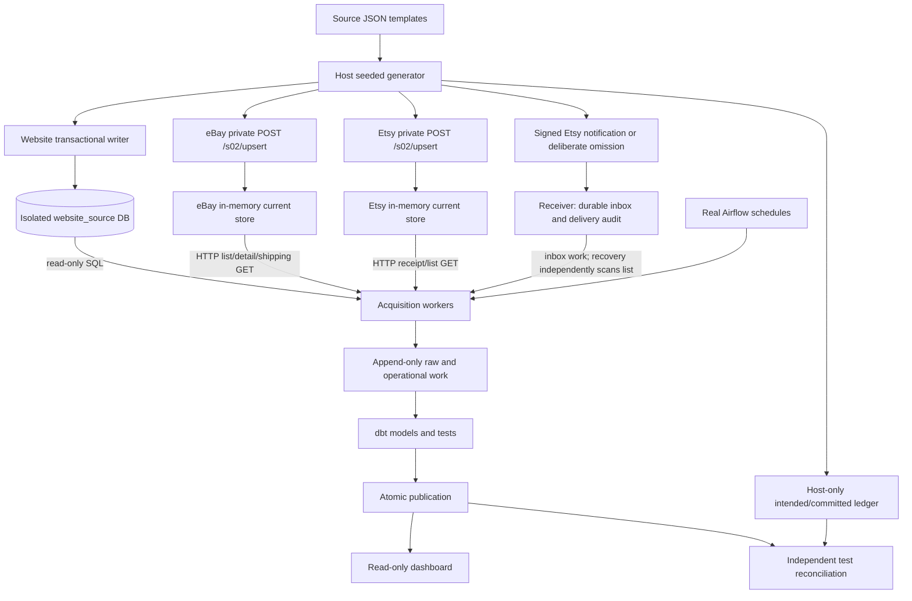
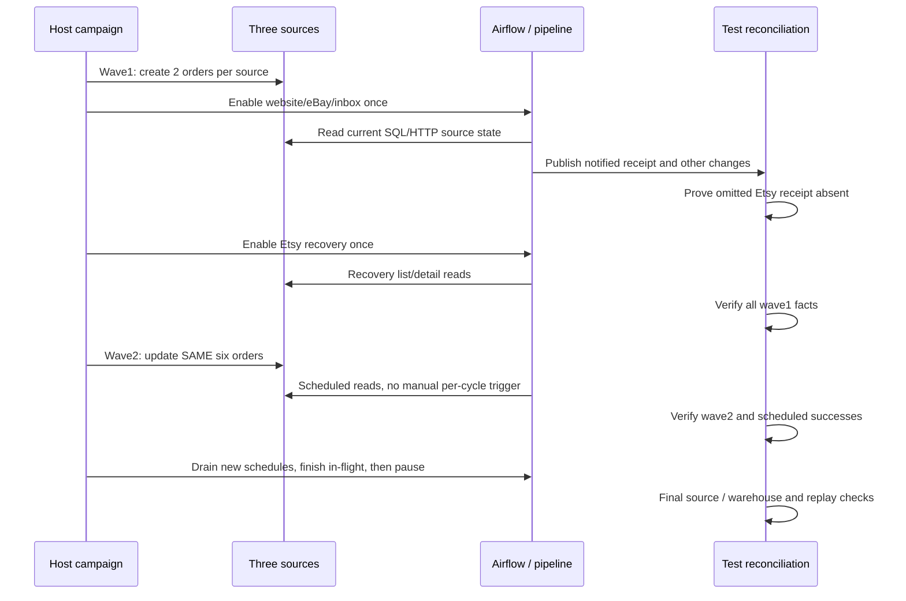
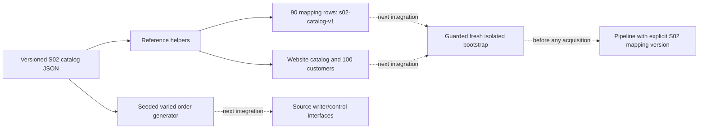

# S02 source generation: process and diversity revision

Historical design reference. Current daily commands/config are in
[the operator guide](../tools/s02_data/README.md) and
[CONFIG](../tools/s02_data/CONFIG.md); current live architecture is [16](16_M08_LIVE_LOCAL.md).
Do not follow the sequence of older revisions as daily setup steps.

For the subsequent implemented per-channel manual generator/config and local
playback workflow, read [15_S02_LOCAL_WORKFLOW.md](15_S02_LOCAL_WORKFLOW.md) and
[the manual guide](../tools/s02_data/README.md). The shared diversity implementation
now lives in tools/s02_data/references.py; old imports remain compatibility shims.

Latest implemented DB-backed design: [14_S02_TEMPORAL_SOURCE.md](14_S02_TEMPORAL_SOURCE.md).
It pre-generates immutable versions and selects state as of a campaign clock,
instead of requiring runtime marketplace business-state updates. This document's
current-code diagrams still describe v1; temporal backend implementation and its
separate acceptance evidence are documented in STATUS and the temporal guide.

## What exists and what does not

M08B `s02-v1` is executable generation from source-shaped JSON templates, not
plain fixed-file playback. A host driver assigns IDs/times, seeded quantities,
recomputed money and two lifecycle waves. It commits to source interfaces before
collectors read. It is finite: six distinct orders, two lines each, twelve source
operations. Polling every180s does NOT create new orders every180s. GET never
creates an order. Normal owner Compose startup does not enable S02 generation.

The additional `s02-diverse-v1` helpers prepare richer source documents and
reference data. New `m08b_temporal` integrates them into separate opt-in temporal
commands, NOT the legacy `m08b accept` command or normal Docker startup.
Earlier v1 PASS results apply only to v1; see STATUS for temporal acceptance.

## Current source and pipeline process

The ledger never feeds ingestion/dbt/report. Marketplace control and public GET
interfaces are separate. Their B stores are in memory: source persistence through
restart is NOT an implemented guarantee.

## Finalized diversity preparation contract (2026-10-31)

No new source fields, warehouse DDL, canonical lifecycle states or customer mart.
Synthetic reference data is separate from approved S01 fixture/mapping bytes.

| Entity / field | Type, grain and constraints |
| --- | --- |
| Catalog product | 30 fixed rows; one sellable variant per product; ID `S02-Pnnn`, canonical variant `S02-Vnnn`; nonempty unique IDs/SKUs; synthetic English title/category; positive integer USD cents |
| Source identities | Website variant equals canonical ID; eBay listing/variation `710000+n` / `810000+n`; Etsy listing/product `720000+n` / `820000+n`; source-specific SKU prefixes; account scoped as existing adapters |
| Mapping | 90 CONFIRMED rows, 30 per source; separate `s02-catalog-v1`; deterministic UUID; UTC valid_from `2026-01-01`; no expiry; never append these rows to `s01-v1` |
| Customer pool | 100 synthetic IDs `S02-Cnnn`, display name and `example.test` email; Website references actual customer row; Etsy buyer_user_id integer `900000+n`; eBay selected contract exposes no buyer field, so no invented buyer API field |
| Orders | Configurable integer2..10000 per channel (input bound, not measured capacity); source-shaped IDs scoped by run; default4; diverse helper two waves, temporal planner independent lifecycle schedules; no new history entitlement |
| Lines | Random1..8 distinct catalog variants per order, positive quantity1..5; prices/purchases stable across waves; integer cents / Decimal calculations only; source-specific money encoding |
| Lifecycle | Same supported two-wave rules as v1; single-line eBay wave2 has its only line shipped (SHIPPED, not falsely PARTIALLY_SHIPPED); multi-line wave2 ships only first line; no refund or delivered claims |
| Reproducibility | Dedicated seeded RNG; seed reproduces choices at fixed run ID/epoch; timestamps and actual concurrency remain evidence, not deterministic promises |

Reference catalog prices are test inputs; mapping is independent reference data,
not inferred from title similarity or the warehouse result. Customer identity is
source scoped: matching synthetic names must not imply cross-channel identity.

## Initialization boundary and remaining integration

This diagram records the earlier offline preparation boundary. The separate
temporal runner now implements fresh isolated preparation/mapping/writer wiring;
its actual runtime acceptance remains in STATUS. Do not seed the owner DB or globally attach
S02 seeds to base Compose. Integrate only behind an explicit fresh S02 test
profile, after schema migrations and before sources/schedules. Use an idempotent
guarded bootstrap command, not only `/docker-entrypoint-initdb.d`: Postgres init
scripts do not rerun for existing volumes. Never reset a volume to apply a seed.

Temporal B integration gates: bind dataset/catalog hash and mapping version into
immutable test config; seed and verify references; pass mapping version to BOTH
CLI and DAG paths; extend independent oracle to catalog lookup (no hardcoded
V001/V002 fallback); derive cardinality/money/history expectations; run fresh CLI
and scheduled profiles plus unchanged S01 regression. Existing v1 runner remains
unchanged; the new temporal runner has its own integration/acceptance gates.

M08C is fault/restart/pause-resume engineering: new fault tests, source persistence
or an explicitly tested source reconstruction policy, and fixes where evidence
finds bugs. It is not just a parameter change and not the load benchmark.
M08D adds a bounded time/rate-driven producer, burst/soak profiles, backpressure
and measurements. It must not assume these offline helpers already provide that.

## Code reading map

- Current input construction: `test_support/s02_inputs.py::inputs`.
- Current source commits/waves: `test_support/m08b.py::Campaign.generate/run`.
- Website source transaction: `simulator/website_s02.py::main`.
- Marketplace storage/control: `simulator/s02_store.py::Store/control`.
- Etsy signed notification/omission: `Campaign.deliver`.
- New offline reference/generation preparation: `test_support/s02_diverse.py`;
  catalog `fixtures/s02/catalog.json`; tests `tests/test_s02_diverse.py`.

Acceptance evidence and unrun integration remain in STATUS, not in diagrams.
