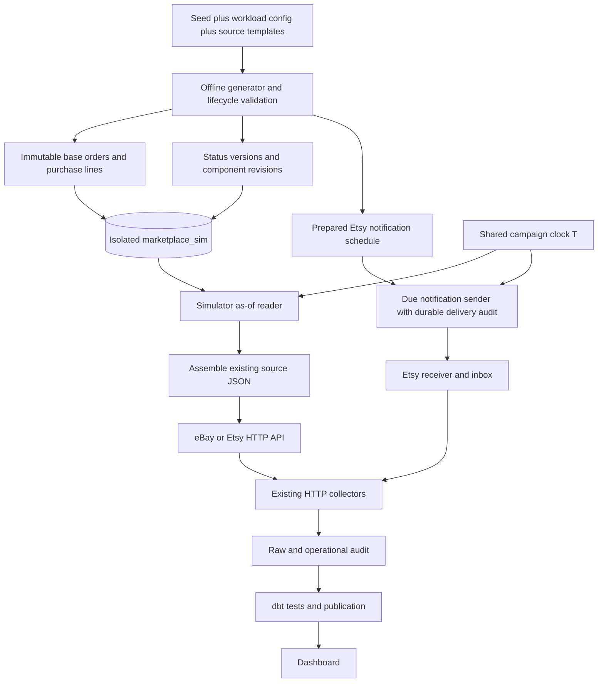
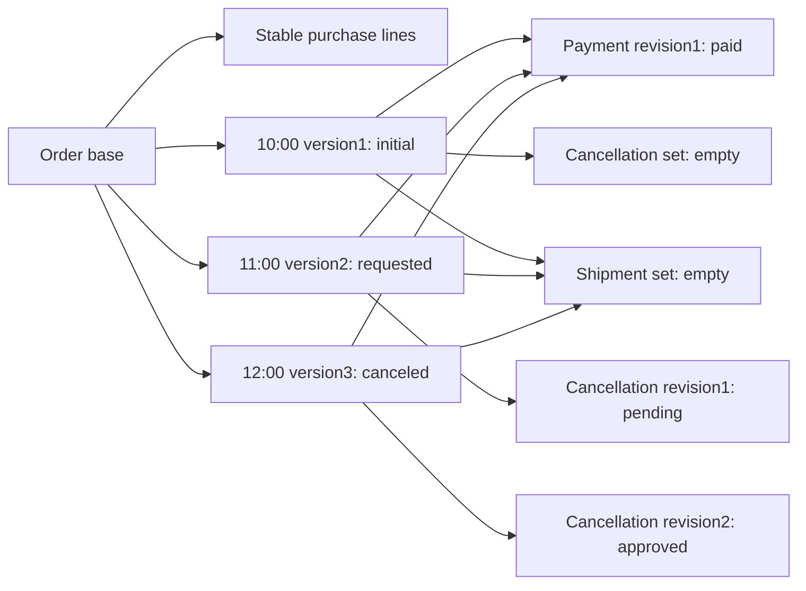
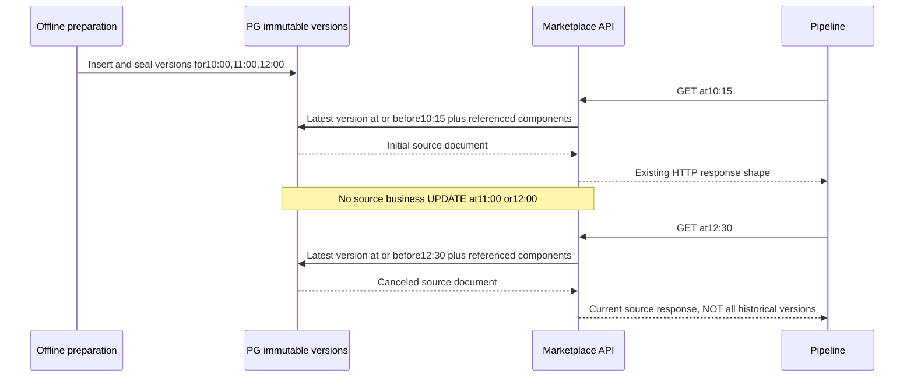

# S02 pre-generated temporal source design

Historical storage foundation, not the daily setup guide. Current live admission
and actual-clock behavior are in [16](16_M08_LIVE_LOCAL.md); selected-campaign
clock behavior below is retained for explicit regression/replay only.

The subsequent local manual/replay revision extends this five-table design with
Website plans, dataset readiness and shared playback control. Physical additions
were specified in [15_S02_LOCAL_WORKFLOW.md](15_S02_LOCAL_WORKFLOW.md) before DDL002.
Legacy isolated campaigns still use actual1x time; new local datasets use the
explicit control. See STATUS for distinct new-path verification, not old PASS.

Design revision:2026-10-31. Owner approved implementation. Opt-in backend, schema,
preparation, read path and guarded runners are implemented; actual acceptance and
remaining gates are recorded in STATUS. Do not confuse original v1 PASS with new
temporal acceptance. The physical contract below preceded the migration.
S01 source bytes/contracts and pipeline boundaries stay fixed.

## 1. Decision: prepared versions, not runtime business-state updates

Prepare one day's source data and valid lifecycle changes before a test. Store
immutable base data, reusable component revisions and ordered order versions in
the isolated PostgreSQL `marketplace_sim`. At request time, select the latest
visible order version and assemble the existing source JSON response. No mutable
`source_current` table, order-status UPDATE, random transition generation or
per-event business-state materializer is required while serving marketplace GET.

This supersedes the earlier conversational proposal of committing each scheduled
change into a current-state table. Preparation still requires DB transactions;
clock controls, notification delivery progress and test audit can still write
operational metadata. "No updates" applies to sealed source business versions,
not an absolute ban on runtime metadata writes.

Preparing versions is NOT inserting expected warehouse outputs. Every stored
business field must be representable by the approved source interface. Mapping
and transformation versions stay independent of source revision identity.

## 2. Process and ownership



Only the simulator reads its backing data. Collector DB credentials must NOT gain
access to `marketplace_sim` merely because both databases use one PG instance.
Do not replace marketplace HTTP with direct collector joins or pass the test
event table straight to ingestion. The change is DB-backed simulation behind the
same API, not a new production source adapter. It must never read golden expected
outputs or a host truth ledger to produce responses.

Website remains the approved read-only SQL source. The first implementation keeps
its transaction writer to apply prepared due versions to normal source tables,
including atomic child changes and parent `orders.updated_at`. It can reuse
prepared schedules without random work at runtime. A no-write temporal SQL view
replacement for Website is a separate proposal because existing tables/constraints
and the consistent source query must continue to work; it is NOT silently included.

## 3. Logical data model: split changing components without a full vendor schema

These are proposed logical entities, not migration-ready physical table names.
All entity identities are scoped by dataset/campaign, source and account. No
cross-source order/customer identity merge is implied.

| Entity | Grain / contents | Rule |
| --- | --- | --- |
| Dataset | One generated workload: seed, generator/schema version, catalog hash, timezone, start/end, counts, checksum and sealed flag | Validate before seal; no serving partial preparation; sealed source rows immutable |
| Order base | One scoped order: source ID, purchase creation time, currency, buyer references and source-specific fixed header fields | Created only when its first version becomes visible; source creation time need not equal first visibility |
| Purchase lines | One source line in an order: source product IDs/SKU/title at purchase, quantity and exact price | Fixed for current supported lifecycles; FK to order, unique source line ID; not today's mutable catalog price |
| Component revision | One immutable revision of payment, shipment or cancellation collection, with source-shaped JSONB details and stable array order | Empty collection explicit; represent state supported by source, not an invented source payment endpoint |
| Order version / status | One ordered source change: sequence, visible_at, source_updated_at, three independent states, component revision references and any changing header totals | References complete selected component sets, never accidental future rows; strict per-order source-time advance in normal profiles |
| Notification schedule | One planned Etsy message: order reference, event type, due time and stable logical message ID | Notification contains approved event/resource fields, not the whole receipt or warehouse answer |
| Runtime control/audit | Campaign clock, notification attempts/checkpoint, reads and actual observations | Mutable operational data separate from immutable source versions; ledger/oracle not mounted as pipeline input |

A component revision may contain multiple shipments/allocations. Later revisions
describe the cumulative visible set required by that API response, not just the
newest shipment. An order version can reuse unchanged payment/cancellation sets.
No need to duplicate all purchase lines for every status change. Conversely, a
few JSONB revision collections avoid creating a full marketplace transactional
schema just to test it. If a later scenario changes line quantity, price or
membership, version the entire line set explicitly; do not overwrite fixed rows.



This is a cancellation example, not a single combined lifecycle enum. The payment
remains PAID; no refund or shipment is inferred. A shipping branch instead adds
dated fulfillment evidence and valid line quantities. Branch availability must
be checked against EACH source contract before enabling it; do not advertise
cancellation rejection/delivery/refund for all three by analogy alone.

## 4. Exact as-of semantics

At each HTTP request, capture ONE campaign time T. For each scoped order:

1. Select the latest version with `visible_at <= T`, deterministic by visibility
   and sequence. If none, order is not yet visible (detail404, absent from list).
2. Read base/lines plus the component revisions referenced by that version.
3. Assemble source-specific status/header/array/money fields. IDs, array ordering
   and original source timestamp representation must be stable on repeated reads.
4. For list endpoints, apply caller's last-modified window to the SELECTED current
   source version, then sort/page using existing endpoint rules. Detail endpoints
   likewise return current visible state, not a hidden test history endpoint.

Do not filter the version history by the caller's window BEFORE selecting current
versions: that would resurrect an old version when a newer current version falls
outside the window. Likewise, the caller's window_end is not the simulator clock.

Illustrative query shape only (not executable migration or verified query):

```sql
WITH current_at_t AS (
    SELECT DISTINCT ON (source, account_id, order_id) *
    FROM prepared_order_versions
    WHERE dataset_id = :dataset_id AND visible_at <= :campaign_now
    ORDER BY source, account_id, order_id, visible_at DESC, sequence DESC
)
SELECT * FROM current_at_t
WHERE source = :source AND account_id = :account_id
  AND source_updated_at BETWEEN :window_start AND :window_end
ORDER BY source_updated_at, order_id
LIMIT :limit OFFSET :offset;
```

Capture T once even if several SQL statements assemble a response. Use the same
sealed dataset/revision references; aggregate each child collection separately
before joining the parent. A raw join of2 lines x2 payments x3 shipments creates12
rows, NOT2 lines; summing that join corrupts money/quantities. Repeated readers
must not increment a cursor that consumes source data or hide orders from others.

One request is coherent; separate order/shipping GETs or offset pages may straddle
a time boundary. Preserve approved HTTP semantics, overlap and reconciliation;
do not claim a vendor-wide atomic pagination snapshot. Sealed data does not freeze
visibility while the clock advances. Define indexes and query plans before load
tests; avoid a Python `get all` across the whole dataset on each request.

PostgreSQL references: [DISTINCT ON ordering](https://www.postgresql.org/docs/16/queries-select-lists.html),
[transaction isolation](https://www.postgresql.org/docs/16/transaction-iso.html).

## 5. Timeline example: no runtime status UPDATE needed

Use explicit UTC timestamps (12:00 here means noon, not12AM/midnight).

| API request time | Visible order A | Important result |
| --- | --- | --- |
| 09:59 | No version |404 / absent from list |
| 10:15 |10:00 initial: PAID, NOT_STARTED, NOT_REQUESTED | Join purchase lines/payment and empty shipment/cancellation sets |
| 11:30 |11:00 requested: PAID, NOT_STARTED, REQUESTED | Join pending cancellation; unchanged purchase/payment data reused |
| 12:30 |12:00 canceled: PAID, NOT_STARTED, CANCELED | Join approved cancellation; no fabricated refund |

An order B may wait unchanged from10:00 until16:00; order A's change does not
advance B's timestamp/version. A timeline index identifies changes and can drive
notifications; it does not require every order to change at every tick.



If the pipeline did not read at11:00, do NOT require the warehouse to contain a
requested snapshot. Prepared changes are available to test control, not a vendor
historical event feed. Golden truth alone never justifies warehouse history.
"Get all" may mean every visible order/page for initial load, not every prepared
future/historical version. API GET remains non-consuming; replay is allowed.

## 6. Clock, initial data, notifications and load measurement

- First integration uses actual UTC/current-clock1x with a prepared day anchored
  to run start. Precomputed relative event offsets can be bound once before seal;
  no random generation or business payload rewriting during requests.
- Explicit clock modes can later include frozen/manual and accelerated. All
  simulators, notification sender and acquisition windows must agree; changing
  ONLY simulator time breaks current runtime-window validation/checkpoints.
  Do not claim1day-in10minutes until this integration is implemented and tested.
- Initial load at T0 reads latest visible state per order at T0, then continuous
  reads observe later changes. Prepare old created dates with recent updates too.
  Use fresh campaign/storage scope; no reset/reseed of retained accepted runs.
- Etsy notifications still need a sender: select due messages, sign with ACTUAL
  delivery-time freshness, deliver to the existing receiver and audit/retry with
  a stable message ID. A crash after ACK before recording success can redeliver;
  receiver dedup/audit must remain correct. Receipt GET can already be newer.
- On restart, retain sealed dataset and campaign-clock anchor. Distinguish pause
  of pipeline (source clock advances) from pause of source playback. Normal reads
  remain available without replaying all earlier business-state writes. Catch-up
  provides supported current state, not guaranteed unobserved intermediate states.
- Prepared due-version count is a SCHEDULED workload, not proof of actual writes,
  source reads or pipeline throughput. Record clock-visible versions, API/page
  rate and bytes, raw observations, admitted logical versions, publication latency,
  backlog/drain, retries and resources separately. Retain query/index cost and
  source-vs-platform contention if they share one PG instance. Preparation CPU/
  disk/time is measured separately; pre-generation does not make runtime free.

## 7. Implementation gates and review boundary

### Physical implementation contract (2026-10-31, owner approved implementation)

The initial backend is opt-in `s02-pg`, separate from legacy `s02` RAM mode and
default S01. Tables in `marketplace_sim.s02`:

| Table | Fields and constraints |
| --- | --- |
| campaigns | id TEXT PK twelve lowercase hex, seed INT>=0, config JSONB object, checksum TEXT64hex, sealed BOOLEAN; sealed campaigns and source rows immutable |
| orders | campaign_id/source/account_id/order_id composite PK, base JSONB object, FK campaign; source ebay_sim/etsy_sim, account validated for source |
| components | scoped order key + digest TEXT64hex PK, body JSONB object; FK order; content-addressed source collections, never warehouse output |
| versions | scoped order key + sequence INT>0 PK; visible_at/source_updated_at TIMESTAMPTZ, header JSONB object, component_digest FK within same scoped order; UNIQUE scoped order+visible_at and source_updated_at; latest index scoped order/visible_at DESC |
| deliveries | campaign/message_id PK, receipt_id TEXT, due_at TIMESTAMPTZ, event_type order.paid/order.shipped, omitted BOOLEAN, attempts INT>=0, delivered_at TIMESTAMPTZ nullable, last_status INT nullable; body schedule frozen after seal, progress only may change |

`components.body` holds whole source collections (eBay lineItems/fulfillments,
Etsy transactions/shipments/refunds) as one coherent revision. This bounded hybrid
avoids a full vendor schema and Cartesian joins; identical collections are reused.
The immutable order base stores fixed purchase/header fields, versions store
changing source header fields. Reconstruct source JSON in Python after SQL selects
one version; same arrays/order/representation are retained. No current table.
Prepared Website payloads remain host-side and use the existing source writer.

NOLOGIN owner remains marketplace_owner. New login readers s02_ebay_reader and
s02_etsy_reader get CONNECT/USAGE/SELECT only with per-source row security on
orders/components/versions; no membership in marketplace_owner and no access to
other application databases. Passwords are random per isolated model, never required by normal
S01 Compose. SQL preparation is guarded host/admin only. Pipeline roles retain no
marketplace_sim CONNECT. Existing v1 mode remains unmodified.

First source branches: Website requested->approved cancellation or steady pending;
eBay not-started->partial/full shipping or steady pending; Etsy paid->shipped or
steady pending. Canceled Website stays paid. No refund/delivery/new enum. Order
selection and delays are seeded per order, can skip ticks, and some orders remain
pending at end. Every generated update must advance source time. Day preparation
supports UTC1x only; no accelerated/frozen clock claim. Acceptance may prepare
already-due initial versions and future versions with short real-time delays.
One progressing sentinel per source arrives early and changes in the last third
of the prepared period, leaving time for cold Airflow startup/first serialized
releases to observe both states. Other orders retain independent seeded times;
this is not a global update wave or a measured load profile.

New isolated markers bind backend=s02-pg and mapping_version=s02-catalog-v1.
DAG and CLI commands both receive this version; default s01-v1 stays unchanged.
Fresh integration must validate reader isolation/immutability, boundaries, source
reconstruction, pipeline reconciliation and real schedules before claiming PASS.

Temporal CLI baseline runs no second Airflow scheduler: resource preflight uses
the declared CLI-only topology (>=3.5GiB Docker total and>=1.5GiB measured headroom).
Scheduled topology retains the existing>=6GiB with owner Airflow running or an
explicitly approved owner-Airflow maintenance window with>=3.5GiB total and>=3GiB
headroom. This is a safety gate, not a capacity benchmark or permission to stop owner.

Acceptance gates for this implementation (completion evidence in STATUS):

1. Finalize physical columns/keys/checks/indexes, schema/role grants, temporal clock
   and per-source supported lifecycle branches before DDL/adapter changes.
2. Add guarded prepare/seal/read path and source DB credentials ONLY to simulators;
   retain old S01 mode and initially B v1 runner for regression. No owner reset.
3. Integrate catalog/mapping, diverse source documents and independent as-of oracle;
   preserve source fingerprints independently of new catalog mapping version.
4. Test exact boundary/404/no-future joins, independent child collections, unchanged
   orders, supported money/state/FKs, list/detail/window ordering, pagination/replay,
   restart data persistence and Etsy notification delivery before scheduled claims.
5. Run fresh CLI + real scheduled cases, unchanged S01 and protection checks.
   C then certifies the wider fault/lifecycle matrix; D measures declared load.

Do not mark steps implemented because this document contains SQL or diagrams.
