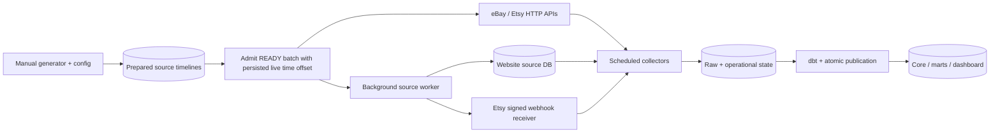
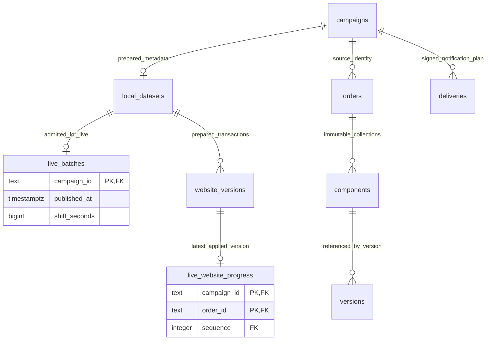

# M08B live local source workflow

## Approved owner intent and resolved design (2026-11-01)

Start sources, receiver, source worker and scheduled pipelines once, then manually
generate data any number of times. No per-generation source switch, campaign
environment variable, DAG trigger, checkpoint reset or separate daily stack.
S01 remains a regression fixture, not a constraint on local source contents.
Existing fixture/replay modes remain explicit test paths, not the daily default.

## Physical contract before DDL

Add marketplace_sim.s02.live_batches:

| Column | Definition |
| --- | --- |
| campaign_id | TEXT PK/FK local_datasets(campaign_id); internal batch identity only |
| published_at | TIMESTAMPTZ NOT NULL; actual time the complete READY batch is admitted |
| shift_seconds | BIGINT NOT NULL; translate the earliest configured channel start to publication+2s, rounded to whole seconds |

Only READY, sealed batches can be admitted. A row is immutable after insert.
Add s02.live_website_progress(campaign_id TEXT, order_id TEXT, sequence INTEGER):
PK(campaign_id,order_id), FK(campaign_id,order_id,sequence) to website_versions.
Mutable source-worker progress only; no reader grant. Record it after source
commit; crash before recording is recovered by comparing actual source timestamps.
This bounds each worker query to100 outstanding order updates rather than loading
every historical order into RAM on each tick.
Prepared source versions are unchanged. All source event timestamps are translated
by the same shift, preserving causal intervals and money/identity/fingerprints of
the source document actually served. Explicit historical timestamps therefore
become a relative live timeline; use the existing replay workflow for literal
historical dates. Publication is after all source, reference and mapping writes.
Unpublished/LOADING batches never appear on live source APIs. Different admitted
batches must not share source/account/order identities. Live admission is separate
from preparation; failure is retained and never automatically overwrites a batch.

Marketplace HTTP APIs read latest due versions across admitted batches using
actual PostgreSQL time, filter by effective source update time, then paginate.
A source-only worker polls admitted batches, writes due Website transactions and
sends signed Etsy notifications. It has source-writer credentials, never warehouse
credentials or a Docker socket. It does not generate data or call collectors/dbt.
Website writes and delivery attempts remain idempotent/retryable; a failed worker
must be visible in logs/health, not reported as a successful release.

Existing S01 runtime records/checkpoints are retained: new source times progress
forward. No destructive reset is needed. Mapping release local-live-v1 explicitly
includes the fixed s01-v1 and s02-catalog-v1 mapping sets; existing global active
mapping uniqueness prevents ambiguous simultaneous matches. Source-version identity
remains separate from this composite mapping-release label. Other mapping versions
retain exact-version filtering. No business transformation is moved to Python.

Switch maintenance uses a persistent /opt/airflow/state/polling-drain signal,
NullTimetables and runnable active DAGs, then pauses terminal DAGs. The small
parse-time scheduling helper is copied into older running Airflow images before
the first switch; this avoids restarting active workers. A newly-created run
racing an idle read is unpaused until it too finishes. Timeout never clears a
task, edits a run state, rewinds a checkpoint or kills a worker. The signal remains
set on failure; inspect/retry startup. Successful startup removes it.

### Source storage relationships

These are source/test-support tables, not warehouse input tables. Marketplace
ingestion still uses HTTP; Website ingestion reads website_source, not these
plans. Core target definitions from M01 remain unchanged.

## M08 scope and faults

| Milestone | Role in this workflow |
| --- | --- |
| A | Isolated regression/fault scope and target guards remain; not mandatory for daily generation |
| B | Start once, append batches, changing sources, real schedules, raw/history/current reconciliation, omitted/duplicate notifications |
| C | API faults, invalid/late/reordered deliveries, process loss, leases, dbt/publication faults, restart/pause/resume; each needs a deterministic trigger and independent evidence |
| D | Pre-generate large batches, measure actual emission rate, backlog/latency/drain and resource ceilings; no capacity claim from generator size |

Data faults are not arbitrary lifecycle corruption. Generator supports its declared
branches plus Etsy omitted/duplicate notification quotas. API/worker/pipeline faults
are injected at their actual boundary, not represented as fake order status values.
Existing HTTP fault controls must work for DB-backed sources, not just fixture
mode. Broader C cases remain planned, not silently claimed implemented by B.

### Concrete case boundaries after the whole-M08 review

| Case | Trigger / owner | Current boundary and required evidence |
| --- | --- | --- |
| Varied purchases / valid status paths | Manual JSON generation, seeds/required/delays | B; check actual source/raw/current/history, not just prepared coverage |
| Omitted / duplicate Etsy notification | faults profile, notifications.omit/duplicate; quick_faults.json | Worker omission/repeated signed send; verify absent inbox + recovered receipt / physical attempts + one logical inbox |
| API429/500 | Loopback eBay control /state fail_offset/errors_left/error_status; Etsy /control errors_left/error_status | Existing controls now apply to DB-backed HTTP; B unit HTTP regression, full retry/checkpoint evidence remains C |
| Timeout / malformed / repeated page / hostile next URL | Source HTTP boundary | Existing fixture-only hooks are NOT claimed as all live-PG supported; C must implement/verify missing live hooks and deterministic restoration |
| Invalid / delayed / reversed webhook | Dedicated test sender with retained bytes/signatures/barrier | Not a random order status; C must add controlled sends and audit assertions |
| Loss after raw / after freeze / failed dbt | Existing Airflow parameters fault_after_raw_once/fault_after_freeze_once/inject_test_failure | Hooks already exist; new live C cases must verify durable retries, original frozen batch and last-good publication |
| Missing mapping / unknown status / conflicting version | Explicit test-only corrupt-input/config boundary | Normal generator must not silently generate unsupported data; C needs opt-in hooks and exception/reprocessing proof |
| Worker/receiver/API/Airflow/PG restart or abrupt kill; lease expiry; publish commit/ack loss | Scoped external test controller, not app credentials/Docker socket | C needs target validation, exact barrier, before/after signatures, deadlines and restore procedure; no claim from service health |
| DAG pause/resume while sources advance | Airflow pause, independent source worker still running | C checks current-state catch-up and explicit unobserved-history limits; ordinary pause is not source freeze |
| Load/burst/soak | Manual pre-generation, measured emission + actual scheduled pipeline | D; record rate, offsets, order/line cardinality, CPU/RAM, lag/backlog/drain; no speed claim from6-minute config |

HTTP controls stay on loopback-only test ports, not the source acquisition API.
Future C/D runners must use these same live service/startup/generation paths where
appropriate, with an explicitly disposable target for destructive faults (the
owner-approved local stack, or an isolated case when main must be protected), rather than bypassing the
operator workflow and declaring the daily path verified. No C/D execution is
authorized or completed merely by this design review.

### Owner protection when sources are live

An Airflow-only maintenance stop no longer guarantees a quiet owner environment:
the independent source worker can still mutate Website/delivery/raw state. M08A
owner_idle now refuses a running owner live-source with outstanding Website
versions or non-omitted deliveries (including future plans). Source plans,
admissions, delivery progress and replay control are included in the optional
marketplace protected signature when live tables exist. No automatic producer
stop is added. A future C/D small-VM window must wait for source quiescence or
obtain explicit producer/receiver maintenance authority and validate restore/
catch-up; old permission to stop only Airflow is not broader authority.

Polling remains on actual time; live mode never calls the simulator clock endpoint.
Each new live polling cycle captures acquisition-start UTC, NOT a potentially
stale Airflow data_interval_end. The bound and window_policy=acquisition-start
are persisted before acquisition; retry uses its original bound/settings, even
for a cycle created under the old policy. This opt-in correction does not alter
S01/replay execution. A delayed scheduled interval otherwise excludes newer
current-state API versions and can miss all intermediate transitions.
The new source worker is started even when there are zero batches. Empty successful
cycles are normal; readiness must distinguish live source mode from fixture mode.
Generator admission is independent of Airflow/worker uptime and DAG pause state:
after live storage is initialized it can keep adding source data while consumers
are stopped. Reachable fixture-mode SIMs are refused; unreachable source services
are warned, not treated as consumer success. Separate live readiness/check commands
verify authenticated source reads, correct consumer config and worker health.
Six-minute generation windows do not promise every15s transition will be observed
or that a four-path dbt workload completes in six minutes. No unobserved history
is fabricated. Slow source publication beyond collector overlap is a measurable
limitation, not permission to rewind checkpoints silently.

## Verification required before claiming completion

Offline timestamp translation/visibility/order identity/mapping isolation tests;
HTTP-backed empty -> first batch -> second batch without restart; Website worker
and signed notification retries; actual scheduled source-to-core evidence; retained
old facts/raw and monotonic checkpoints; affected S01 regression; live-mode fault
controls. Existing isolated/replay PASS does not certify these new paths.
