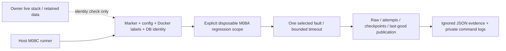

# M08C recovery verification

## Scope and entry review (2026-11-01)

**Paused by the owner on 2026-11-01.** Three selected continuation cases passed:
lease_fencing, receiver_audit and stage_resume. failed_gate failed before injection
because its assertion connection lacks core.orders_current read permission.
The other cases have runner code but no passing continuation runtime evidence.
Do not execute this runbook as part of M09 packaging or call M08C complete.
STATUS records the exact evidence and successful owner restoration.

The owner accepted the M08B daily-live direction and requested cleanup followed
by M08C. The current workflow is **live-up once, then generate manually**. See
[16](16_M08_LIVE_LOCAL.md) and the [operator guide](../tools/s02_data/README.md).
RAM campaigns and selected-dataset replay remain regression tools, not alternative
daily setup instructions. No source contract, fingerprint or warehouse grain changes.

M08B has retained finite correctness evidence, not latency certification. A fresh
read-only review found an unhealthy Airflow healthcheck, a failed Etsy recovery
run and a roughly 30-minute Website acquisition gap. Earlier PASS evidence is not
proof of current health. Missing intermediate history is explained by missing
raw observations; reconstructing it from the simulator is forbidden. Investigate
availability separately from the M08D performance work; do not erase these audits.

## Test boundary

Continuation: a fresh current-config A baseline563f55c17bab passed all61 runtime
steps, with unchanged protected owner signature. Initial case attempts uncovered
a nested RO/RW Docker mount error and absent signing key in the test controller;
neither was counted as recovery PASS. Source code/fixtures do not give Airflow a
signing key: only the ephemeral test sender/receiver controller reads its ignored
test.env via a RO file. Collector subprocesses explicitly remove signing/writer
secrets. Current per-case outcomes: `python -m test_support.m08c report --id ID`.



Ordinary development still uses one stack. Automated destructive fault tests use
the existing M08A isolation harness, not a second always-running environment.
The runner never stops owner services, clears tasks, resets budgets, rewinds a
checkpoint, changes `.env`, deletes volumes or silently initializes a retained DB.
Any temporary owner-Airflow stop needs separate authorization and idle/restore
checks; permission does not authorize stopping the source worker or PostgreSQL.

No application DDL is needed. Evidence is host-only JSON under the ignored
`runtime/isolated/m08a-ID/evidence/` directory. Each invocation records a unique
file, selected case, code/test hashes, environment/DB identity, actual outcome,
before/after counts and command log references. A failed command is FAIL, never a
successful expected fault unless the probe asserts the precise durable boundary.

### New test controls and one correctness fix

- Existing loopback control listeners accept optional `transport_fault` object:
  kind `none|malformed|timeout`, count integer0..5, offset integer0..1000,
  delay_seconds finite number greater than0 and at most15 (default11).
  Defaults inject nothing. Malformed returns exact invalid JSON with HTTP200;
  timeout delays a response. Health/control/error replies do not consume it.
- eBay repeated-page/hostile-next controls now work with PG-backed reads too;
  immutable source plans are not edited. The virtual repeated-order list inserts
  one duplicate at position1 and keeps pagination total/offset coherent.
- Etsy `extra_receipt: true` exposes one explicitly synthetic9001002 receipt in
  fixture-mode tests to prove omitted-notification recovery. It does not alter
  fixed S01 files or PG-backed source state; defaultfalse preserves S01 behavior.
- Source worker now handles SIGTERM/SIGINT by finishing its tick and exiting,
  rather than blindly interrupting its source transaction. SIGKILL is still abrupt.
  Its source-only credential boundary and commit/progress recovery are unchanged.
- Test-only `m08c_recovery` DAG is copied into TEST Airflow only. A file handshake
  holds a live task for deterministic drain timeout/retry checks; permanent stage
  failure exercises durable budgets and actual Airflow task clear. This DAG is
  not copied into the normal Airflow image or installed on the owner stack.

## Executable cases and honest coverage

The authoritative inventory is [m08c_cases.json](../test_support/m08c_cases.json).
`plan` lists required cases and execution support. A component or rollback-only
test is labelled as such, not a scheduled/crash proof. Unimplemented or unexecuted
rows remain NOT_RUN; passing a selected subset does not complete M08C.

```powershell
python -m test_support.m08c plan
python -m test_support.m08c offline
```

On Windows without host project dependencies, run the tested CLI-container wrapper:

```powershell
powershell -NoProfile -ExecutionPolicy Bypass -File infra/scripts/check_m08c_offline.ps1
```

It uses the already-built Airflow image, no `.env`/warehouse network/Docker socket,
256MiB memory and0.5 CPU. It starts no services and makes no DB calls. Actual local
HTTP tests still work over the container's loopback interface.

The offline suite uses local HTTP servers/mocks and no Docker/DB mutation. The
full suite requires the existing project Python dependencies (`requirements/m03.txt`);
the stdlib-only target guards can run as `python tests/test_m08c.py` without them.
If host dependencies are absent, use the existing Airflow image as a CLI-only
test container with repository test/source/fixture/migration inputs mounted
read-only and only the ignored runtime evidence directory writable. Never start
an extra Airflow scheduler just to run offline tests.
The runtime runner needs a previously accepted, retained M08A **S01** regression
scope, with bound PostgreSQL identity. It refuses B/replay/owner IDs and active
test schedules/releases. Do not use the owner Compose project as a substitute.
Old A IDs created before a base Compose change fail the existing config hash
guard. Do not edit identity.json to bypass it: establish a fresh A baseline with
the current Compose revision first. A healthy/idle owner maintenance window and
adequate RAM are prerequisites for that baseline, not assumed by this runner.

```powershell
# Use YOUR accepted disposable ID, not an arbitrary example or a B ID.
python -m test_support.m08c run --id YOUR_ID --case lease_fencing --confirm-disposable
python -m test_support.m08c run --id YOUR_ID --case stage_resume --confirm-disposable
python -m test_support.m08c run --id YOUR_ID --case failed_gate --confirm-disposable
python -m test_support.m08c run --id YOUR_ID --case postgres_restart --confirm-disposable
```

An accepted A scope may have its containers removed while retaining the volume.
The runner can start only its test PostgreSQL and fixture APIs/receiver, and uses
one-shot CLI containers, not another Airflow scheduler. It requires memory
headroom before starting them. Services started for the case are stopped in
`finally`; data, artifacts, audits and evidence are retained. A cleanup failure
makes the result FAIL. An interrupted host process may bypass `finally`: use
the isolated `m08a stop --id ID` after inspecting the recorded target, never
`down -v` or a broad Docker prune.

### Assertions / operator outcomes

- `stage_resume`: intentionally interrupt collection after durable raw and freeze
  after durable manifest; retry the same identity/config. Assert retained raw,
  stable frozen input IDs, no duplicate successful business stages, real dbt
  tests and publication, then idempotent rerun. Exceptions are caught only when
  their boundary marker matches. No process kill is implied by this hook test.
- `failed_gate`: inject the existing dbt failure, explicitly abort the failed
  batch, retain last-good source publication and business signature. A new
  recovery execution is required; never mark the failed batch TESTED.
- `lease_fencing`: existing real-SQL/HTTP rollback-only probe verifies expired
  token fencing, five-attempt exhaustion and explicitly linked replay. This is
  not a concurrent killed-worker proof.
- `receiver_audit`: real HTTP rejects invalid/stale signatures, retains physical
  duplicate audits and one logical work item; supported work remains in test DB.
- `postgres_restart`: compare durable data signature and PostgreSQL identity
  before/after a graceful restart. Not host/disk-loss durability certification.

## Remaining required matrix

API timeout/malformed/mid-page failure and checkpoint assertions, live-PG fault
controls, late/reordered arrivals, abrupt raw/freeze/dbt/publish loss, commit/ack
ambiguity, mapping/status/version conflicts, retry exhaustion after task clear,
receiver/worker/Airflow abrupt/graceful restart, real scheduled pause/resume and
maintenance drain, scheduler/observer/source outage must have independent
runtime evidence. See [strategy matrix](10_S02_TEST_STRATEGY.md#4-faultlifecycle-matrix-m08c).
The inventory does not reduce these requirements or silently defer them to D.

## Completion rule

Every required inventory row needs reproducible runtime evidence and its declared
automatic or operator outcome, affected S01 regressions and retained last-good
publication. Until then STATUS must say **M08C in progress**, even when all
available component tests pass (currently paused/incomplete by owner request).
M08D is deferred. M09 may package the partial, evidence-backed portfolio without
claiming recovery/load certification; it does not change this acceptance rule.
