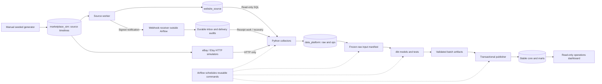

# Portfolio handoff and demo guide

Packaged: 2026-11-01. Reviewed implementation checkpoint:
`63c36c986d42fa5812ac73bc2afdbac78ed50b91`.

This is a local Data Engineering portfolio, not a production-ready release.
M01-M07 were accepted; M08A and finite M08B have local runtime evidence.
Verification update2026-11-05: all18 declared M08C local recovery cases PASS;
M08D load/soak remains deferred. The packaging checkpoint above is historical.
Subsequent commit-review update: a later scheduled pause/resume rerun timed out
with successful cleanup. Latest inventory is17 PASS/1 FAIL; the earlier18-case
result is retained evidence, not current all-green certification. See STATUS.
M09 documentation packaging proceeds at the owner's request without waiving
the original recovery/load/fresh-reproduction release gates. See [STATUS](STATUS.md).

## Project pitch

An operations team needs one view of orders from an internal website, an
eBay-style marketplace and an Etsy-style marketplace. Their interfaces, product
identifiers and lifecycle evidence differ. This project acquires those sources,
preserves raw audit evidence, normalizes observed versions and publishes tested
multi-channel data for an operations dashboard.

Marketplace services are synthetic local HTTP simulators, not live seller
accounts. The internal website is a synthetic PostgreSQL source. All demo data
is synthetic; no real customer records or vendor credentials are needed.

## CV-ready wording (English)

**Multi-channel Order Data Platform | Personal Data Engineering Project**

*Python, PostgreSQL, dbt Core, Apache Airflow, Docker Compose, Streamlit*

- Built a local data platform integrating three synthetic order sources through
  read-only website SQL, paginated marketplace HTTP polling and signed webhook
  notifications with receipt-API recovery.
- Implemented durable raw acquisition audits, source/account-scoped identity,
  deduplicated observed history and current-state models in dbt, with tested
  transactional publication to PostgreSQL reporting tables.
- Orchestrated reusable ingestion and transformation commands in Airflow and
  delivered a multi-channel operations dashboard with order drilldowns, channel
  comparisons, backlog and pipeline execution monitoring.
- Developed reproducible fixtures, seeded lifecycle data generation and guarded
  local regression tooling; verified finite three-source flows and selected
  retry, webhook-audit and lease-fencing cases.

Short version: **Built a Dockerized multi-channel order pipeline using Python,
PostgreSQL, dbt and Airflow, with auditable ingestion, observed-state history,
tested publication and a Streamlit operations dashboard.**

Do not add throughput, million-order scale, cloud deployment, exactly-once
delivery, full recovery coverage or production vendor integration to these claims.
Finite correctness counts below are test scope, not performance benchmarks.

## Architecture and ownership



The generator and source worker are simulation infrastructure, not ingestion
shortcuts. Marketplace collectors cannot query simulator backing tables. Python
owns acquisition/operational state; dbt owns business SQL; Airflow orchestrates.
The publisher changes stable data and its publication pointer transactionally
only after required tests/artifacts pass.

Order identity is `(source_system, source_account_id, source_order_id)`, not an
unscoped order ID. Payment, fulfillment and cancellation remain independent.
Retries retain physical acquisition/delivery audits while logical versions
deduplicate. History records only snapshots actually observed by the pipeline;
it never reconstructs missed transitions from the generator timeline.

## Demo A: deterministic contract, no running services

From the repository root, using Python3.12:

```powershell
Push-Location fixtures/s01
try {
    python verify.py
    if ($LASTEXITCODE -ne 0) { throw 'Fixture verification failed' }
    python -m unittest -v test_tools.py
    if ($LASTEXITCODE -ne 0) { throw 'Fixture tests failed' }
} finally { Pop-Location }
```

Expected: ten fixture checks and ten utility tests PASS. Fixed S01 has three
orders, four lines, six ordered units, USD124 original merchandise and six
observed order versions. This is an offline contract demo, NOT ingestion proof.

For a complete disposable S01 bootstrap/dbt/publication/report demonstration,
follow [M08A prerequisites and commands](../test_support/README.md). It needs
an explicitly disposable ID, a healthy/idle owner and sufficient Docker RAM;
it is not a command to reset the current database. Temporary owner-Airflow
stop/restore requires separate authorization. Do not run it during the current
owner pause. The latest retained baseline passed61 steps; another machine has
not independently reproduced it.

## Demo B: changing local sources and scheduled pipelines

### Setup boundaries

Do not run startup or generation during the current pause merely to read this
guide. These are owner-run instructions for a later demonstration.

For a new clone only, copy `.env.example` to `.env` without overwriting an existing
file, then replace password placeholders and fill both S02 reader passwords.
Keep `.env` private. Use Docker Engine/Compose and Python3.12; project Python/dbt/
Airflow dependencies run in their pinned images. The measured test Docker VM
had approximately3.83GiB RAM; this is a constrained test environment, not a
recommended capacity or guarantee that two Airflow instances can coexist.

On fresh storage, use [infrastructure bootstrap](../infra/README.md):

1. Validate `docker compose --env-file .env --file infra/compose.yaml config --quiet`.
2. Start PostgreSQL with `docker compose --env-file .env --file infra/compose.yaml up --detach --wait postgres`.
3. Run `powershell -NoProfile -ExecutionPolicy Bypass -File infra/scripts/migrate.ps1`.
4. Start initial Airflow with `docker compose --env-file .env --file infra/compose.yaml --profile m04 up --detach --build --wait --wait-timeout 420 airflow`.
5. Check each exit code is0 before proceeding. Resolve bootstrap/import/health
   failures first. `live-up` requires an existing running Airflow to drain; it
   is not a substitute for these initial steps.

This fresh live sequence is documented from existing commands but was NOT rerun
on a second machine during M09. Retained-volume passwords do not change just
because `.env` changes; never delete a volume to resolve authentication blindly.

### Start once, then append data

On an existing migrated stack, begin here. The startup drains active scheduled
work before deployment; it refuses unsafe conditions rather than killing jobs.

```powershell
python -m tools.s02_data live-up
if ($LASTEXITCODE -ne 0) { throw 'Startup failed; inspect services before continuing' }
python -m tools.s02_data generate --config tools/s02_data/config/observe_6min.json
if ($LASTEXITCODE -ne 0) { throw 'Generation/admission failed' }
python -m tools.s02_data live-status
if ($LASTEXITCODE -ne 0) { throw 'Live readiness/status failed' }
```

Use the versioned `observe_6min.json`; owner files `local_now.json` and
`quick_6min.json` are local customizations, not required checkout inputs.
[CONFIG](../tools/s02_data/CONFIG.md) documents per-channel counts, date ranges,
seeds, peak hours, valid lifecycle branches and opt-in delivery faults. Generate
again to append another uniquely named batch; no campaign selector, manual DAG
trigger or restart is required. Six minutes bounds source visibility, not
pipeline completion. Polling can miss fast intermediate states.

Open Airflow at `http://localhost:8080` and the report at
`http://localhost:8501` using the configured local ports/authentication. Expect
four unpaused periodic DAGs: `website_polling`, `ebay_polling`, `etsy_inbox` and
`etsy_recovery`. A green empty poll is not proof of new data. Demonstrate:

1. Prepared source timelines in `marketplace_sim.s02`, then actual raw observations
   and publications in `data_platform`. DBeaver uses `.env` host port/credentials;
   `postgres:5432` is the internal Docker address, not necessarily the host port.
2. Scheduled task logs showing acquire/freeze/build-test/publish work. Inspect
   task/stage durations and retries rather than attributing every delay to HTTP.
3. Dashboard channel comparison, orders needing review, bounded order search,
   one order drilldown and technical monitoring. Choose the generated date range,
   refresh after publication and explain last-good data vs pipeline freshness.

Read-only SQL in `data_platform`:

```sql
SELECT source_system, count(*) AS current_orders
FROM core.orders_current GROUP BY source_system ORDER BY source_system;

SELECT source_system, source_account_id, source_order_id, source_updated_at,
       first_observed_at, payment_state, fulfillment_state, cancellation_state
FROM core.order_snapshot_history
WHERE source_system = 'ebay_sim' AND source_order_id = 'REPLACE_WITH_A_REAL_ID'
ORDER BY source_account_id, source_updated_at;
```

Counts include retained batches. Reconcile the newly printed identities, not
only total counts. History may contain fewer rows than prepared simulator
transitions; only raw-backed observations are valid.

Optional later finite check, not executed during the pause:

```powershell
python -m test_support.m08b_live_check --wait-seconds 1200 --verify-reread-seconds 600 --require-observed-changes
```

Exit0 means the checker's declared finite assertions passed. It is neither a
six-minute SLA nor full crash/load acceptance. Use the versioned observe profile,
not arbitrary short-delay local data, for observed-transition checks.

## Evidence index and known limits

Private runtime logs/credentials are intentionally not published. The paths below
identify retained local evidence, not downloadable artifacts or remote CI runs.
Historical results are not proof of today's service health or later code changes.

| Scope | Recorded result / evidence |
| --- | --- |
| Current recovery component regression | 88 tests PASS in network-isolated CLI container; `runtime/m08c-offline-402e015534ff4d859b5dc2ff85a93ec8.json`; additional host checks and exact commands in STATUS |
| S01 fixture utilities | Ten checks + ten tests PASS; offline only |
| Fresh disposable baseline | ID563f55c17bab,61 steps PASS: three-source acquisition/dbt/publication, PG persistence and report checks; owner signature unchanged |
| Daily live finite correctness | `runtime/m08b-live-check-20261101T050453Z.json`: four batches/72 new orders plus3 retained S01,105 raw-linked history snapshots; changing observations on all channels, omitted notification recovered, duplicate delivery audit retained, reread logical signatures stable |
| Declared recovery matrix | All18 cases PASS on2026-11-05 in retained disposable scope563f55c17bab; per-case filenames, repaired harness failures and scope limits in STATUS |
| Post-recovery regression | Ten actual SQL/report UI tests plus four mocked layout tests PASS; retained S01 cohort remains3 orders/4 lines/6 units/USD124 and6 observed versions |
| Owner restoration | Window result overall FAIL, but restoration PASS: exact Airflow container, original DAG pause states, protected data and PG identity verified |

Open limits: historical owner Airflow healthcheck failure, a recorded Website acquisition
gap, and previously measured eBay convergence19m37s under local workload. Owner
services remained stopped throughout the Nov5 recovery campaign; their current
health was not revalidated. Full
history rebuild/shared publication serialization are scaling constraints. M08D
load/burst/soak, remote GitHub Actions execution, independent-machine reproduction
and browser visual review are NOT verified. No throughput/latency guarantee,
live-vendor certification, refund/revenue-recognition or delivery claim is made.

## Code review / interview route

Read [business](01_BUSINESS.md) and [source contracts](02_SOURCE_CONTRACTS.md), then:

1. `ingestion/website.py`, `ingestion/ebay.py`, `ingestion/etsy.py`: source access,
   raw audits, pagination/receipt work and checkpoint boundaries.
2. `migrations/platform/` and [target dictionary](05_TARGET_SCHEMA.md): keys,
   constraints and role boundaries; `transformation/batch.py`: frozen raw inputs.
3. `transformations/models/`, `transformations/tests/` and
   `transformation/publish.py`: business mappings, observed history, quality gates
   and transactional stable release.
4. `orchestration/dags/`, `orchestration/polling.py`: orchestration, retry budgets,
   durable windows and source/release coordination.
5. `reports/data.py`, `reports/operations.py`, `reports/charts.py`: bounded read-only
   reporting, business review rules and multi-channel presentation.
6. `tools/s02_data/`, `simulator/`, `tests/`, `test_support/`: source generation
   separated from expected outputs, protected disposable test scopes and explicit
   case evidence. Review each M08C case's bounded assertions before generalizing
   its PASS result to other failure timings or workloads.

For ordinary deployment/restart retain the live Compose overlay; base-only
recreation can remove live configuration. Follow the [live runbook](../tools/s02_data/README.md)
and [recovery boundaries](17_M08C_RECOVERY.md). Do not use `down -v`, prune storage,
clear budgets or automatically restart unhealthy services as a demo workaround.

Before sharing publicly, review screenshots/exports for customer-like data,
credentials, DSNs and private paths. Capture Airflow task timing, the business
dashboard and one source-to-raw-to-history example after checking actual health.
No screenshots or remote repository link are fabricated by this package.
