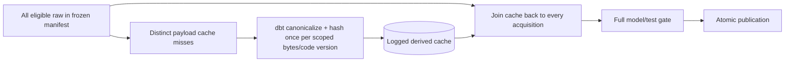
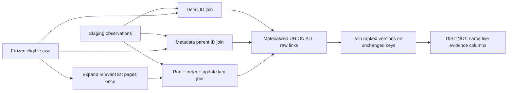

# M08D canonical reuse and worker-free coordinator waits

Owner approved priorities1/2 on2026-11-12. This is a bounded implementation,
not a new load acceptance verdict. Baseline remains the failed900 report in STATUS.
Column contracts precede DDL in05_TARGET_SCHEMA.md.



Etsy first: it is the measured slowest staging node. Cache does not filter raw
membership, deduplicate audit or change first_observed_at/history. A new function
definition gets a new normalization_version automatically; source/mapping identity
remain separate. Invalid JSON aliases/line identities must fail just as before.
Frozen manifest prevents later cache entries from leaking into an older batch.
No max(timestamp) cursor: late acquisitions/replay remain valid. No automatic GC.

Live polling uses a reschedule sensor under the existing task_id cycle. One poke
runs the reusable CLI with nonblocking locks. Busy source/release returns75;
sensor reschedules (no business attempt consumed), freeing worker capacity.
This does NOT hold a session/transaction open while rescheduled. A durable
source owner prevents a later cycle overtaking a collected but unpublished one.
On reentry collect/freeze/build/publish use existing durable stage identities.
An active process is still fenced by session advisory locks. Shared build stays
serialized through freeze/build/test/publish; no parallel shared-candidate writes.
Explicit abort is still required for orphaned RUNNING workflows; no lease steal.

Release fairness: among ready cycles with a live wait ticket, serve the earliest
logical release wait first (retain its place across real retries). A new cycle
cannot take a free release ahead of an older eligible waiter. Resuming an existing
active batch always takes precedence to avoid a frozen-barrier deadlock. Expired
wait tickets do not block other sources; no source ownership is stolen. Live
nonblocking CLI requires wait_seconds to match the deployment-wide
POLLING_SLOT_WAIT_SECONDS (0..600), so all peers evaluate ticket expiry with the
same bounded policy. Policy changes require guarded drain/redeploy, not mid-cycle
editing. No new table/field or larger infrastructure/business budget is needed.

Infrastructure wait clock persists across reschedules, keyed by workflow, phase
and actual Airflow try number; retries keep immutable windows/page settings.
Live sensor timeout15minutes and DAG timeout30minutes remain bounded. Do not
enable the new path on a partially upgraded or actively running image: use normal
guarded drain, migrations, image update, import/readiness checks then unpause.
Base/manual/S01 keep their existing task implementation and blocking CLI.

## Local review and evidence

```powershell
python tests/etsy_staging_probe.py --report runtime/etsy-cache-review.json
python tests/coordinator_probe.py --docker --report runtime/coordinator-review.json
```

Both refuse report overwrite and clean only uniquely labeled disposable resources.
The coordinator probe starts a small private PostgreSQL plus a short-lived Python
worker from the existing main Airflow image, NOT a second scheduler. It needs
that image/container identity to exist; main can remain stopped. Its worker mounts
only source/config directories, never .env or owner runtime. It applies/reapplies
all migrations in disposable data_platform, runs real lock/owner/wait SQL with
business stages as test doubles, compiles dbt and checks SDK DAG serialization.
These checks do not prove actual scheduler rescheduling or warehouse correctness.

For normal rollout use `python -m tools.s02_data live-up` AFTER the existing live
dependencies/Airflow are running. It naturally drains old tasks before migration/
image update. On orphan refusal stop and use explicit operator recovery; do not
delete source owner rows or reset stage budgets. Confirm actual full dbt/release
and four-DAG operation before rerunning unchanged900; do not auto-escalate load.

Airflow UI: live cycle is a sensor; coordinator contention appears as
`up_for_reschedule`, then returns to running with the same cycle/try. SQL examples
for cache, durable owner and wait clocks are in
[inspect_coordination.sql](../tools/s02_data/inspect_coordination.sql). Use the
specified database/administrative connection; report users have no cache/ops access.
An idle/rescheduled worker is not a completed business stage. Wall wait telemetry
includes scheduler time; do not interpret it as occupied worker or CPU duration.

Acceptance before load: cold/warm cache complete row/hash parity, repeated raw,
late raw/manifest isolation, aliases/invalid data, new code version, scope and
cache collision refusal; source exclusion/reentry/terminal-owner handoff,
nonblocking release wait, durable wait timeout, restart/retry and official abort;
real Airflow import/reschedule evidence plus complete dbt release. Do not infer
same900 PASS without running its unchanged gates. Leave task changes unstaged.

References: [PostgreSQL CTE evaluation](https://www.postgresql.org/docs/16/queries-with.html),
[dbt incremental processing](https://docs.getdbt.com/docs/build/incremental-models),
[Airflow sensors](https://airflow.apache.org/docs/apache-airflow/3.3.2/core-concepts/sensors.html).

## Next measured SQL slice: eBay evidence

The original evidence model joins all observations and raw in the same collection
run, then applies an OR for detail identity, metadata parent identity or list-page
membership. In the300-order synthetic execution plan this rejected538200 joined
pairs and invoked jsonb_array_elements180000times. Splitting OR alone still
repeated list expansion; retain that first experiment as diagnostic evidence.

The revised model materializes observations and eligible frozen raw, then UNION
ALLs three equijoin paths. A page_orders CTE expands each relevant list page once
and joins its order/update keys. Materialized raw evidence links are resolved
BEFORE joining the ranked versions, using the unchanged account/order/update/hash
conditions. This keeps the ranked-view join out of the raw matching branches.
The final DISTINCT preserves OR/
EXISTS set semantics, including repeated page entries and overlapping branches.
Null equality, account/hash identity, response200 and manifest filters remain.
No persistent schema, source fingerprint, history or publication changes.



Reproduce without shared writes or a scheduler restart:

```powershell
python tests/ebay_evidence_probe.py --container multi-channel-order-platform-airflow-1 --report runtime/ebay-evidence-review.json
```

Uses the existing project venv/transform role, a repeatable-read transaction and
session-temp tables, always rolled back. Statement timeout60s, lock timeout2s,
outer timeout600s; existing report files are never overwritten. Compares all five
columns with bidirectional EXCEPT ALL against tests/sql/ebay_evidence_before.sql.
Includes empty/repeated/overlapping evidence, account/hash scope, missing manifest,
failed responses, missing arrays and invalid-array error parity. Reconstructs up
to600 retained staging observations from a published eBay batch's immutable raw/
frozen manifest, not mutable shared build tables or simulator truth. An empty
retained sample now REFUSES rather than claiming parity. Refreshes temp statistics
after sample replacement; an additional ranked-view case exercises rank=1 estimates.
For the larger retained check, use `--retained-limit 4000 --samples 2`.
Limits1..4000 and samples1..4 are validated; timeouts
are unchanged. These controls affect only the diagnostic sample, not load gates.
By default, four alternating ANALYZE/BUFFERS JSON plans at100/300orders and retained input
are SELECT-only diagnostics under shared-machine contention, NOT whole-pipeline
speedup or a new load verdict. Full54-node release remains required separately.
