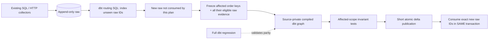

# M08D delta runtime and ten-second target

Next acquisition design, revised2026-11-14 (not implemented):
[22_M08D_EBAY_ACQUISITION.md](22_M08D_EBAY_ACQUISITION.md). Sequential discovery,
reuse complete eBay/Etsy page elements, then up to TWO DETAIL workers per
source/account where needed. This supersedes the earlier two-page-worker proposal.
Website retains its consistent set-based read; multi-order dbt/publication remains
set-based. Historical measurements and verified delta-runtime behavior remain valid.

Owner approved incremental processing and delta publication on2026-11-13.
This supersedes the per-cycle full-project gate ONLY for the opt-in live path.
Base/S01 full dbt build remains the regression/bootstrap oracle. Source schemas,
canonical identity, money/state rules, raw audit and observed-history policy stay fixed.

## Clock and acceptance

T0 is the real start of collection; T1 is successful publication commit observed
by the caller/SQL reader, not the stored publisher-supplied published_at. Include
every wait AFTER T0, compile/execution, tests and publication. Record scheduling/
source-slot wait before collection separately; do not call this source-event latency.
Target is MAX<=10s for predeclared healthy warm samples, not merely p95 or a SQL
node. Start with1 and10 changed orders/source/cycle,1..6lines/order on the retained
local baseline and current Docker allocation. Then expand to100; record failures
without moving the target. Cold bootstrap, mapping/code reprocessing and outage/
429/recovery are separately reported; no universal bound for arbitrary workloads.
The old900 drain/cadence gates and failures are NOT retroactively changed.

## Execution model

Coordinator integration contract2026-11-13: optional POLLING_DELTA_PLAN_DIR
contains one deployment artifact per source (<source>.json), disabled when unset.
New live/nonblocking cycles pin delta_plan_sha256 (64 lowercase hex) in the
existing immutable polling_cycles.settings JSON object, alongside mapping and
transformation versions. Retries restore that identity; no new columns/tables.
Existing cycles without it continue legacy execution, even after option changes.
Missing/stale pinned plans refuse, never fall back. Bootstrap is an explicit
operator operation, not an implicit polling action. Full/S01/manual remains legacy.
All freeze admission and source-owner registration share a short per-source
transaction lock. Legacy/manual cannot bypass a nonterminal live owner; delta
does not bypass an active legacy batch. Preserve actual Airflow owner IDs at
FROZEN creation, the five-attempt task ledger, and PUBLISH pipeline-run audit.
Publication audit success commits atomically with business rows/raw consumption.

Measured old dbt parse-only wall time44.122s under the running stack already
exceeds the target. Compile once on deployment, not once per acquisition. dbt
continues to own ALL business SQL and invariant tests. A versioned compiled plan
contains dbt-generated SELECTs/tests and exported operational hooks. Python only
binds the batch session variable, materializes the dependency graph, evaluates
test failures and atomically promotes tested rows. No independent Python business
normalizer or handwritten replacement for dbt model semantics is permitted.
Compiled artifacts are local runtime data, never committed. Source/plan/mapping
hash mismatch refuses; no silent stale-plan fallback. Compilation is NOT testing.

Each source has its own build_delta_web/ebay/etsy schema and source lock. No global
build lock; only a short global publication transaction lock. Failed batches do
not consume raw. No source_updated_at cursor: late acquisition/replay is included.
Routing is raw->order operational indexing, implemented in dbt SQL; marketplaces
are still acquired ONLY over HTTP, never simulator storage. Empty pages get a
NULL-order routing marker, not an invented order. Invalid missing IDs fail closed.

The first implementation recomputes the COMPLETE observed history of affected
orders, not every order in a channel. This preserves first_observed_at, old/late
versions and mapping reprocessing without fabricating snapshots. Website staging
filters headers to frozen keys because a raw window can contain multiple orders.
Published source-version IDs are unchanged. Cache remains a derived optimization.

Current candidates contain affected orders only. Mart SQL combines those
candidates with unchanged published orders/lines, then aggregates; it does not
mistake a delta subtotal for a channel total. Atomic publication replaces affected
order histories/current/evidence only and merges changed mart rows, removing
obsolete aggregate groups. Row batch IDs identify last recomputation; unchanged
rows may retain older published batch IDs. publication_state remains the latest
source release pointer. Mixed row lineage is intentional and must be tested.

Mandatory gate: original source-specific business tests plus applicable generic
tests and injected-failure gate, no unrelated channel model builds. Full S01,
cross-channel parity, repeated/late/conflicting versions, mapping changes, empty
ticks, failed tests, interrupted/retried publication and independent-source
execution remain regression requirements. Activation requires a tested cold
bootstrap; a new plan/hash must not silently mark existing raw as consumed.

Dictionary precedes migration012 in05_TARGET_SCHEMA.md. Runtime verification,
rollout and unrun gates are recorded ONLY in STATUS. Keep the feature disabled
until integration/parity and the real warm end-to-end clock are verified.

## Measured follow-up, not a completed SLA

Disposable report02 passes full dbt54-node/output parity but still measures an
eBay warm freeze/build/test/publish cycle at8.096s, of which5.957s is build/test.
Website/Etsy are faster in this small fixture scope; acquisition is excluded.
The next probe captures node timings and EXPLAIN ANALYZE with session-local JIT
on/off, without changing the owner server. PostgreSQL's
[JIT decision documentation](https://www.postgresql.org/docs/16/jit-decision.html)
explains why compilation overhead can outweigh savings for short queries and
why estimated planner cost matters. That is a hypothesis to measure here, not
proof of this repository's bottleneck or a reason to disable JIT globally.

Report03 subsequently confirmed the effect for the line-history SELECT:
2967.709ms with JIT (2904.663ms compilation),0.489ms without, estimated cost
2426733.84. This is a disposable SELECT comparison, not end-to-end capacity.
The delta build transaction now uses SET LOCAL jit=off and ANALYZE after each
CTAS so downstream queries have fresh statistics. Main PostgreSQL and ordinary
full dbt keep their settings. Full semantic parity must pass again after this
change; do not apply that SELECT ratio to an entire acquisition/publication cycle.

Report04 passes the full dbt oracle again after these changes. Warm SQL/storage
samples: eBay2.095s, Etsy2.308s, Website2.259..2.619s; acquisition excluded. Same-source
physical fencing and Python DDL-interruption unwind/retry also pass. No live
Airflow/coordinator or end-to-end target acceptance is implied. In particular,
activation must also fence legacy/manual batch registration and preserve the
existing publication-attempt audit and durable workflow retry ledger.

## Integrated private verification (2026-11-13)

The coordinator adapter now preserves those fences and the existing five-attempt
stage ledger; publication audit success commits atomically with data/pointers/raw
consumption. Report `runtime/delta-integration-20261113-03.json` passes 13
coordinator checks, real SQL/HTTP acquisition, full dbt54-node execution and all
eight business-output multiset comparisons. This does not qualify main rollout.

Uninstrumented report02 real collector-to-readable-publication upper bounds for
100 changed orders: Website3.673s, eBay6.831s, Etsy15.532s. Etsy fails the10s target
in that sample; its collect phase alone is12.635s. Instrumented report03 isolates
14.432s in102 fetch calls versus1.506s in claim. A separate no-network image
microbenchmark constructs100 urllib openers in14.706s, including14.299s loading
the default certificate store. Etsy previously constructed one opener per fetch;
eBay already reused one per collector.

Etsy now reuses an opener per worker thread, preserving default TLS verification,
redirect refusal, fresh request credentials, bounded body reads and every
response/audit/retry. This is setup reuse, not skipped HTTP or relaxed leases.
The follow-up uninstrumented real-collector report must establish its effect;
do not derive an end-to-end speedup from the microbenchmark alone.

Measurement provenance correction: reports02..04 launched child collectors from
the image's default working directory. They used the old image collector while
the parent coordinator/dbt runtime used the review mount. Report04 is therefore
NOT a post-opener result. The worker now uses /review as cwd and a child-process
module-path assertion refuses mixed-source measurements. See report05/STATUS
for the corrected acquisition measurement; earlier full dbt parity remains
evidence for the acquired raw, not verification of the new collector source.

Corrected report05 exits0/PASS: full dbt54nodes/all8output parity and13coordinator
checks again. All9 uninstrumented healthy wall-upper-bound samples pass10s in
this finite disposable scope: Website1/10/100orders3.541/6.775/4.173s;
eBay3.675/3.761/9.213s; Etsy4.244/4.778/7.048s. Workload has1Website/Etsy line and
2eBay lines/order, small retained test history and no actual scheduler. eBay100
has little headroom. This is not a controlled old/new A/B, retained-owner or
sustained900-load acceptance. Main stays unchanged until rollout gates pass.

Next recovery probe adds actual SIGKILL while a real CTAS or publication merge
is uncommitted, followed by a separate-process retry and audit checks. It also
tests two real source sessions crossing a shared build-start barrier and
publishing independently. Test code alone is not acceptance: actual run/failure
evidence remains in STATUS. This changes no target fields, production SQL or
source contract, and does not stand in for an actual Airflow scheduler restart.

Both recovery and retained-history probes subsequently pass (exact commands in
STATUS). The latter runs27SQL/HTTP cycles with333new orders/source retained in
warehouse: max3.580sWeb/5.874seBay/8.558sEtsy,0finite-sample10sviolations,
full54-node/all8output parity. Actual scheduler gate is still pending: owner
conditional idle-stop approval was received, but main has active runs and a
retained legacy TESTED Etsy batch whose Airflow owner failed. No main stop,
automatic abort or new scheduler was performed. This does not certify900/soak.

Subsequent isolated Website scheduler gate is now verified in
runtime/delta-scheduled-20261113-02.json (exit0). Production DAG/sensor/collector,
actual scheduled run, configured freeze1 failure and test-container restart;
same cycle/batch resumes with collect1only/freeze2/build1/publish1. Exact original
Airflow run SUCCESS, two successes ending after restart and all3final runs SUCCESS;
latest pointer asserted. Main was idle-stopped/restored healthy with identical
pause flags and drain state. No main activation. Original Airflow task used4tries
while logical freeze used2: extra restart-task retries remain undiagnosed, not
silently reclassified as business attempts or blamed on RAM. This closes only
one-source scheduled recovery, not all-source contention, mapping bootstrap or
retained-owner900/soak gates. STATUS records the earlier incomplete test evidence.

Follow-up2026-11-13 reproduced the extra tries: shutdown grace allowed try2 to
start before container death; orphan recovery dispatched try3 before standalone
Execution API readiness (ConnectError111); try4 succeeded without recollection.
No main startup fix or retry-budget increase is included. Later fault-enabled
cycles intentionally fail once per workflow, explaining their normal two tries.
Diagnostic root evidence and failed Windows log-copy iteration remain in STATUS.

The separate all-source scheduler gate now PASSes in
runtime/delta-scheduled-four-dags-20261113-03.json:26native scheduled runs all
SUCCESS/try1,104business stages attempt1; actual Etsy source-lock contention and
native reschedule while Website/eBay succeed, then inbox and HTTP recovery resume.
Signed webhook202 accepted; a second receipt WITHOUT notification is discovered
by recovery. Raw consumption, per-source pinned plans, snapshot deduplication and
latest publication pointers verified. Portable tar.gz retains26task logs without
extracting invalid colon paths on Windows. Exact main container/image/health,
pause flags and drain state restored; isolated containers/network removed.
This is tiny-data scheduling/contention acceptance, not marketplace container-kill,
retained-owner900 performance, sustained/burst/soak or main delta rollout.

## Next authorized rollout gates (2026-11-13)

Owner requested API-ready startup, mapping rebootstrap, retained-main activation,
then the UNCHANGED900 envelope in that order. No budget/workload relaxation.
The local adapter orchestration.airflow_local retains the pinned3.3.2 upstream
standalone initialization/auth/component commands, gating only the scheduler
thread on API HTTP readiness plus healthy metadatabase (NOT scheduler health).
SIGTERM is forwarded into upstream component shutdown rather than waiting for
Docker's forced kill. Startup refusal is nonzero; task/retry state is never forged.
This remains a one-container development topology, not production supervision.
Reference: [pinned upstream standalone](https://github.com/apache/airflow/blob/3.3.2/airflow-core/src/airflow/cli/commands/standalone_command.py).

Before main deployment, rerun real scheduled freeze/restart and require exactly
two cycle tries (one intentional freeze fault, one successful reentry), rather
than accepting four. Mapping transition tests run only in disposable PostgreSQL:
close old active rows before adding a replacement release under the existing
unique constraints, refuse stale/unbootstrapped plans, explicitly bootstrap all
retained raw and preserve source snapshot identity/fingerprint/first observation.
No owner mapping or source fixture is changed by that test. Runtime evidence,
rollout progress and any inability to reach900 belong in STATUS.

Mapping rollout refinement: an old previously bootstrapped/consumed plan cannot
be reactivated over another plan's current publication, even if its old mapping
hash is restored. Both admission before collection and ordinary freeze verify
the active pointer's plan. Rollback/reprocessing requires an explicit newly
compiled release/bootstrap, not an empty delta tick that silently keeps newer
mapped output. No new DDL or source-version identity change. Existing published
workflow reentry and explicit operator abort remain available.

The adapter sets one shared stable JWT signing secret BEFORE importing Airflow:
explicit AIRFLOW_EXECUTION_JWT_SECRET through Compose, or an exclusively created
ignored state/execution-jwt.key (0600) reused across starts. No logging/auto-rotation
or authentication bypass. The first private adapter failed initial JWT validation
and was corrected, not deployed or declared passing. See STATUS and
[pinned JWT guidance](https://airflow.apache.org/docs/apache-airflow/3.3.2/security/jwt_token_authentication.html).

### Explicit retained deployment (not an automatic live-up migration)

`python -m tools.s02_data.delta_deploy --startup-report <passing-report.json>
--report <new-report.json> --confirm-local` is the cold deployment entry point.
It refuses anything other than a passing strict restart plus mapping/full-dbt
gate for the current compiled source hash. `LIVE_DELTA_PLAN_DIR` must explicitly
name a new `/opt/airflow/state/delta-plans/<release>` directory in local `.env`.
Leaving it blank preserves legacy execution; setting it alone does not bootstrap.

The command drains main without aborting work, preserves the seven pause flags,
builds the image and stops only idle Airflow. It applies additive migration012,
compiles three source plans, then calls `transformation.delta_bootstrap` separately
for each source. Each cold bootstrap requires a complete ordinary dbt build and
all eight candidate multiset comparisons BEFORE publication, plus retention of
already observed snapshot IDs, timestamps and fingerprints. Cold compilation and
bootstrap are not counted as warm-cycle latency. PostgreSQL, SIM, raw/audit and
last-good data are never reset.

Only after all three publications match their verified plans does Compose replace
the Airflow container. Activation must retain pause flags, become healthy, and
produce at least two real scheduled successes per active live DAG. Future live-up
calls validate the configured plans/publications rather than silently reverting
to legacy or bootstrapping themselves. Any failure retains its report and exact
bootstrap identities: no automatic abort, budget reset or task-success override.
Implementation is not runtime evidence; check STATUS before attempting load900.

## Retained rollout and finite900 result (2026-11-13)

Strict startup/mapping gate PASS, followed by explicit retained-main rollout:
all three cold bootstraps matched full54-node dbt and all eight outputs before
publication; observed source IDs/fingerprints/first observations preserved.
Airflow became healthy, kept all seven pause flags and completed at least two
real scheduled cycles per live DAG. Ordinary campaign live-up then retained
the verified plans and persisted signing key across another image recreation.

The UNCHANGED campaign_rate_900.json run exited0:
runtime/campaign-55425905726c48c880d022e0fbface94/report.json.
Independent900order/3801line reconciliation PASS, no errors; cadence
Website10/eBay5/Etsy inbox9/recovery7; observed drain96.438s against900s budget.
Resource and final-observation budgets PASS. This is the finite rate step only,
not burst/soak, universal capacity or the ten-second target.

MAX<=10s is NOT achieved: successful collect stage p95 is59.427s for eBay and
40.153s for Etsy, versus build/test p95 Web6.971/eBay3.797/Etsy6.916s. Five eBay
collection failures were mutable-page-total refusals, then recovered within the
existing budget. Do not suppress that guard, inflate retry limits or blame dbt
for collection time. Current eBay acquire() processes all details for a page
before fetching the next page, widening the mutable-pagination race. Proposed
next slice: separate bounded list crawl from detail processing, retain every
audit and checkpoint/window/identity rule, then test any bounded concurrency.
No such collector change was made during this measurement. Review that slice
before another load increase; STATUS separates no-retry ACK spans from retry
and final-source-eligibility observation delay. Exact commit latency remains
NOT_MEASURED by the campaign observer.
