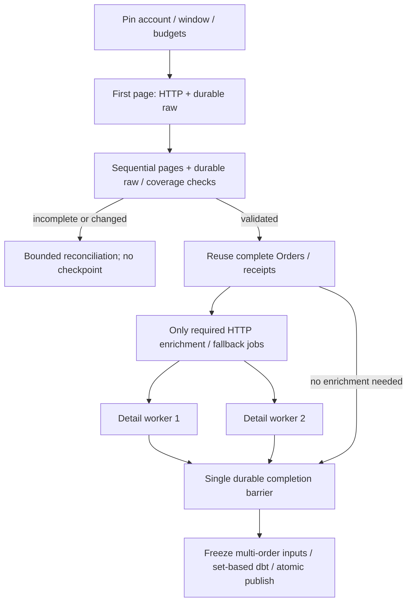

# M08D multi-source acquisition enhancement

Decision date: 2026-11-14, revised after owner review. Code implemented as an
opt-in profile; focused checks are recorded in STATUS. NOT activated or qualified
by a full database/release/campaign run. Operational guide:
[ingestion/ACQUISITION.md](../ingestion/ACQUISITION.md).
Focused PostgreSQL qualification subsequently PASSed (STATUS): real migration014,
collector CLI/HTTP page reuse/fallback, two-worker completion and failure checkpoint
barriers, audit/grant/constraint checks and stale-token eligibility fencing.
The DB probe found/fixed CHECK allowing JSON null; the predicate now requires TRUE.
This is not full dbt/new-envelope parity, scheduler/rollout or load qualification.
Ordinary dbt singleton/page-input parity subsequently PASSed on2026-11-18:
60nodes per branch,21business comparisons and scoped evidence/fingerprint/cache
checks. See STATUS and the owner-facing temporary Vietnamese review. This is a
small seeded fixture, not compiled delta/runtime or live-release qualification.
This revision supersedes the earlier two-PAGE-worker proposal:
use up to TWO DETAIL/ENRICHMENT workers per source/account where needed, keep
page discovery sequential, remove redundant complete-receipt refetches in Etsy
live recovery, and retain Website's set-based snapshot read. Existing S01
interfaces and deterministic acceptance remain unchanged. The filename is kept
to preserve review links; the scope now includes all three sources.

## Current bottleneck and published API

The unchanged900 finite envelope passed, not MAX<=10s. Successful eBay collect
p95 was 59.427s; five collect attempts refused mutable page totals and recovered
on subsequent retries. See [STATUS](STATUS.md) for actual evidence.

Legacy `ingestion/ebay.py:Collector.acquire()` fetches one page, records work, then
calls `details()` for every order before fetching the next page. `details()`
retrieves one order, its shipping collection, and each fulfillment individually.
The opt-in `ReuseCollector` now finishes discovery first, reuses eligible Orders,
and overlaps only required enrichment. No measured speedup is claimed yet.

The selected enhancement is **up to two DETAIL/ENRICHMENT workers**, not page
workers or two source owners. Avoid redundant detail requests first. Concurrency
overlaps unavoidable HTTP latency; it does not increase quota, guarantee a
twofold speedup or prove the ten-second target.

Published Fulfillment behavior checked on 2026-11-14:

| Operation | Boundary |
| --- | --- |
| `GET /order?filter=lastmodifieddate:[from..to]&limit=...&offset=...` | Discover changes; pages already contain Order objects, not just IDs. |
| `GET /order?orderIds=id1,id2,...` | At most50 IDs; other query parameters are ignored. Same getOrders envelope, not richer getOrder cancellation data. |
| `GET /order/{id}` | Authoritative cancellation requests / unresolved order detail. getOrders always returns empty `cancelRequests`. |
| `GET /order/{id}/shipping_fulfillment` | Shipping collection for ONE order; no cross-order fulfillment batch is assumed. |

Sources: [getOrders](https://developer.ebay.com/develop/api/sell/fulfillment_api/order/getOrders),
[Fulfillment OpenAPI](https://developer.ebay.com/api-docs/master/sell/fulfillment/openapi/3/sell_fulfillment_v1_oas3.json),
[order-management guide](https://developer.ebay.com/develop/guides/sell/order-management-guide).

Bulk IDs remove redundant single-order reads for eligible orders, not every
per-order call. A batch can observe a newer version than discovery; it is not
a server-side snapshot of the earlier page. Never combine conflicting versions
of order, cancellation and shipment into an invented snapshot.

## Shared collection policy and eBay algorithm

1. One parent owner pins account, time window, page size, mode and worker count
   in immutable cycle settings. Existing order/page/time/retry budgets remain;
   worker count does not multiply them.
2. Crawl discovery pages sequentially and audit identified work durably. Do not
   wait for all details of one page before requesting the next. After validating
   the bounded scan, dispatch only required detail/enrichment work to a bounded
   pool of at most TWO workers for the source/account. Each worker has its own
   HTTP client and DB connection; never share a connection concurrently.
3. Persist each actual response and identified work before acknowledging its
   page. Merge by requested offset and scoped identity, not completion order.
   Share rate-limit cooldown and bounded attempt accounting.
4. Validate origin, bounds, envelopes, offsets, totals and coverage. Deduplication
   removes repeated IDs, not unseen skipped orders. Mutable totals/membership
   require bounded reconciliation; failed required pages leave the window
   incomplete. Equal totals alone do not prove provider snapshot isolation.
5. Reuse complete validated discovery Order objects instead of fetching identical
   objects again. Retain support for grouped refresh/known-ID lookup via `orderIds`
   (at most50, without a time filter) where justified; it is not a mandatory
   second fetch of every discovered order. Audit each actual envelope once;
   validate account, membership, fields and versions. Missing/unexpected IDs or
   changed/out-of-window versions require fallback/reconciliation, not silent success.
6. Use single getOrder for cancellation-bearing or unknown cancellation state,
   missing required fields and unresolved completeness/version conflicts. Empty
   list/batch `cancelRequests` is NOT evidence of no requests. Keep canonical
   source fingerprints and independent payment/fulfillment/cancellation semantics.
7. In the same bounded enrichment pool, fetch per-order shipping collections where
   required for parcel date, line allocations and references. Only omit individual fulfillment-detail calls
   after proving the collection is complete and consistent. Otherwise use targeted
   detail/reconciliation. No fabricated individual HTTP responses/evidence.
8. A single parent barrier completes acquisition/checkpoint only after all required
   pages, batches and enrichment work are durably complete. Worker exit alone is
   not success. Failures retain raw, attempts, work and last-good publication.
   Existing source ownership and freeze/build/publish gates remain.

Batch-by-ID repeats information already present in discovery Orders; it is not
mandatory enrichment imposed by eBay. The owner's revised direction prioritizes
reusing complete page payloads, then overlapping necessary cancellation/shipping
or fallback requests. Per-order HTTP requests remain where required by the API;
this is distinct from per-order SQL transformation or per-order publication.

## Acquisition reference dictionary, before dependent DDL/models

Existing raw fields remain authoritative. Migration014 adds validated page-element
references, immutable options, bounded eBay scans/restart markers and a separate
Etsy element cache. Final columns/constraints are in05_TARGET_SCHEMA.md. Page
offset/limit remain in actual response/URL, not invented extra raw columns.

| Reference | Definition / constraint |
| --- | --- |
| `raw_record_id` | Existing physical acquisition identity: one actual response per raw record, including failure audit; no synthetic single-order raw records from a batch. |
| `request_phase` | Proposed metadata enum: `discovery`, `order_ids`, `order_detail`, `fulfillment_collection`, `fulfillment_detail`; retain actual URL/attempt/run audit. |
| `page_offset`, `page_limit` | Nonnegative offset and valid provider limit for discovery. Not worker completion order. |
| `requested_order_ids` | When a batch lookup is used: 1..50 unique account-scoped IDs. Validate returned membership separately, without positional assumptions. |
| `order_id` and element reference | Actual Order within a parent raw array, with unique scoped membership. dbt expands the array. |
| `order_raw_id` AND `order_id` | Shipping-parent lineage must include BOTH: one batch raw UUID can represent many orders. Join by scoped order and parent, not raw UUID alone. |
| Source version/fingerprint | Preserve existing identity rules, separately from mapping/transformation version; transport grouping alone must not change identity. |

Python owns HTTP, validation, bounded work and raw/operational audit; dbt owns
array expansion and business normalization. eBay staging now supports both legacy
`ebay_order` payloads and accepted page elements. Shipping-parent joins retain
raw ID plus order ID, with a legacy-only missing-order-ID fallback. The changed
graph requires a new verified release, not fake single-order acquisitions.

## Etsy: remove redundant live recovery detail reads

Owner accepted this refinement after reviewing published reference and code:
[getShopReceipts](https://developers.etsy.com/documentation/reference/#operation/getShopReceipts),
[webhook payloads](https://developers.etsy.com/documentation/essentials/webhooks/),
[rate limits](https://developer.etsy.com/documentation/essentials/rate-limits/).
No undocumented batch receipt-ID endpoint is introduced.

- `simulator/etsy_api.py` already returns receipt objects, including transactions
  and available shipment fields, in recovery `results[]`. No new payload endpoint
  is needed for this optimization. This is code inspection, not a real-Etsy field
  completeness certification; regional permissions/nullable fields still matter.
- `ingestion/etsy.py:recovery_pages()` currently returns ID/raw-page pairs;
  `recover()` enqueues these and `drain()` fetches each receipt again. Replace
  redundant live refetches with eligibility references to validated page elements.
  Keep page membership/window checks, actual acquisition time and the real page raw.
- Legacy staging/cache consumes `etsy_receipt`; the opt-in branch now consumes
  accepted `etsy_receipts` elements. Route, cache inputs, dbt normalization and
  evidence changed together. No synthetic
  detail HTTP record or successful receipt-HTTP attempt may be created for a
  request that did not happen. Keep webhook delivery/inbox audits distinct.
- One page hash represents many receipts. Before dependent DDL, finalize an
  append-only, versioned cache key containing source/account, receipt identity,
  normalization version and the normalized-input element's content identity.
  Preserve whole-response byte hash and raw+element lineage separately. Reusing
  the old whole-page byte hash alone as a receipt cache key is forbidden. Keep
  canonical source fingerprint behavior unchanged and verify full-dbt parity.
- Use up to two detail workers for webhook resource URLs and required fallback,
  not for refetching every complete recovery receipt. Page recovery and inbox
  continue to obey one source/account ownership fence; this does not permit two
  competing DAG owners or a second independent source pool to bypass it.
- Each worker claims its own leased work with its own DB connection/client.
  Preserve per-work/attempt/token audit, stale-owner fencing and shared API quota,
  cooldown and durable budgets. Parallel work requires an audit/lease race review,
  not merely wrapping current `drain()` in threads.
- Owner scope clarification: LEAVE THE ETSY SIM UNCHANGED in this slice. Existing
  receipt-list payload support is sufficient for removing redundant collect GETs.
  The whole-request lock may limit a later detail-pool speedup; measure that limit,
  do not preemptively refactor SIM locking, storage, generation or endpoints.
  If a correctness blocker is demonstrated, report it before expanding SIM scope.
  S01 endpoints and exact legacy acceptance remain unchanged.

Etsy implementation sequence (collector-focused, necessary input adaptations only):

1. Validate/persist actual recovery page and durable receipt-element eligibility
   references; reuse complete elements instead of enqueueing every receipt for GET.
2. Adapt raw eligibility, dbt route/cache/staging/evidence to that input shape.
   Define the element/cache identity before dependent DDL. These are prerequisites
   for correct collection reuse, not an unrelated business-model redesign.
3. Keep single-receipt GET for webhook resource URLs and explicit missing/conflicting
   element fallback; preserve existing retry, receipt-work and checkpoint fences.
4. Qualify required detail work with1worker, then optional2workers with shared
   quota/lease/attempt safeguards. Do not change the SIM just to show a speedup.
5. Check complete recovery => zero redundant detail GETs, multi-receipt lineage/
   cache isolation, missing-field fallback, observed-only history and unchanged S01.
   New compiled/full-dbt parity, explicit plan release/bootstrap and unchanged900
   remain activation gates; HTTP success alone is not a complete integration PASS.

Build/test DOES depend on the acquired envelope shape. See the actual historical
node timings, unmeasured remainder and proposed profiling order in
[23_M08D_BUILD_TIMING.md](23_M08D_BUILD_TIMING.md). No speedup is inferred merely
from a smaller HTTP count. This slice changes only necessary acquired-input
adapters, not unrelated business mart definitions or publication semantics.

## Website: retain set-based source extraction

`ingestion/website.py:acquire_source()` uses one REPEATABLE READ, READ ONLY
transaction. It selects changed orders once, then related rows with
`order_id = ANY(order_ids)` (and the corresponding shipment/customer/product ID
sets). It does not issue one detail query per order. Python serializes returned
rows, but that is not a source-query-per-order loop.

Do not force two workers onto this path: independent connections can read
different snapshots, and additional queries may increase DB pressure. Keep one
consistent read until measurement justifies a separately designed bounded read
strategy. Existing successful collect p95=5.274s in the unchanged900 run is a
workload-specific observation, not proof of unlimited capacity. Large raw payloads,
fetchall memory and window sizes remain future measurement points.

## After collect: multi-order SQL, not per-order business execution

- `transformation/delta_runtime.py:freeze()` uses `INSERT ... SELECT` for unseen
  raw membership and affected order keys, then adds observed historical context
  for those keys. A frozen batch may contain many orders.
- `build()` loops over dbt model/test nodes in dependency order. Each node runs
  set-based SQL over that batch; it does NOT invoke the graph separately per order.
  JSON array expansion, joins, grouping and window functions necessarily process
  rows inside PostgreSQL; removing a Python order loop does not remove that work.
- `transformation/delta_publish.py:publish()` loops over target tables, not orders.
  Set-based DELETE/INSERT/UPSERT applies affected order sets and commits publication
  atomically. Do not add per-order commits or expose partially updated core/marts.
- HTTP acquisition/validation/raw audit can still contain per-response/per-entity
  work; preserve that audit. Measure DB round trips before introducing bulk writes.
  Bound the queue and batch sizes rather than one unbounded 'all orders' operation.
- Two detail workers overlap HTTP only; they do not require two dbt builds or
  two publishers. Keep the single frozen-batch completion/quality/publication gates.

## Implementation map and rollout

- `ingestion/ebay.py`: separate sequential discovery from bounded two-worker
  enrichment; reuse complete pages, optional grouped lookup, fallback/barrier.
- `simulator/ebay_api.py`: add documented `orderIds`/max50/query precedence and
  preserve cancellation gap. Its current `state.lock` covers the entire request;
  narrow to safe state/fault snapshots so DB reads/socket writes do not serialize
  both detail workers. Test control/fault-counter consistency, not just remove locks.
- eBay staging/intermediate/evidence models/tests: batch-element provenance,
  scoped shipping-parent joins and source-version consistency.
- `ingestion/etsy.py`, Etsy cache/route/staging/evidence: direct eligible page
  elements for recovery, two-worker leased detail/fallback pool for inbox as needed.
- Supported live-only settings: `LIVE_EBAY_ACQUISITION_MODE=page-reuse`,
  `LIVE_ETSY_ACQUISITION_MODE=page-reuse`, `LIVE_EBAY_DETAIL_WORKERS=2`,
  `LIVE_ETSY_DETAIL_WORKERS=2` (each1 or2). Defaults remain legacy/1.
  Grouped lookup supports at most50 IDs through the explicit client/SIM interface;
  it is not a second fetch or a batch-size environment setting. Existing live page-size
  settings remain independently bounded at200 for eBay and100 for Etsy. Persist settings per cycle;
  legacy missing settings keep the old path, including on retry.
- Base/manual S01 keeps existing request/audit behavior and page-size default1.
  Activate new live mode explicitly after isolated gates; never switch mid-cycle.
- Model changes require a new transformation/compiled-plan release, full-dbt
  parity and retained-data bootstrap. Old verified delta plans are not implicitly
  valid for a changed graph. No quota, hardware or load-budget increase is assumed.

## Gates before another unchanged900 run

1. HTTP/SIM: batches1/50, over-limit/malformed/duplicate IDs, missing/unexpected
   IDs, query precedence, cancellation gap/fallback and partial/multi-parcel evidence.
2. Concurrency: prove two required detail requests overlap, never exceed two per
   source/account, do not multiply on retry or across DAG owners, and tolerate
   out-of-order completion. Discovery stays sequential. Exercise mutable totals,
   same-count changed membership, duplicates/skips, shared429 cooldown and retry
   exhaustion. Do not claim offset
   pagination provides snapshot isolation; document reconciliation limits.
3. Durability: interruption after page/batch raw commit, outstanding enrichment,
   worker crash/retry must not lose audit or prematurely advance checkpoints.
4. Semantics: real batch-element/shipping-parent evidence, no cross-order joins,
   fingerprints, cancellations, independent states, line/money grain and version
   conflicts. Never fabricate unobserved history or HTTP evidence.
   Etsy complete recovery pages must cause zero redundant detail GETs; incomplete
   page elements use explicit fallback, and webhooks still fetch required receipts.
   Test multiple receipts sharing a page hash, content updates, stale leases,
   duplicate notifications, worker death and shared429 cooldown. Website source
   snapshot consistency remains unchanged.
5. Regression: unchanged S01 fixture/DB checks; new-mode business parity against
   legacy inputs with valid actual provenance (physical request counts/UUIDs may
   differ). Same new frozen-batch compiled-vs-full54-node dbt parity for all eight
   outputs, then explicit release/bootstrap/scheduled rollout gates.
6. Repeat SAME900/hardware/cadence/budgets. Measure HTTP count/time by phase,
   raw commits, work DB time, parsing, cooldown and reconciliation separately.
   Keep collect-to-publication distinct from source-eligibility observation delay.
   Fewer requests alone do not satisfy MAX<=10s; burst/soak remain later gates.

Focused unit/control-flow, loopback SIM, Jinja/lineage and SQL-style checks PASS.
The subsequently authorized collect-only DB probe also PASSed migration014,
reuse/fallback/barrier, selected grants/immutability and stale-token checks; exact
coverage/failure/fix evidence is in STATUS. Neither proves full warehouse semantic
parity, crash/lease-expiry races, release/scheduler or performance acceptance.
Owner workflow requires explicit approval before broader gates. Next: new-input
dbt parity qualification and an explicit new release/bootstrap before activation;
unchanged900 is a later separately requested check. No automatic campaign,
scheduler, reset, main service restart or source-mode switch in this task.
