# TẠM THỜI — Giải trình M08 để chủ dự án kiểm tra

## M08C — Bản giải thích và hướng dẫn kiểm tra hiện hành, 2026-11-05

**Cập nhật khi review để commit:** phát hiện lượt bạn chạy lại
`scheduled_pause_resume` bị timeout ở bước catch-up, cleanup PASS; evidence có
đuôi `d6dc5866662a4db38d588943b4a48cf3`. Report mới nhất là **17 PASS / 1 FAIL**.
Kết quả18/18 bên dưới là lượt trước, không được dùng để che lần FAIL mới. Commit
lần này là checkpoint có ghi rõ vấn đề, không phải chứng nhận mọi rerun đều đạt.
Cần chẩn đoán và chạy lại case này trước khi kết luận campaign tiếp theo PASS.

Hướng M08D bạn đã chốt: dùng chung config M08B (như `local_now.json`), một lệnh
campaign chuẩn bị dữ liệu, bật môi trường quan sát ổn định, gây lỗi/khôi phục theo
timeline có seed, cho xem Airflow/DB và xuất kết quả correctness/recovery/performance
riêng. Các bài regression M08C vẫn giữ. Đây là kế hoạch tiếp theo, chưa có lệnh
campaign mới; lệnh generate cũ không tự nhiên được quyền gây lỗi hay dừng service.

**Đọc phần này trước.** Những mục từ ngày 2026-11-01 phía dưới được giữ để bạn
đối chiếu lịch sử, không phải trạng thái hiện tại. M08C đã đạt **18/18 case runtime
local**, **88 test component** và **14 test report/UI sau recovery**. M08D chưa làm.
Các câu cũ như “M08C đang dừng”, “chỉ ba case PASS” hay “failed_gate thiếu quyền”
đã được thay thế bởi kết quả mới, nhưng log lỗi cũ không bị xoá.

### 1. M08C giải quyết việc gì? Có thay M08B không?

M08B chứng minh đường đi bình thường: sinh dữ liệu nguồn, pipeline tự thu thập,
dbt xử lý, publish và dashboard đọc được. M08C hỏi tiếp: **nếu lỗi xảy ra ở giữa
đường thì hệ thống có giữ dữ liệu/audit, không publish dở dang, retry đúng và biết
khi nào phải nhờ người vận hành không?** Đây là kiểm thử đúng/sai khi có lỗi,
không phải đo được bao nhiêu đơn/giây; tải/burst/soak thuộc M08D.

Không yêu cầu bạn chọn campaign mỗi lần chạy pipeline hằng ngày. Luồng sử dụng
thường vẫn là `live-up` rồi tự chạy `generate --config ...`; pipeline tự xử lý dữ
liệu đến hạn. Riêng **test có chủ đích kill/restart/inject lỗi** phải chọn case và
scope disposable để tránh phá stack đang demo. S01 ở đây chỉ là bộ dữ liệu đối
chiếu cố định cho regression, không phải bộ lọc bắt pipeline thật chỉ nhận S01.

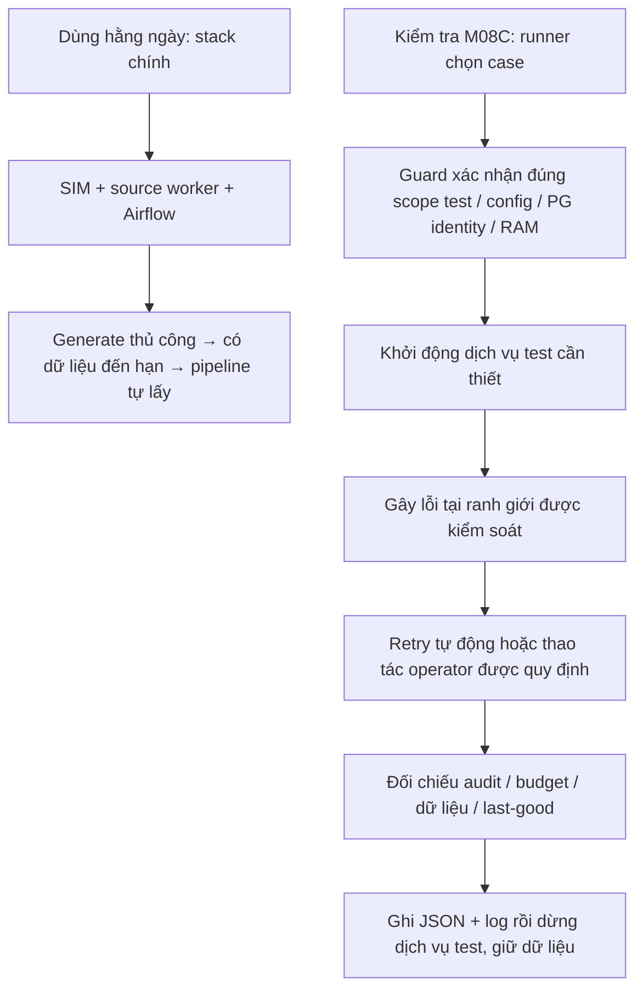

Stack test không phải môi trường thứ hai phải chạy suốt ngày. Nó dùng cùng
Docker Engine nhưng có project/volume/database riêng, chỉ bật khi kiểm tra.
Test không chuyển dữ liệu test sang DB chính sau khi chạy. **DBeaver đang nối
DB chính không tự thấy dữ liệu của scope test.** Việc tách này là để có thể kill
PostgreSQL, Airflow hay receiver mà không làm mất buổi demo/dữ liệu của bạn.

### 2. Những gì đã làm và đã sửa

Phần M08C gồm runner, inventory, safety guards, các probe HTTP/SQL/process/lifecycle,
DAG test riêng và regression. Những code có từ checkpoint trước vẫn được dùng;
lượt tiếp tục này hoàn thiện bằng chứng và sửa các vấn đề phát hiện lúc chạy.

| Phần | File nên đọc | Ý nghĩa / thay đổi |
| --- | --- | --- |
| Inventory 18 case | `test_support/m08c_cases.json` | ID, runner và phạm vi từng case; không suy ra PASS chỉ vì có code |
| Điều phối và evidence | `test_support/m08c.py` | Xác nhận scope, kiểm tra RAM đúng topology, chọn probe, ghi kết quả và dừng dịch vụ trong finally |
| Guard môi trường | `test_support/m08a.py` | Kiểm tra marker/config/labels/mounts/PG identity; không nhận stack chính làm test target |
| Chữ ký publication | `test_support/m08c_pipeline_probe.py` | Dùng quyền publisher sẵn có trong transaction read-only, repeatable-read; không cấp thêm SELECT cho transform role |
| HTTP | `test_support/m08c_http_probe.py`, `simulator/http_faults.py` | Lỗi timeout/JSON/page/retry có số lần và phạm vi cụ thể |
| Process loss / atomicity | `test_support/m08c_loss_probe.py` | Chết sau raw commit, khi dbt đang chạy, trong transaction publish và sau commit trước ACK |
| Worker / notification / chất lượng | `test_support/m08c_worker_probe.py`, `test_support/m08c_webhook_probe.py`, `test_support/m08c_quality_probe.py` | Fencing owner cũ, thông báo sai thứ tự/bị bỏ sót, policy dữ liệu |
| Lifecycle thật | `test_support/m08c_lifecycle.py`, `test_support/airflow/m08c_recovery.py` | Lịch thật, pause/resume, drain, clear task, service restart và outage |
| Source worker | `simulator/live_worker.py`, `test_support/m08c_source_worker_probe.py` | Worker hỗ trợ kết thúc tick khi SIGTERM; probe chờ heartbeat thật trước khi gửi signal, tránh lỗi do giết interpreter quá sớm |
| Drain dùng chung | `tools/s02_data/live.py` | Test gọi cùng thuật toán drain thật, nhưng chỉ chọn DAG test; mặc định live vẫn là bốn DAG periodic ban đầu |
| Offline regression | `tests/test_m08c.py`, `tests/test_m08c_probes.py`, `tests/test_m08c_http.py`, `infra/scripts/check_m08c_offline.ps1` | Guards/assertion/HTTP local; CLI container không bị nhầm là Airflow chính do label kế thừa từ image |

Các sửa quan trọng khi chạy Airflow 3:

- Copy DAG test vào container đang dừng **trước** khi start. Copy sau startup có
  thể lỡ lần scan đầu và đợi refresh 300 giây, vượt deadline discovery 180 giây.
- Kiểm tra bản serialized DAG mới nhất, không đòi metadata chỉ được có một row.
- CLI task-clear ban đầu exit0 nhưng không chọn được task do cách xử lý
  `--task-regex` ở bản cài đặt này. Bản sửa kiểm tra đúng run đã failed, đúng hai
  task test và logical date duy nhất rồi mới clear bằng CLI thật. Không viết SQL
  ép task thành success, không reset durable retry budget. Đã chạy lại tự động PASS.
- Drain trước đây dùng chờ giả để tạo timeout trong prototype; nay kiểm tra timeout
  của thuật toán drain thật, giải phóng barrier rõ ràng rồi để retry chạy hết.

**Không thay source contract, fingerprint, schema core/marts hay business SQL**
trong lượt hoàn thiện này. Không dựng history từ lịch generator; không đưa quyền
admin vào collector; marketplace vẫn chỉ đi HTTP, website ingestion vẫn read-only.

### 3. Đầy đủ 18 test case: gây lỗi gì, mong đợi gì?

Mỗi hàng dưới đã có evidence runtime PASS trong scope `563f55c17bab`. PASS có
nghĩa là assertion của hàng đó đạt, không đồng nghĩa mọi kiểu sự cố đều được thử.

| Case | Tình huống mô phỏng / mong đợi PASS |
| --- | --- |
| `api_failures` | API trả 429/500, timeout, HTTP200 nhưng JSON hỏng, lỗi giữa các trang, next URL không an toàn hoặc lặp trang. Giữ audit, không đẩy checkpoint vượt phần chưa thu thập an toàn; hồi phục đúng khi nguồn hết lỗi. Không phải test tải API. |
| `receiver_audit` | Gửi HTTP chữ ký sai/cũ và delivery trùng. Từ chối request không hợp lệ; delivery hợp lệ trùng vẫn giữ audit vật lý nhưng không tạo nhiều logical work cho cùng thông báo. |
| `late_reordered_webhooks` | Gửi shipped trước rồi thông báo paid đến trễ, gửi trùng, và bỏ một notification. Inbox/audit/work/raw đúng; polling receipt API tìm được phần bị bỏ sót. Không khẳng định mọi trạng thái đó đã được publish thành history. |
| `stage_resume` | Ngắt có kiểm soát sau raw và sau freeze rồi chạy lại cùng identity/config. Giữ raw/manifest đã commit, chạy tiếp đúng stage, không nhân đôi kết quả; dbt/test/publish thật đạt và rerun idempotent. Đây là hook interruption, không phải SIGKILL. |
| `abrupt_raw_inbox` | Process chết sau raw commit; receiver chết sau DB commit trước ACK. Chạy lại không mất raw/inbox; retry delivery vẫn một inbox logical và giữ đủ delivery audits. |
| `lease_fencing` | Probe SQL/HTTP kiểm tra token hết hạn, budget năm lần và replay được liên kết rõ ràng. Owner/token cũ không được ghi thành công. Probe rollback-only; không thay thế case process owner độc lập dưới đây. |
| `abrupt_lease_owner` | Owner cũ quay lại sau khi lease đã được owner mới reclaim và commit. Token cũ bị fence; không ghi đè kết quả owner mới. |
| `failed_gate` | Cố ý làm dbt test fail. Không đổi core/marts/publication pointer last-good; batch lỗi không tự thành TESTED. Abort lỗi rõ ràng rồi execution mới có thể recovery thành công. |
| `data_quality` | Chạy compiled SQL thật với input literal: thiếu product mapping, status lạ, hai version cùng timestamp nhưng xung đột. Áp dụng đúng UNMAPPED/reject/conflict, không đoán mapping. Đây không phải campaign dữ liệu lỗi đi toàn bộ từ source đến warehouse. |
| `abrupt_freeze_dbt` | Process mất sau freeze hoặc dbt bị SIGKILL. Manifest không mất; batch orphan cần thao tác operator có kiểm soát, không giả vờ tự recovery mọi trường hợp. Sau xử lý được quy định, pipeline chạy lại đúng. |
| `publish_atomicity` | Kill giữa transaction thay stable tables phải rollback, không thấy nửa dữ liệu mới. Nếu commit đã xong nhưng ACK mất, retry phải idempotent; đối chiếu đầy đủ core/marts/pointer. |
| `task_clear_budget` | Làm collect hết năm durable attempts, rồi clear task bằng Airflow CLI thật. Task thử lại có thể lên try6 nhưng durable budget vẫn5; DAG tiếp tục failed đúng thiết kế. Test PASS dù DAG đỏ vì nó chứng minh không bypass budget bằng clear. |
| `postgres_restart` | Restart PostgreSQL test nhẹ nhàng. PG system identity và chữ ký dữ liệu bền vững giữ nguyên; không chứng minh phục hồi mất ổ cứng/host. |
| `other_service_restarts` | Restart nhẹ nhàng API/receiver/Airflow; kiểm tra source-worker commit/progress recovery và SIGTERM sau tick. Dữ liệu bền vững giữ đúng, worker không nhân đôi order. |
| `abrupt_service_loss` | SIGKILL API/receiver/Airflow/PostgreSQL test và source worker rồi khởi động lại. Kiểm tra persistence/recovery theo assertion. Đây là mất service ở trạng thái kiểm soát; các điểm raw/dbt/publish đang bận có case riêng. |
| `scheduled_pause_resume` | Pause consumer trong khi nguồn đi qua các trạng thái rồi resume. Có ít nhất hai run scheduled thành công thật và bắt kịp snapshot quan sát được; lần đã chạy chỉ thêm một history version được quan sát, không bịa ba transition. |
| `maintenance_drain` | Giữ một task thật ở barrier, drain hết timeout phải báo lỗi rõ ràng và để retry còn chạy được. Operator release barrier, drain hoàn tất rồi mới idle; không clear task/reset budget để ép PASS. |
| `outage_visibility` | Làm source/observer/scheduler không sẵn sàng. Giữ last-good; checkpoint không chạy vượt lỗi nguồn; monitoring chuyển Unknown/stale đúng lý do. Đợi tuổi sample/heartbeat thật, không sửa timestamp để giả outage. |

### 4. Hiểu recovery trong thực tế

```mermaid
sequenceDiagram
    participant S as Source API / Website
    participant C as Collector
    participant R as Raw + operational DB
    participant D as dbt + tests
    participant P as Publisher
    participant U as Dashboard
    C->>S: Lấy dữ liệu
    C->>R: Commit raw + thông tin acquisition
    Note over C,R: Nếu chết sau commit, retry dùng trạng thái bền vững
    R->>D: Manifest input đã freeze
    alt Test dữ liệu fail
        D-->>P: Không đủ điều kiện publish
        Note over P,U: Giữ bản last-good; operator xem lỗi / abort đúng quy trình
    else Test đạt
        D->>P: Artifacts hợp lệ
        P->>R: Transaction đổi stable data + pointer
        Note over P,R: Chết giữa transaction: rollback; mất ACK sau commit: retry idempotent
        U->>R: Đọc publication đã commit
    end
```

Trong vận hành, API có thể chập chờn nên retry; webhook có thể gửi trùng/đến trễ
nên giữ audit và dedupe; scheduler có thể dừng nên resume rồi thu thập tiếp.
Không phải lỗi nào cũng tự chữa: hết budget, dữ liệu không hợp lệ hay batch orphan
cần người xem evidence và xử lý theo quy trình. Dashboard không nên hiển thị
“healthy” chỉ vì vẫn còn số liệu cũ; khi thiếu bằng chứng mới phải Unknown/stale.

Ví dụ nguồn đổi paid → shipped → cancelled giữa hai lần polling: pipeline có thể
chỉ thấy cancelled. Đó không tự động là mất raw. Nó không được quan sát hai trạng
thái đầu nên không được tạo history cho chúng. Muốn đủ mọi transition cần interface
event/change-log phù hợp, không thể lấy lịch giả lập để vá history production.

### 5. Bạn tự check local: từ nhẹ đến đầy đủ

Các lệnh PowerShell chạy tại thư mục gốc repository. Không cần generate thêm đơn
để xem lại evidence M08C. **Không bật live-up hay tự kill stack chính để chạy C.**

#### Bước A — Xem inventory và bằng chứng đã có, không bật dịch vụ

```powershell
git status --short
python --version
docker version
docker compose version
docker ps
python -m test_support.m08c plan

# ID này là scope đã chạy trên máy hiện tại, không phải ID mẫu dùng ở mọi máy.
$testId = '563f55c17bab'
Test-Path "runtime/isolated/m08a-$testId/evidence"
python -m test_support.m08c report --id $testId
if ($LASTEXITCODE -ne 0) { throw 'Cannot read M08C evidence' }
```

Mong đợi report: đủ18 case, mỗi case `status: PASS`,
`all_required_cases_passed: true`. `plan` chỉ liệt kê khả năng chạy, luôn có
`evidence_status: NOT_RUN`; nó không đọc kết quả cũ, nên **không dùng plan để chấm
PASS**. `milestone_complete: false` trong từng evidence/plan là nhãn không tự
sign-off milestone; phải xem report, cleanup, regression và giới hạn nữa.

Nếu đường dẫn không tồn tại, runtime bị xoá hoặc bạn clone trên máy khác thì chưa
có evidence local này. Đọc STATUS không tương đương đã chạy test trên máy mới.
Không tạo thủ công marker hay đổi ID trong identity.json để bỏ qua guard.

#### Bước B — Chạy bộ component không đụng DB chính

```powershell
powershell -NoProfile -ExecutionPolicy Bypass -File infra/scripts/check_m08c_offline.ps1
if ($LASTEXITCODE -ne 0) { throw 'Offline regression failed' }

Push-Location fixtures/s01
try {
    python verify.py
    if ($LASTEXITCODE -ne 0) { throw 'Fixture checks failed' }
    python -m unittest -v test_tools.py
    if ($LASTEXITCODE -ne 0) { throw 'Fixture utility tests failed' }
} finally { Pop-Location }
```

Wrapper cần Airflow image đã build theo repo; nó chạy CLI container giới hạn
256MiB/0.5 CPU, không bật scheduler, không mount `.env` hay Docker socket,
không nối warehouse network. Mong đợi88 test PASS; S01 có10 checks +10 tests PASS.
Nếu thiếu image/dependencies thì sửa prerequisite, không gọi đó là runtime PASS.
Host chỉ có Python cơ bản vẫn chạy được `python tests/test_m08c.py` (19 guard tests),
nhưng19 test đó **không thay thế** suite88 hay18 runtime case.

#### Bước C — Chạy lại một case thật đơn giản

Chỉ dùng scope **M08A S01 đã accept thành công**, còn nguyên config/volume/marker.
Lệnh có `--confirm-disposable` vì ghi dữ liệu và gây lỗi trên target test.

```powershell
$testId = '563f55c17bab'  # chỉ khi scope này vẫn còn và guard chấp nhận
python -m test_support.m08c run --id $testId --case postgres_restart --confirm-disposable
if ($LASTEXITCODE -ne 0) { throw 'PostgreSQL restart case failed or was refused' }
python -m test_support.m08c report --id $testId
```

Mong đợi dòng cuối case `M08C case PASS; evidence=...`, exit0, JSON có
`status: PASS`, `cleanup: PASS`; dữ liệu/PG identity trước-sau khớp. Đây là restart
DB **test**, không phải DB chính của bạn. Sau case dịch vụ được runner bật sẽ dừng;
volume/log/evidence vẫn còn. Một case PASS chỉ xác nhận một case, không đủ ký M08C.

Nếu scope bị từ chối do config hash, engine, RAM, marker hay identity khác:
**dừng và đọc lỗi**, không xoá volume hoặc sửa guard. Nếu cần baseline mới, đi theo
[M08A prerequisites và init/check/accept](../test_support/README.md#prerequisites--safety).
Baseline mới cần stack chính running/idle để kiểm tra bảo vệ dữ liệu, khác với
việc tái sử dụng baseline đã accept khi stack chính đang dừng. Máy4GB không nên
tự bật hai Airflow; tăng tài nguyên hoặc sắp maintenance window được đồng ý trước.
Runner không tự dừng Airflow chính giúp bạn.

#### Bước D — Chạy case có Airflow thật, rồi mới chạy toàn bộ

```powershell
python -m test_support.m08c run --id $testId --case scheduled_pause_resume --confirm-disposable
if ($LASTEXITCODE -ne 0) { throw 'Scheduled case failed or was refused' }
```

Case lifecycle tự bật Airflow test và cài DAG `m08c_recovery`; bạn không phải bật
SIM/source generator thủ công. Các case HTTP/CLI khác có thể không bật scheduler.
Case có thể mất nhiều phút vì phải đợi schedule/retry/service health thật, không
phải lúc nào thấy lâu cũng là treo. `outage_visibility` còn cố ý đợi freshness hết hạn.

Muốn xem web trong lúc lifecycle đang chạy, mở terminal khác và chỉ đọc binding:

```powershell
docker ps --filter "label=com.docker.compose.project=m08a-$testId" --format 'table {{.Names}}\t{{.Ports}}\t{{.Status}}'
```

Dùng địa chỉ localhost/port published của Airflow **test** nếu có, không mặc định
8080 (có thể là stack chính). Credential test nằm trong file runtime riêng của
scope; không gửi file đó lên chat/Git. Chỉ quan sát, không trigger/pause/clear tay
trong khi runner đang chạy. UI không phải điều kiện bắt buộc để case PASS và có
thể không kịp mở trước khi cleanup dừng container. DAG đỏ trong case budget hoặc
gate lỗi có thể đúng kỳ vọng; kết luận từ assertion/evidence, không chỉ màu UI.

Để chạy đủ18 case theo inventory, **tuần tự, dừng ngay nếu có lỗi**:

```powershell
$cases = Get-Content test_support/m08c_cases.json -Raw | ConvertFrom-Json
foreach ($case in $cases) {
    python -m test_support.m08c run --id $testId --case $case.id --confirm-disposable
    if ($LASTEXITCODE -ne 0) { throw "M08C stopped at $($case.id); inspect evidence before retry" }
}
python -m test_support.m08c report --id $testId
```

Không chạy hai case cùng target song song. Không clear budget hoặc reset DB giữa
các case để làm số đẹp. Các case tự chuẩn bị input/identity cần thiết trong scope.
Nếu host bị Ctrl+C/crash, finally có thể không chạy; kiểm tra đúng project/log rồi
dùng `python -m test_support.m08a stop --id $testId` khi không còn runner đang làm
việc. Không dùng `down -v`, prune hoặc xoá latch khi chưa xác minh tiến trình cũ.

#### Bước E — Đọc JSON và kiểm tra DB ở đâu?

File chính nằm tại `runtime/isolated/m08a-ID/evidence/m08c-CASE-UUID.json`.
Report in đường dẫn evidence mới nhất cho từng case. Ví dụ:

```powershell
$file = Get-ChildItem "runtime/isolated/m08a-$testId/evidence/m08c-postgres_restart-*.json" |
    Sort-Object LastWriteTime -Descending | Select-Object -First 1
$result = Get-Content -LiteralPath $file.FullName -Raw | ConvertFrom-Json
$result | Select-Object case,status,cleanup,started_at,finished_at,id,db_system_id,failure
$result.steps | Select-Object -Last 5
```

Xem status/cleanup, scope, hashes, probe summary và các command log được tham chiếu.
Log/raw có thể chứa secret hoặc dữ liệu chi tiết nên không publish nguyên file.
Evidence là file ignored, không mất đi khi container dừng; commit code không kèm
runtime credentials hay JSON private. Lỗi cũ được giữ, không xoá để che FAIL.

Trong test PostgreSQL, `data_platform` giữ raw/ops/core/marts; `website_source`
giữ nguồn website; `airflow_meta` giữ DAG/run/task metadata; `marketplace_sim`
phục vụ các probe dùng nguồn PG-backed. Không phải mọi case đều cần/generate
dữ liệu vào marketplace_sim: nhiều case dùng fixture HTTP hoặc input SQL nhỏ để
kiểm tra đúng một ranh giới. Xem cả ba DB không tự chứng minh mọi case đã PASS.

Các bảng hữu ích ở `data_platform`: `ops.pipeline_runs`, `ops.task_attempts`,
`ops.publication_state`, `core.orders_current`, `core.order_snapshot_history`.
Chỉ SELECT khi tự inspect. Đừng kỳ vọng các tổng count luôn trở về đúng baseline
vì case mới giữ thêm audits/test orders; cần đối chiếu identity/cohort của case.
Nếu muốn DBeaver vào scope test đang dừng, cần một phiên inspection riêng được
chuẩn bị đúng target/credential/port, không vừa sửa hoặc bật dịch vụ vừa chạy runner.
Hướng dẫn ở đây ưu tiên evidence để không vô tình restart sai stack.

### 6. Khi nào được coi là PASS M08C?

1. Đúng scope disposable, guards hợp lệ, không tác động trái phép stack chính.
2. Đủ18 case hiện hành, mỗi case có evidence runtime mới nhất PASS, cleanup PASS;
   lỗi được inject đúng ranh giới chứ không phải “bất kỳ exception nào cũng đạt”.
3. Raw/audits không bị bỏ; logical retry không nhân đôi; lease và budget vẫn đúng.
4. Gate fail không đổi last-good; publish không tạo stable data/pointer nửa cũ nửa mới.
5. Resume/recovery có kết quả tự động hoặc operator outcome được quy định, không
   reset budget, ép success, hay tự dựng history để đạt assertion.
6. Regression liên quan đạt: component, S01 utilities và report/publication bị ảnh
   hưởng; giữ bằng chứng lệnh/kết quả/phạm vi, không chỉ ảnh UI màu xanh.
7. Dịch vụ test được dừng, dữ liệu/evidence giữ lại; nếu có maintenance trên main
   thì phải xác minh restore theo trạng thái ban đầu. Lượt Nov5 không cần đụng main.

**Bằng chứng lượt đã làm:** scope563f55c17bab, PG identity7703125723137740838,
18/18 runtime PASS; offline88 PASS; thêm52 host regression tests PASS;
S01 utilities10 checks +10 tests PASS; sau recovery10 SQL/report UI tests +4 mocked
layout tests PASS. Không cộng19 guard tests vào88 lần nữa vì đã nằm trong suite.
S01 cohort giữ3 orders/4 lines/6 units/USD124 và6 observed versions; không áp tổng
này cho tất cả test orders phát sinh thêm. Exact command, filename từng case và
các lần FAIL đã sửa nằm ở [STATUS — final acceptance](STATUS.md#final-m08c-local-acceptance--2026-11-05).

Lượt này không khởi động/dừng main vì main đã dừng sẵn; các container chính giữ
nguyên ID. Không có so sánh SQL signature main mới hay xác nhận health main mới.
Chưa test tải/soak M08D, chưa chạy CI remote/fresh machine, chưa chứng minh mất
disk/host hay API vendor thật. **PASS local M08C không đồng nghĩa production-ready.**

### 7. Trình tự đọc code và bước tiếp theo

Đọc `m08c_cases.json` → `m08c.py` → chọn đúng probe theo case → xem command/log
runtime → đọc DAG test/lifecycle nếu có scheduler → đối chiếu STATUS. Đọc
`transformation/publish.py`, `transformation/batch.py`, `orchestration/polling.py`
khi muốn hiểu cơ chế production được probe gọi, thay vì chỉ đọc assertion test.

Bạn có thể bắt đầu bằng report → offline → postgres_restart; không cần chạy lại
18 case chỉ để hiểu project. Muốn tự xác nhận toàn milestone trên revision/máy
mới thì chạy đủ runtime và regression tương ứng. Sau bạn review mới quyết định
commit hoặc sang M08D. Phần cập nhật tài liệu này không chạy lại các fault test,
không stage/commit/push và không xoá nội dung lịch sử bên dưới.

---

## Các checkpoint lịch sử — không dùng làm trạng thái hiện tại

## Tạm dừng M08C và chuyển ưu tiên — 2026-11-01

Theo yêu cầu mới của bạn, không chạy thêm campaign lỗi/load. Các container test
đã dừng; stack chính và dữ liệu giữ nguyên. Airflow chính đang unhealthy, chưa
được coi là xử lý xong. Lượt baseline cô lập mới PASS61 bước và đã khôi phục đúng
Airflow/pause state/dữ liệu chính sau maintenance window được bạn cho phép.

Ba case C có PASS riêng: lease_fencing, receiver_audit, stage_resume. failed_gate
FAIL vì probe thiếu quyền SELECT core.orders_current, chưa tới bước inject dbt.
Các probe còn lại có code nhưng chưa có bằng chứng runtime PASS. Vì vậy **M08C
chưa hoàn thành, M08D chưa chạy**, không phải toàn bộ phần còn lại chỉ là tối ưu.

Bạn đã yêu cầu review và commit checkpoint local, rồi làm M09 để giới thiệu CV.
M09 sẽ đóng gói kiến trúc, demo, bằng chứng và nội dung CV đúng phạm vi đã làm;
không ghi production-ready, chịu tải lớn hay recovery toàn diện. Không push.
Kết quả chính xác và những lần FAIL giữ trong STATUS; các mục dưới là lịch sử.

## Cập nhật dọn tài liệu và bắt đầu M08C — 2026-11-01

- Giữ file này theo yêu cầu của bạn. Các mục phía dưới là diễn tiến lịch sử,
  không phải tất cả đều là bước phải chạy hôm nay.
- Luồng dùng hằng ngày duy nhất: `live-up` một lần, sau đó `generate --config`
  theo nhu cầu. Không chọn campaign, không chạy replay/play cho từng batch.
- Tài liệu hiện hành: `tools/s02_data/README.md`, `tools/s02_data/CONFIG.md`,
  `docs/16_M08_LIVE_LOCAL.md`. Nhật ký STATUS cũ chuyển sang
  `docs/history/STATUS_2026-11-01.md`; STATUS mới là checkpoint ngắn để đọc trước.
- Đã bắt đầu runner, guard và một số probe M08C; phạm vi/case chưa có bằng chứng
  được ghi rõ trong `docs/17_M08C_RECOVERY.md` và `test_support/m08c_cases.json`.
  **Chưa hoàn thành M08C**, không suy ra PASS từ các bài test component.
- Không đổi schema core, thuật toán sinh đơn, source contract hay dữ liệu đang
  có. Không xoá code regression cũ vì các test vẫn phụ thuộc vào chúng.
- Kiểm tra hiện tại phát hiện Airflow unhealthy dù vẫn có heartbeat và có run
  Etsy lỗi. Đây là vấn đề còn mở, không bị xoá khỏi báo cáo vì lượt B trước PASS.


## Revision live ngày 2026-11-01 — đã PASS local, chờ bạn review

**Kết quả cuối:** lệnh kiểm tra strict đã exit0, evidence
runtime/m08b-live-check-20261101T050453Z.json.72 đơn mới/4 lô, core tổng75
(giữ3 đơn cũ); observed changes Website5/eBay6/Etsy10; omitted1 được recovery,
hai message ID gửi trùng vẫn một inbox mỗi ID. Lượt lịch bổ sung làm raw950->954,
facts/history không đổi. Không có collector/dbt chạy tay để trợ giúp lấy kết quả.

**Cách dùng hằng ngày:** live-up một lần, sau đó chỉ generate bằng config
observe_6min.json. Không chọn campaign, không chạy play riêng, không xóa dữ liệu
hay tạo stack mới. Phần bên dưới giữ lại diễn tiến kiểm chứng/giới hạn lịch sử;
các câu đang chờ ở checkpoint trước không có nghĩa lượt cuối vẫn chạy.

Chưa chạy CI remote, dashboard browser/visual, full S01 runtime rebuild mới,
toàn bộ fault matrix M08C hay load/soak M08D. Không tuyên bố pipeline production
hay SLA6 phút. Còn bottleneck full rebuild/queue đã đo; cần xử lý trong M08D.

Cập nhật thực tế mới nhất: đã nạp4 lô qua generator,72 đơn mới; core tổng75
bao gồm3 đơn S01 cũ. Đối chiếu cuối đã khớp nguồn/API với core và có observed
changes ở Website5/eBay6/Etsy10 đơn. Có phát hiện/sửa lỗi cửa sổ đọc dùng mốc
lịch Airflow cũ khi job bị trễ: live mới chốt UTC lúc cycle bắt đầu, retry giữ
mốc đã lưu. Lượt trước sửa được giữ NOT_PASS, không bịa lại history đã bỏ lỡ.
Đang chờ kiểm tra đọc lại tự nhiên cuối; chưa gán kết quả đó là PASS.

Giới hạn phải biết: máy4GB Docker đang có độ trễ queue/dbt/publication lớn,
lô thứ4 cần khoảng19m37s từ lúc công bố đến publication cuối cần cho đối chiếu.
6 phút là khoảng nguồn phát dữ liệu, không phải SLA xử lý6 phút. M08D còn phải
đo/tối ưu full rebuild và hàng đợi; hiện không tuyên bố đạt test tải.

Yêu cầu đã chốt lại: bật SIM, source worker, Airflow và reporting **một lần**;
sau đó chỉ gọi generator thủ công. Có dữ liệu mới thì pipeline tự lấy. Không
chọn campaign cho collector/SIM, không chạy play theo từng dataset, không yêu
cầu DB trống hay giữ các đơn S01. Giữ fixtures/contracts S01 để regression.

- Đã thêm live-up/generate/live-status. generate tự tạo mã lô nội bộ, nạp xong
  mới công bố; lô trước và checkpoint không bị xóa. Một worker nguồn chạy nền
  cập nhật Website và gửi webhook Etsy; API eBay/Etsy tự đọc các lô đã công bố.
- Timeline input được dịch đồng loạt sang lúc lô sẵn sàng +2 giây. Khoảng cách
  các event giữ nguyên; ngày giả lập cũ không làm collector bỏ sót vì checkpoint.
  Đọc lịch sử đúng ngày giờ cũ vẫn dùng replay riêng, không bắt daily workflow dùng nó.
- Mapping local-live-v1 hợp nhất rõ hai bộ mapping S01 và catalog S02 để dữ liệu
  cũ còn được xử lý đúng. Không đổi fingerprint hay business SQL sang Python.
- Đã khởi động được dịch vụ live trên cùng stack/port; đang kiểm tra gen và
  đối chiếu về core. Chưa coi revision này hoàn tất. Có sửa lỗi drain khi pause
  làm chặn retry; không clear task, reset checkpoint hay xóa volume để cho PASS.
- Toàn bộ A/B/C/D được rà lại: A dùng cho test cô lập, không bắt người dùng daily
  chạy môi trường khác; B chứng minh nguồn thay đổi và pipeline tự xử lý; C mới
  nghiệm thu lỗi/restart/pause/lease/dbt/publish; D mới đo tải. Case data và lỗi
  hạ tầng không phải một thứ; config coverage không đồng nghĩa đã chạy fault test.

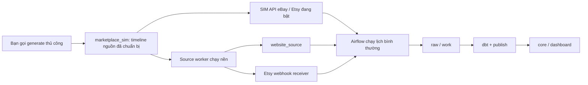

Chi tiết schema, fault matrix và giới hạn: docs/16_M08_LIVE_LOCAL.md.
Lệnh từng bước: tools/s02_data/README.md. Kết quả thực tế: docs/STATUS.md.

## Bổ sung ngày 2026-11-01: cấu hình demo ngắn

- Giữ đúng mục tiêu **một môi trường local dùng hằng ngày**, không thêm stack hay
  chuyển volume trong thay đổi này. Đề xuất thêm volume trong hội thoại trước
  không phải yêu cầu đã chốt và chưa được thực hiện.
- Đã thêm `duration_minutes`: bỏ trống `start_at` thì lấy lúc prepare; bỏ trống
  `end_at` thì lấy start cộng số phút này. Mặc định300 phút để giữ hành vi cũ;
  đặt5 hoặc6 để gen khoảng ngắn. `end_at` cụ thể luôn được ưu tiên.
- Mẫu `tools/s02_data/config/quick_6min.json` có6 phút,6 đơn mỗi nguồn,
  `delay_seconds: [15, 30]` để các bước request/cancel/partial/shipped có đủ thời gian.
  Không sửa `local_now.json`, không ghi đè dataset READY cũ, không gen hay bật
  pipeline tự động. Khoảng nguồn6 phút không cam kết pipeline xử lý xong trong6 phút.
- Đã chạy44 tests offline liên quan, S01 verify10 checks và10 utility tests,
  compileall và kiểm tra whitespace: PASS. Chưa chạy prepare vào DB hay Airflow
  runtime cho tham số mới; không gán kết quả runtime cũ cho code mới.
- Việc bật S02 trên main đang có S01 vẫn bị guard chặn; chưa giải quyết bằng cách
  xóa dữ liệu, tạo môi trường mới hoặc âm thầm bỏ guard. Cần chốt riêng cách giữ
  dữ liệu cũ khi chuyển sang demo S02 trên cùng stack.

Ngày lập/cập nhật: 2026-10-31. Ngôn ngữ tiếng Việt theo yêu cầu riêng của chủ dự án.

**Chủ dự án đã đồng ý triển khai hướng mục0 vào2026-10-31; tài liệu được giữ lại theo yêu cầu và sẽ ghi trạng thái thực hiện ở mục0.13/14.3.** Đây không phải lệnh tiếp tục M08C. Các ví dụ ID/port lịch sử không phải cấu hình cố định. Không có password trong tài liệu; chưa xóa tài liệu này.

## 0. Hiểu lại yêu cầu mới — đọc phần này trước

**Phần này ghi thiết kế đã thống nhất. Trạng thái code/test mới ở mục0.13 và14.3; không coi mọi đề xuất bên dưới tự động đã nghiệm thu. Mục1–13 giữ lại để giải trình code/DB/evidence cũ; mục14 là thứ tự thực hiện và các cổng kiểm tra.**

### 0.1 Điều bạn thực sự cần

Mình hiểu mục tiêu của bạn là xây pipeline DE nhiều nguồn, không phải xây một hệ thống simulator phức tạp. Bạn muốn:

1. DBeaver kết nối ổn định, biết rõ DB nào chứa dữ liệu; không đổi port/password mỗi lần gen.
2. Chạy generator **thủ công một lần trước khi mô phỏng** để nạp sẵn product/customer/mapping, orders và các event hợp lệ.
3. Chọn khoảng thời gian dữ liệu, ví dụ `2026-10-20 01:00:00` đến `2026-10-31 00:00:00`, kèm múi giờ rõ ràng. Business timestamps do generator tạo theo khoảng đó, không bắt buộc là ngày giờ thật lúc chạy.
4. Sau khi gen, mở DB kiểm tra trước, rồi mới chủ động chạy source playback/pipeline. Không bắt buộc chạy acceptance tự động gộp33phút để xem dữ liệu nguồn.
5. Simulator chỉ lấy dữ liệu chuẩn bị sẵn để trả qua interface nguồn/gửi webhook; không random lại khi GET, không chứa business logic warehouse.
6. Sinh liên tục cũng dùng cùng generator. Với một khoảng chạy hữu hạn, dữ liệu được chuẩn bị trước rồi lần lượt lộ ra theo thời gian, nhìn như nguồn sinh liên tục. **Không cần generator chạy random nền sau mỗi chu kỳ.** Muốn thêm khoảng khác thì bạn chủ động chuẩn bị thêm dataset, không tự âm thầm gen.
7. Giữ được chuẩn bị dữ liệu tải lớn, nhưng việc đo tải thật là bước riêng; simulator đơn giản không có nghĩa bỏ qua correctness của pipeline.
8. Có thể sửa/bỏ code cũ không còn phù hợp sau khi kiểm tra regression, thay vì chồng thêm nhiều runner khác nhau.

### 0.2 Môi trường mục tiêu: một local stack dùng hằng ngày

**Không yêu cầu hai PostgreSQL hoặc hai Airflow chạy song song. Không có bước cuối M08 chuyển dữ liệu test sang DB chính.**

Đề xuất dùng Compose local ổn định, một PostgreSQL container và một Airflow, với các database theo trách nhiệm:

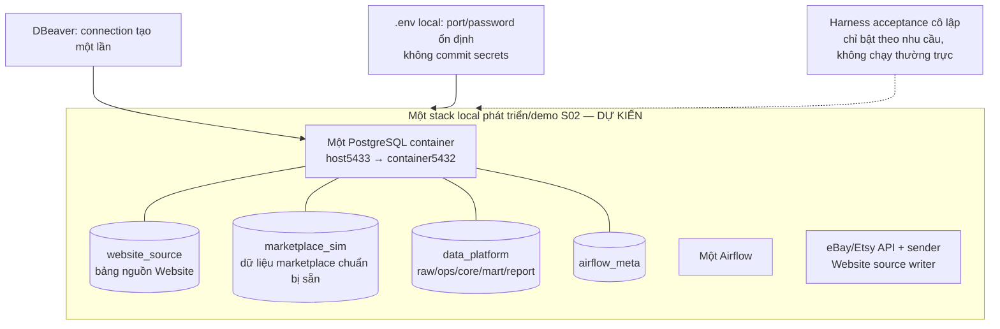

Mũi tên nét đứt của harness chỉ có nghĩa kiểm tra cùng code/config được khai báo, **không phải** cho phép harness reset local stack hay dùng DB local làm disposable target. Acceptance reset/fault/cold bootstrap vẫn cần storage test đã xác minh là disposable.

- Port/password local cấu hình qua `.env`, giữ5433 nếu tiếp tục stack hiện tại. `.env.example` chỉ giá trị mẫu; không đưa secret vào Git.
- Đổi dataset không cần đổi credential/port. Dataset ID là định danh dữ liệu, không nhất thiết là Compose project mới.
- Acceptance cô lập được giữ làm công cụ an toàn; lúc cần mới chạy. Chỉ khởi chạy song song nếu đủ tài nguyên và được chọn rõ; không mặc định tạo hai scheduler.
- Không phải “gen xong migrate data từ môi trường test qua chính”. Triển khai cùng code vào stack local rồi gen dataset tại đúng nơi đã chọn.
- Dữ liệu local hiện có không tự bị xóa. Cách chuyển từ S01 sang S02 phải kiểm kê/checkpoint/backup và thống nhất trước; không seed chồng S01/S02 hoặc reset để tiện làm.
- Việc `.env` đổi password không tự đổi password của role trong volume PG cũ; nếu cần rotation thì làm bước riêng, không xóa volume.

### 0.3 Workflow mục tiêu: tách gen, quan sát, playback và pipeline

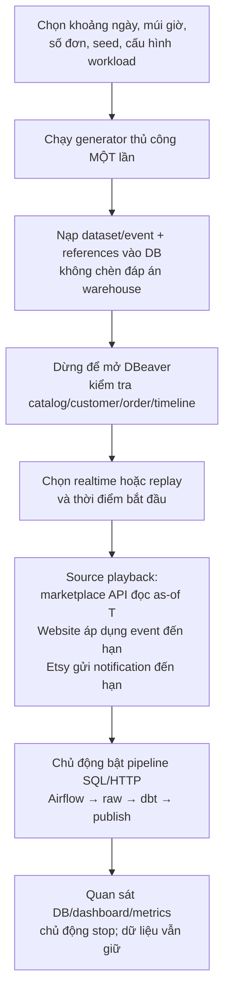

Các tên hành động dự kiến là `prepare / inspect / start / status / stop`; **chưa phải command CLI đã có để copy chạy**. Chuẩn bị phải nạp DB, không chỉ ghi một file JSON rồi báo đã xong. File manifest/checksum có thể giữ để tái lập, nhưng không được bắt bạn đọc file mới biết nguồn đã được nạp chưa.

Một generator dùng cho correctness nhỏ và bộ tải lớn: khác workload config/count, không có engine random riêng trong simulator. Không tự nhân bản full stack sau mỗi lần chuẩn bị.

### 0.4 Khoảng ngày và event được hiểu như thế nào?

Ví dụ cấu hình **minh họa dự kiến, chưa phải file/CLI hiện có**:

```yaml
dataset: local-s02-demo
order_seed: 17
event_seed: 91
start_at: "2026-10-20T01:00:00+07:00"
end_at: "2026-10-31T00:00:00+07:00"
orders_per_channel: 1000
```

- Đề xuất dùng khoảng `[start_at,end_at)`: gồm đầu, không gồm cuối; parse ISO8601 có offset, lưu UTC trong DB.
- Sinh created time của đơn trong khoảng đó, rồi sinh event theo lifecycle hợp lệ và thứ tự thời gian. Đây là business time được mô phỏng, không phải giả mạo giờ ghi log vận hành.
- Đề xuất mặc định các event cũng nằm trong khoảng. Đơn không đủ thời gian đi đến bước cuối thì giữ pending; không nhét các bước sai thứ tự hoặc ép hoàn thành sát cuối.
- Không giữ bắt buộc quy tắc cũ “đơn đầu created trước7ngày” cho mọi workload mới; chỉ có initial backlog nếu workload chọn rõ. Sentinel phục vụ acceptance có thể là profile nhỏ riêng, không áp đặt cho bộ demo/load thông thường.
- Các tỷ lệ/độ trễ/line/quantity nên ở một cấu hình workload nhỏ có validate; không tạo quá nhiều cờ riêng lẻ, không bắt bạn chỉnh code.
- Product/customer vẫn synthetic; giữ catalog30/customer100 hiện có làm default nếu bạn chưa cần số khác. Không bịa thêm field marketplace ngoài contract.

### 0.5 Đồng hồ mô phỏng: chỉ hai chế độ đơn giản trước

| Chế độ dự kiến | T dùng để nhìn nguồn và chọn cửa sổ dữ liệu |
| --- | --- |
| `realtime` | T bằng UTC thực hiện tại |
| `replay` | T bằng thời điểm bạn chọn cộng thời gian thực đã trôi qua kể từ lúc start; tốc độ1× |

Ví dụ replay: máy đang31/10 nhưng bạn chọn T0=`20/10 01:00+07:00`; sau10phút thật, T=`20/10 01:10+07:00`. Không cần đổi clock Windows/Docker/PostgreSQL server. Realtime với dataset đã hoàn toàn ở quá khứ sẽ thấy final state, không tự phát lại các bước cũ như thể còn tương lai.

**Phải có một quy ước T nhất quán cho API marketplace, Website due events, Etsy notification schedule và cửa sổ polling/recovery.** Airflow vẫn được scheduler thật trigger; không giả Airflow execution clock. Source-cycle upper bound phải lấy từ T đã chốt cho cycle thay vì lấy wall-clock interval_end không cùng timeline.

Timeout, retry, lease, heartbeat, started/finished log, observation/acquisition time và webhook signing freshness dùng giờ thực. Dữ liệu `created_at/source_updated_at` dùng business time. Không đánh tráo hai loại clock để làm đẹp latency chart; metric phải được đặt tên/phân biệt đúng.

Vòng đầu không làm fast-forward/tốc độ tùy ý/clock pause controller. Chọn lại mốc replay lùi về trước trong khi còn checkpoint/raw cũ **không được tự coi là chạy mới**; phải từ chối hoặc có dataset/reset scope được phê duyệt, không quay ngược checkpoint âm thầm. Replay recovery/pause-resume rộng vẫn thuộc M08C.

### 0.6 Simulator giữ đơn giản ở mức nào?

| Nguồn | Dự kiến giữ/làm | Không làm thêm |
| --- | --- | --- |
| eBay | Đọc source versions đã nạp từ `marketplace_sim` tại T, ghép JSON list/detail/shipping như contract | Không dựng DB e-commerce đầy đủ, không random lúc GET, collector không đọc backing DB |
| Etsy | API đọc as-of T; sender riêng đọc notification đến hạn và ký bằng giờ thật | Không đưa webhook receiver vào DAG, không phát đáp án warehouse qua webhook |
| Website | Giữ bảng nghiệp vụ và writer transaction; áp dụng event chuẩn bị sẵn tại T; collector SQL read-only | Không đổi interface Website sang event feed hoặc temporal view âm thầm |

Đề xuất tái sử dụng5bảng PG temporal đang có, không tách thêm hàng loạt bảng payment/shipment nếu chỉ phục vụ gen. Tuy nhiên cần chốt nơi lưu timeline Website và references để thao tác `prepare` nạp đủ kế hoạch vào DB và sau đó không phụ thuộc file-only. **Tên bảng/field/constraint bổ sung chưa chốt**, sẽ hoàn thiện trước migration; sơ đồ mục7–8 vẫn chỉ mô tả schema hiện có.

Code RAM/two-wave cũ chỉ gỡ khi đã kiểm kê caller/tests và có đường thay thế. Không tiếp tục đưa hai backend khác nhau vào hướng dẫn hằng ngày. Không xóa fixtures S01, evidence hoặc volume giữ lại để “dọn cho đơn giản”.

### 0.7 Định hướng đã thống nhất và ranh giới không tự vượt qua

1. Một stack local ổn định để dev/demo; acceptance cô lập chỉ theo nhu cầu, không chạy song song mặc định.
2. `.env` cho connection/secrets local, một workload config cho generation và replay; không đổi DBeaver theo dataset.
3. Gen thủ công một lần theo khoảng `[start,end)`, default event không vượt end; đơn cuối kỳ có thể pending.
4. Realtime hoặc replay1×, một logical business clock nhất quán, operational/security clocks vẫn thực.
5. Giữ JSONB temporal marketplace và Website writer để giảm scope; có thể thêm storage tối thiểu cho Website plan thay vì full simulator redesign.
6. Bổ sung config/lifecycle/case coverage theo từng channel như mục0.8–0.12; không hứa “đủ mọi lỗi” bằng random. Nhánh nằm ngoài contract phải ghi unsupported/proposed, không âm thầm bịa field/state mới.
7. Không reset hay trộn dữ liệu S01 hiện có khi chuyển local stack sang S02; phương án giữ lại dữ liệu phải được xác nhận trước thao tác có tác động.

### 0.8 Bổ sung theo yêu cầu: config riêng từng channel và giờ cao điểm

**Hợp lý, không dư thừa nếu giữ gọn.** Đặc tính nguồn khác nhau nên số đơn, giờ mua hàng, basket và nhịp lifecycle có thể khác. Không cần xây engine mô phỏng hành vi người dùng hay tự học phân phối.

Đề xuất một file workload chung, có defaults và ba block `internal_web / ebay_sim / etsy_sim`. Mỗi channel override độc lập:

- Tổng số **đơn mới**, khoảng ngày (mặc định kế thừa khoảng chung), múi giờ.
- Một vài khung giờ cao điểm và hệ số trọng số; ngoài peak mặc định weight1.
- Khoảng số line/quantity, phân phối chọn product/customer nếu cần.
- Tỷ lệ nhánh lifecycle hợp lệ, khoảng delay từng bước.
- Case bắt buộc theo số lượng và lỗi có chủ đích; không chỉ tỷ lệ xác suất.

Ví dụ **thiết kế minh họa, chưa phải config có thể chạy**; tên folder/field sẽ chốt trước implement:

```yaml
dataset: local-s02-demo
timezone: Asia/Bangkok
start_at: "2026-10-20T01:00:00+07:00"
end_at: "2026-10-31T00:00:00+07:00"
order_seed: 17
event_seed: 91
profile: normal
channels:
  internal_web:
    orders: 1000
    peak_hours:
      - {start: "19:00", end: "22:00", weight: 3}
    basket: {lines_min: 1, lines_max: 8, quantity_min: 1, quantity_max: 5}
  ebay_sim:
    orders: 600
    peak_hours:
      - {start: "09:00", end: "12:00", weight: 2}
    basket: {lines_min: 1, lines_max: 4, quantity_min: 1, quantity_max: 3}
  etsy_sim:
    orders: 400
    peak_hours:
      - {start: "20:00", end: "23:00", weight: 4}
    basket: {lines_min: 1, lines_max: 3, quantity_min: 1, quantity_max: 2}
```

Weight3 có nghĩa **mật độ đơn mỗi đơn vị thời gian** gấp3 lần bình thường, không có nghĩa chính xác75% tổng đơn trong peak hay số đơn tăng gấp3. Tổng đơn mỗi channel vẫn đúng số `orders` đã chọn. Cùng múi giờ chỉ là default, không ép traffic các kênh giống nhau. Khung qua nửa đêm được tách thành hai đoạn; khung overlap bị từ chối để tránh double-count; weight phải hữu hạn và>0.

Giờ cao điểm mặc định điều khiển **created time của đơn**, không ép mọi shipment/cancel xảy ra cùng khung mua hàng. Event delay sinh từ lifecycle sau đó; nếu sau này muốn mô phỏng ca xử lý vận hành thì thêm một setting rõ ràng, không tự gộp hai khái niệm.

### 0.9 Seed không phải order hoặc event — tách số lượng và random stream

Trong thuật toán random, **seed là số khởi tạo để tái lập kết quả, không phải một đơn hàng, số đơn hay event**. Mình hiểu ý bạn là cấu hình khối lượng theo **số đơn**, còn số event được sinh từ quá trình sống của những đơn đó.

Thiết kế dễ hiểu hơn:

| Tham số dự kiến | Ý nghĩa |
| --- | --- |
| `channels.<source>.orders` | Số đơn mới chính xác;1000 nghĩa1000đơn, không phải1000event |
| `order_seed` | Tái lập chọn created time, buyer, product, basket, giá từ catalog và identity theo namespace dataset |
| `event_seed` | Tái lập lựa chọn nhánh/delay/shipment allocation/notification; thay event_seed để giữ đơn nhưng có timeline khác hợp lệ |

Nếu bạn không nhập seed, **lệnh prepare thủ công** chọn seed rồi lưu vào manifest/DB để lần lỗi có thể replay. Không chọn seed mới mỗi lần API GET hoặc mỗi lần start playback.

Mình hiểu “event thì tự random” là **generator tự chọn event theo rule khi prepare**, không phải bạn phải liệt kê event bằng tay và cũng không phải runtime mới random. Đây là điểm cần bạn kiểm tra xem đúng ý chưa.

Một đơn có thể có1,2,3hoặc nhiều event tùy nhánh; tổng event là **đầu ra thống kê**, không phải lấy orders làm event count. Lệnh inspect sẽ hiển thị riêng orders, source versions, planned notifications và planned fault cases.

Để đổi số đơn eBay không làm xáo đơn Website, đề xuất stream tách theo `(seed,channel,order_index,purpose)` bằng hash ổn định (không dùng Python `hash()` phụ thuộc process). Order stream và event stream tách nhau. Tái lập cần cùng config/catalog/code version/dataset namespace, không chỉ cùng seed.

### 0.10 Thuật toán random dự kiến: sinh theo state machine, không chọn status độc lập

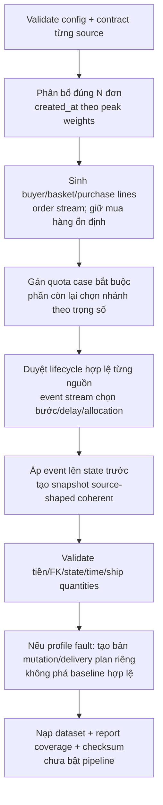

**Bước A — chọn created time có peak mà không materialize mỗi giây:**

1. Chia khoảng ngày mỗi channel thành các đoạn giờ địa phương normal/peak, cắt theo `[start,end)` rồi chuyển UTC đúng múi giờ.
2. Mỗi đoạn có trọng lượng `duration × weight`. Với từng đơn, lấy mẫu đoạn theo trọng lượng tích lũy, rồi chọn timestamp trong đoạn. Tổng vẫn đúng N; timestamp có thể trùng giữa hai đơn khác nhau.
3. Với workload nhỏ, tỷ lệ quan sát có thể dao động. Test kiểm tra xác định với seed và phân phối trên sample đủ lớn/tolerance khai báo, không ép mọi case nhỏ ra đúng tỷ lệ kỳ vọng.

**Bước B — sinh đơn trước:** chọn customer/product/line/quantity trong range hợp lệ; tính tổng bằng cents/Decimal theo currency; stable ID trong dataset. Giá và purchased quantity không random lại mỗi event. Các source IDs khác nhau vẫn map về cùng catalog như contract; không merge order/customer xuyên nguồn.

**Bước C — gán nhánh có kiểm soát:** một bảng rule nhỏ mỗi nguồn, không một framework workflow tổng quát. Chọn nhánh từ nhánh được source contract hỗ trợ; giữ payment, fulfillment, cancellation độc lập nhưng áp các điều kiện ràng buộc trước khi đi tiếp. Không chọn ngẫu nhiên một bộ ba status rồi cố sửa cho hợp lệ.

- Website: có thể giữ paid/not-started, request→approve cancel hoặc paid→shipment nếu nhánh đó đã được adapter/contract chứng minh; không cho cancel rồi tùy tiện ship tiếp. Cần code generator hỗ trợ shipping nếu chọn case này, không ghi đã có sẵn.
- eBay: chưa giao→giao một phần→giao hết với allocation đúng line/quantity. Partial chỉ khi có thể giao một phần thật; đơn1line quantity>1 có thể về mặt nghiệp vụ chia quantity, nhưng chỉ thêm khi contract/adapter và tests hiện có hỗ trợ, không tự đổi rule cũ một cách ngầm định.
- Etsy: paid/unshipped→shipped hiện đã hỗ trợ; paid/shipped notification là delivery plan riêng. Không tự phát refund/cancel nếu source subset hiện tại chưa cung cấp đủ bằng chứng.

**Bước D — tạo event theo quan hệ nhân quả:** `next_time = previous_time + sampled_delay`, delay>0 theo config. Không random timestamp độc lập rồi sort để che quan hệ sai. Một bước không còn nằm trong `[start,end)` thì dừng nhánh, giữ trạng thái hiện tại; không clamp các event vào cùng end-time. Event shipment phải có shipment/line allocation tương ứng, request approval phải có request trước đó.

Mỗi event áp lên state trước để dựng snapshot đầy đủ: parent updated time tăng, collection chỉ gồm dữ liệu đã có hiệu lực, shipment trước giữ nguyên trong collection tích lũy, tiền và purchase identity nhất quán. Tổng số lượng đã ship không vượt ordered; không có event delivery/refund thiếu bằng chứng. Dataset validator kiểm tra trước seal/load.

**Bước E — coverage thay vì hy vọng random đủ:** reserve trước những đơn/cấu hình cần cho case bắt buộc (ví dụ multiline để partial shipping, đủ khoảng thời gian cho request→approve). Phần còn lại mới random theo branch weights. Nếu N/quãng thời gian/range basket không đủ cho mandatory cases thì báo rõ config không đáp ứng; không im lặng bỏ case hoặc tạo flow sai. Một số case có thể cùng một đơn, nhưng không ép các nhánh loại trừ nhau vào cùng đơn.

**Bước F — kiểm soát tài nguyên:** generate theo đơn/chunk và nạp staging dataset, chỉ đánh dấu ready sau khi tất cả nguồn được validate/load; cross-database không giả vờ có một transaction nguyên tử chung. Case chưa ready không được playback. Không cần giữ tất cả đơn/event của bộ tải lớn trong RAM; index as-of và batch insert dùng cấu trúc hiện có ở mức tối thiểu. Cách staging/ready/cleanup phải chốt field/constraint trước DDL và không tự xóa dataset cũ khi lỗi.

### 0.11 “Đầy đủ case, gây lỗi” phải có ma trận rõ, không random phá mọi thứ

Mình ghi nhận yêu cầu phải bao phủ cả bình thường, edge và lỗi có chủ đích. **Không thể hứa mọi lỗi đều sinh được chỉ bằng data generator**, và không thể cam kết mọi source có cùng lifecycle khi contract khác nhau.

Đề xuất ba profile, dùng cùng code prepare thủ công:

| Profile dự kiến | Nội dung | Mặc định |
| --- | --- | --- |
| `normal` | Dữ liệu hợp lệ, lifecycle đa dạng, peak khác nhau, pending và progressed | Không cố ý làm pipeline lỗi |
| `coverage` | Dữ liệu hợp lệ + quota case bắt buộc/boundary/replay scenarios | Có coverage report, không dựa vào xác suất có trúng |
| `faults` | Gắn lỗi nguồn/payload/delivery/runtime plan có tên, scope, kết quả mong đợi và cách phục hồi | Opt-in; không tự inject khi chạy normal/load |

Ma trận dự kiến phải phân loại tối thiểu:

| Nhóm | Case cần có trong danh mục | Thực hiện ở đâu? |
| --- | --- | --- |
| Dữ liệu bình thường | Pending, completed trong phạm vi source, cancellation hợp lệ, partial/full allocation, nhiều line/customer/product | Generator/state machine; unsupported branch ghi rõ thay vì bịa |
| Boundary | Start/end, không đổi qua nhiều polling, old backlog khi chọn rõ, empty window, nhiều trang, trùng timestamp giữa các đơn | Generator + API/window checks |
| Dedupe/delivery | Duplicate notification cùng ID, event IDs khác cùng receipt, bỏ webhook, notification đến muộn/out-of-order | Prepared delivery schedule; source version chronology vẫn đúng |
| Data quality | Missing mapping, invalid money/quantity, field thiếu hoặc kiểu sai | Fault overlay trên payload/mapping riêng; chỉ field/endpoint được phép; validation expected-failure/quarantine rõ |
| API/security |429/500/timeout/malformed response, signature sai/stale, origin không hợp lệ | Thin test fault hooks/sender fixture; không thể chỉ insert một order là gây timeout thật |
| Recovery | Restart/crash/pause/resume, interrupted work/dbt/publish/lease, retry exhaustion | Operator/harness steps của M08C; không đặt random kill process trong generator |

Fault payload phải tách khỏi dữ liệu chuẩn để không làm sai baseline và không phá constraints của Website bằng cách bypass DB validation. Ví dụ Website quantity0 bị CHECK từ chối thì case kiểm tra rejection ở writer; không giả đã nạp thành công để mong collector đọc nó. Malformed HTTP là lỗi ở API response hook, không buộc backing store lưu dữ liệu mất cấu trúc.

Mỗi case có `case_id`, channel/target, điều kiện kích hoạt, loại lỗi, outcome/recovery mong đợi. Chi tiết vật lý chưa chốt, không thêm table bừa bãi. Fault schedule được chuẩn bị trước; kích hoạt theo request/attempt hoặc thời điểm playback đã định, **không random tại runtime**. Retry logic vẫn dùng thời gian thật. Server chỉ có hook tối thiểu phục vụ các case đã chọn, không phát triển thành fault engine tổng quát.

Prepare tạo **coverage manifest**: case nào required, được gán cho order nào, planned count, supported/unsupported và lý do. Khi test chạy mới ghi observed result. `planned` không có nghĩa `PASS`. Lỗi retryable mong đợi tự recover; malformed/unmapped có thể phải quarantine/giữ last-good và phục hồi có thao tác riêng, không mặc định mọi case kết thúc pipeline xanh.

M08B chuẩn bị data/case plan và các hook tối thiểu cần thiết; chạy đủ fault/recovery matrix vẫn là cổng M08C, load/soak là M08D. Không bỏ yêu cầu lỗi, nhưng không âm thầm làm tất cả C/D trong một lần sửa generator.

### 0.12 Code và config chung một folder, chỉ generate bằng lệnh manual

Cấu trúc code đã tạo trong lượt triển khai; dùng JSON thay YAML để Python stdlib đọc được, không cần cài thư viện trên host:

```text
tools/s02_data/
  README.md                 một hướng dẫn gen/inspect
  __main__.py               entry point manual
  config/
    demo.json               ba block channel + giờ cao điểm
    coverage.json           case quota nhỏ
    load.json               khối lượng lớn, không tự bật faults
    faults.json             omitted/duplicate notification opt-in
  references.py             catalog/customer/payload helper dùng chung
  config.py                 validation + weighted-time sampling
  generate.py               order-first + lifecycle causal
  load.py                   DB loading và invariant checks
  playback.py               activation + source-only tick/stop/resume
```

Đây là một folder sở hữu config và generator; catalog input gốc vẫn ở `fixtures/s02/catalog.json` để không tạo hai bản catalog lệch nhau. Cùng config có block source riêng, không nhân bản ba engine. Secrets lấy từ `.env` local, không chép vào workload JSON. Compatibility import `test_support/s02_diverse.py` trỏ về implementation duy nhất `references.py`; chưa xóa runner RAM hay evidence cũ.

CLI đã có (mức kiểm chứng thực tế xem mục0.13; đây không phải chỉ dẫn reset dữ liệu hiện có):

```text
python -m tools.s02_data prepare --config tools/s02_data/config/demo.json
python -m tools.s02_data inspect --dataset local-s02-demo
```

Không thêm cron/DAG/Docker entrypoint tự gen, không chạy gen khi API GET, không tự gen lại khi restart container. **Auto playback dữ liệu đã có** vẫn cần để nhìn thấy liên tục, nhưng khác hoàn toàn **auto generation**; Airflow chỉ orchestrate pipeline, không chạy generator. Không nạp đè dataset hiện có; operator chọn dataset mới hoặc explicit replacement có scope/approval.

Các helper cũ trong `test_support/` sẽ được consolidate/reuse vào folder này sau kiểm kê imports/tests, không vừa copy vừa giữ hai generator không đồng nhất. Harness và assertion tests vẫn có thể ở thư mục test riêng; chúng gọi generator cùng nguồn, không để test truth nhập vào pipeline.

### 0.13 Trạng thái triển khai mới — không gộp với PASS cũ

**M08B đã hoàn tất nghiệm thu kỹ thuật local, chờ chủ dự án review.** Realtime/default-date case `167c0411490a` PASS468steps/28scheduled runs;18đơn,87line,256units,USD5182,history39 có raw evidence. Airflow chính đã khôi phục HEALTHY đúng container cũ; protected hash/pause state/PG identity trước–sau khớp. Lượt trước `4b082af2312e` bị abort vì runner bật polling trước khi nạp nguồn; đã sửa warmup và chạy lại ID mới, không lùi watermark hay bù warehouse. Chi tiết mới nhất ở14.4. Không chuyển main sang S02, không reset PostgreSQL, không sửa config cá nhân/local_now.json; chưa làm M08C.

**Bổ sung config theo yêu cầu mới:** bỏ/null/chuỗi rỗng `start_at` toàn cục thì lấy giờ hiện tại lúc manual prepare; `end_at` tương tự thì lấy start đã chọn +5giờ. Mốc giờ được chốt/lưu, không đổi theo mỗi lần GET/playback. Ngày nhập rõ vẫn ưu tiên; file mẫu cũ không bị sửa. Channel bỏ ngày thì kế thừa từng ngày global. Tham số đầy đủ ở [CONFIG.md](../tools/s02_data/CONFIG.md), gồm required theo số đơn riêng cho từng nhánh (không phải số event). Sau checkpoint73unit tests đã chạy thêm runtime realtime với PG/Airflow thật ở14.4; tổng hồi quy cuối78tests PASS. Không lấy evidence replay cũ thay cho option mới.

**Lượt mới sau khi chủ dự án cho phép maintenance: PASS.** Scheduled replay case cô lập `31cf3196a802` đã hoàn tất. Chỉ Airflow chính `bb4bb1194e57` được tạm dừng sau kiểm tra idle/healthy và đã khôi phục HEALTHY đúng container cũ; PostgreSQL, chữ ký dữ liệu main, pause state của7DAG và system identity không đổi. Kết quả chi tiết ở14.3; không suy rộng thành realtime/load hay chuyển main sang S02.

Contract/schema được chốt trước migration ở [15_S02_LOCAL_WORKFLOW.md](15_S02_LOCAL_WORKFLOW.md). Hướng dẫn mới ở [tools/s02_data/README.md](../tools/s02_data/README.md).

| Hạng mục | Trạng thái hiện tại |
| --- | --- |
| Config/code chung folder, manual CLI | Đã tạo tools/s02_data; không có DAG/entrypoint tự gen |
| Theo channel/peak/order_seed/event_seed/quota | Đã code;16 unit test local generator/parser/activation guard PASS, runtime default-date READY/5h/counts PASS |
| Clock client chỉ HTTP, default S01 không gọi clock | Đã code;3 unit test clock PASS |
| Schema kế hoạch Website/references/playback | Migration002 tạo3bảng mới và view clock; probe PG/HTTP PASS trên case cô lập |
| Prepare | Hai lượt streaming generate/validate rồi nạp theo chunk; READY sau source/mapping/ref load; LOADING giữ lại nếu lỗi |
| Source references | Code nạp100customer/30product/30variant Website ngay prepare; không nạp trước future final orders |
| Stable local stack | Overlay giữ port5433 và credentials.env; Compose config check PASS, không thêm stack mặc định |
| Data-flow runtime | CLI/replay giữ evidence riêng. Realtime167c0411490a PASS468steps/28runs;18đơn/87line/256units/USD5182, history39 có raw evidence; reread không nhân đôi business/history |
| Faults | Đã code omitted/duplicate Etsy; API/security/crash/malformed/missing-mapping chưa có injection mới, manifest ghi excluded rõ |
| Chuyển main S01 sang S02 | Chưa thực hiện. Start từ chối nguồn/warehouse/checkpoint không rỗng; cần quyết định giữ dữ liệu riêng trước khi chuyển |
| Evidence cũ | Giữ nguyên; case4c1d2b1719eb không được dùng làm bằng chứng đường logical-clock mới |

DDL mới (sơ đồ logic khóa chính, schema cũ mục7 không bị giả vờ thay bằng bảng khác):

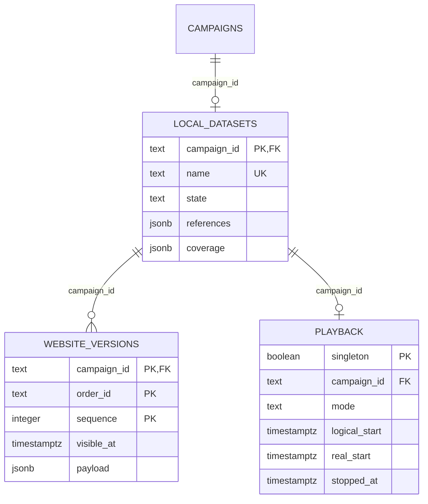

PLAYBACK chỉ có tối đa1row toàn stack (singleton=true); mỗi dataset có thể chưa được activate. View `s02.playback_clock` tính T; source reader chỉ được đọc metadata cần thiết, không Website plans/references. Chi tiết constraints/index/immutability trong DDL002. Không có cross-database FK/transaction chung; READY là cổng phục vụ sau tất cả bước load.

## Mục lục và cách đọc

0. [Hướng dự định sửa — đọc trước](#0-hiểu-lại-yêu-cầu-mới--đọc-phần-này-trước)
1. [Kết luận và những điểm chưa ổn](#1-kết-luận-và-những-điểm-chưa-ổn)
2. [Toàn bộ phạm vi M08](#2-toàn-bộ-phạm-vi-m08)
3. [Môi trường, port và nơi lưu dữ liệu](#3-môi-trường-port-và-nơi-lưu-dữ-liệu)
4. [Ba phiên bản mô phỏng cùng tồn tại](#4-ba-phiên-bản-mô-phỏng-cùng-tồn-tại)
5. [Product, customer và mapping](#5-product-customer-và-mapping)
6. [Thuật toán sinh đơn và lifecycle](#6-thuật-toán-sinh-đơn-và-lifecycle)
7. [Schema vật lý marketplace_sim: đầy đủ phần M08 mới](#7-schema-vật-lý-marketplace_sim-đầy-đủ-phần-m08-mới)
8. [Schema Website: đủ chín bảng nghiệp vụ](#8-schema-website-đủ-chín-bảng-nghiệp-vụ)
9. [Data platform: M08 sử dụng gì, không tạo gì](#9-data-platform-m08-sử-dụng-gì-không-tạo-gì)
10. [Luồng thực thi và cấu hình](#10-luồng-thực-thi-và-cấu-hình)
11. [Bằng chứng đã chạy, lỗi đã sửa và giới hạn](#11-bằng-chứng-đã-chạy-lỗi-đã-sửa-và-giới-hạn)
12. [Cách kiểm tra không chạy lại acceptance](#12-cách-kiểm-tra-không-chạy-lại-acceptance)
13. [Danh sách code/doc thay đổi và thứ tự review](#13-danh-sách-codedoc-thay-đổi-và-thứ-tự-review)
14. [Dự định làm tiếp và tiêu chí bàn giao](#14-dự-định-làm-tiếp-và-tiêu-chí-bàn-giao)

## 1. Kết luận và những điểm chưa ổn

Mình đã làm **harness môi trường test cô lập (M08A)** và **generator + kiểm tra pipeline liên tục (M08B)**. Sau các vòng trao đổi, M08B có thêm catalog đa dạng và backend PostgreSQL temporal cho eBay/Etsy. M08C/D chưa triển khai thành chiến dịch nghiệm thu.

Những điều đã có:

- Sinh đơn có nhiều dòng/số lượng, customer tổng hợp, 30 sản phẩm và mapping ba nguồn.
- Chuẩn bị trước dữ liệu và các thời điểm đổi trạng thái. Marketplace lưu trong PostgreSQL, API đọc trạng thái có hiệu lực theo thời gian.
- Website vẫn dùng writer áp dụng thay đổi đến hạn vào bảng nguồn thật; collector chỉ đọc.
- Chạy qua HTTP/SQL nguồn, raw audit, dbt, publication và Airflow thật; không chèn đáp án vào warehouse.
- Có bằng chứng local cho bootstrap, continuous correctness, recovery webhook bị bỏ và replay/dedupe trong phạm vi nhỏ.

Những điểm mình đã làm chưa tốt hoặc chưa hoàn thiện:

1. Hướng dẫn trước tập trung vào PASS/FAIL pipeline, không đưa ngay bản đồ DB/schema/port cho chủ dự án.
2. Có cả RAM cũ và PostgreSQL mới; một số docstring/đoạn doc còn giọng điệu checkpoint cũ, dễ tưởng phần mới chưa tích hợp.
3. Mỗi case có port/credential riêng và tự teardown: phù hợp automation nhưng bất tiện cho DBeaver và review thủ công.
4. Chưa có chế độ S02 dev/review cố định, chủ động prepare/start/inspect/stop với port cấu hình ổn định. Đây mới là đề xuất, **chưa code**.
5. Nhiều quy tắc generator còn hardcode, không phải tất cả đều chỉnh được qua `.env`.
6. Schema marketplace hiện là base/header/collection JSONB, **không phải** các bảng nghiệp vụ riêng `payments`, `shipments`, `status_table` như một lựa chọn bạn từng nêu.
7. Chưa có bộ lifecycle phong phú cho mọi nghiệp vụ: Website hiện thiên về hủy, marketplace thiên về shipment; không sinh tùy ý refund/delivered hay unpaid→paid.
8. “Prepare một ngày” đã có, nhưng **không đồng nghĩa** có driver load/soak chạy trọn ngày đã được kiểm chứng.
9. Đã có code/DB-backed source, nhưng nhận định “trải nghiệm local đã hoàn chỉnh, dễ tự review” là chưa đúng. PASS nhỏ không thay cho sự đồng thuận của bạn về workflow.

Lượt làm tài liệu này chỉ đọc code/evidence và Docker trạng thái. Không sửa code runtime, không bật/tắt container, không nạp/reset DB, không stage/commit/push.

## 2. Toàn bộ phạm vi M08

| Phần | Mục tiêu | Hiện trạng và ranh giới |
| --- | --- | --- |
| M08A | Tạo môi trường cô lập, guard an toàn, cold bootstrap và chạy lại S01 | Đã có local acceptance; mỗi ID có Compose project/volume/network/runtime/port/password riêng |
| M08B RAM ban đầu | Sinh một lượng nhỏ đơn theo hai wave, tự chạy lịch và đối soát | Đã chạy local; giữ lại để regression, không phải backend PostgreSQL mới |
| M08B diversity | 30 sản phẩm, 100 customer, nhiều line/quantity, mapping độc lập | Đã tích hợp vào temporal runner; không tự bật khi chạy Compose chính |
| M08B temporal | Chuẩn bị phiên bản marketplace trước, đọc as-of qua API, Website writer, signed webhook | Đã có storage/CLI/scheduled/replay evidence riêng |
| M08C | Fault/restart/pause/resume/recovery matrix | Chưa làm toàn bộ; không được suy ra PASS từ một vài probe B |
| M08D | Load/burst/soak, resource/backlog/latency và stabilization | Chưa đo capacity; giới hạn tham số nhập không phải tải được chứng nhận |
| M09 | Đóng gói portfolio/reproducibility | Sau M08D, chưa làm |

M08 không thay thế dbt/Airflow. Python sinh/acquire/điều phối; dbt vẫn sở hữu business SQL; Airflow chạy các command dùng lại được.

## 3. Môi trường, port và nơi lưu dữ liệu

### 3.1 Hai PostgreSQL khác nhau, không phải chỉ hai database

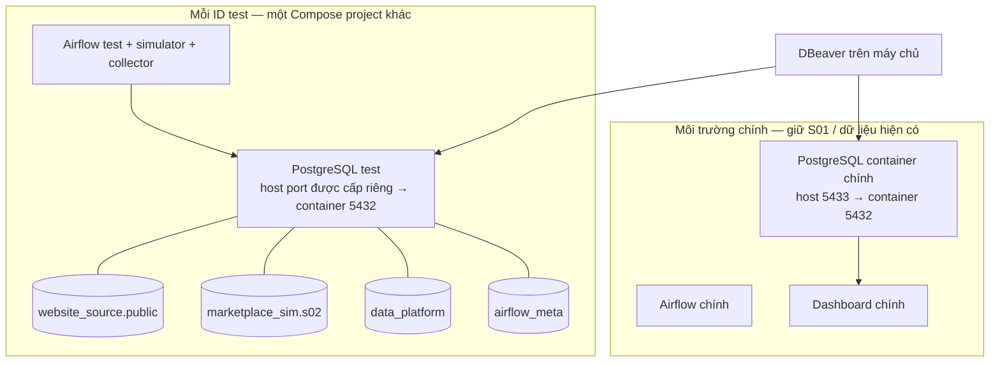

- `5432` trong container/network vẫn đúng; DBeaver dùng **host port**.
- `.env` chính cấu hình Compose chính. Harness tạo `test.env` + `compose.json` riêng cho từng case; không dùng password/host port chính để nối DB test.
- Tên DB giống nhau ở hai PostgreSQL không có nghĩa dữ liệu giống nhau.
- Schema `marketplace_sim.s02` chỉ được migration opt-in của temporal runner tạo; không tự thêm vào bootstrap chính.
- Mỗi ID mới tạo volume mới. Một ID giữ volume khi container teardown; không tự xóa dữ liệu.
- Thư mục có tiền tố `m08a-` vẫn được dùng cho B vì B tái sử dụng harness A. Tiền tố không có nghĩa case đó đang chạy S01.

### 3.2 Ảnh chụp local khi lập tài liệu

Docker read-only lúc lập tài liệu cho thấy:

| Project / ID | PostgreSQL host port | Trạng thái quan sát |
| --- | --- | --- |
| Chính `multi-channel-order-platform` | 5433 | PostgreSQL healthy; Airflow chính đang dừng trong lúc case test mới chạy |
| Test `e00cdf2177e8` | 62972 | PostgreSQL/Airflow/simulator/receiver test đang healthy |
| Test cũ `4c1d2b1719eb` | 60519 trong model cũ | Không có container case này đang chạy; volume/evidence trước đó được giữ |

Port 60519 không phải port thay thế 5433 của môi trường chính. Ở lần kiểm tra trước, case cũ đã teardown; **không có bằng chứng kết luận lỗi đó là do xung đột port**. Không mặc định các port snapshot còn chạy khi bạn đọc tài liệu sau này.

Mình không khởi động lại Airflow chính trong lúc bạn đang chạy test mới. Wrapper của lần test có trách nhiệm khôi phục sau teardown; ảnh chụp “đang dừng” không phải kết luận restoration đã lỗi hoặc đã hoàn tất.

### 3.3 File local của một case

```text
runtime/isolated/m08a-<test-id>/
  identity.json                marker/hash/identity do harness quản lý
  compose.json                 model riêng; có secrets, không chia sẻ toàn bộ
  test.env                     environment riêng; không commit
  binds/                       logs/state/dbt artifacts riêng
  evidence/
    prepared-source.json       kế hoạch nguồn, references và events của 3 nguồn
    prepared-source.sha256     checksum kế hoạch
    s02-ledger.jsonl            audit driver thực sự áp dụng/gửi gì
    result.json                acceptance pipeline
    temporal-result.json       probe storage nếu chạy chế độ storage
    *.log                      từng command đã chạy

runtime/isolated/window-<uuid>/owner-window.json
  snapshot + kết quả bảo vệ/khôi phục Airflow chính của maintenance wrapper
```

`prepared-source.json` là đầu vào simulator/test driver, không phải warehouse expected output. Pipeline không đọc file này. `s02-ledger.jsonl` không được dùng làm source interface của collector.

## 4. Ba phiên bản mô phỏng cùng tồn tại

| Chế độ | Store marketplace | Command/đường dùng | Vai trò |
| --- | --- | --- | --- |
| S01 mặc định | Source-state fixtures cố định | Compose chính và M08A baseline | Bảo toàn golden behavior đã duyệt |
| `SIMULATOR_MODE=s02` | Dictionary RAM | `test_support.m08b`; `simulator/s02_store.py` | B v1 cũ: nhỏ, hai wave; không có persistence marketplace qua restart |
| `SIMULATOR_MODE=s02-pg` | PostgreSQL `marketplace_sim.s02` | `test_support.m08b_temporal`; `simulator/s02_temporal.py` | B temporal mới: chuẩn bị trước, seal, API chọn phiên bản đến hạn |

`simulator/s02_temporal.py:make_store()` chọn backend. Backend PG không nhận runtime `/s02/upsert` như RAM. Marketplace collector vẫn chỉ gọi HTTP, không được đọc backing DB.

Docstring đầu `s02_diverse.py` còn ghi “NOT wired into runtime acceptance”: đây là mô tả cũ, không đúng với temporal runner hiện đã gọi helper này qua `s02_plan.py`. Không sửa code trong lượt giải trình này; ghi nhận để bạn không bị đánh lừa bởi comment cũ.

## 5. Product, customer và mapping

### 5.1 Sinh gì, ở đâu?

| Dữ liệu | Cách sinh | Nơi nạp |
| --- | --- | --- |
| 30 sản phẩm | `fixtures/s02/catalog.json`: số thứ tự, tên, category, giá cents, USD | Website `products` và `product_variants`; marketplace giữ thông tin cần thiết trong source payload |
| 100 customer | `references()` tạo `S02-C001..100`, tên tổng hợp, email `example.test` | Website `public.customers` khi writer áp dụng đơn đầu tiên |
| 90 mapping | 30 variant × 3 nguồn, ID mapping UUID5, source ID/SKU riêng | `data_platform.config.product_mapping`, version `s02-catalog-v1` |
| Đơn/line | Seed chọn buyer, 1..8 sản phẩm khác nhau, quantity 1..5 | Bảng Website hoặc base/components/versions marketplace |

Không có file customer riêng: customer đang được tạo bằng code. Mỗi sản phẩm hiện có **một variant**, không phải 30 sản phẩm với nhiều size/color mỗi sản phẩm. 100 customer là tập tham chiếu, không có nghĩa 12 đơn phải dùng đủ 100 người.

Customer Website có bảng riêng. Etsy dùng `buyer_user_id=900000+buyer`; eBay không bịa trường customer ngoài contract. Không có customer dimension/đồng nhất khách hàng xuyên kênh được thêm vào platform trong M08.

### 5.2 Mapping nhiều kênh

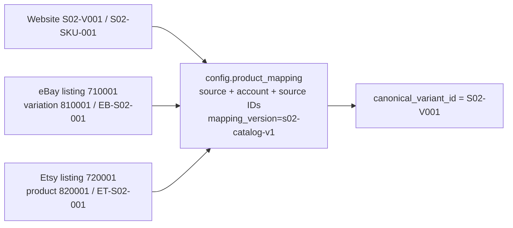

Đây là mapping logic, không phải FK vật lý nối PostgreSQL nguồn vào warehouse. Mapping S01 giữ nguyên; B dùng mapping version mới. Nguồn version/fingerprint và mapping/transformation version là các khái niệm riêng.

### 5.3 Bằng chứng dữ liệu đã nạp

Truy vấn read-only ở lượt hỗ trợ ngay trước tài liệu này, trên case đang chạy `e00cdf2177e8`, trả về:

- Website: customers100, products30, variants30, orders4.
- Platform: mapping S02 90, mapping S01 4; orders Website4/eBay4/Etsy4.
- Marketplace: orders eBay4/Etsy4, prepared versions eBay7/Etsy7.

Đây là snapshot lúc case còn chạy, **chưa phải kết luận acceptance cuối cho case e00cdf2177e8**. Không dùng nó để thay evidence của case PASS cũ. DB chính không có thêm những dòng này vì test cô lập.

## 6. Thuật toán sinh đơn và lifecycle

### 6.1 Hai bước riêng biệt

1. `s02_diverse.diverse_inputs()` dựng source-shaped payload từ lifecycle template, chọn sản phẩm/customer/quantity và tính tiền.
2. `s02_plan.plan()` quyết định đơn nào tiến triển, thời điểm từng phiên bản, rồi sắp xếp toàn bộ events theo thời gian.

Không gọi random trong marketplace GET. Với cùng seed **và cùng test ID, start, count, duration, code/catalog**, kế hoạch tái lập được. Chỉ cùng seed nhưng ID/start khác thì ID và timestamp/checksum không giống nhau.

Nguồn template là utility/source-shaped fixtures S01, **không phải** `fixtures/s01/expected`. B không tự sáng tạo thêm API payment/refund ngoài source contract.

### 6.2 Chọn nội dung đơn

- `random.Random(seed)` là PRNG local, không đổi global random state.
- Mỗi đơn chọn customer trong 1..100; chọn 1..8 sản phẩm bằng sample không trùng trong đơn.
- Quantity mỗi dòng 1..5; giá catalog ở cents, tổng cộng bằng số nguyên trước khi định dạng tiền. Không cộng tiền bằng float.
- Purchase lines, quantity, giá và creation time giữ ổn định giữa các phiên bản hiện hỗ trợ.
- Danh tính có source/account scope. Hai nguồn có ID giống chữ không tự động là cùng đơn.
- Đơn index0 là đơn cũ (created trước start7 ngày), luôn giữ trạng thái ban đầu; các đơn còn lại có created theo arrival.

### 6.3 Chọn nhánh và thời gian

Gọi `D=duration_seconds`, `S=start`, index tính riêng theo thứ tự đơn mỗi nguồn:

| Quy tắc | Code hiện tại |
| --- | --- |
| Đơn index0 | Arrival tại S, không tiến triển |
| Đơn index1 | Bắt buộc tiến triển; arrival trong đầu D/20, thay đổi muộn khoảng 2D/3 và 5D/6 cộng jitter D/12 |
| Đơn khác | Arrival trong đầu D/3; nếu tiến triển, hai khoảng chờ độc lập 1..D/4 |
| Xác suất tiến triển của đơn khác | `rng.random() >= 0.25`, khoảng75%; chưa phải config CLI |
| Thứ tự trong đơn | sequence tăng, source_updated_at tăng, các collection coherent |
| Thứ tự toàn kế hoạch | Sort visible_at, source, order_id, sequence |

Đơn index1 là sentinel cố ý đổi trạng thái muộn để Airflow cold startup có cơ hội quan sát trước/sau. Vì vậy generator này **có cấu trúc phục vụ correctness**, chưa phải phân phối lưu lượng thực tế đã hiệu chỉnh.

Không có quy tắc “wave sau phải update hết wave trước”. Một đơn có thể đứng yên qua nhiều chu kỳ. Tuy nhiên khi driver Website bị chậm qua nhiều phiên bản, `latest()` chỉ áp dụng phiên bản mới nhất đến hạn, không đảm bảo materialize mọi trạng thái đã trôi qua. Điều này được phản ánh bằng history quan sát, không bù snapshot giả.

### 6.4 Lifecycle hiện có và chưa có

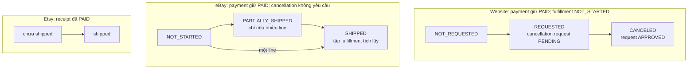

Các trạng thái trong sơ đồ là diễn giải nghiệp vụ/canonical; JSON nguồn vẫn dùng vocabulary riêng (`FULFILLED`, `IN_PROGRESS`, `is_shipped`...). Một số đơn ở lại node đầu do lựa chọn pending.

Chưa có: unpaid→paid đa dạng, hủy eBay/Etsy, shipment Website trong generator mới, rejected cancellation, refund thật, delivered có bằng chứng, thay line/giá sau mua, nhiều currency. DB Website có thể hỗ trợ nhiều trạng thái hơn nhưng **schema hỗ trợ không có nghĩa generator đã sinh tất cả**.

Etsy: `notify = index % 2 == 0`; các đơn xen kẽ bỏ webhook có chủ đích. Timeline message được chuẩn bị trước; host driver gửi signed notification đến receiver khi đến hạn. Recovery HTTP phải tìm được nhóm bị bỏ.

### 6.5 “Wave” thực chất đang là gì?

`diverse_inputs(wave=1/2)` còn dùng để dựng template đầu/cuối. `plan()` chuyển template thành timeline riêng từng đơn, có thể thêm intermediate/full-shipment. **Không có wave scheduler toàn cục được cấu hình trong .env của backend temporal.**

```mermaid
sequenceDiagram
    participant G as Generator trước test
    participant DB as marketplace_sim
    participant API as eBay/Etsy simulator
    participant C as Collector
    G->>DB: Nạp base + collections + mọi phiên bản rồi seal
    Note over DB: Ví dụ một đơn: 10h initial, 11h intermediate, 12h final
    C->>API: GET lúc 10h30
    API->>DB: Chọn latest visible_at <= 10h30
    DB-->>API: Phiên bản 10h + collection nó tham chiếu
    API-->>C: JSON source hiện tại
    Note over DB: Đến 11h không UPDATE status trong DB
    C->>API: GET lúc 12h30
    API->>DB: Chọn latest visible_at <= 12h30
    DB-->>API: Phiên bản 12h
    API-->>C: JSON source final; không trả history 11h nếu không từng đọc
```

## 7. Schema vật lý marketplace_sim: đầy đủ phần M08 mới

Nguồn kiểm chứng: [DDL thực tế](../migrations/marketplace_sim/001_s02_temporal.sql). Đây là **đủ năm bảng mới của schema s02**, không vẽ những bảng payment/shipment tưởng tượng. `public.schema_migrations` là metadata migration có sẵn, không phải nguồn nghiệp vụ.

Ký hiệu: PK khóa chính; FK khóa ngoại; UK duy nhất. Khóa order luôn gồm `(campaign_id,source,account_id,order_id)`.

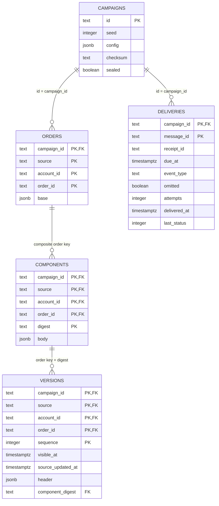

### 7.1 Ràng buộc và giới hạn quan hệ

- Campaign ID 12 hex; checksum/digest 64 hex; seed không âm.
- `orders` chỉ nhận eBay/account `seller_sim_01` hoặc Etsy/account `7001`, không chứa Website.
- `versions`: sequence>0, UK thời gian visible và UK source_updated theo scoped order; index `(campaign_id,source,account_id,order_id,visible_at DESC)`.
- Version tham chiếu component bằng **đủ khóa order + digest**, không chỉ digest; component có FK về order.
- `deliveries.receipt_id` hiện **không có FK về orders**; chỉ campaign_id có FK. Quan hệ receipt→order là logic của generator/driver. Không được vẽ nó như FK đã tồn tại.
- `config`, `base`, `header`, `body` bắt buộc object JSONB. Nhiều quy tắc business bên trong JSON được code/test kiểm tra, không phải tất cả là CHECK SQL.
- Seal bằng transaction insert rồi `campaigns.sealed=TRUE`; trigger chặn thay đổi source rows đã seal. Delivery chỉ được update attempts/delivered_at/last_status sau seal.
- Hai role reader eBay/Etsy chỉ SELECT, RLS phân nguồn trên orders/components/versions. Collector không nhận các credential này.

### 7.2 JSON được tách ra sao?

| Nguồn | `orders.base` | `versions.header` | `components.body` |
| --- | --- | --- | --- |
| eBay | Order fields còn lại: identity/creation/pricing và header cố định | lastModifiedDate, orderPaymentStatus, orderFulfillmentStatus, cancelStatus, fulfillmentHrefs | lineItems và fulfillments |
| Etsy | Receipt fields còn lại, buyer/totals/creation và trường cố định | updated_timestamp, status, is_paid, is_shipped | transactions, shipments, refunds |

`split_document()` chia; `assemble()` ghép lại JSON đúng interface nguồn. Collection được hash và reuse nếu toàn bộ body giống nhau **trong cùng order**. Không dedup xuyên order. Nếu chỉ fulfillment đổi thì body mới có thể vẫn lặp lại lineItems; đây chưa phải chuẩn hóa từng line/payment/shipment row để tối ưu tối đa dung lượng.

### 7.3 API chọn phiên bản

`PostgresStore.query()` lấy một `statement_timestamp()` UTC làm T cho request; chọn latest version có visible_at<=T của campaign đã seal; **sau đó** mới lọc cửa sổ source_updated_at. Join đúng component của version, không ghép shipment tương lai.

Từng page/detail HTTP là request khác, T có thể khác. Không có cam kết snapshot toàn bộ vendor API xuyên nhiều request. Current clock là1x thực; chưa có clock pause/fast-forward controller được nghiệm thu.

## 8. Schema Website: đủ chín bảng nghiệp vụ

Nguồn: [DDL Website](../migrations/website_source/001_schema.sql). Đây là schema từ M01, **không phải chín bảng mới do M08 tạo**. Sơ đồ liệt kê đủ cột nghiệp vụ của chín bảng; `schema_migrations` không đưa vào ER nghiệp vụ.

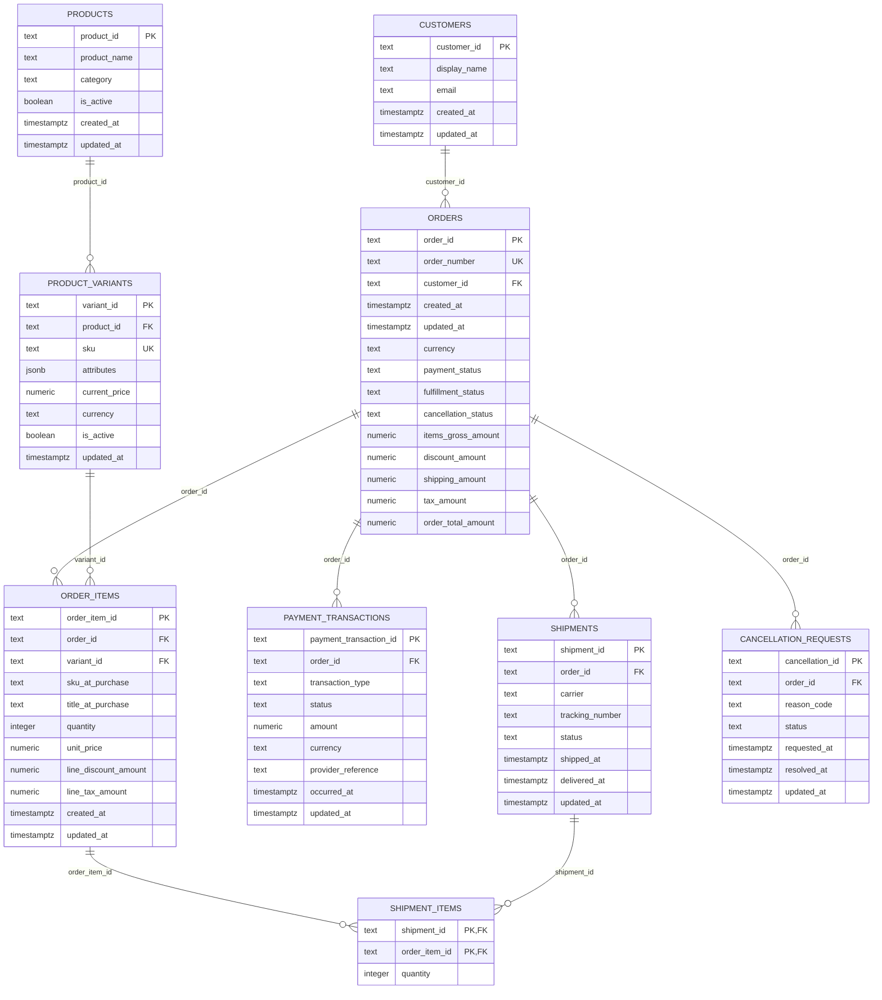

Tiền Website numeric(18,2); quantity>0; timestamps/total/state có CHECK trong DDL. Tổng đơn = items-discount+shipping+tax. Shipment delivered phải có delivered_at hợp lệ; cancellation PENDING thì chưa có resolved_at.

`website_s02.py` thực hiện transaction/upsert theo PK, giữ advisory lock writer và yêu cầu updated_at của đơn tăng. Đầu tiên nạp đủ references; sau đó chỉ payload tham chiếu. Schema có shipments/shipment_items nhưng generator temporal hiện không sinh nhánh Website shipping; writer còn từ chối shipment allocation nếu không có handler riêng. Đừng kỳ vọng bảng có schema là chắc đã có dữ liệu.

## 9. Data platform: M08 sử dụng gì, không tạo gì

**M08 không thêm DDL warehouse.** Chỉ nạp mapping mới và chạy lại pipeline hiện hữu trên nguồn đa dạng. Không thêm bảng customer master hay product dimension mới. Từ metadata vào raw đến mart/report vẫn là schema M01–M07.

Sơ đồ sau là **đường dữ liệu/nhóm bảng liên quan**, không phải ER toàn bộ platform và mũi tên không mặc định là FK. DDL đầy đủ của platform nằm trong `migrations/platform/`; dictionary ở [05_TARGET_SCHEMA.md](05_TARGET_SCHEMA.md).

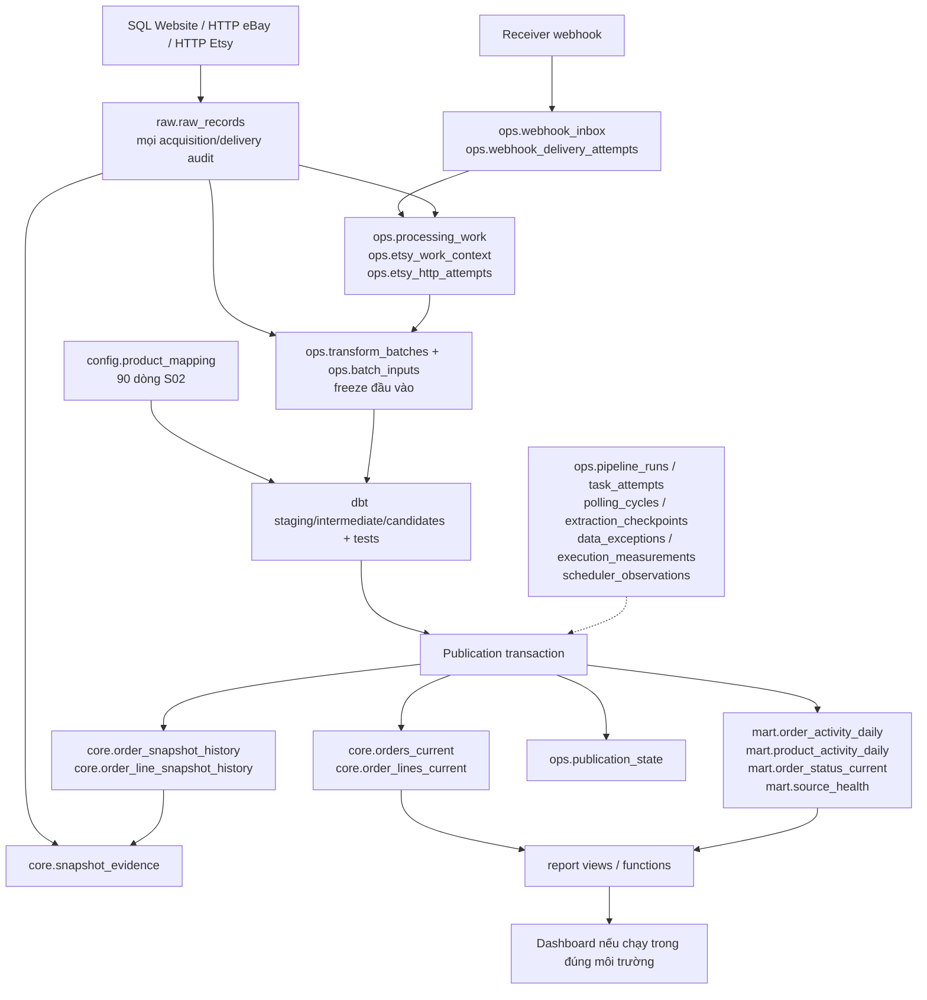

Quan hệ vật lý cốt lõi để kiểm tra lịch sử và current:

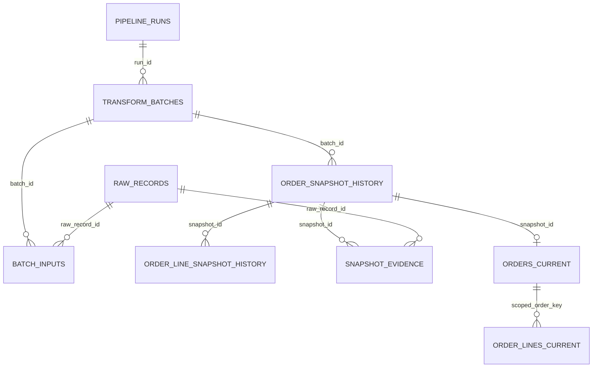

Identity của current là source_system + source_account_id + source_order_id; line thêm source_line_id. Source snapshot identity không bị thay bằng mapping_version. Không vẽ FK product_mapping→line vì mapping là phép resolve của dbt, không có FK trực tiếp đó trong DDL.

History chỉ giữ phiên bản **được quan sát** qua raw. Ví dụ nguồn có24 phiên bản mà warehouse có20 snapshot là có thể đúng nếu collector không quan sát bốn trạng thái trung gian. Không synthesize bốn snapshot còn thiếu từ kế hoạch test.

## 10. Luồng thực thi và cấu hình

### 10.1 Continuous acceptance mới thực sự làm gì?

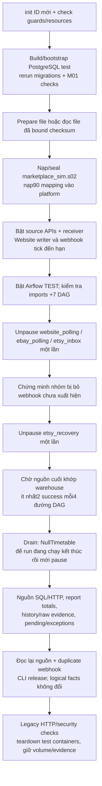

Lịch source và lịch Airflow là hai việc khác nhau. Tick của host driver xử lý Website/webhook; marketplace GET chỉ đọc theo T. Airflow không đọc kế hoạch để nhận đáp án.

### 10.2 Mỗi command làm được gì?

| Command | Tác dụng | Không có nghĩa là |
| --- | --- | --- |
| `m08b_temporal init` | Cấp ID/model/env/private paths | Đã có dữ liệu trong DB |
| `check --id` | Kiểm tra model/resources/target | Runtime acceptance PASS |
| `prepare --id ...` | Tạo file kế hoạch/checksum và bind marker | Đã nạp PostgreSQL hoặc chạy một ngày |
| `storage --id` | Nạp test PG, kiểm tra storage/HTTP/role/seal/restart | Warehouse/scheduled đã PASS |
| `accept --profile baseline` | Initial-load toàn bộ đã đến hạn, CLI transform/release/replay | Scheduled Airflow đã chạy |
| `accept --profile continuous` | Nguồn thay đổi tương lai và scheduler thật | Tải lớn/24h đã được chứng nhận |
| `stop --id` | Down container/network test, giữ volume | Xóa dataset hoặc reset thời gian |
| `verify-retained` | Bổ sung đọc/đối chiếu case PASS giữ lại | Cold acceptance lần hai |
| `replay-retained` / `notification-retained` | Có ghi thêm raw/work/audit trong test scope | Chỉ đọc hoặc không đổi gì trong DB |

`storage` và `accept` dùng ID mới riêng; không nạp lại/reset source đã seal trên ID đã dùng. Case lỗi giữ evidence, lần retry mới dùng ID mới.

### 10.3 Config hiện có, chỗ còn hardcode

| Tham số | Hiện ở đâu? | Mặc định / giới hạn |
| --- | --- | --- |
| Host port chính | `.env`/Compose chính | Local đang dùng5433 |
| Host port test | Harness cấp port loopback riêng lúc init | Không có fixed S02 dev port trong .env chính |
| Test credentials | Model/env riêng, random mỗi case | Không dùng password chính |
| Seed | CLI `--seed` | 17 |
| Orders/channel | CLI `--orders-per-channel` | 4; cho nhập2..10000, không phải capacity guarantee |
| Prepare duration | CLI prepare `--duration-seconds` | 86400; cho30..86400 |
| Prepare start | CLI `--start-delay-seconds` |0 so với lúc prepare |
| Auto-prepare baseline | `TemporalCampaign.run()` |30s schedule đã ở quá khứ |
| Auto-prepare continuous | `TemporalCampaign.run()` |1200s schedule, start khoảng now-60s |
| B polling interval | Model B của harness |180s, không lấy từ interval .env chính để ghi đè tùy ý |
| Coordinator slot wait | `POLLING_SLOT_WAIT_SECONDS` | Chính default15s; B override300s |
| Continuous wait budget | `TemporalCampaign` |3600s, command timeout riêng; không phải hard kill mọi process sau1h |
| Catalog size/customer count | JSON + `references()` |30 sản phẩm/100customer; code validation đang cố định |
| Lines/quantity | `diverse_inputs()` |1..8 / 1..5, hardcode |
| Nhánh/tỷ lệ/jitter/sentinel | `plan()` | Hardcode như mục6 |
| Wave toàn cục / clock acceleration | Không có config temporal hiện tại | Không giả vờ đã có |

`m08b_window` hiện chỉ expose cờ xác nhận maintenance ở CLI; chạy mặc định seed17/count4/continuous auto1200s. Nó không cho truyền đủ tham số generator qua CLI riêng. Cờ `--duration-seconds` của temporal parser dùng cho action prepare; **không tự thay auto-duration của accept**.

Muốn gen trước một ngày: prepare làm được, nhưng future24h schedule không nằm trong budget correctness ngắn nên continuous acceptance từ chối. Một kế hoạch đã hoàn toàn ở quá khứ có thể làm initial-load đầu vào, vẫn không phải load/soak certificate. Không tự chạy10000đơn chỉ vì parser cho phép.

### 10.4 Vì sao cần tạm dừng Airflow chính?

Docker VM local khoảng4GB; hai Airflow standalone cùng chạy đã gây vấn đề Engine/resource. Harness không nới guard để ép PASS. Scheduled test yêu cầu RAM phù hợp hoặc maintenance được chủ dự án cho phép.

`m08b_window.py` kiểm tra owner idle/healthy, chụp exact container ID + protected signature + DAG pause state + PG system ID; chỉ stop Airflow chính; chạy test mới; `finally` start lại **cùng container** và xác minh. Không stop PostgreSQL, không xóa volume, không tự restart Docker. Nếu restoration không healthy thì window FAIL dù test PASS.

Quyền maintenance của một lượt không phải quyền dừng dịch vụ tùy ý trong mọi task sau. Đang làm doc không được phép can thiệp test bạn đang chạy.

## 11. Bằng chứng đã chạy, lỗi đã sửa và giới hạn

### 11.1 Các checkpoint tiêu biểu (không trộn số liệu các phiên bản)

| Case | Phạm vi | Kết quả đã ghi nhận |
| --- | --- | --- |
| `49a6b80472b1` | M08A cold S01 | PASS61 steps:3đơn/4line/6units/USD124/6observed versions; bootstrap/restart/migrate, dbt, Airflow discovery, report checks |
| `4ef4b2b2a92d` | B RAM baseline ban đầu | FAIL24 steps vì runner chỉ recovery, chưa drain inbox Etsy nên còn pending2; sửa runner gọi drain riêng |
| `ac9779fac6c1` | B RAM continuous | PASS170 steps;6đơn,12line,12observed versions; separate evidence trong STATUS |
| `8c951c922502` | Temporal storage | PASS23; role/visibility/seal/migration/restart; không phải pipeline acceptance |
| `0f0ac6cbe7c2` | Temporal CLI thử đầu | FAIL14 do log keyword sequence trùng; sửa source_sequence |
| `ef9cbc714cf6` | Temporal CLI baseline mới | PASS45;12đơn/52line/152units/USD2883, replay raw34→67; không tự nhận là scheduler |
| `4c1d2b1719eb` | Temporal continuous + replay | PASS227;25 real scheduled successes;12đơn/52line/152units/USD2883;24prepared→20observed |
| `e00cdf2177e8` | Case đang chạy của chủ dự án lúc chụp | Có dữ liệu trong DB như mục5; tài liệu này chưa xác nhận final acceptance |

Danh sách lịch sử đầy đủ, các retry/supplemental case, code hash và timestamp nằm trong [STATUS](STATUS.md). Các đoạn “pending/not run” bên dưới STATUS là checkpoint cũ; phải đọc mục mới nhất trước, không coi mọi đoạn lịch sử đồng thời là hiện trạng.

### 11.2 Kết quả temporal continuous đã hoàn tất của mình

Evidence: `runtime/isolated/m08a-4c1d2b1719eb/evidence/result.json`.

- Seed17,4 đơn/nguồn,180s intervals,300s coordinator wait.
- 25 scheduled runs đều success: Website7, eBay7, Etsy inbox6, recovery5.
- Chứng minh đơn Etsy bỏ notification chưa xuất hiện trước recovery, cuối cùng recovery lấy đủ.
- Final facts khớp qua scheduled **trước** bước CLI replay.
- History20 có raw evidence: Website8/eBay6/Etsy6; không lấy24prepared làm golden history count.
- Replay raw70→103, logical business/history unchanged.
- Gửi trùng message đã nhận: inbox3→3, accepted deliveries3→5.
- Teardown/protected_check PASS, owner Airflow restored healthy, pause states và PG ID giữ nguyên.
- Dataset checksum `ed41e25a90f2d23d54f50c714d2d0f63b222e4614749ae4a17d398696b060bc9`.

Evidence owner window: `runtime/isolated/window-3f60710c635d4ea7834687dad2744a11/owner-window.json`.

Số observed versions/raw/scheduled runs phụ thuộc thời điểm thực thi, không phải mọi case phải đúng20/103/25. Purchase totals của default seed17/count4/catalog hiện tại là số đối soát nhỏ, không phải giá trị dùng để chèn warehouse.

### 11.3 Những lỗi đã gặp và thay đổi kỹ thuật đi kèm

- M08A: health tạm trong bootstrap có thể báo sớm; chuyển health test PostgreSQL sang TCP final listener.
- Docker/dual-Airflow resource failure: thêm kiểm tra resource và maintenance explicit, không tự restart Engine.
- Log từng invocation từng bị ghi đè khi counter quay lại0: đổi sang UUID filename/exclusive create.
- B RAM baseline: thiếu inbox drain dù recovery đã xong khiến pending2; sửa harness, không gán lỗi này cho pipeline. Diversity/temporal bổ sung oracle theo catalog và shipment allocation thay vì dùng giả định line/variant cố định của bộ nhỏ.
- B scheduled: contention/retry/drain có thể để run cuối fail; thêm bounded configurable coordinator wait và drain signal/NullTimetable, đợi terminal trước pause.
- B test mount: thu hẹp mount read-only, không đưa credentials/runtime/truth vào pipeline.
- Temporal: log field sequence collision; actual delivery status phải202 thay vì hardcoded200; sửa replay từ empty incremental-window audit thành full reread và duplicate message thật.
- Sentinel timing/single-line eBay shipment: sửa lịch để có cơ hội quan sát thay đổi, không giả partial shipment cho đơn một line.

Từng fix có regression/evidence theo checkpoint trong STATUS; không khẳng định mọi fix đều có một full cold test riêng nếu chỉ unit/supplemental test đã chạy.

### 11.4 Chưa kiểm chứng / chưa làm

- Chưa có measured load envelope, benchmark ingestion triệu đơn, soak24h/burst certification.
- Chưa chạy broad M08C fault/restart/pause-resume matrix; probe restart simulator/PG không thay thế C.
- Chưa rerun full M08A cold S01 trên toàn bộ code temporal cuối; đã có S01 offline và legacy HTTP/security regression, phạm vi khác nhau.
- Remote GitHub Actions chưa chạy. Workflow YAML có không nghĩa CI xanh.
- Day plan offline3000orders/6681versions chỉ chứng minh preparation, không throughput DB/pipeline.
- Chưa có persistent dev/review workflow/config ổn định, UI quản lý generator, config tỷ lệ/lifecycle đầy đủ.

## 12. Cách kiểm tra không chạy lại acceptance

Mục này chỉ cần đọc DB hiện đang chạy. Không yêu cầu dừng Airflow chính, reset DB hoặc chạy lại33phút.

### 12.1 Tìm connection đúng

```powershell
# Read-only: xem container nào thực sự đang chạy và port nào được publish.
docker ps --format "{{.Names}} {{.Status}} {{.Ports}}"

# Dùng ID đang chạy của chính bạn, không chép ID cũ theo thói quen.
$testId = 'e00cdf2177e8'
$model = Get-Content "runtime/isolated/m08a-$testId/compose.json" -Raw | ConvertFrom-Json
$model.services.postgres.ports | Select-Object host_ip,published,target
```

DBeaver: host127.0.0.1, port lấy từ published, user postgres, password lấy riêng từ `services.postgres.environment.POSTGRES_PASSWORD` trong file local của **đúng ID**. Không chụp/gửi cả compose.json. Tạo ba connection khác database, đặt tên có test ID để không nhầm main.

Nếu container không chạy thì connect không được, không đồng nghĩa mất volume. Để tránh tài liệu kiểm tra vô tình điều khiển môi trường, ở đây không đưa lệnh start/stop tự chạy; trao đổi riêng nếu cần mở lại case giữ lại. Không sửa port/password trong compose.json đã hash-bound vì guard sẽ từ chối.

### 12.2 Website: đọc đủ references và dữ liệu hiện tại

Trong DB `website_source` của TEST:

```sql
SELECT 'customers' AS entity, count(*) FROM public.customers
UNION ALL SELECT 'products', count(*) FROM public.products
UNION ALL SELECT 'variants', count(*) FROM public.product_variants
UNION ALL SELECT 'orders', count(*) FROM public.orders;

SELECT * FROM public.customers ORDER BY customer_id LIMIT 10;
SELECT * FROM public.products ORDER BY product_id;
SELECT * FROM public.product_variants ORDER BY variant_id;
SELECT * FROM public.orders ORDER BY order_id;
SELECT * FROM public.order_items ORDER BY order_id, order_item_id;
SELECT * FROM public.payment_transactions ORDER BY order_id;
SELECT * FROM public.cancellation_requests ORDER BY order_id;
SELECT * FROM public.shipments;
SELECT * FROM public.shipment_items;
```

Mong đợi default temporal có100/30/30/4; shipments có thể rỗng vì nhánh hiện không sinh shipping Website. DB hiện tại chỉ thấy state mới nhất; lịch Website trước/tương lai xem prepared file và driver ledger, không có bảng status timeline riêng trong website_source.

### 12.3 Marketplace: xem kế hoạch, phiên bản, payload và notification

Trong DB `marketplace_sim` của TEST:

```sql
SELECT id, seed, sealed, checksum, config FROM s02.campaigns;
SELECT source, count(*) FROM s02.orders GROUP BY source;
SELECT source, count(*) FROM s02.versions GROUP BY source;

SELECT source, order_id, sequence, visible_at, source_updated_at, header
FROM s02.versions ORDER BY source, order_id, sequence;

SELECT v.source, v.order_id, v.sequence, v.visible_at,
       o.base, v.header, c.body AS collections
FROM s02.versions v
JOIN s02.orders o USING (campaign_id, source, account_id, order_id)
JOIN s02.components c
 ON c.campaign_id=v.campaign_id AND c.source=v.source
 AND c.account_id=v.account_id AND c.order_id=v.order_id
 AND c.digest=v.component_digest
ORDER BY v.source, v.order_id, v.sequence;

SELECT receipt_id, message_id, event_type, due_at, omitted,
       attempts, delivered_at, last_status
FROM s02.deliveries ORDER BY receipt_id, due_at;
```

Chọn một order_id và xem đủ sequence. DB cho thấy cả tương lai vì bạn đang audit bằng postgres; API không được expose tương lai. `omitted=true` không gửi là chủ ý, khác gửi lỗi. JSON viewer trong DBeaver dùng để mở base/header/collections.

### 12.4 Platform: xem mapping, current và observed history

Trong DB `data_platform` của TEST:

```sql
SELECT mapping_version, source_system, count(*)
FROM config.product_mapping GROUP BY mapping_version, source_system;

SELECT * FROM config.product_mapping
WHERE mapping_version='s02-catalog-v1'
ORDER BY source_system, canonical_variant_id;

SELECT source_system, count(*) FROM core.orders_current GROUP BY source_system;
SELECT * FROM core.orders_current ORDER BY source_system, source_order_id;
SELECT * FROM core.order_lines_current
ORDER BY source_system, source_order_id, source_line_id;

SELECT source_system, source_order_id, source_updated_at,
       payment_state, fulfillment_state, cancellation_state
FROM core.order_snapshot_history
ORDER BY source_system, source_order_id, source_updated_at;
```

Ba nguồn phải cùng resolve được về catalog canonical nhưng không merge order identity. Đừng so prepared-version count với history bằng phép bằng tuyệt đối. Đừng mong thấy một bảng100customer mới ở platform vì M08 không thêm dimension đó.

## 13. Danh sách code/doc thay đổi và thứ tự review

### 13.1 Các nhóm đã làm trong M08 (đều chưa commit ở checkpoint này)

| Nhóm | File/đường dẫn | Trách nhiệm |
| --- | --- | --- |
| Guard M08A | `test_support/m08a.py`, `m08a_baseline.py`, `tests/test_m08a_guards.py` | Isolation/model/identity/resource guard, cold baseline, preservation |
| B RAM | `s02_inputs.py`, `m08b.py`, `m08b_drain_probe.py`, `simulator/s02_store.py` | Template, finite two-wave driver, oracle checks/drain; chế độ cũ |
| Diversity | `fixtures/s02/catalog.json`, `s02_diverse.py`, `s02_oracle.py` | References/đơn đa dạng và đối soát độc lập |
| Temporal | `s02_plan.py`, `m08b_temporal.py`, `simulator/s02_temporal.py`, migration marketplace | Prepare/seal/as-of storage, runner và verification |
| Website | `simulator/website_s02.py` | Transaction writer source-only; không warehouse writes |
| HTTP adapters simulator | `simulator/ebay_api.py`, `etsy_api.py` | Chọn backend, list/detail/shipping source-shaped response |
| Images | `infra/python/Dockerfile.ebay`, `Dockerfile.etsy` | Copy modules mới, cài pinned psycopg qua requirements hiện có |
| Scheduling | `orchestration/scheduling.py`, `dags/polling_orders.py`, `dags/etsy_orders.py` | Bounded slot wait, explicit mapping version, drain mode giữ default cũ |
| Config chính nhỏ | `.env.example`, `infra/compose.yaml` | Expose slot wait default15; không tự bật S02 hoặc đổi host port chính |
| Maintenance | `m08b_window.py`, `tests/test_m08b_window.py` | Owner-authorized stop/finally restore + evidence |
| Tests | `test_m08b_sources.py`, `test_s02_diverse.py`, `test_s02_temporal.py` | Seed/payload/oracle/guard/replay/timing regressions |
| CI | `.github/workflows/offline-smoke.yml`, `s02-integration.yml` | Offline gates và finite matrix RAM/PG × baseline/continuous; chưa có remote result |
| Docs | docs10–14, test_support README/M08B/TEMPORAL, STATUS/plan/architecture/source/provenance, README và operation guides | Quyết định, cách chạy, evidence, giới hạn |

Không sửa fixture S01/expected/fingerprint contract. Không tự stage/commit/push; HEAD đang là M07 `7f459ab`. Untracked `HANDOFF_SHA256SUMS.txt` là file ngoài task, giữ nguyên.

### 13.2 Nên đọc code theo thứ tự này

1. `fixtures/s02/catalog.json`: input sản phẩm có gì.
2. `test_support/s02_diverse.py:references/diverse_inputs`: customer/mapping/đơn được tạo thế nào.
3. `test_support/s02_plan.py:plan`: lifecycle/timestamps và các quy tắc hardcode.
4. `migrations/marketplace_sim/001_s02_temporal.sql`: nơi dữ liệu marketplace thực sự lưu.
5. `simulator/s02_temporal.py:split_document/assemble/PostgresStore.query`: JSON chia/ghép và visibility.
6. `test_support/m08b_temporal.py:install/tick/run`: lúc nào nạp DB, lúc nào Website update/webhook gửi.
7. `simulator/website_s02.py`: Website transaction thật.
8. `test_support/s02_oracle.py` và các test: đối soát có kiểm tra tiền/state/line/mapping đúng không.
9. `test_support/m08a.py` và `m08b_window.py`: port/password/isolation/cleanup/restore.

Không cần bắt đầu ở `s02_store.py` nếu đang review backend PostgreSQL mới. Nó là RAM implementation cũ.

## 14. Dự định làm tiếp và tiêu chí bàn giao

**Đã bắt đầu các bước sau theo đồng ý của chủ dự án; trạng thái thực tế ở mục0.13/14.3.** Đây là chỉnh lại workflow M08B, không tự chuyển sang M08C hoặc tuyên bố tất cả M08 hoàn thành.

| Bước | Công việc dự định | Đầu ra kiểm tra được |
| --- | --- | --- |
| 1. Chốt thiết kế nhỏ | Đồng bộ docs10–14/plan/architecture theo local stable + prepare-once; config riêng channel/peak, order/event seeds, lifecycle/case matrix; chốt timezone/clock/checkpoint và storage Website plan/reference trước DDL | Một cách dùng chính, fields/keys/constraints rõ; case supported/unsupported và proposed tách code đã có |
| 2. Local config ổn định | Reuse stack local, env port/password ổn định; workload config riêng; status in DB/port/dataset/mode an toàn, không in secrets | DBeaver không đổi sau mỗi gen; không tự tạo Airflow/PG thứ hai |
| 3. Prepare độc lập | Gom config/code vào một folder, manual entry point; sampling theo peak từng channel, order-first + lifecycle event stream, quota coverage/fault plan opt-in; validate rồi nạp DB và mark ready | Đúng số đơn mỗi channel, coverage manifest, xem DB trước pipeline; dataset chưa hoàn chỉnh không được serve, không ghi expected warehouse |
| 4. Playback mỏng | Đọc state đến hạn tại T, Website writer/API/sender tái sử dụng; clock realtime/replay1×; cùng cycle bound cho polling/recovery | Không random trong GET; không tương lai bị lộ; Etsy signatures vẫn hợp lệ giờ thật |
| 5. Quyền chủ động | Tách prepare/inspect/start/status/stop; chạy xong không tự teardown local; refuse overwrite/backward rewind nếu chưa có explicit scope | Xem DB trước/trong/sau chạy; stop không xóa volume; không cần sửa model đã hash-bound |
| 6. Thu gọn code cũ | Sửa lại runner/config cũ nếu không phù hợp; bỏ đường thừa sau kiểm tra caller/regression; giữ S01 và harness an toàn | Hướng dẫn dev chỉ còn một luồng; RAM cũ không còn là lựa chọn gây nhầm nếu đã có thể gỡ an toàn |
| 7. Kiểm chứng và bàn giao | Chạy offline/regression, source DB/HTTP, clock-boundary/realtime/replay, pipeline scheduled và dedupe phù hợp; cập nhật STATUS | Lệnh và kết quả thật, fail/not-run minh bạch; không suy rộng thành capacity24h |

### 14.1 Các bài kiểm tra cho thay đổi dự định

- Config/timezone sai bị từ chối trước khi ghi DB; khoảng `[start,end)` và event order được kiểm tra.
- Config từng channel/peak được validate, đúng N orders; phân phối weight được test trên sample đủ lớn; đổi eBay count không xáo random stream Website.
- Giữ order_seed/config purchase thì basket/customer/created ổn định khi đổi event_seed; event vẫn obey lifecycle/invariants. Seed được auto-chọn chỉ lúc manual prepare phải được lưu để tái lập.
- Coverage quota không khả thi bị từ chối với lý do; fault profiles không tự bật; planned cases không bị báo là runtime PASS. Kiểm tra duplicate delivery không tạo version mới chỉ vì attempt mới.
- Cùng toàn bộ input tạo cùng source dataset nội dung; prepare không thay source payload khi chỉ start/stop playback.
- References/mapping nạp đủ và transaction hoàn chỉnh; Website plan cũng xem được qua SQL, không chỉ JSON file.
- Tạo đơn/phiên bản tương lai không lộ trước T; đúng boundary hiển thị; source SQL/HTTP giữ contract.
- Replay ngày20 khi máy ngày31: collector chọn đúng logical window; history chỉ chứa quan sát thật, không fabricate event bị bỏ lỡ.
- Real operational clocks cho signature/timeout/lease; không dùng logical date cũ để làm webhook hết hạn hoặc lease sai.
- DBeaver connection/port/password giữ nguyên qua nhiều dataset; local containers không tự down khi simulation xong.
- Repeated reads/notification giữ physical audit nhưng không duplicate logical snapshots; không thay fingerprint/mapping contracts S01.
- Giữ dữ liệu hiện có: trước khi chuyển mode/seed cần xác minh scope, không tự delete/truncate hay migrate test data vào local.

Nếu clock hỗ trợ thêm buộc phải sửa source/ops schema hay metric, phải mô tả rõ và chốt field/constraint trước migration; không nhét redesign đó vào simulator vì tiện làm. Nếu gặp vật cản cần đổi hành vi đã duyệt, báo lại trước.

### 14.2 Chưa làm trong vòng này

Không làm simulator nghiệp vụ đầy đủ, engine event phức tạp, nhiều API mới, UI generator, fast-forward/acceleration hay automatic random nền. Không chạy broad recovery matrix M08C hoặc đo load24h M08D dưới tên “simplification”. Chuẩn bị sẵn dữ liệu lớn không phải chứng nhận pipeline xử lý nổi mức tải đó.

### 14.3 Checkpoint thực hiện

Đã sửa code runtime/config mẫu và thêm migration opt-in sau khi chốt contract. Không nạp/chuyển/xóa dữ liệu main, không sửa `.env` thật. Các probe CLI ban đầu không dừng Airflow chính; riêng lượt scheduled mới đã tạm dừng và khôi phục đúng container theo quyền chủ dự án cho phép. Tất cả thay đổi để unstaged; chưa commit/push; giữ file tiếng Việt này theo yêu cầu.

Kết quả thực tế của revision local mới:

- `python tests/test_s02_local.py`: PASS10. `python tests/test_s02_clock.py`: PASS3. Bộ cũ diverse4/temporal10/guards15/source12/window2/scheduling4 đều PASS; tổng60unit test host. S01 offline10checks +10utility tests PASS. Compileall/diff check PASS.
- `python tests/m08b_local_probe.py`: case đầu e65618ac2dbc source-storage-only PASS198steps; là bản loader ban đầu, không dùng để nhận đã test CLI mới.
- Case343cb0daa278 FAIL29steps tại helper đọc JSON SQL nhiều dòng; source/reference/clock trước đó PASS. Đã sửa parse full JSON và thêm regression. Volume/evidence giữ nguyên, không reset.
- Retry bằng ID mới7bd055e54de0 PASS71steps, UTC12:21:27–12:30:09 ngày31/10. References100/30/30, marketplace replay clock/future boundary/frozen state,6Website source transactions,11notification và bốn CLI cycle (Website/eBay/Etsy drain/Etsy recovery) chạy qua acquisition/dbt/publish. Persist logical dataset/mode/bounds,18current orders. Evidence `runtime/isolated/m08a-7bd055e54de0/evidence/local-probe.json`.
- `python tests/m08b_local_verify.py 7bd055e54de0`: supplemental read-only PASS10steps;18đơn,87line,256units,USD5182. So source-shaped final state với core current: state/created/updated/money/mapping/line/published-snapshot coherence đúng; không còn pending work/unresolved exceptions, history có raw evidence. File `local-final-readonly.json` cùng evidence folder. Đây không phải cold/scheduled test lần hai.
- Cả test và verify đều teardown container/network test, giữ volume; owner signature unchanged. Airflow/PostgreSQL/report/API/receiver chính healthy, không có test container còn chạy ở lần kiểm tra cuối.
- Offline `load.json`: gen/validate2000đơn (1000Website/600eBay/400Etsy),4562source versions,23.89s; không phải capacity pipeline. Sau tối ưu quota và zero-count metadata có unit rerun; hash code trong cold evidence phản ánh đúng bản lúc chạy, không sửa retroactive.
- Compose overlay config PASS giữ projectlocal/port5433 và không đưa backing DB password vào Airflow; chỉ dùng dummy values khi check cấu hình, không sửa secret.env.
- Rà cuối:5doc/33local links/fences và compile/diff check PASS; Mermaid chưa render bằng CLI, remote CI chưa chạy. Sau cold probe có refinement nhỏ về quota/metadata/reference checksum/default notification counters/host project pinning; unit/compile/config được kiểm tra, không tự gán cold PASS cũ cho mọi dòng code sửa sau đó.

Lượt scheduled replay mới, sau khi nhận quyền maintenance:

- Lệnh: `python -m test_support.m08b_window --confirm-owner-airflow-window --local-replay`, exit0. Case `31cf3196a802` PASS426steps; acceptance UTC13:20:54–13:59:44 ngày31/10; cả cửa sổ dừng/khôi phục khoảng40phút. Dữ liệu chỉ được gen/nạp một lần bằng cùng tools/s02_data; replay1×, không random nền/tua nhanh. Test correctness nhỏ, không phải đo tải.
- Có2đơn/nguồn: một pending, một tiến triển theo lifecycle hợp lệ. Thay đổi nguồn cuối đến logical+1216s; pipeline tự lấy/publish cuối trước bất cứ CLI trợ giúp nào. Etsy pending bỏ webhook chưa có trong platform trước recovery; sau bật recovery thì lấy đủ.
- Sau drain,29scheduled runs đều success: Website8/eBay8/Etsy inbox7/recovery6. Không clear task, ép success hay pause giữa chừng; mỗi đường được enable một lần. Cả29cycle trước replay có logical dataset/mode/bounds và DAG/run lineage.
- Source authority, state/time/money/mapping/line/publication và report-role totals PASS:6đơn,20line,48units,USD1066. History11 (Website4/eBay4/Etsy3) đúng các version thực sự có trong raw, không lấy số event đã gen làm lịch sử mặc định. Không còn pending work/unresolved exceptions.
- Sau full reread và4CLI cycle release: raw54→74, business/history giữ nguyên. Gửi lại cùng webhook: logical inbox2→2, accepted audit2→4. Evidence: `runtime/isolated/m08a-31cf3196a802/evidence/result.json`.
- Window `runtime/isolated/window-99d8bba0eacf4213829f9e2b0e4a924d/owner-window.json` PASS: Airflow chính `bb4bb1194e57` HEALTHY trở lại; Website manual DAG vẫn unpaused,6DAG còn lại vẫn paused. Protected data hash và PG systemID7700550531765104677 giữ nguyên. Chỉ container/network test được teardown, volume/evidence giữ lại; kiểm tra cuối chỉ còn stack chính chạy, PG5433/Airflow8080.
- Rerun offline cuối:67unit tests PASS (thêm3guard và4workload test); S01 offline10checks+10utility tests PASS; compile, tracked diff và whitespace55file mới PASS.11hash code runtime local-path vẫn khớp sau test.6guide/14local links/fences PASS; không render Mermaid hay chạy remote CI.

**Giới hạn tại checkpoint14.3:** lúc đó realtime chưa kiểm chứng; nay đã PASS riêng ở14.4. Activation main vẫn chưa thực hiện: main chứa S01 nên `start` sẽ từ chối; cần quyết định giữ/backup dữ liệu trước chuyển mode, không xóa volume để bypass guard. Full fault matrix M08C và load/soak M08D chưa làm. Chưa stage/commit/push. Khi xem dữ liệu replay ngày20/10 trên dashboard, phải chọn đúng khoảng ngày nghiệp vụ; monitor vận hành vẫn dùng giờ thật ngày31/10.

### 14.4 Nghiệm thu cuối M08B — realtime và ngày mặc định

- Lệnh: `python -m test_support.m08b_window --confirm-owner-airflow-window --local-realtime`. Chủ dự án cho phép tạm dừng/khôi phục riêng Airflow chính cho lượt này; không dừng PostgreSQL chính hay xóa volume.
- Lượt đầu `4b082af2312e` xác nhận default storage READY/5h nhưng phát hiện runner bật DAG trước khi Website writer nạp xong nguồn: raw đọc0/0/1đơn trong khi source có6, watermark đã vượt timestamp ban đầu. Đã abort, không nhận PASS hay sửa dữ liệu để test xanh. Ngắt process từ tool không chạy `finally`; stop CLI từ chối interrupted latch. Sau xác nhận process đã kết thúc, teardown đúng target bằng Harness guards và khôi phục Airflow chính healthy. Original snapshot chưa ghi xuống đĩa nên so chữ ký cả cửa sổ lỗi là INCONCLUSIVE; có `operator-abort.json`, không giả vờ PASS. Volume/audit giữ nguyên.
- Sửa harness: source warmup khi DAG vẫn paused, đủ initial rows/notifications rồi mới enable; warmup quá muộn thì fail. Thêm snapshot `owner-window-start.json` trước khi stop main để không mất bằng chứng nếu process bị kill. Không sửa logic nghiệp vụ/overlap/fingerprint hay bù warehouse.78unit tests (profile8/window3 và các suite cũ) +S01 offline10checks/10utility tests PASS.
- Retry ID mới `167c0411490a`: PASS468steps, UTC15:55:10–16:34:07 ngày31/10. Global start/end thật được lưu là15:57:30Z–20:57:30Z, đúng5giờ;18đơn READY, seed17/91. Clock realtime so với PG lệch0.003221s. Source warmup xong16:01:18Z trước enable; lần đọc Website đầu thấy đủ6đơn. Không tua clock, không random khi GET/DAG.
- 28scheduled runs đều SUCCESS sau drain: Website8/eBay7/Etsy inbox7/recovery6. Đơn Etsy bỏ webhook vắng trước recovery và có sau recovery. Final-state reconciliation PASS trước CLI reread. Source authority/report-role totals/state/time/money/mapping/line/publication PASS:18đơn,87line,256units,USD5182. History39 đúng raw observations: Website15/eBay13/Etsy11; không còn pending/unresolved exceptions.28cycle lưu logical mode/campaign/bounds và DAG/run lineage.
- Reread/release4CLI cycle: raw142→191 nhưng business/history giữ nguyên. Webhook duplicate: logical10→10, accepted audit10→12. Đây là kiểm tra sau scheduled, không trợ giúp giai đoạn scheduled. Dataset SHA256 `326f8ecc7e261814cb8ce50d60138d7ce8e634d12da8b306b1924fe2f85e6084`; result ở `runtime/isolated/m08a-167c0411490a/evidence/result.json`.
- Window `2a289b5e8c3e44eb8731360addfe608e` PASS, UTC15:55:05–16:35:21: Airflow `bb4bb1194e57` khôi phục HEALTHY đúng container;7pause states giữ nguyên. Protected hash trước/sau đều `52f95678d28d92ddead3f9a999c6399c6b396f151d67a705752668c30cd38b0d`; PGsystem7700550531765104677 giữ nguyên. MainPG5433/Airflow8080, chỉ còn stack main chạy. Test down container/network, giữ volume/evidence.30hash runtime/harness khớp code cuối; compile/diff PASS.
- **Đã đủ cổng kỹ thuật M08B local; chờ bạn review/nghiệm thu.** Main vẫn S01, chưa tự kích hoạt S02 trên main; đây là quyết định retention riêng, không bắt bạn xóa dữ liệu để PASS. CI có thêm local-replay/local-realtime trong matrix nhưng chưa chạy remote. Không suy ra test tải24h/capacity hay toàn bộ recovery từ case này. Chưa làm M08C/M08D, chưa stage/commit/push; giữ tài liệu tiếng Việt này theo yêu cầu.
