# TẠM THỜI — Giải trình M08 để chủ dự án kiểm tra

## Checkpoint mới nhất: kiểm tra dbt với raw page mới (18/11/2026)

Phần này cập nhật sau các mục 14/11 bên dưới. Các ghi chú cũ là lịch sử,
không có nghĩa mọi thay đổi hiện tại đã triển khai lên main.

### Đang kiểm tra gì và tại sao?

Collect mới đã PASS bài DB riêng ngày 14/11: giữ raw thật, lưu tham chiếu
`ops.acquisition_elements`, lấy detail khi cần, hai worker và checkpoint khi lỗi.
Lỗi CHECK cho phép JSON null trong migration014 đã sửa. Bài đó **chưa chạy dbt**.

Bây giờ kiểm tra bước kế tiếp: dbt đọc raw page có còn cho kết quả nghiệp vụ
đúng như đọc raw đơn lẻ không? Không chạy lại collect, Airflow, webhook receiver,
publish, campaign900 hay test hiệu năng. Không đọc `.env`, không sửa stack main.

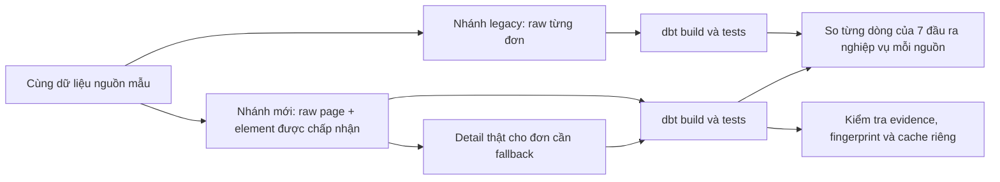

### Cách bài kiểm tra hoạt động

Script: `tests/dbt_acquisition_probe.py`. Tạo PostgreSQL tạm dùng RAM, không mở
port máy; dùng Python/dbt trong image Airflow có sẵn nhưng **không chạy Airflow**.
Áp dụng migrations001..011 và014 trên DB test; chưa cần delta012/013.
Code và fixture mount read-only; artifacts dbt nằm trong `/tmp` của client test.

Hai manifest test độc lập chọn hai cách biểu diễn cùng dữ liệu. Đây là fixture
để kiểm tra SQL, không phải một lượt thu thập HTTP hoặc freeze/publish thực tế.
Raw vẫn được giữ nguyên trong suốt bài test; không xóa raw để làm kết quả khớp.

| Nội dung | Mong đợi |
| --- | --- |
| dbt build/test ở cả hai nhánh | Tất cả model/test của graph runtime thành công; không chỉ parse/compile |
| Đơn, line, current, history, daily và status | So đủ 7 bảng nghiệp vụ/nguồn, chỉ bỏ batch lineage khác nhau có chủ đích |
| Website | Giữ kết quả nhánh không đổi để phát hiện tác động lan sang nguồn khác |
| eBay | Page có nhiều order; đơn cancellation dùng detail; shipping collection thiếu trường dùng fulfillment detail thật |
| Etsy | Page có nhiều receipt; receipt thiếu trường dùng raw detail; entry chưa được chấp nhận không trở thành snapshot |
| Đọc lại cùng phiên bản | Giữ quan sát/evidence, không tăng logical history/current |
| Fingerprint | So với hàm chuẩn độc lập trong fixture utilities, không sửa quy tắc định danh phiên bản |
| Evidence | Trỏ raw thuộc đúng manifest; hash đúng bytes; role đúng nguồn. Không đòi raw UUID hai nhánh giống nhau |
| Cache Etsy | Page lặp lại dùng chung cache theo nội dung element; không lấy hash cả page làm danh tính receipt |

Không so evidence bằng phép bằng nhau đơn thuần: cách lấy dữ liệu đã thay đổi
nên raw ID và loại response có thể khác. Ví dụ page thật phải mang role
`EBAY_ORDERS`/`ETSY_RECEIPTS`, không tự dựng một response detail chưa từng nhận.
Website vẫn dùng role riêng `WEBSITE_RELATIONAL_SNAPSHOT` đã có từ trước.

### Tự chạy ở máy bạn

Bật Docker Engine, không cần bật Compose main hoặc DAG. Từ thư mục gốc repo:

```powershell
python tests/dbt_acquisition_probe.py
```

Cần sẵn image `postgres:16.15-bookworm` và `multi-channel-order-platform-airflow`
có project venv/dbt. Script không cài package host hay tự đổi image main.
Kết thúc sẽ in PASS/FAILED và đường dẫn report `runtime/dbt-acquisition-*.json`.
Chỉ container test có tên/label do script tạo và dữ liệu tmpfs của chúng bị dọn;
không xóa volume, DB hoặc dữ liệu chính. Xem `checks.builds`, `checks.parity`,
`checks.fingerprints`, `checks.evidence`, `checks.element_cache` và `cleanup`.

### Kết quả thực tế và giới hạn

**Kết quả cuối: PASS**, report
`runtime/dbt-acquisition-157f78dfe5b2.json`, source hash
`673cbce2ca50fe5105f541df2184a799ba138e188701d1b6c4f90dd85b5c4c5c`.

- Legacy: 60node success/pass; page mới: 60node success/pass; không có node lỗi.
  Số node bao gồm model, test và hook, không phải 60model.
- 21phép so sánh: 7bảng nghiệp vụ × 3nguồn, so đủ giá trị/từng dòng chứ không
  chỉ so count. Chỉ loại batch lineage khác nhau giữa hai manifest.
- Mỗi marketplace có 2đơn current, 3snapshot từ 4quan sát. Quan sát lặp không
  tạo thêm logical snapshot. Website vẫn 1đơn/1snapshot như fixture đối chứng.
- 4kiểm tra fingerprint (2nguồn × 2nhánh) đúng utility độc lập; 6kiểm tra
  evidence (3nguồn × 2nhánh) đúng manifest/raw bytes/role. Evidence eBay legacy
  8dòng, page11dòng vì có page/detail/shipping thật khác nhau; không ép count bằng nhau.
- Cache element Etsy: trước nhánh page0dòng, sau2dòng; hai page lặp cùng phiên bản
  dùng chung entry. Không cần sửa thêm model/macro nghiệp vụ để đạt kết quả này.
- Client/DB test đã dọn, không còn container chạy ở kiểm tra cuối; main vẫn dừng
  như trước. Không stage/commit/push.

Trong lúc dựng probe có3lần chưa PASS, đều ghi report thay vì bỏ qua:
`5b2e20f0957e` thiếu finished_at trong metadata fixture (chưa chạy dbt);
`7d89d38a218c` dbt legacy đã chạy qua nhưng helper evidence áp sai role cho Website,
đồng thời helper cleanup chưa nhận dạng chuỗi lowercase "no such object" khi
client đã tự xóa; `5182e546fff1` chờ nhầm server PostgreSQL khởi tạo tạm.
Đã sửa helper đúng contract và chờ TCP final readiness, không sửa constraint,
không sửa SQL nghiệp vụ hoặc giả PASS. Lượt cuối chạy lại đủ hai nhánh và PASS.

Ngay cả khi PASS, đây chỉ là kiểm chứng dbt với input mới trên fixture nhỏ:
**không** chứng nhận thời gian dưới10giây, tải900, compiled delta runtime,
scheduler/restart, release/bootstrap hoặc main đã bật page-reuse.
Để bật main theo đường delta đang có, bước tiếp theo vẫn là yêu cầu riêng cho
qualification compiled plan/release/bootstrap. Không tự đổi `.env` hay bypass
stale-plan guard chỉ vì dbt build thông thường đã PASS.

## Sửa daily aggregate/publish và nghĩa ngày trên report (14/11)

Không chọn một loại ngày cho toàn hệ thống: đơn/sản phẩm theo cohort ngày tạo
đơn nguồn, monitor theo thời gian chạy thực tế. Lượt xử lý không phải đơn mới;
quan sát phiên bản không phải doanh thu. UI ghi rõ, không tráo tên số liệu.

Lỗi chi phí đã xác nhận: daily model tính lại current toàn source. Đã sửa cả
model lẫn publisher: dbt tạo scope ngày cũ + ngày mới của order bị ảnh hưởng,
chỉ lấy current trong những ngày này; line dùng scoped order IDs. Các ngày ngoài
scope giữ nguyên cả giá trị và lineage. Scope vẫn có ngày cũ khi bucket mới rỗng
để publisher xóa đúng phần hết dữ liệu, không xóa lịch sử khác. Bootstrap/backfill
mới xử lý phạm vi toàn bộ cần thiết; không dùng WHERE ngày hôm nay làm mất late data.
Hai helper model/source; không đổi schema/grain của các mart/core đang công bố.
Migration013 chỉ cấp quyền SELECT hai mart cho dbt tạo scope bootstrap.

Staging hiện đã là bảng materialized, không bị chạy lại bởi từng downstream model.
Dedup logical version xảy ra sau shape/hash; raw trùng vẫn có thể tốn công tính lại.
Giữ bằng chứng raw, không dedup mất audit. Chưa có bằng chứng phải thêm cache/table
cho Website ngay. Thêm timer CTAS/ANALYZE và config/prepare/drop/finish; chưa đo riêng
mọi thao tác JSON, wrapper và commit nên không tự kết luận parse là nút thắt.
dbt CLI threads2 chạy node độc lập được, nhưng compiled live runner vẫn tuần tự
trong một transaction. Không bật thread trên cùng connection hay commit nửa chừng.

Regression mới có case ngày cũ/mới, đổi currency, bucket rỗng, late data, replay,
empty tick, ngày không liên quan giữ nguyên; thêm parity staging fingerprint/
multiset với duplicate/NULL/Unicode/invalid arrays. Kết quả thực tế, cả lỗi harness
và lần chạy lại, xem STATUS. Chưa rollout main hay chạy lại bài900.

## Chuẩn hóa SQL dbt theo yêu cầu chủ dự án (14/11)

- Các SQL tự viết trong models/macros/tests không còn SELECT wildcard; ghi rõ
  projection. Macro effective_current nhận danh sách cột từ model gọi nó, không
  kéo toàn bộ schema của core vào mỗi aggregate. Không sửa dữ liệu raw đã lưu.
- COUNT(1), INNER JOIN rõ ràng; LEFT/CROSS LATERAL giữ đúng ý nghĩa. Dedup dùng
  GROUP BY, kể cả kiểm tra distinct identity có xử lý NULL đúng như trước.
  IS DISTINCT FROM vẫn giữ vì là phép so sánh NULL-safe, không phải loại trùng.
- Bỏ hai CTE wrapper dư ở test Etsy; không tháo MATERIALIZED đang chống parse
  JSON nhiều lần. CTE nhiều không đồng nghĩa plan sai; cần xem execution plan.
- EXISTS dùng SELECT1, PostgreSQL tự dừng khi thấy dòng, không cần TOP(1) hoặc
  thêm LIMIT1 cho đẹp. TOP là cú pháp SQL Server, không dùng trong PostgreSQL.
- Đã đối chiếu index trong migration: batch/raw/dirty-key/cache có PK phù hợp;
  các điều kiện OR mapping, metadata raw và join vào CTAS vẫn cần đo plan. Không
  tự thêm index hoặc khẳng định mọi ON đều được index tối ưu.
- Giữ filter theo frozen batch/source/resource và affected keys; aggregate vẫn
  cần đọc phần current cũ không đổi để ra tổng đúng, không thêm LIMIT tùy ý.
- Việc đổi SQL làm đổi compiled/source/cache version: chưa rollout lên main;
  plan cũ phải từ chối. Cần compile/parity/bootstrap release mới trước khi bật.

Quy tắc và giới hạn: [SQL_STYLE.md](../transformations/SQL_STYLE.md).
Kết quả kiểm tra chính xác và các lượt cần chạy lại được ghi ở STATUS.

## Review build & test bài 900 và chốt phạm vi Etsy (14/11)

Report số đo thực: [23_M08D_BUILD_TIMING.md](23_M08D_BUILD_TIMING.md).
Đã bật riêng PostgreSQL theo sự đồng ý của chủ dự án, chỉ SELECT read-only ledger
bài cũ, rồi dừng lại: exited0. Không bật Airflow/SIM, không chạy lại pipeline.

| Nguồn | Số chu kỳ | Build/test p50 / p95 / max (giây) | Model trung bình | Test trung bình | Phần chưa tách timer |
| --- | ---: | --- | ---: | ---: | ---: |
| Website | 11 | 1,842 / 6,971 / 7,895 | 2,890 | 0,036 | 0,197 |
| eBay | 6 | 2,641 / 3,797 / 4,080 | 2,359 | 0,225 | 0,139 |
| Etsy | 18 | 4,982 / 6,916 / 8,066 | 1,540 | 0,046 | 3,653 |

- Đây là 35 chu kỳ thực trong cửa sổ bài 900, không phải mỗi chu kỳ xử lý cả
  900 đơn. Còn có dữ liệu cũ trong core và raw context của các order bị ảnh hưởng.
- Website: model product activity từng tốn5,061s. Model này join tập current
  (đơn cũ không đổi + candidate thay đổi), rồi group theo ngày/sản phẩm/tiền tệ.
  Output chỉ166 dòng không có nghĩa nó chỉ đọc166 dòng. Cần execution plan mới
  để biết join/scan/spill hay contention cụ thể, chưa khẳng định nguyên nhân đó.
- Etsy: thời gian chưa chia timer là3,653s trung bình, khoảng70% tổng thời gian.
  Một batch KHÔNG có order mới vẫn tốn6,607s, trong đó5,679s ngoài model/test.
  Phần này có thể gồm validate release/hash, cache hook, DROP, audit/commit/wait;
  **chưa có số đo để kết luận hook hay mạng là thủ phạm**.
- Các test không phải phần chiếm đa số. Không bỏ test để nhanh hơn. Runtime
  hiện chạy SQL dbt đã compile, không khởi động dbt CLI/full project mỗi chu kỳ.
- Đề xuất: đo các subphase còn thiếu trước; profile product aggregate cả3nguồn;
  sau đó thiết kế no-business-change tick để không rebuild nghiệp vụ khi không
  đổi, nhưng vẫn giữ audit/checkpoint/health/mapping và raw consumption đúng.
- Publish tạm chưa tối ưu theo yêu cầu. Không có bằng chứng chậm do đường truyền.

**Etsy SIM giữ nguyên** ở slice tiếp theo. Sửa collect bỏ GET receipt dư; vẫn cần
đổi eligibility/route/staging/cache/evidence để nhận đúng page array, không phải
chỉ xóa một lời gọi HTTP. Giữ GET cho webhook/fallback. Xong phải parity dbt,
release/bootstrap mới rồi mới bật live; chưa triển khai code ở lần review này.

## Hướng nâng cấp collect đã sửa sau review (14/11)

Lần này chỉ sửa doc/plan, **chưa sửa collector/SIM hay chạy lại test tải**.
Thiết kế chi tiết và diagram: [22_M08D_EBAY_ACQUISITION.md](22_M08D_EBAY_ACQUISITION.md).

- Đổi quyết định cũ: page lấy tuần tự; tối đa hai worker **lấy detail/enrichment**
  cho từng source/account khi cần. Không phải bật thêm hai DAG hay hai owner.
- eBay tận dụng Order trong page khi đủ; chỉ lấy thêm cancellation/shipping hoặc
  fallback thật sự cần. Batch `orderIds` tối đa 50 vẫn có thể hỗ trợ khi cần lookup
  theo nhóm, nhưng không bắt buộc gọi lại toàn bộ đơn đã có payload đầy đủ.
- Batch vẫn là getOrders, không giàu thông tin cancellation hơn list. Khi có
  cancellation hoặc thiếu/chưa chắc dữ liệu, vẫn gọi getOrder riêng. Shipping
  collection vẫn theo từng order nếu cần bằng chứng ngày gửi và phân bổ line.
- SIM cần hỗ trợ orderIds nếu dùng grouped lookup và thu hẹp khóa đang bao cả
  request để detail thực sự chạy song song. Không tự tạo bulk fulfillment API.
- Một response thật chỉ lưu một raw; dbt tách Orders từ array và giữ lineage
  theo raw + order ID. Không giả raw detail hay tự tạo history chưa quan sát.
- Etsy recovery: SIM đã trả receipt kèm transactions và các trường shipment có
  trong payload. Bỏ GET detail dư khi page đã đủ, nhưng phải sửa route/staging/cache
  để dùng đúng page element. Một page có nhiều receipt: không được dùng page hash
  làm cache key duy nhất cho mỗi receipt. Không giả raw detail hay attempt HTTP.
- Etsy webhook vẫn cần GET receipt theo resource URL; dùng tối đa hai detail worker
  nếu cần, giữ lease/token/audit và quota chung. SIM đã đủ payload nên giữ nguyên;
  nếu khóa request hạn chế speedup thì ghi số đo, không tự sửa SIM để đẹp kết quả.
- Website đang lấy hàng loạt order và child bằng ANY(order_ids), cùng transaction
  REPEATABLE READ READ ONLY. Giữ một snapshot, không ép hai worker gây lệch snapshot.
- Sau collect, freeze/dbt/publish đã xử lý nhiều order bằng SQL theo tập. Python
  loop model/table, không phải chạy cả pipeline/commit một lần cho từng order.
  JSON vẫn phải parse từng phần tử trong DB; đó không phải N lần gọi DB từ Python.
- Giữ kiểm tra page bị thay đổi, retry/budget, checkpoint hoàn tất một lần sau
  toàn bộ công việc; detail worker không tự giải quyết việc offset có thể bỏ sót.
- S01 giữ nguyên. Model thay đổi cần release/compile/parity/bootstrap mới, rồi
  chạy lại đúng bài 900; chưa khẳng định sẽ đạt dưới 10 giây.

Hướng Etsy đã được chủ dự án đồng ý và đưa vào plan ở lần review này. Đây vẫn là
thiết kế, chưa sửa code runtime. Không coi việc đọc code là test concurrency hay
chứng nhận dữ liệu thực tế của mọi tài khoản Etsy đều đủ trường.

## Kết quả mới nhất: bài 900 đã PASS, chưa đạt tổng xử lý dưới 10 giây (13/11)

Đã hoàn tất đúng thứ tự: sửa/gate startup Airflow → test đổi mapping → rollout
delta trên main có dữ liệu cũ → chạy nguyên `campaign_rate_900.json`.

- Bài 900 exit0, `BASELINE_PASS` và load assessment `PASS`. Đối chiếu độc lập
  đủ 900 đơn, 3.801 dòng sản phẩm, không có sai lệch; mỗi nguồn 300 đơn đúng
  trạng thái cuối. Không reset dữ liệu, không abort batch hay nới retry/budget.
- Scheduled successes trong cửa sổ tải: Website 10, eBay 5, Etsy inbox 9,
  Etsy recovery 7; ngưỡng cũ yêu cầu ít nhất 2 cho mỗi DAG.
- Sau cửa sổ phát dữ liệu, quan sát đủ dữ liệu cuối sau **96,438 giây**,
  dưới giới hạn drain 900 giây. Future versions và pending sends đều về 0.
- Report: `runtime/campaign-55425905726c48c880d022e0fbface94/report.json`.
  Dataset: `campaign-rate-900-8eab0dfd3312`; campaign nguồn `9caed6c79e22`.
  Main cuối có Website 2.919/eBay 2.723/Etsy 2.837 đơn: giữ 7.579 đơn cũ,
  thêm đúng 900 đơn. Airflow healthy, giữ nguyên 7 cờ pause và plan đã kiểm chứng.
- 28 mẫu tài nguyên: đỉnh RAM quan sát toàn stack khoảng 2,25 GB, DB tăng khoảng
  30,8 MiB; Docker 2 CPU, khoảng 4 GB RAM. Đây là đỉnh lấy mẫu, không phải giới
  hạn công suất tối đa hay bằng chứng ổn định nhiều giờ.

**Điểm chưa đạt là tổng collect → publish dưới 10 giây.** Build/test p95 hiện
Website 6,971s/eBay 3,797s/Etsy 6,916s; nhưng collect p95 eBay 59,427s và Etsy
40,153s. Ngay các workflow không retry cũng có tổng thời gian vượt 10 giây.
Không được lấy riêng SQL nhanh hay bài 900 PASS để nói toàn pipeline dưới 10s.

Lý do retry eBay đã xác nhận là `mutable page total; reconcile window`: API nguồn
đổi trạng thái trong lúc đọc nhiều trang. Code `ingestion/ebay.py`, hàm `acquire`,
đang lấy detail của hết một page rồi mới đọc page tiếp theo; khoảng cách dài làm
dễ gặp thay đổi tập kết quả. Có 5 collection attempt lỗi kiểu này rồi retry thành
công theo budget cũ, không phải 5 DAG thất bại vĩnh viễn. Raw/audit được giữ lại;
HTTP trả 200 vẫn có thể bị từ chối vì pagination không nhất quán.

Đề xuất tiếp theo, **chưa sửa trong bài đo**: crawl hết các list page trước rồi
mới xử lý detail, giữ kiểm tra window/checkpoint/audit; sau đó kiểm chứng concurrency
HTTP có giới hạn nếu cần. Không bỏ kiểm tra mutable page hay tăng retry để che lỗi.
Chưa chạy burst/soak hay tăng tải tiếp; chưa gọi toàn M08D hoàn thành. Số
77,376s/p95 236,711s trong report là từ lúc trạng thái cuối đủ điều kiện xuất hiện
ở nguồn đến lần SQL observer nhìn thấy, bao gồm polling/retry; không phải riêng
thời gian transform hay exact commit latency.

## Đang tiến tới bài tải 900: thứ tự triển khai ngày 13/11

Mục tiêu là chạy lại **nguyên cấu hình** `campaign_rate_900.json`: 300 đơn mỗi
nguồn, tổng 900 đơn trong 10 phút phát sinh dữ liệu. Không nới giới hạn drain,
retry, tài nguyên hay số chu kỳ scheduled thành công để đổi kết quả thành PASS.

1. Sửa startup Airflow: đợi Execution API sẵn sàng rồi mới bật scheduler. Bản
   adapter đầu tiên bị lỗi JWT ngay lúc khởi động trong môi trường test, chưa tới
   bước restart cố ý; không phải lỗi JWT đã xác nhận trên main. Đã sửa cách chia sẻ
   và lưu bền khóa ký trước khi import Airflow. Không tắt kiểm tra chữ ký.
2. Gate restart mới đã có 3 chu kỳ Website SUCCESS, mỗi chu kỳ đúng try2: lỗi
   freeze cố ý một lần rồi retry thành công. Đang chạy tiếp gate mapping/full dbt;
   chưa được coi toàn bộ lượt test PASS khi chưa khôi phục/xác minh main xong.
3. Đổi mapping chỉ trong DB test: đóng mapping cũ, thêm bản mới; plan cũ phải bị
   từ chối. Rebootstrap đối chiếu đủ 8 đầu ra với dbt build đầy đủ trước publish,
   giữ snapshot ID/fingerprint/first_observed_at và raw audit. Không tự bật lại
   artifact cũ trên publication mới dù trả config mapping về hash cũ.
4. Khi các gate PASS mới rollout main: drain đến idle, chỉ dừng Airflow; migration
   012 bổ sung, compile/bootstrap riêng 3 nguồn, đối chiếu full dbt trước publish,
   rồi thay container Airflow. Giữ PostgreSQL/SIM/dữ liệu và 7 cờ pause. Cần ít
   nhất 2 scheduled successes cho mỗi DAG live trước khi chạy tải.
5. Sau đó mới chạy 900 và báo riêng correctness, cadence, drain, latency, tài
   nguyên. Chưa có kết quả 900 mới ở checkpoint này; không suy từ test nhỏ ra SLA.

Tool rollout mới là `tools/s02_data/delta_deploy.py`, phải có report gate PASS
đúng mã nguồn và xác nhận local. `LIVE_DELTA_PLAN_DIR` là đường dẫn release rõ
ràng, không phải chọn dataset. Khi bật, các chu kỳ vẫn tự lấy dữ liệu mới qua
source interface bình thường; không gen data hay compile lại dbt mỗi chu kỳ.
Nếu bootstrap lỗi thì giữ batch/artifact để kiểm tra, không tự abort hay reset.
Lệnh và kết quả cuối từng bước được cập nhật trong `docs/STATUS.md`.

Cập nhật gate: `runtime/delta-startup-mapping-20261113-02.json` đã exit0/PASS,
khôi phục đúng container/image main healthy, 7 pause flags và drain state không
đổi. Test mapping giữ nguyên 113 snapshot, tái xử lý 234 raw; đủ 8 output bằng
full dbt 54 node. Đã bắt đầu lệnh rollout main, đang drain; chưa chạy bài 900 mới.

Cập nhật triển khai: rollout main đã PASS. Cả 3 nguồn qua full dbt 54 node và
đối chiếu đủ 8 output trước publish; Airflow healthy, 7 pause flags không đổi,
mỗi DAG live có 2 scheduled successes. Không reset PostgreSQL/SIM/raw. Đang chạy
nguyên bài 900: report `runtime/campaign-55425905726c48c880d022e0fbface94/report.json`,
dataset `campaign-rate-900-8eab0dfd3312`, admit lúc 21:52:56 ngày 13/11 (giờ local).
Phát sinh 300 đơn/nguồn trong 10 phút; pipeline tự chạy qua SQL/HTTP như bình thường.
Chưa có kết quả cuối, không gọi toàn M08D hoặc mốc MAX dưới 10 giây là PASS.

## Ưu tiên 1/2: đã xác định nguyên nhân retry, gate đa nguồn PASS (13/11)

Kết quả cuối: `runtime/delta-scheduled-four-dags-20261113-03.json`, exit0/PASS.
26 scheduled runs đều SUCCESS, task cycle đều try1:

| DAG | Runs thành công |
| --- | ---: |
| website_polling | 10 |
| ebay_polling | 9 |
| etsy_inbox | 4 |
| etsy_recovery | 3 |

104 stage attempts collect/freeze/build/publish đều SUCCEEDED ở attempt1.
Giữ khóa nguồn Etsy trong DB test khiến cả hai sensor Etsy reschedule đúng;
Website/eBay vẫn hoàn tất. Sau khi thả khóa, các Etsy workflow tiếp tục bình thường,
không reset budget hay sửa trạng thái task trong DB. Một webhook ký thật được
receiver nhận202; receipt9001002 không có webhook vẫn được recovery tìm qua HTTP.

Receipt9001001 được quan sát4lần và9001002 được quan sát3lần nhưng mỗi đơn chỉ có
1snapshot marketplace, không nhân đôi history. Inbox có1detail HTTP; recovery
có6detail qua3runs. Raw frozen đã được tiêu thụ đủ sau publish; cả3publication
pointers đúng cycle hoàn tất cuối. Web có2snapshot do bootstrap rồi cập nhật nguồn.

Đã lưu/đọc26task logs trong archive tar.gz ở thư mục evidence của test. Main đã
khôi phục đúng container/image, healthy, giữ nguyên7pause flags và bỏ đúng tín
hiệu drain test tạo. Scope test đã cleanup; không dừng PostgreSQL/SIM main,
không xóa dữ liệu, không abort thêm batch, chưa bật delta/migration012 trên main.

Đây là gate scheduling/contention với dữ liệu nhỏ, KHÔNG phải chốt tải900 hay
cam kết dưới10s trên dữ liệu main tích lũy. Còn startup hardening, mapping/bootstrap,
rollout có kiểm soát và các bài tải/burst/soak. Chưa stage/commit/push.

### Giải thích retry và các lượt test thất bại trước khi sửa harness

Lượt tái hiện `delta-scheduled-diagnostics-20261113-01.json` giải thích được 4 tries:

1. Try 1 lỗi freeze do test cố ý tạo, raw và manifest đã lưu bền vững.
2. Try 2 bắt đầu trong 30 giây chờ dừng container, rồi bị ngắt trước khi chạy
   nghiệp vụ. Đây là khoảng shutdown, không phải collect lại.
3. Khi khởi động lại, scheduler nhận diện task mồ côi và giao try 3 trước khi
   Execution API sẵn sàng. SDK/LocalExecutor báo `Connection refused`.
4. Try 4 thành công. Ledger nghiệp vụ vẫn chỉ collect một lần, freeze lỗi một
   lần rồi thành công; build/publish một lần. Không reset budget.

Đây là race shutdown/startup của Airflow standalone đã tái hiện bằng log và
metadata, không phải kết luận do dbt SQL hay hết RAM. Các cycle sau có 2 tries
vì fault được cấu hình một lần MỖI WORKFLOW, không phải chỉ một lần lúc deploy.
Chưa thay đổi startup của main; hướng hardening là chỉ cho scheduler dispatch
khi Execution API thật sự ready, không tăng retry để giấu lỗi.

Lưu ý trung thực: các assertion workflow đã qua nhưng lệnh diagnostic tổng
exit1 ở bước copy log: thư mục chứa dấu `:` trong run ID không hợp lệ trên Windows.
Đã đổi sang nén `.tar.gz` bên trong container rồi copy một file, không giải nén
tên thư mục đó ra Windows. Main vẫn được khôi phục healthy, 7 pause state nguyên
vẹn và bỏ đúng tín hiệu drain do test tạo. Không đổi kết quả FAIL thành PASS.

Bước 2 dùng `--all-sources`: chạy Website, eBay, Etsy inbox và Etsy recovery
bằng DAG production trong scope test. Test giữ khóa nguồn Etsy tạm thời để
quan sát hai sensor `reschedule`, còn Website/eBay vẫn hoàn tất. Khi thả khóa,
Etsy phải chạy tiếp; có webhook ký thật gửi vào receiver HTTP riêng ngoài DAG,
và một receipt không có webhook để recovery tự tìm qua HTTP. Mỗi DAG phải có
ít nhất 2 scheduled successes, đúng plan/pointer, không mất raw hay nhân snapshot.

Lượt four-dags01 bị từ chối an toàn trước khi dừng main do scheduler tạo nốt
interval giữa hai lần đọc idle. Đã yêu cầu idle liên tục 15 giây trong cùng giới
hạn 600 giây; không abort hay ép task success. Lượt02 có20DAG runs thành công
nhưng test tổng FAIL vì join nhầm raw receipt đã xác nhận với raw HTTP audit:
hai loại là hai bản ghi riêng. Đã sửa truy vấn theo `metadata.http_raw_id` và
`collection_run_id`, KHÔNG sửa ingestion để chiều test. Lượt03 mới là kết quả PASS
nêu ở đầu mục. Các FAIL vẫn được giữ nguyên trong STATUS và report, không đổi xanh.
Chưa bật delta trên main, chưa đo lại900/burst/soak.

## Gate scheduler delta Website thật đã PASS (13/11)

Đã chạy `runtime/delta-scheduled-20261113-02.json`, exit0. Dùng DAG Website,
sensor, collector và SQL dbt thật trong môi trường cô lập; không mock nghiệp vụ.
Gây lỗi có chủ đích sau freeze lần 1, restart container Airflow test, rồi kiểm tra:

- Chính DAG run bị restart kết thúc `success`, không chỉ dựa vào bảng ops.
- Cùng cycle/batch: collect chỉ một lần; freeze lần 1 RETRYABLE, lần 2 thành công;
  build/publish thành công. Không reset budget hay recollect khi retry.
- Có hai scheduled run kết thúc thành công sau restart; tổng ba run cuối đều
  thành công, kể cả run đã tạo thêm trước khi drain test. Con trỏ publish đúng.

Một điểm cần review tiếp: task Airflow bị restart dùng tới 4 lần thử, trong khi
ledger nghiệp vụ chỉ có 2 lần freeze. Chưa giữ đủ log để kết luận nguyên nhân
các retry bổ sung; chưa thể nói do RAM hay API startup. Không giấu điểm này bằng
cách tăng budget hoặc ép task success.

Main được drain cho run đang có chạy hết, chỉ dừng Airflow khi thực sự idle.
Sau test đã khôi phục đúng container/image, healthy, giữ nguyên cả 7 pause state
và bỏ đúng tín hiệu drain do test tạo. Không abort thêm batch, reset dữ liệu hay
bật migration012/delta trên main. Scope test đã cleanup.

Lượt 01 chỉ là bằng chứng một phần: param ở task ghi đè param DAG nên ban đầu
fault chưa bật; sau sửa có retry thật nhưng chưa ghi đầy đủ trạng thái cuối DAG.
Đã sửa wrapper cấu hình cả DAG/task, thêm kiểm tra SDK serialization và siết gate;
lượt 02 mới được dùng để chốt gate này. Lệnh/kết quả đầy đủ ở `docs/STATUS.md`.

Chưa xong toàn bộ M08D: còn scheduled delta đa nguồn/contention, đổi mapping và
bootstrap lại, dữ liệu main tích lũy, tải 900/burst/soak. Đây không phải bài đo
healthy dưới 10s vì cố ý fault và restart.

## Đã abort chính thức batch cũ được bạn cho phép (13/11)

Batch `0bf4d6be-5ed6-5b56-85c7-d8b56c3e4781` và workflow owner đã chuyển sang
FAILED qua CLI chính thức, exit0. Đã xác minh lại DAG owner FAILED/task skipped,
không có SQL thực thi trước thao tác; dùng lại đúng lượt chờ 5 đã thành công.

Đối chiếu trước/sau: giữ nguyên toàn bộ 20.961 raw và manifest của batch (cả số
lượng lẫn chữ ký dữ liệu), con trỏ last-good Etsy không đổi. Không reset retry,
không ép task success; dòng audit build_and_test RUNNING cũ vẫn giữ làm bằng chứng.
Source owner đã được workflow kế tiếp nhận theo cơ chế bình thường, không sửa tay.

Không dừng/restart Airflow, không đổi pause state hay bật delta trên main. Các
container vẫn healthy. Chưa chạy gate scheduler riêng; lệnh đầy đủ và kết quả
được ghi ở đầu `docs/STATUS.md`. Chưa stage/commit.

## Kiểm tra tiếp recovery và dữ liệu tích lũy (13/11)

Đã chạy `runtime/delta-recovery-20261113-01.json`, kết quả PASS cho ba tình
huống bổ sung trên PostgreSQL tạm:

1. Kill thật tiến trình Python ngay sau khi tạo bảng candidate nhưng chưa
   commit. DB rollback phần chưa commit và nhả khóa nguồn. Batch vẫn BUILDING,
   raw chưa bị đánh dấu xử lý; lần thử 2 build/publish thành công.
2. Kill thật tiến trình khi publish đang sửa core/mart nhưng chưa commit. Một
   connection đọc độc lập vẫn thấy last-good. Retry ghi publisher cũ là
   FAILED/INTERRUPTED rồi publish thành công, không mất raw.
3. Hai tiến trình Website/eBay cùng có đơn bị ảnh hưởng, cùng qua điểm bắt đầu
   build; cả hai build và publish thành công vào con trỏ nguồn tương ứng.

Full dbt 54 node và cả 8 bảng đầu ra vẫn khớp sau các tình huống đó. Đây là kill
tiến trình SQL/Python, **chưa phải restart scheduler/container Airflow**.

Đã thêm `--http-rounds 3` vào probe: chạy 27 cycle, sinh thêm 333 đơn cho mỗi
nguồn, giữ nguyên raw/warehouse qua các đợt. Mỗi cycle kiểm tra tổng đơn tích
lũy; báo cáo tách riêng PASS dữ liệu và PASS/FAIL mốc 10 giây. Kết quả lượt dài
được cập nhật vào `docs/STATUS.md` khi kết thúc. Không gọi đây là tải 900 hoặc soak.

**Lượt tích lũy đã xong, PASS:** 27/27 cycle dưới 10s, không mẫu nào vượt.
Thời gian lớn nhất Web 3,58s / eBay 5,87s / Etsy 8,56s. Cuối lượt có
335/334/334 đơn trong core tương ứng (333 đơn mới mỗi nguồn cộng seed regression).
Full dbt 54 node và cả 8 bảng đầu ra vẫn khớp. Đây chưa phải dữ liệu main/tải 900.

Không đổi schema hay thuật toán nghiệp vụ trong lượt này, chưa bật delta trên
main, không reset dữ liệu của bạn. Docker hiện khoảng 4 GB RAM; muốn chạy thêm
scheduler riêng thì cần cửa sổ Airflow chính idle và được bạn cho phép tạm dừng,
rồi khôi phục. Chưa có xác nhận thì không tự dừng.

Bạn đã cho phép dừng Airflow chính **nếu idle**, nhưng kiểm tra thấy chưa idle:
4 DAG còn running/reschedule/retry. Batch Etsy
`0bf4d6be-5ed6-5b56-85c7-d8b56c3e4781` còn TESTED, trong khi DAG owner
`etsy_inbox` lúc 05:00 UTC đã FAILED lúc 05:30 UTC; audit build_and_test vẫn
RUNNING. TRANSFORM hoàn thành sau lúc DAG kết thúc khoảng 3 giây. Snapshot kiểm
tra không có SQL main đang thực thi; đây là trạng thái giữ lại trên đường main
cũ, không phải probe delta tạo ra. Chưa tự abort batch, drain, đổi pause state
hay dừng Airflow. Cần chốt xử lý owner cũ và quiet window trước gate scheduler.

## Đã nối đường delta vào workflow, nhưng chưa bật main (13/11)

Đường thử nghiệm không tạo workflow/retry riêng. Nó dùng lại collector và các
bước collect → freeze → build_and_test → publish hiện có; giữ giới hạn 5 lần thử,
quyền sở hữu theo nguồn và lệnh abort chính thức. Một cycle đã chọn plan nào thì
retry vẫn dùng đúng hash/phiên bản đó. Thiếu plan thì dừng trước khi lấy dữ liệu,
không âm thầm chuyển về đường cũ. Audit publish thành công được commit cùng dữ
liệu, con trỏ publication và danh sách raw đã xử lý.

Đã kiểm tra bằng collector SQL/HTTP thật trên DB tạm, không đọc thẳng DB SIM cho
marketplace. Đường mới vẫn cho kết quả khớp cả 8 bảng core/mart với full dbt
54 node. Kiểm tra coordinator đã bao gồm hết 5 lần thử, abort rồi chạy tiếp mà
không mất raw, chặn chen ngang cùng nguồn và cho nguồn khác tiến triển độc lập.

Đo trước sửa HTTP, với 100 đơn thay đổi: Web 3,67s, eBay 6,83s, Etsy 15,53s.
Etsy **chưa đạt 10s**; chủ yếu chậm ở collector, không phải dbt. Profile chỉ ra
việc tạo HTTP opener liên tục; đo riêng tạo 100 opener mất 14,7s, gần hết do nạp
lại kho chứng chỉ. Đã sửa tái sử dụng opener theo worker thread, không tắt kiểm
tra TLS, không bỏ request/audit hay thay cách claim. Lượt đo lại không profile
sẽ xác nhận hiệu quả; không lấy số microbenchmark làm kết luận toàn pipeline.

**Kết quả cuối trên đúng code mới:** probe đã sửa thư mục làm việc và kiểm tra
đường dẫn module collector để không lẫn code cũ trong image. Với 100 đơn:
Web **4,17s**, eBay **9,21s**, Etsy **7,05s**, bao gồm đọc xác nhận publication.
Cả 9 mẫu 1/10/100 đơn đều dưới 10s; full dbt 54 node và cả 8 bảng đầu ra khớp.
Đây chỉ là mỗi mức một mẫu trên DB tạm nhỏ, chưa phải chứng nhận tải 900 đơn;
eBay còn ít dư địa. Các lượt 02–04 dùng collector cũ đã được ghi rõ trong STATUS,
không coi chúng là số đo của sửa opener.

Chưa bật migration012 hoặc cấu hình delta trên main, chưa đụng `.env` của bạn.
Các test tạm không tạo scheduler Airflow thứ hai và không reset dữ liệu chính.
Chưa chứng nhận tải 900 đơn/soak, scheduler delta thật hoặc kill/restart. Chi tiết
lệnh, kết quả lỗi ban đầu và các gate chưa chạy được ghi ở đầu `docs/STATUS.md`.

## Tối ưu mới theo mục tiêu lấy dữ liệu → publish ≤10 giây (13/11)

**Chưa bật đường mới trên main và chưa tuyên bố đạt 10 giây.** Hướng được chốt
là thay cách làm, không chỉ tăng RAM hay sửa một câu SQL:

- Không khởi động dbt CLI cho mỗi lượt: đã đo riêng bước parse mất44,12giây
  trong stack đang chạy. Compile SQL/test của dbt một lần khi triển khai; mỗi lượt
  chạy lại chính SQL đã compile, kiểm tra hash code/mapping để không dùng nhầm bản.
- Raw vẫn giữ mọi lần lấy dữ liệu. Một bảng chỉ mục nối raw với mã đơn giúp tìm
  đơn nào bị ảnh hưởng. Chỉ dựng lại lịch sử của các đơn đó từ bằng chứng đã lấy;
  không tạo lịch sử từ lịch gen SIM và không bỏ bản đến trễ.
- Mỗi nguồn có schema build riêng. Khi publish, chỉ thay những đơn bị ảnh hưởng;
  bảng tổng hợp do dbt tính trên cả đơn mới lẫn đơn cũ không thay đổi. Raw chỉ được
  đánh dấu đã xử lý trong cùng transaction publish thành công.
- Full dbt/S01 vẫn là bài regression độc lập. Đây không phải bỏ dbt/test để lấy
  số đo đẹp. Tài liệu tiếng Anh chi tiết:21_M08D_DELTA_RUNTIME.md.

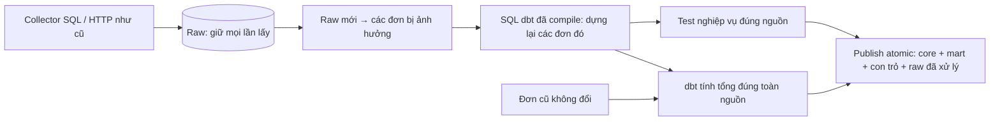

Bộ thử PostgreSQL tạm đã pass3nguồn, duplicate raw, lỗi test, rollback publish,
retry, lượt không có raw mới và giữ nguyên đơn không thay đổi. Đã đối chiếu với
full dbt54node PASS: cả8bảng core/mart khớp mọi trường nghiệp vụ, bỏ qua duy nhất
cột batch lineage có chủ đích. Đơn không đổi được giữ batch lần dựng gần nhất;
publication_state chỉ lần publish mới nhất của nguồn.

Đã kiểm tra thêm bản đến trễ, lỗi dữ liệu nghiệp vụ, khóa nguồn và retry sau khi
Python bị ngắt sau một lệnh CREATE TABLE thật. Full dbt54node và8bảng vẫn khớp.
Đã tìm được chi phí JIT: một SELECT eBay tốn gần3giây, riêng biên dịch2,90giây;
tắt JIT cho đúng transaction và cập nhật statistics sau khi dựng bảng giúp phần
build/test eBay trong mẫu mới còn0,48giây. Không đổi JIT toàn PostgreSQL.

Report04 đo riêng freeze/build/test/publish: eBay2,09giây, Etsy2,31giây,
Website khoảng2,26–2,62giây. Mẫu dữ liệu nhỏ trong DB tạm, **chưa có collector**,
không phải đo tải900đơn và không đủ để tuyên bố cả pipeline dưới10giây.
File kết quả: runtime/delta-probe-20261113-04.json.

Những số này **không phải** thời gian lấy dữ liệu → publish. Vẫn phải tích hợp
ownership/retry/audit của Airflow, kiểm tra restart/concurrency, bootstrap rõ ràng,
rồi đo cả collector trên dữ liệu lưu sẵn. Chưa sửa cách bạn bật pipeline hiện tại.
Lệnh thử cô lập và giới hạn được ghi trong transformation/DELTA.md; kết quả thực
tế/lệnh chạy nằm đầu STATUS.md. Không xóa DB/volume hay tự commit.

## Kiểm tra lại ngày13/11/2026 — batch đã publish, không abort

Bạn đã duyệt abort batch1513a865..., nhưng đọc lại DB sau khi khởi động
PostgreSQL cho thấy batch **PUBLISHED**, workflow DB **SUCCEEDED**, không còn
barrier. Vì vậy **không thực hiện abort**. Airflow vẫn giữ run FAILED do timeout;
không sửa audit thành success. Trạng thái TESTED đã đọc hôm trước chưa phải trạng
thái commit cuối. published_at lưu trong DB không phải mốc đo được lúc commit.

Đã giữ volume/data, khởi động stack qua drain/migrate/rebuild có guard. Image mới
có đúng SQL cuối5bd4e013... và FIFO8fd93d88..., khớp workspace. Startup PASS,
service healthy, gỡ drain marker và bật lại đủ bốn lịch.

Kết quả thật sau triển khai:

| Kiểm tra | Kết quả |
| --- | --- |
| Full dbt eBay | 54node PASS,52,81giây; batch PUBLISHED |
| Node evidence eBay có dữ liệu | 13.700dòng,1,60giây; không phải node rỗng |
| Full dbt Etsy inbox | 54node PASS,78,36giây; batch PUBLISHED |
| Evidence eBay trong build Etsy | 13.700dòng,3,50giây |
| Cache Etsy | 2.567payload giữ nguyên; staging7.345quan sát,7,19giây |
| Đối soát dữ liệu900đơn cũ | PASS900đơn/3.801lines/904phiên bản quan sát,0lỗi |

Đây chưa phải lần chạy tải900mới hay phép đo A/B toàn pipeline. Run recovery mới
còn đang chờ/retry nguồn tại checkpoint; không nói cả bốn DAG đã SUCCESS. Cần
kiểm tra tiếp recovery/cadence trước khi chạy qualification900. Các phần còn tốn
thời gian trong build Etsy là staging eBay33,72s, staging Website24,26s và test
fulfillment15,33s; không cộng đơn giản vì dbt có chạy song song.

Chưa chấm PASS toàn M08D, chưa stage/commit/push. Stack đang bật để bạn xem UI;
chi tiết batch, timestamps, lệnh và các check chưa chạy được ghi trong STATUS.

## Checkpoint trước đó — chưa triển khai xong SQL cuối, 12/11/2026

- FIFO đã triển khai và quan sát được eBay có ticket cũ được chạy trước cycle mới.
- SQL eBay bản đầu nhanh trên mẫu nhỏ nhưng full build mất79,4giây. Đã giữ kết
  quả bất lợi này, không tuyên bố toàn pipeline nhanh hơn. Plan sau đó cho thấy
  PostgreSQL ước lượng observations/raw chỉ1dòng, chọn Nested Loop không phù hợp.
- Bản sửa cuối nối bằng chứng raw trước, JOIN ranked versions sau. Đã kiểm tra
  toàn bộ3.152quan sát eBay/13.700liên kết bằng chứng: đủ5cột khớp bản cũ. Mẫu SQL
  đầy đủ median26,8s->1,7s; mẫu ranked-view30,0s->3,2s. Đây chưa phải full build.
  Compile, full dbt build trên DB rỗng,13case coordinator và import4DAG đều PASS.
- Bản cuối **chỉ có trong workspace**, chưa vào image chính. Drain hết600giây
  nên đã dừng đúng giới hạn. Run Etsy recovery cũ sau đó hết30phút khi batch
  `1513a865-d10b-536d-a01f-135de14f73f5` đã TESTED nhưng chưa publish. Artifact
  đủ54node PASS, không phải fail nghiệp vụ; phần chờ đã dùng gần hết thời gian DAG.
- Cần bạn duyệt abort chính thức **đúng batch mới này**, rồi mới rebuild khi idle.
  Chưa dùng quyền duyệt batch trước cho batch mới. Không reset retry, xóa raw hay
  đổi last-good. Dữ liệu và service còn nguyên; drain mode còn bật nên không xem
  container healthy là pipeline đã chạy lịch bình thường trở lại.
- Chưa chạy lại bài900 hay chấm PASS M08D; không stage/commit/push.

## Tối ưu tiếp: bằng chứng eBay và FIFO — 12/11/2026

Cache Etsy và sensor reschedule đã có bằng chứng chạy thật; FIFO được kiểm tra
cô lập, triển khai tiếp qua drain/rebuild có bảo vệ. Trong lượt này guard phát
hiện batch Etsy `2b1c970b-dd4c-5679-92dd-bff5463bd0cb` bị giữ BUILDING khi DAG
sở hữu đã FAILED. Sau khi bạn đồng ý, đã abort bằng workflow chính thức: giữ
20.903 dòng manifest và giữ nguyên mọi last-good publication; không reset retry.

Ưu tiên3 bắt đầu bằng execution plan, không đoán rồi thêm index. SQL evidence
eBay cũ tạo nhiều cặp raw/observation trong cùng run rồi lọc OR. Mẫu300đơn gọi
hàm đọc JSON180.000lần. Bản mới tách đường liên kết detail, metadata và list page;
mỗi page chỉ mở mảng một lần, cuối cùng DISTINCT để không nhân bằng chứng.
Không bỏ audit, không đổi fingerprint/history, không thay schema nghiệp vụ.

Probe tạm đã PASS10case, gồm600quan sát thật/2.613liên kết bằng chứng khớp toàn
bộ5cột. Median SELECT trên mẫu thật: cũ4.932,5ms, mới248,8ms; đây là SQL đơn lẻ
trên dữ liệu đã chụp, không phải toàn pipeline nhanh20lần hay M08D đã PASS.
Xem diagram/runbook trong `docs/20_M08D_REUSE_COORDINATION.md` và STATUS để biết
deployment/full dbt đã hoàn tất chưa. Bài900, burst/soak chưa được chấm lại.

## Ưu tiên 1 và 2 — đang kiểm chứng, 12/11/2026

Hai thay đổi được chủ dự án đồng ý đang được triển khai:

1. **Cache chuẩn hóa Etsy:** `cache.etsy_payloads` trong `data_platform`, không
   nằm ở DB SIM. dbt chỉ chuẩn hóa payload còn thiếu theo source/account/byte hash/
   phiên bản code. Sau đó nối ngược lại **tất cả raw thuộc manifest**. Không xóa
   raw trùng, không gộp mất audit, không dựng history chưa từng quan sát. Đổi code
   chuẩn hóa tự có version cache mới; mapping version không thay source identity.
2. **Nhường worker khi chờ:** bốn DAG live vẫn có task `cycle`, nhưng task dùng
   sensor `reschedule`. CLI trả75 khi coordinator bận: task chuyển sang chờ lịch
   lại, không giữ worker và không tiêu một business retry. Quyền theo nguồn nằm
   trong `ops.source_cycle_owners`, đồng hồ chờ nằm ở `ops.coordinator_waits`.
   Vì vậy Etsy inbox và recovery không vượt nhau sau khi task nhường worker.

Migrations010/011 chỉ bổ sung cache và operational state; không đổi core/source
schema. Shared build/publish vẫn được bảo vệ bằng DB lock, không chạy song song
vào cùng candidate tables. S01/manual CLI giữ kiểu chạy cũ, nhưng phải tôn trọng
live owner còn hoạt động. RUNNING owner bị mất process không tự bị cướp quyền;
vẫn cần xác minh và abort chính thức khi cần.

Probe cache/coordinator, compile dbt và import/serialize DAG được kiểm tra riêng
trước deployment. Chi tiết thiết kế: `docs/20_M08D_REUSE_COORDINATION.md`.
**Đọc STATUS để biết deployment/runtime đã chạy tới đâu.** PASS probe không phải
PASS bài tải900; các FAIL trước đây vẫn giữ nguyên, không nâng timeout để đổi màu.

## Đã triển khai và chạy lại bài 900 — 08/11/2026

**Kết quả: dữ liệu đúng và drain đúng hạn, nhưng bài tải vẫn FAIL cadence.**

| Kiểm tra | Kết quả thực tế |
| --- | --- |
| SQL mới vào Airflow | Đã triển khai qua drain/build/start; hash khớp workspace |
| dbt + publish | 10 batch trong cửa sổ đo, mỗi batch đủ 54 node, không có node lỗi |
| Đối soát độc lập | PASS 900 order, 3.801 lines, 907 observed versions, 0 lỗi |
| Bắt kịp trạng thái cuối | 751,03 giây sau khi cửa sổ nguồn kết thúc, dưới budget 900 giây |
| Scheduled success đủ điều kiện | Website/eBay/inbox/recovery = 1/1/1/1; yêu cầu 2 cho từng DAG → FAIL |
| Giữ nguyên code/cấu hình khi đo | 78 hash khớp; vẫn 2 slots, polling 60 giây, page size 50/50 |

Report chính: `runtime/campaign-262f579dff4943a1bc8b9ef0fb03a5cb/report.json`.
Nguồn kết thúc 12:07:50 giờ Việt Nam; quan sát đủ trạng thái cuối lúc 12:20:21;
controller chốt FAIL lúc 12:22:52. Không tính các run bắt đầu ngoài cửa sổ đã chốt
để biến kết quả thành PASS. 907 history versions là phần pipeline thật sự thấy,
không tự dựng đủ 1.941 trạng thái đã lên lịch ở SIM.

Trong lúc triển khai có hai việc vận hành cần phân biệt:

1. Batch cũ `5d030239-d64c-58ae-895b-6d5804464e5f` thật sự mồ côi: owner FAILED,
   task SKIPPED, không có publisher đang chạy. Theo đúng phép bạn đã cho, mình
   dùng bước abort chính thức dưới release lock; giữ raw/audit/manifest/last-good.
   Lệnh đi qua coordinator trước đó timeout source slot, không reset budget.
2. Lượt startup đầu báo nhầm một batch mới là orphan: thực tế owner RUNNING và
   dbt đang chạy. Mình không abort nó. Nguyên nhân trong code là owner metadata
   chỉ được bổ sung ở `finally`, sau khi batch đã lộ trạng thái FROZEN. Đã sửa
   `batch.py`/workflow để ghi owner cùng transaction tạo manifest; guard đọc lại
   đúng batch còn active trước khi từ chối. Orphan thật vẫn bị chặn, không tự abort.

Lượt startup bị từ chối không nhận dữ liệu, giữ riêng ở
`runtime/campaign-73a90b8c3a2f4a4b99cec8a8d1ed8ffc/report.json`.
Không có thay đổi chọn raw mới/incremental trong `batch.py`; chỉ sửa owner metadata.
Không thêm bảng/schema/procedure, không đổi business SQL ngoài staging đã duyệt.

Những phần còn chậm được đo, không phải phỏng đoán máy đã đạt giới hạn:

- Etsy staging: khoảng 82–109 giây trong các batch Etsy.
- Chờ source slot tới 235 giây, release slot tới 177 giây.
- Toàn stage build/test Etsy 116–162 giây; stage còn có startup/process overhead.
- Một lượt eBay collect retry vì `mutable page total; reconcile window`, sau đó
  chạy thành công. HTTP error audit bằng 0 không có nghĩa không có retry nghiệp vụ.
- 63 resource samples không chạm ceiling; peak reported stack memory khoảng 2,17 GiB.

Hướng review tiếp là Etsy parsing/canonicalization và cách task chờ slot chiếm
executor; chưa tự tăng worker/budget hay chuyển toàn bộ sang stored procedure.
Không thể kết luận pipeline nhanh hơn bao nhiêu chỉ từ hai lần chạy có lịch sử
lưu sẵn và phase scheduler khác nhau. M08D vẫn chưa hoàn thành; chưa chạy burst/soak.

Bạn kiểm tra lại kết quả dữ liệu bằng lệnh **chỉ đọc** sau, với stack đang bật:

```powershell
python -m test_support.m08d_measure --report runtime/campaign-262f579dff4943a1bc8b9ef0fb03a5cb/report.json
```

Lệnh trên PASS không thay verdict FAIL của bài tải. Nếu chủ động chạy lại toàn
bài, lệnh campaign dưới đây sẽ **thêm một bộ 900 order mới**, không reset dữ liệu:

```powershell
python -m tools.s02_data campaign --config tools/s02_data/config/campaign_rate_900.json --confirm-local
```

45 regression test chọn lọc, S01 offline và diff-check pass. Các dịch vụ đang
healthy, bốn DAG không pause; giữ để bạn xem UI/DBeaver. Chưa stage/commit/push.

## Tối ưu Website staging theo số đo — 08/11/2026

Lượt này chỉ sửa `transformations/models/staging/stg_website_observations.sql`.
Chưa chuyển sang incremental, chưa bật build song song, không đổi page size,
worker, transaction publish hay điều kiện PASS. Không thêm bảng/schema bền vững.

Trước đây: mỗi order lại lọc các mảng items/payment/cancel/shipment trong cùng
raw; việc dựng payload để trả ra và tính fingerprint còn có thể lặp các subquery.
Hiện tại: mở từng mảng một lần theo raw, gom theo order rồi join với header.

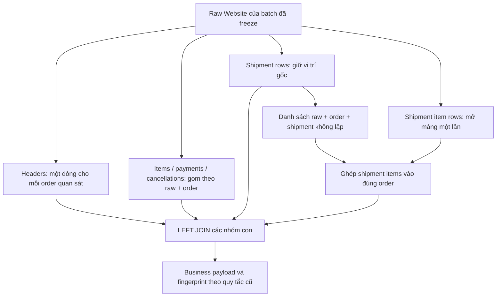

Các CTE `MATERIALIZED` trong câu SQL là kết quả trung gian của lần chạy, không
phải thêm bảng để bạn quản lý trong DBeaver. Mình giữ nguyên thứ tự phần tử,
child trùng, header trùng và phân biệt raw; shipment lặp không làm nhân đôi item
vì giữ đúng ngữ nghĩa `EXISTS` cũ. Không tự tạo history từ lịch SIM.

Đã so sánh SQL cũ/mới trên PostgreSQL thật bằng `EXCEPT ALL` hai chiều cho toàn
bộ cột, gồm fingerprint. PASS trên S01, child rỗng/thiếu, header/raw lặp,
shipment lặp/cross-order, Unicode và 200 raw thật chứa 2.091 order observations.
Ba dạng mảng child sai kiểu vẫn báo lỗi `22023` ở cả hai bản; không che lỗi dữ liệu.

| Order trong một raw giả lập | SQL cũ, trung vị | SQL mới, trung vị |
| --- | ---: | ---: |
| 1 | 1,16 ms | 1,16 ms |
| 10 | 9,30 ms | 6,76 ms |
| 100 | 280,89 ms | 69,62 ms |
| 300 | 2.643,85 ms | 287,44 ms |
| 600 | 9.190,57 ms | 432,45 ms |

Mỗi số là trung vị 4 lượt `EXPLAIN ANALYZE`, chạy cũ/mới luân phiên. Kết quả
cuối xác nhận từng mảng chỉ mở một lần cho một raw. Cải thiện khoảng 21 lần ở
600 order **chỉ dành cho câu staging này**, không có nghĩa toàn pipeline nhanh
21 lần. Báo cáo v1 cũng được giữ: nó giúp phát hiện shipment items vẫn bị planner
quét lặp; bản v2 đã khắc phục bằng CTE materialized và được đo lại.

Bạn tự chạy lại từ thư mục gốc, Docker và Airflow container hiện có đang bật:

```powershell
python tests/website_staging_probe.py --container multi-channel-order-platform-airflow-1 --report runtime/website-staging-review.json
```

Chọn tên report mới nếu file đã tồn tại. Không cần bật thêm stack test; script
dùng bảng/hàm tạm trong session và rollback toàn bộ. Không sửa core/mart/ops,
không restart/pause Airflow. `status: PASS` nghĩa là parity và probe này pass,
không phải M08D đã pass. Execution plans nằm trong file JSON để bạn kiểm tra.

**Chưa triển khai SQL mới vào image Airflow đang chạy.** Chưa chạy lại đủ
54 node dbt/build/test/publish hay bài 900 với SQL mới. Bước tiếp là triển khai
tại thời điểm không có release đang làm, kiểm tra gate đầy đủ rồi mới chạy lại
bài 900 với cùng tiêu chí cũ. M08D vẫn chưa hoàn thành. Không stage/commit/push.

## Đã thêm phân trang live và đo lại — 07/11/2026

Theo bước tiếp theo đã trao đổi, mình chỉ đổi cách chia trang danh sách:
live mặc định eBay50/Etsy recovery50; base/S01 vẫn1. Có thể cấu hình trong.env:
`LIVE_EBAY_PAGE_SIZE` (1..200) và `LIVE_ETSY_RECOVERY_PAGE_SIZE` (1..100).
Mình thêm ví dụ vào.env.example, không sửa.env riêng của bạn.

Cycle mới lưu `settings.page_size` trong cấu hình bất biến. Retry dùng đúng giá
trị đã lưu; cycle cũ chưa có field này được hiểu là1. Recovery trực tiếp cũng
kiểm tra limit của request đã lưu trước khi dùng lại cache/scan. Không thêm
schema/table hay stored procedure, không đổi dbt, worker, fingerprint, giới hạn
retry hoặc cổng PASS. Mỗi đơn vẫn GET detail đầy đủ, không lấy list thay detail.

Test chọn lọc125case PASS, probe HTTP thật/PostgreSQL rollback17kiểm tra PASS.
Ví dụ có51đơn, page20 cần3list request thay vì51; eBay vẫn cần102request detail/
enrichment ở cả hai cách. Source thay đổi giữa list/detail vẫn phải bị từ chối,
không bỏ kiểm tra nhất quán để chạy nhanh. CI đã thêm lệnh nhưng chưa chạy remote.

Đã triển khai qua guarded drain/build và chạy lại đúng900/10phút. Container khớp
hash code trên máy; page50/50, worker2. Report:
`runtime/campaign-a152a820e7324b50a6fda9dfcdf6198c/report.json`.
Dataset `campaign-rate-900-47b3eeb1ab2e`, nhận dữ liệu22:01:20, deadline22:26:20.
DB trước lượt này đã có4.879đơn/5.086history, không phải DB trống hay A/B cố định.

**Dữ liệu cuối đúng, nhưng bài tải vẫn FAIL nhịp scheduled.** Đối soát độc lập
PASS900đơn/3.801dòng hàng/914history quan sát trên1.941phiên bản nguồn,zero sai
lệch. Đủ900final lúc22:23:51, drain751,88giây trong ngưỡng900. Nhưng Website/
eBay/inbox/recovery chỉ1/1/1/1scheduled success hợp lệ, yêu cầu mỗi DAG2. Report
vẫn FAILED/measurement INCOMPLETE, không tự điền p95 hay đổi FAIL cũ thành PASS.

Phân trang mới chạy thật: một recovery lấy300receipt bằng6list request rồi300
detail GET, mỗi work chỉ1attempt. Inbox có collection459receipt hoàn tất1attempt.
Trong cửa sổ audit22:01:20..22:24:00, có10list audit eBay và7Etsy, đều limit50;
không dùng con số này để tuyên bố độc quyền toàn bộ CPU/request cho campaign.

Phần còn vướng: eBay vẫn có count drift phải retry; có source-slot wait tới183
giây, release wait90giây; build/test khoảng81..166giây trong các lượt đã đọc.
Như vậy ít trang hơn chưa đủ làm toàn pipeline đạt nhịp. RAM stack mẫu cao nhất
khoảng2,23GiB, DB tăng71,74MiB, chưa vượt ceiling; chưa kết luận giới hạn máy.
78/78hash code khớp cuối bài. Không so hai lượt warm khác lịch sử để kết luận
toàn pipeline nhanh hơn bao nhiêu. Chưa sửa thêm phần SQL/index/build/queue trong
lượt này; đó là bước profiling tiếp theo, kể cả chi phí rebuild khi không có data mới.

Stack vẫn healthy,4DAG đều unpaused; batch còn chạy có owner RUNNING, không abort.
Không reset/xóa dữ liệu hoặc volume. Chưa stage/commit/push; M08D chưa hoàn tất.

## Đã chạy lại tải 900 sau bản sửa — 07/11/2026

Mình đã chạy đúng lệnh campaign900 theo yêu cầu, không đổi ngưỡng. Startup
drain/build an toàn, hash code `etsy.py` trong container khớp máy; dataset
`campaign-rate-900-89dd726f2873`, bắt đầu 20:57:58 giờ Việt Nam. Report:
`runtime/campaign-c9e9f6fab5594f7ca89c0459a9af37ab/report.json`.

**Bản sửa drain hoạt động thật:** inbox lấy 390 receipt trong một collection,
recovery lấy 300 trong một collection; mỗi work chỉ 1 attempt. Không còn lỗi
phải retry vì dừng ở 100. Các lượt collect Etsy được đọc lại cuối bài đều
SUCCEEDED, không có FAILED/RETRYABLE trong phạm vi từ admission lúc kiểm tra.

**Toàn bài 900 vẫn FAIL cổng nhịp scheduled.** Website/eBay/inbox/recovery đạt
2/1/1/1 scheduled success hợp lệ, cần mỗi DAG ít nhất2 với thời điểm bắt đầu
trong cửa sổ nguồn. Các lượt chạy thành công bắt đầu sau cửa sổ không được cộng
ngược. Việc collect thành công không đồng nghĩa cả DAG đã hoàn tất đúng nhịp.

Đủ 900/900 đơn ở phiên bản cuối lúc21:22:01, trước deadline21:22:58; drain
843,24 giây vẫn trong ngưỡng900. Đối soát độc lập PASS900 đơn/3.801 dòng hàng/
910history đã quan sát trên1.941 phiên bản nguồn, không sai lệch. Report tải
vẫn FAILED/measurement INCOMPLETE, không tự bổ sung p95 hay đổi thành PASS.

Phần còn chậm đã đo được: eBay phải retry do bộ trang thay đổi; có lượt chờ
release97 giây, inbox chờ source slot127 giây; inbox390 receipt mất khoảng192
giây, recovery300 receipt khoảng277 giây, rồi còn dbt/build/publish. Đây là
nhiều phần cộng lại, không chỉ lỗi recovery hay giới hạn100 nữa. RAM stack cao
nhất khoảng2,19GiB trong VM2CPU/4GB, chưa vượt ceiling; chưa đủ bằng chứng để
khẳng định nâng RAM sẽ giải quyết hay máy hoàn toàn không liên quan.

DB trước bài đã có3.979 đơn và4.176 history; khác baseline bài trước, nên không
so thời gian hai lượt để kết luận bản sửa làm pipeline nhanh/chậm bao nhiêu.
76/76 hash code vẫn khớp cuối bài. Không sửa code/worker/page size/ngân sách
giữa lượt đo, không tăng tải tiếp. Bước tiếp theo là profiling HTTP/phân trang,
queue và build trước khi quyết định sửa tiếp; chưa triển khai thêm.

Stack vẫn healthy,4DAG đều unpaused, dữ liệu giữ nguyên để xem Airflow/dashboard/
DBeaver. Batch đang BUILDING được xác nhận owner RUNNING, không abort. Chưa
stage/commit/push. M08D chưa hoàn tất, kết quả FAIL cũ vẫn giữ nguyên.

## Bản sửa hẹp `drain()` theo yêu cầu — 07/11/2026

Đã sửa đúng vòng lặp nhận việc: từ tối đa 100 sang tối đa số work ID được chọn
ở đầu lần gọi. Ví dụ có 250 việc GET đều thành công thì lấy hết trong một lần,
không cần fail/retry chỉ vì chạm mốc 100. Không đổi claim, process, stored
procedure, page size, dbt, ngân sách 5 attempt hay schema DB.

Kiểm chứng: 11 unit test PASS; probe HTTP thật + PostgreSQL PASS 15 kiểm tra,
trong đó lấy 250 receipt trong một lần, mỗi việc 1 attempt, lưu raw/lineage đầy
đủ, gọi lại không GET thêm. Probe dùng transaction rollback; đọc lại xác nhận
không còn run/work thử nghiệm. Các regression scan 8, envelope 11 và fixture
S01 cũng PASS. Lần test đầu lỗi do test double trả ID 0 thay vì lease tuple;
đã sửa test và chạy lại, không bỏ kiểm tra lỗi để làm xanh.

Giới hạn: danh sách chỉ chốt theo mỗi lần gọi, chưa phải manifest lưu bền xuyên
mọi lần retry/restart. Lỗi HTTP, cooldown hay lease chưa nhận được vẫn không
được coi là hoàn tất. Bản sửa chưa chứng minh toàn bài 900 PASS và chưa xử lý
mọi nút thắt phân trang/chờ release. Không đổi verdict FAIL cũ.

Chưa redeploy Airflow chính hay chạy lại tải 900 trong lượt sửa hẹp này. Chạy
campaign bên dưới sẽ tự qua startup/drain/build để triển khai code mới rồi đo
lại đúng cấu hình cũ (không cần tự xóa container/volume):

```powershell
python -m tools.s02_data campaign --config tools/s02_data/config/campaign_rate_900.json --confirm-local
```

Stack chính vẫn healthy, không dừng PostgreSQL hay reset dữ liệu. Chưa stage,
commit hoặc push. Lệnh test chi tiết và kết quả thực tế ở STATUS và
`orchestration/ETSY.md`.

## Bước tối ưu cadence đang kiểm chứng — 07/11/2026

**Chốt lượt đo: 144 và 600 PASS; 900 FAIL nhịp scheduled. Dừng tăng tải.**

Mức 900 kết thúc 17:51:23 ngày 07/11/2026, report
`runtime/campaign-5dac64c79dce4008905e7af52b97fcec/report.json`.
Đã quan sát đủ 900 đơn ở phiên bản cuối lúc 17:48:32; đối soát độc lập PASS:
3.801 dòng hàng, 935 history quan sát/1.941 phiên bản nguồn, không sai lệch.
Drain khoảng 730,42 giây, trong ngưỡng 900 giây. Nhưng scheduled success hợp lệ
chỉ đạt Website/eBay/inbox/recovery = **3/1/0/1**, yêu cầu mỗi DAG ít nhất 2.
Lượt recovery tiếp theo bắt đầu ngoài cửa sổ nguồn. Inbox đã FAILED ở attempt 5,
log còn 159 receipt work chưa hoàn tất; lượt scheduled mới sau đó tiếp tục lấy
phần còn lại. Không reset attempt, không ép success, không xóa raw hay dữ liệu.

Vì vậy đây không phải mất dữ liệu cuối, nhưng **chưa đạt khả năng xử lý theo nhịp
đã chốt**. Report tải vẫn FAILED/measurement INCOMPLETE, không tự điền p95 hay
đổi thành PASS từ đối soát độc lập. 63 mẫu: RAM stack cao nhất khoảng 2,16 GiB,
DB tăng khoảng 64,83 MiB; 76/76 hash code được đọc lại vẫn khớp. Không đổi code
hay tiêu chí giữa các lượt đo. Các mức FAIL trước đây vẫn giữ nguyên.

Hướng tiếp theo: phân tích việc chia receipt work thành các phần nhỏ có thể
resume, chi phí phân trang HTTP và thời gian chờ stage/khóa release. Hiện drain
giới hạn 100 claim/lượt, stage có 5 attempt; không nên dùng tăng retry vô hạn để
che backlog. Thiết kế phải giữ audit, dedup, ngân sách hữu hạn và publish nguyên
tử; sau đó chạy lại đúng mức 900 trước khi tăng tải/burst/soak. Chưa triển khai
thêm thay đổi kiến trúc trong lượt này. Cả stack vẫn bật, 7 service có healthcheck
đều healthy, observer đang chạy và 4 DAG live đều unpaused. Chưa stage/commit/push.

Cập nhật mới nhất: **600 đơn cũng PASS toàn bộ envelope** lúc 17:17:54 giờ
Việt Nam. Ba nguồn mỗi nguồn đủ 200 đơn ở phiên bản cuối; đối soát 2.482 dòng
hàng, 619 phiên bản đã quan sát/1.317 phiên bản nguồn, không sai lệch. P95 quan
sát 636,72 giây; drain 392,57 giây. Bốn DAG có 4/2/3/2 scheduled success hợp lệ
(Website/eBay/inbox/recovery). 52 mẫu tài nguyên: RAM stack cao nhất khoảng
2,05 GiB, tổng DB tăng khoảng 50,30 MiB. Đối soát độc lập đọc lại cũng PASS.
Report: `runtime/campaign-bc8879a3cad646e2a8e11b46dcb8c2ac/report.json`.
Kết luận cuối mức 900 ở trên. Các mục bên dưới ghi lại diễn tiến trước
đó; kết quả FAIL cũ không được đổi thành PASS hay xóa đi.

Cập nhật runtime: lượt 144 đã **PASS toàn envelope**, không chỉ PASS dữ liệu.
144 đơn/602 dòng hàng/157 history quan sát,0 sai lệch; Web/eBay/inbox/recovery
có 3/3/3/2 scheduled success hợp lệ. P95 quan sát khoảng503 giây,drain394 giây;
RAM mẫu cao nhất khoảng2,00GiB,DB tăng30,62MiB.76hash đều khớp. Report
`runtime/campaign-4e0d2e5f09be49eb828776a7fd4d4b35/report.json` và đối soát đọc lại
đều PASS. Đây là một lượt hữu hạn trên DB giữ lịch sử, không chứng nhận24h hay
tuyên bố cả pipeline nhanh hơn2,4lần. Đã bắt đầu startup mức600;900 chỉ chạy khi
600PASS. Kết quả FAIL cũ vẫn giữ nguyên để review.

Sau lỗi cache đã sửa, mình không bỏ cổng hai chu kỳ hay kéo dài cửa sổ. Thay đổi
lần này chỉ là **hai dòng config dbt**: tầng Website staging/intermediate từ
view thành table trong schema `build`. Không đổi SELECT, fingerprint, grain,
trạng thái nghiệp vụ, 54 model/test hay khóa publish. Dữ liệu tính từ đúng
manifest đóng băng, vẫn rebuild theo batch, chưa làm incremental.

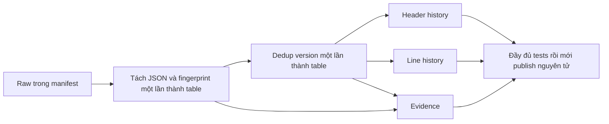

Trước đây hai tầng là view nên truy vấn header, line và evidence lặp lại phần
tách JSON/tính fingerprint. Benchmark có kiểm soát dùng SQL dbt đã compile từ
cùng manifest: 962 snapshot, 4.407 dòng history, 1.369 evidence link giống nhau
từng dòng bằng EXCEPT ALL ở cả hai chiều. Tổng nhánh này từ **23,15 giây xuống
9,70 giây**, đã tính 8,42 giây tạo bảng trung gian. Đây là một lượt chẩn đoán
tuần tự trên dữ liệu warm, không tự suy ra cả pipeline nhanh hơn cùng tỷ lệ.

Benchmark chỉ tạo object TEMP và rollback, không publish/core/source writes;
publication checksum giữ nguyên, bốn lịch được drain rồi khôi phục trạng thái.
Đổi lại, hai table trung gian sẽ dùng thêm dung lượng `build`, cần đo thực tế.
Report mới chụp thêm hash project/model/macro/test dbt và code release để biết
đúng phiên bản đã đo. Chưa stage/commit/push, không xóa dữ liệu.

Đang triển khai qua idle startup và chạy lại đúng `campaign_rate_144.json`.
Chỉ PASS toàn bộ cổng mới tăng `campaign_rate_600.json`, rồi `campaign_rate_900.json`;
bất cứ mức nào FAIL thì dừng. Không thay thời lượng/ngưỡng/worker để làm xanh.
Kết quả cuối phải đọc STATUS; số đo SQL phía trên chưa phải chứng nhận M08D.

## Kết quả sau bản sửa — 07/11/2026

**Lỗi retry dùng lại bộ trang sai đã sửa và kiểm chứng được trên run thật.
M08D vẫn chưa PASS cổng tải/cadence; chưa tăng lên 600/900 đơn.**

Lượt `campaign-rate-144-80116bcdf045` đối soát PASS: 144 đơn, 602 dòng hàng,
150 history quan sát/316 phiên bản nguồn, không sai lệch. Trên chính HTTP SIM +
pipeline đang chạy, collection `8bbf241f-eb3f-5a16-af62-bd9daa6d17d8` có:

| Scan | Kết quả | HTTP list audit | Attempt cao nhất mỗi URL |
| --- | --- | --- | --- |
| 1 | INVALID do bộ trang đổi | 14, vẫn giữ nguyên | 1 |
| 2, cùng collection | VALIDATED sau retry đọc lại | 33 | 2, không reset về 1 |

Đây là bằng chứng đường sửa hoạt động, không chỉ là unit test tự mock.
Trong DBeaver, chọn database `data_platform` để tự kiểm:

```sql
SELECT scan_number,status,started_at,finished_at,error_code
FROM ops.etsy_recovery_scans
WHERE run_id='8bbf241f-eb3f-5a16-af62-bd9daa6d17d8'
ORDER BY scan_number;
```

Nhưng cả envelope vẫn FAIL lúc 14:55:15 giờ Việt Nam: số scheduled success hợp
lệ Web/eBay/inbox/recovery là 4/2/3/1, trong khi yêu cầu ít nhất 2 mỗi đường.
Recovery run quét lại đã SUCCESS; run tiếp theo cũng SUCCESS nhưng bắt đầu sau
cửa sổ nguồn, không được tính bù. Không nới tiêu chí để làm xanh kết quả.
Report: `runtime/campaign-20d7ee19c7aa47f2bdcd64b543057b59/report.json`.
Lệnh đối soát chỉ đọc, không thay verdict của envelope:

```powershell
python -m test_support.m08d_measure --report runtime/campaign-20d7ee19c7aa47f2bdcd64b543057b59/report.json
```

P95 quan sát trạng thái cuối khoảng 537 giây, drain khoảng 318 giây; RAM mẫu cao
nhất khoảng 2,01 GiB, DB tăng khoảng 32,35 MiB. Không vượt resource ceiling,
nhưng build mỗi lượt vẫn khoảng 59–80 giây p95 trong cohort nhỏ, còn cộng chờ
slot/executor. Không thể suy ra hệ thống chịu tải cao từ việc đủ 144 đơn.

Sau khi kết thúc đo, đã siết constraint SQL không cho scan INVALID thiếu mã lỗi
(tránh CHECK cho NULL đi qua). Probe cuối PASS **12 kiểm tra HTTP/SQL**, mọi ghi
DB rollback; 8 unit test scan PASS. Các kiểm tra M06/S01 và live/campaign đã ghi
lệnh/kết quả cụ thể trong STATUS. Hash collector/helper không đổi suốt lượt đo;
migration009 được siết sau đó nên không giả vờ toàn bộ file cuối cùng đều đã
nằm trong lượt campaign trước. Chưa chạy lại toàn campaign sau thay đổi DDL-only.

Bước kế tiếp vẫn thuộc M08D: tối ưu nhịp workflow/build có giới hạn và đo lại
đúng envelope, không thêm môi trường, không tự bỏ source/global lock hay đổi
S01. Chưa chứng nhận burst/soak, tải 600/900 hoặc production SLA. Không stage,
commit, push hay xóa dữ liệu/volume. Các đoạn “đang chạy” phía dưới là nhật ký
checkpoint cũ; kết luận mới nhất là phần này.

## Bản sửa recovery — đã qua probe, đang kiểm tra lại scheduled

Startup đã chặn đúng batch cũ sau khi owner chuyển FAILED. Sau khi bạn cho phép
riêng, đã abort chính thức đúng batch `acc3d02c-1d89-5a1e-9d98-7c2d0c094da7`;
6.715 manifest inputs, 6.715 raw liên quan và 3 publication last-good giữ nguyên
số dòng/checksum. Không abort batch khác hay ép task success. Lượt mới bắt đầu
07:19:42 UTC đang drain các run còn lại; report startup bị từ chối trước đó vẫn
giữ nguyên. Kết quả scheduled cuối cùng phải xem cập nhật STATUS.

Đã triển khai bản sửa cho lỗi bộ trang 23/23/22. Không bỏ kiểm tra count, không
xóa raw/cache cũ và không reset retry budget. Thay đổi schema chỉ thuộc DB
`data_platform`, không sửa schema nguồn hoặc bảng business:

- Thêm `ops.etsy_recovery_scans`: khóa `(run_id, scan_number)`, scan từ 1 đến 5;
  trạng thái RUNNING → VALIDATED hoặc INVALID; giữ giờ bắt đầu/kết thúc và mã lỗi.
- Thêm `ops.etsy_http_attempts.recovery_scan_number`, nullable để giữ nguyên audit
  cũ; FK đến scan. Mọi HTTP attempt cũ vẫn còn và vẫn tính vào giới hạn 5/URL.
- Scan 1 được dùng lại trang legacy chưa có scan number. Khi bộ trang bị lỗi count/
  thứ tự, đánh INVALID; retry tạo scan kế tiếp và đọc lại từ trang 0. Chỉ cache
  của scan hiện tại mới hợp lệ. Không cấp lại 5 HTTP attempt cho mỗi scan mới.
- Interruption/HTTP lỗi thông thường giữ scan hiện tại và trang đã đọc thành công.
  Bộ trang đã VALIDATED được dùng lại nếu bước xử lý receipt bị gián đoạn.
- Chỉ enqueue receipt sau khi toàn bộ trang hợp lệ; checkpoint vẫn chờ receipt
  work xử lý thành công. Không dựng history cho trạng thái chưa quan sát được.

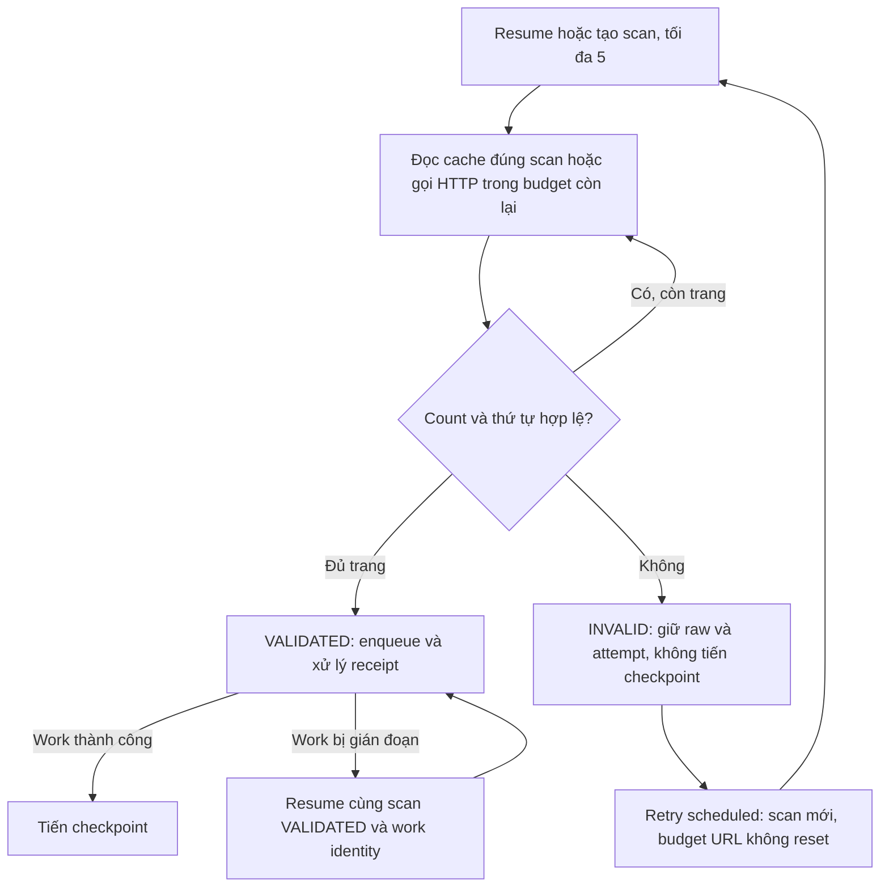

Code chính: `ingestion/etsy_recovery.py` giữ identity/cache/budget;
`ingestion/etsy.py` kiểm trang, chuyển scan và xử lý receipt. Schema chi tiết đã
chốt trước DDL ở `docs/05_TARGET_SCHEMA.md`, migration
`migrations/platform/009_etsy_recovery_scans.sql`. Bootstrap, migrate và live-up
đều đã nhận migration mới. Đây không phải cam kết API có snapshot isolation;
count không đổi vẫn không chứng minh được mọi thay đổi vô hình trên vendor.

8 unit test scan đã PASS. Probe `tests/etsy_recovery_probe.py` dùng HTTP thật và
PostgreSQL thật, PASS 11 kiểm tra gồm count đổi, duplicate/thứ tự, scan mới,
giữ 5 attempt/URL, không enqueue/checkpoint dở, resume legacy, interruption,
receipt processing thật và khóa audit. **Mọi ghi DB của probe đều rollback**;
không chạm control SIM chính. Đây chưa phải scheduled/load acceptance.

Sau lần tạm ngắt, cả stack đang dừng nên probe đầu gặp lỗi DNS `postgres`.
Đã bật lại PostgreSQL giữ nguyên volume, chạy lại probe PASS. Có một batch
BUILDING cũ `acc3d02c-1d89-5a1e-9d98-7c2d0c094da7` chưa xác nhận được recovery
sau khởi động; không tự abort. Đã bắt đầu lại đúng profile `campaign_rate_144.json`,
không nới ngưỡng hay thời lượng. Kết quả scheduled mới phải đọc STATUS; chưa
gọi M08D hoàn thành hoặc chạy tiếp 600/900 khi chưa đạt cả lượt.

## Kết luận mới nhất — 07/11/2026, dừng tăng tải để sửa recovery

**Chưa thể gọi M08D hoàn thành hay hệ thống chịu tải tốt.** Đã đo thật trên stack
main đang giữ lịch sử, không mở thêm môi trường hoặc reset DB.

| Lô mới | Kết quả dữ liệu | Kết quả toàn lượt đo |
| --- | --- | --- |
| 24 Website / 6 phút | PASS, 24 đơn / 121 dòng hàng | PASS |
| 72 mixed / 6 phút, 2 slot | PASS, 72 đơn / 313 dòng hàng | FAIL: chưa đủ chu kỳ Etsy |
| 72 mixed / 6 phút, thử 4 slot | PASS, 72 đơn / 313 dòng hàng | FAIL: chưa đủ chu kỳ Etsy; đã trả về 2 slot |
| 144 mixed / 12 phút, 2 slot | PASS, 144 đơn / 602 dòng hàng | FAIL: Etsy recovery lặp lỗi paging |
| 600 / 12 phút, 900 / 10 phút | Chưa chạy | Đã bị chặn đúng sau FAIL |

Lượt 144 có 48 đơn/nguồn, 316 phiên bản nguồn đã chuẩn bị; history thực sự quan
sát được là 148 phiên bản, không bắt buộc dựng lại những trạng thái polling bỏ
qua. Đối soát trạng thái, tiền, dòng hàng, mapping và liên kết raw không có sai
lệch. Tất cả trạng thái cuối đã thấy lúc 11:02:08 giờ Việt Nam; cổng chu kỳ chốt
FAIL lúc 11:12:26 (04:12:26 UTC), không đổi thời hạn để lấy PASS. Web/eBay/inbox/
recovery lần lượt có 4/2/3/1 scheduled success hợp lệ, yêu cầu ít nhất 2 mỗi đường.

### Lỗi tìm được: retry lặp lại bộ trang đã không nhất quán

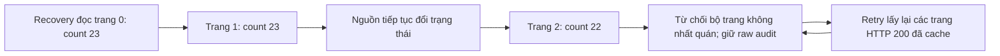

Thông điệp thật: `changing recovery count; retry/reconcile window`. Các HTTP
response đều 200 nhưng tập dữ liệu phân trang thay đổi. Việc từ chối là cần thiết
để không âm thầm bỏ sót đơn; điểm chưa đúng là retry dùng lại nguyên bộ trang
23/23/22 nên không thoát được lỗi. Tăng RAM hoặc executor slot không sửa logic này.
Đây là lỗi đã xác minh, không phải phỏng đoán dựa vào DAG màu đỏ.

Số đo của 144 đơn: p50 khoảng 249 giây, p95 khoảng 471 giây, cao nhất khoảng
579 giây; drain khoảng 289 giây. Đây là **mốc nguồn đủ điều kiện xuất hiện → SQL
observer thấy trạng thái cuối**, không phải latency commit→publish chính xác.
RAM báo cao nhất khoảng 1,98 GiB; DB tăng khoảng 29,08 MiB trong lượt. Không
suy ra công suất production từ số offered 0,2 đơn/giây. Cổng recovery vẫn FAIL.

### Tự kiểm lại và bước tiếp theo

Report giữ nguyên tại
`runtime/campaign-de879a18327d4d4f97b494335b1af8b5/report.json`, dataset
`campaign-rate-144-af960b23dede`. Đọc `measurement.load_assessment` để thấy FAIL,
run ID, số chu kỳ và deadline. Đối soát DB chỉ đọc:

```powershell
python -m test_support.m08d_measure --report runtime/campaign-de879a18327d4d4f97b494335b1af8b5/report.json
```

Mong đợi ở dữ liệu đang giữ: PASS, 144 orders, 602 lines, 148 observed versions,
316 planned versions, 0 errors. Lệnh này **không đổi verdict FAIL** của cả lượt.
Trong Airflow xem DAG `etsy_recovery`, run
`scheduled__2026-11-07T03:54:13.633356+00:00`, log task `cycle`. SQL kiểm stage,
raw audit và executor queue nằm ở `tools/s02_data/inspect_campaign.sql`.

Tiếp theo cần sửa cơ chế quét lại/reconciliation có giới hạn khi bộ trang biến
động: giữ mọi raw audit, không reset attempt budget, không tiến checkpoint trên
scan dở dang, bảo toàn S01/resume đã duyệt. Thêm regression test và kiểm chứng
HTTP/DB rồi chạy lại đúng envelope 144 đã khai báo; chỉ PASS mới tăng 600/900.
Không xóa cache/audit, bỏ kiểm tra count hay kéo dài thêm cửa sổ để làm xanh bài đo.
Chưa sửa collector giữa lượt vừa chạy. Chưa chứng nhận burst/soak/triệu đơn.

122 unit tests chọn lọc và các kiểm tra S01 đã PASS; lỗi runtime ở trên vẫn là
lỗi mở. Stack chính còn chạy, các service có healthcheck đều healthy, bốn DAG live
unpaused; không xóa dữ liệu/volume và chưa stage, commit hay push. Các phần bên
dưới là nhật ký checkpoint cũ; ưu tiên kết luận mới nhất ở đầu file này.

## Tiếp tục sau khi được phép recovery và tăng tải — 2026-11-07

Bạn cho phép xử lý đúng batch cũ và muốn bài tải có ý nghĩa hơn. Đã chạy abort
chính thức cho `d0b60a58-f9fe-5b0c-8fc5-486f584195b7` sau khi kiểm lại chủ FAILED,
không có task chủ đang chạy. Batch chuyển FAILED;3949 manifest inputs,3949 raw
liên quan và3 last-good publication giữ nguyên số dòng/checksum trước–sau.
Không reset retry, ép task success, xóa dữ liệu hay abort batch khác. Evidence:
`runtime/operator-abort-rate-4bc2e5165be1400fb2fbb95eaf04fe29.json`.

Thứ tự tăng tải đã chốt trước khi gen/admit:

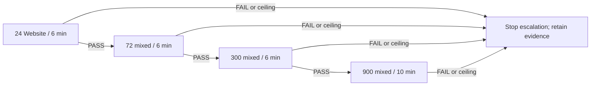

Hai profile lớn thêm trong cùng `tools/s02_data/config/`:
`campaign_rate_300.json` (100 đơn/nguồn,643 phiên bản),
`campaign_rate_900.json` (300 đơn/nguồn,1941 phiên bản). Các mức đơn là lô mới,
DB vẫn giữ lịch sử cũ; không gọi chúng là tổng toàn bộ DB. Mỗi lần runner gen
một lô hữu hạn trước khi đo, SIM/pipeline dùng đúng đường hiện có, không mở thêm
stack. Website vẫn SQL read-only; eBay/Etsy vẫn HTTP.

Hai mức lớn khai báo trước max1000 đơn/3000 phiên bản/1000 planned send còn lại,
payload10MiB. Planned send gồm cả chưa đến giờ nên không đồng nghĩa retry backlog.
**Không tăng giới hạn RAM/disk/tăng trưởng DB hay nới độ trễ1200 giây/drain900
giây** để có PASS. Nếu mức nào lỗi, dừng trước mức sau và ghi lỗi thật.

900 đơn/10 phút là mức offered1,5 đơn/giây, không tự suy ra pipeline đã commit/
publish1,5 đơn/giây hay chạy ổn24h. Đây vẫn chưa phải soak, triệu đơn hoặc SLA
production. Cần kết quả runtime thật để biết bottleneck nào đáng tối ưu; không
thể kết luận "chịu tải tốt" chỉ từ cấu hình gen. Kết quả từng mức sẽ được ghi lại
trong STATUS và cập nhật ở đây.

Kết quả đã có: Website24 PASS,121 lines,28 history quan sát/63 phiên bản nguồn,
0 sai lệch;2 scheduled success, p95 quan sát cuối383,57 giây, drain273,57 giây,
RAM báo cao nhất khoảng2,07GiB. Report
`runtime/campaign-6a5e93898982497cac3da36e101cd123/report.json`;
đối soát DB chỉ đọc sau chạy vẫn PASS. Đây là lô mới trên nền1879 đơn đang giữ,
không phải DB trống. Mức72 đang chạy;300/900 chỉ chạy nếu mức trước PASS.

**Mức72 với2 executor slot đã FAIL cổng chu kỳ** (03:05 UTC), không FAIL dữ liệu:
đối soát72 đơn/313 lines/75 history PASS; Web/eBay2 scheduled success nhưng Etsy
inbox/recovery chỉ1 run bắt đầu trong cửa sổ đã chốt. Đủ dữ liệu không được tự
đổi verdict đó thành PASS. Queue task đo từ queued_dttm→start_date khoảng119–156
giây ở các nhóm; không phải suy đoán từ đồng hồ DAG.300/900 đã được chặn đúng.

Thử nghiệm tiếp theo đã khai báo trước và chỉ áp dụng SAU verdict: thêm
`LIVE_AIRFLOW_PARALLELISM=4` vào `.env` local; example/default vẫn2, base/disposable
không đổi. Mục đích giảm task chờ executor trong khi worker khác đang đợi slot.
Không tăng CPU/RAM Docker, không đổi per-DAG1 hay khóa source/global; dbt vẫn
publish từng lượt, không chạy4 publication cạnh tranh. `.env` là file ignored,
không đưa secret lên Git. Host tool chỉ nhận giá trị2 hoặc4 và từ chối trước drain
nếu cấu hình sai. Sau khi drain idle mới recreate Airflow, không kill task đang chạy.

Chạy lại đúng profile72/6 phút, seed/basket/ngưỡng không đổi; chỉ nếu PASS mới
tăng300/900. Lịch sử cũ vẫn giữ và sẽ lớn hơn nên không gọi đây là so sánh A/B
hoàn toàn đồng nhất. Hiệu quả và RAM phải đo thật; chưa kết luận4 slot sẽ tốt hơn.

Đã đo thật với4 slot: queue các mẫu đầu giảm về khoảng0,06–0,19 giây, nhưng
global build/publish vẫn tuần tự; đủ72 đơn/313 lines/75 history,0 sai lệch, chưa
đạt2 chu kỳ của mỗi DAG trong6 phút. Không gọi việc giảm queue là cải thiện toàn
bộ độ trễ. Hai bài ngắn đều giữ nguyên verdict, không sửa timestamp hay tiêu chí.

Để bài sustained có đủ thời gian quan sát, chốt MỘT lần hiệu chỉnh trước lượt mới:
144 đơn/12 phút vẫn0,2 đơn/giây như72/6;600/12 vẫn0,8333 đơn/giây như300/6.
Đó là tăng gấp đôi tổng dữ liệu và thời gian tiếp xúc, không giảm áp lực mỗi giây.
File `campaign_rate_144.json` là qualification; chỉ khi PASS mới600 rồi900/10
phút (mức1,5 đơn/giây ban đầu giữ nguyên). RAM/disk/độ trễ1200 giây/drain900 giây/
hai scheduled success đều giữ nguyên. Nếu qualification hoặc bước sau vẫn FAIL,
dừng và báo giới hạn, không tiếp tục kéo dài cửa sổ cho đến khi xanh. Không có
DDL hay thay đổi schema/SIM nghiệp vụ; đây là chỉnh thiết kế thời lượng bài đo.

## Bước hiện tại: tăng mức dữ liệu hữu hạn — 2026-11-07

Sau baseline PASS, bạn cho phép bước tiếp theo. Mình dùng lại cùng runner/config
folder, không thêm môi trường hay schema:

1. `campaign_rate_website.json`:24 đơn Website/6 phút,63 phiên bản nguồn.
2. Chỉ nếu lượt đầu PASS mới chạy `campaign_rate_mixed.json`:72 đơn/6 phút,
   mỗi nguồn24 đơn,161 phiên bản nguồn. Các phiên bản là cập nhật cùng đơn,
   không phải161 đơn khác nhau.

Mức đầu chỉ **lô mới** có Website; lịch eBay/Etsy cũ vẫn bật. Không gọi đây là
benchmark máy chỉ chạy riêng Website. Hai lượt giữ lịch sử cũ, không reset DB.
Khoảng6 phút là cửa sổ nguồn; startup và drain cần thêm thời gian. Đây là bước
tải thấp hữu hạn, không phải soak hay khẳng định công suất tối đa.

Phần bổ sung kiểm tra ở test tool, không sửa pipeline/SIM nghiệp vụ:

- Ghi kế hoạch số đơn mới/phiên bản mỗi phút để biết offered load thực sự định
  đưa vào nguồn; không nhầm thành số commit hay số pipeline xử lý mỗi giây.
- Ghi tại mỗi lần SQL nhìn thấy: bản cuối nào đã đến giờ nhưng chưa có trong
  current, độ tuổi chờ lớn nhất và số bản cuối đã khớp theo từng nguồn.
- Giữ quan sát đến hết cửa sổ nguồn đã config, dù random khiến đơn đến sớm hết.
- Mỗi DAG của nguồn có dữ liệu phải có ít nhất2 scheduled success bắt đầu trong
  cửa sổ admit→hết nguồn. Etsy kiểm cả inbox và recovery. Run manual, run cũ và
  success hoàn tất sau deadline không được tính.
- Sau hết cửa sổ nguồn, tối đa900 giây phải drain/đạt các lượt lịch. Quá hạn
  FAIL, không nới thời gian hoặc clear/reset task. Giới hạn RAM/disk/DB giữ như
  baseline. Khi đã admit, lịch nguồn hữu hạn giữ nguyên, không bị xóa để test xanh.

```powershell
python -m tools.s02_data campaign --config tools/s02_data/config/campaign_rate_website.json --confirm-local
if ($LASTEXITCODE -ne 0) { throw 'Dừng tăng tải: kiểm tra report Website trước' }
python -m tools.s02_data campaign --config tools/s02_data/config/campaign_rate_mixed.json --confirm-local
```

Xem Airflow8080, report8501, DBeaver5433 như cũ. Trong report cần cả
`measurement.status=BASELINE_PASS` và `measurement.load_assessment.status=PASS`.
Đọc `final_progress`, `observed_drain_seconds`, `scheduled_successes` và run IDs;
`READY_FOR_REVIEW` riêng lẻ không đủ. Đồng hồ commit→publish vẫn chưa có và không
bịa số. Các bài single-source riêng eBay/Etsy, burst/soak và tối ưu có đối chứng
vẫn là cổng sau. Kết quả thật của lượt này được cập nhật bên dưới khi xong.

### Kết quả hiện tại: bị chặn ở khôi phục phiên cũ, chưa chạy tải

Code/config đã làm;119 unit test PASS, S01 vẫn10 checks +10 utility test PASS.
Khi khởi động lại Airflow, run eBay cũ15:39 ngày06/11 chuyển FAILED, nhưng batch
`d0b60a58-f9fe-5b0c-8fc5-486f584195b7` còn BUILDING. Các run retry hiện tại15:42+
không sở hữu batch này nên phải chờ release. **Không phải24 đơn mới làm chậm:**
DB xác nhận chưa gen/admit bất kỳ dataset campaign-rate nào.

Mình dừng riêng host test trước admission, không kill task chính. Tool interrupt
không chạy Python finally nên report đầu còn RUNNING cũ; có operator-stop.json
giải thích và xác minh không còn host process. Lượt chạy lại guard hiện tại từ
chối đúng batch, exit1 trong vài giây; report
`runtime/campaign-1e1f970d54094648a297fe8297de9f97/report.json` là FAILED,
**không phải PASS tải**. Mình cũng thêm kiểm tra orphan trong lúc drain, không
chỉ kiểm trước restart, để lỗi tương tự không bị đợi hết600 giây mới lộ ra.

Hiện PG/Airflow/hai API/receiver healthy; worker/report/observer vẫn dừng vì chưa
qua startup. Drain marker giữ lịch mới không phát thêm, retry đang có vẫn được
chạy; không tự clear, đổi pause state để ép xanh hay xóa dữ liệu. Mình cần bạn
cho phép abort chính thức **đúng batch cũ trên**, sau khi xác minh lại không có
task chủ đang chạy. Giữ raw/audit/manifest/last-good. Sau đó mới chờ các retry
drain rồi chạy Website→mixed. Các cổng M08D còn mở, chưa có kết quả tải runtime.

## Bước tiếp theo: baseline đo có giới hạn — 2026-11-06

Bạn đã review campaign bình thường và sự cố, cho phép chuyển bước. Mình bắt đầu
M08D bằng **baseline nhỏ trên dữ liệu lịch sử đang giữ**, chưa nhảy ngay sang test
tải lớn/soak. Không thêm bảng, không đổi schema hay logic nghiệp vụ các nguồn.

- Dùng cùng folder config: `tools/s02_data/config/campaign_baseline.json`.
  Có12 đơn (mỗi nguồn4),30 phiên bản nguồn, khoảng sinh3 phút. Không có sự cố
  mới trong lượt baseline này. Pipeline vẫn chạy qua HTTP/Website read-only/dbt/
  Airflow hiện có; không lấy kết quả mong đợi để đổ vào warehouse.
- `campaign.measurement` là phần config tùy chọn mới: giới hạn số đơn, phiên bản,
  bytes, RAM, dung lượng trống, tăng trưởng DB, backlog và thời gian quan sát cuối.
  Profile cũ không có phần này giữ nguyên cách chạy để bạn quan sát.
- Bộ kiểm tra riêng `test_support/m08d_measure.py` tính kỳ vọng từ dữ liệu nguồn,
  đối chiếu trạng thái, tiền/currency, từng line, quantity, mapping, liên kết
  snapshot và raw/manifest. History chỉ kiểm các trạng thái thực sự quan sát được,
  không bắt buộc đủ30 phiên bản nguồn.
- Lưu mẫu RAM/CPU từng container, dung lượng4 DB, backlog và thời gian stage thực.
  Đây là stack đang dùng chung: không gán toàn bộ tài nguyên cho riêng12 đơn mới.
- Giới hạn được kiểm trước admit. Nếu vượt trong lúc chạy, báo FAIL và giữ bằng
  chứng; không xóa timeline đã admit, không kill stack chính hay reset retry.

**Điểm quan trọng về đồng hồ:** hiện hệ thống chưa có sổ ghi commit nguồn → lần
publish đầu tiên chính xác. Không dùng `first_observed_at` hay batch hiện tại để
giả làm chỉ số đó. Lượt này đo **thời điểm phiên bản cuối đủ điều kiện xuất hiện
ở nguồn → lần câu SQL kiểm tra nhìn thấy đúng timestamp cuối trong core**. Nó gồm
chờ worker/poll/build và cả chu kỳ observer; không gọi là độ trễ commit→publish.
Đơn chưa quan sát được phải ghi thiếu/censored, không tự cho PASS.

Chạy tại root, Docker Desktop đang bật; không cần tự gen/startSIM trước:

```powershell
python -m tools.s02_data campaign --config tools/s02_data/config/campaign_baseline.json --confirm-local
```

Runner drain các lượt cũ an toàn, bảo đảm dịch vụ healthy, bật4 lịch hiện có,
gen/admit một lô có tên duy nhất rồi theo dõi. Airflow8080/report8501 và DBeaver
PG5433 vẫn dùng địa chỉ hiện tại. Đọc đường dẫn report được in ra; kết quả riêng
phải là `measurement.status=BASELINE_PASS`, reconciliation PASS, đủ12 quan sát
cuối và không vi phạm ngân sách. `READY_FOR_REVIEW` một mình chưa đủ chứng minh
baseline PASS. Không cần thấy đủ30 dòng history.

Chi tiết hợp đồng/chỉ số: [19_M08D_MEASUREMENT.md](19_M08D_MEASUREMENT.md).
Baseline PASS vẫn chưa hoàn thành M08D: còn các mức tải sustained, burst/drain,
soak đúng thời lượng khai báo, thiết kế đồng hồ commit/publish và tối ưu dựa trên
bằng chứng. Kết quả chạy thực tế sẽ được bổ sung ngay dưới đây và trong STATUS.

### Kết quả baseline đã chạy thật

- Lệnh ở trên exit0, `measurement.status=BASELINE_PASS`. Dataset
  `campaign-baseline-d05c55aa6ddc`, source ID `0481cfb69ceb`; report
  `runtime/campaign-551964eda899400d9a4a3276373990a4/report.json`.
- Admit15:07:31 UTC, thấy đủ bản cuối15:15:52 UTC ngày06/11 (giờ Việt Nam cộng7).
  Tổng lệnh có cả drain/startup:14:59:24–15:15:54 UTC. Khoảng sinh3 phút không
  có nghĩa toàn bộ khởi động/pipeline sẽ xong trong3 phút.
- Đủ12/12 đơn,49 lines,13 phiên bản history quan sát được; đối soát0 sai lệch.
  Gen30 phiên bản nguồn không bắt warehouse phải có30 history. Chạy lại riêng
  lệnh đọc report để đối soát DB vẫn PASS, không chạy collect/publish tay.
- 12 mẫu độ trễ quan sát cuối: p50 khoảng265 giây, p95 khoảng372 giây, không thiếu
  mẫu; dưới ngân sách1200 giây đã đặt. Không gọi đây là p95 commit→publish.
- 24 mẫu tài nguyên: RAM Docker CLI báo cao nhất khoảng2,23GiB;4 DB tăng nhiều
  nhất16,625MiB so với mốc ban đầu; pending send cao nhất8, cuối cùng0.
  Không vượt giới hạn. Đây là tài nguyên stack chung, không riêng12 đơn mới.
- Telemetry cho thấy build/test và chờ release slot đáng điều tra tiếp: build
  p95 Web53,8/eBay68,1/Etsy84,5 giây; chờ release p95 Web82/eBay54,3/Etsy67,8 giây.
  Mỗi nhóm chỉ1–3 mẫu hoàn tất, chưa đủ suy ra công suất tối đa hay cam kết SLA.
- 107 unit test liên quan PASS; S01 vẫn10 fixture checks +10 utility test PASS.
  Compile/diff check PASS. Không sửa schema trong bước này, không xóa dữ liệu,
  không stage/commit/push; stack chính vẫn chạy để bạn xem Airflow/report/DBeaver.

**Bước kế tiếp chưa chạy:** chốt các mức sustained/mixed, burst và soak có ngân
sách rõ ràng rồi mới tăng tải; cần hợp đồng đồng hồ bền vững nếu muốn đo chính
xác commit→publish. Không tự gọi M08D hoàn thành chỉ từ baseline này.

## Bước đang làm sau SIM: sửa C và campaign để bạn quan sát — 2026-11-06

Bạn đã duyệt phần gen/SIM. Yêu cầu mới: sửa lỗi C trước, làm campaign bình thường,
thêm một sự cố dễ quan sát; **chưa đo tải hoặc chấm hiệu năng**. M08D chưa được
coi hoàn tất chỉ vì có campaign command. Những mục cũ phía dưới là lịch sử review.

Lỗi C đã báo trước là bài `scheduled_pause_resume` chờ core catch-up quá hạn.
Nguyên nhân harness có hai phần: `polling-drain` của lượt trước làm DAG test không
lên lịch; khi chỉ xóa marker rồi bật scheduler lại có race vì DAG cũ đang unpaused
có thể chạy trước lệnh pause. Fix mới dùng CLI thật pause đúng DAG test trước khi
bật scheduler, xóa cả hai marker chỉ trong scope disposable đã xác minh và drain
đúng khi kết thúc. Không sửa marker main, không ép task success/reset budget.
Một run test bị ngắt đã được cho về trạng thái terminal tự nhiên; đó là operator
recovery, không ghi thành test PASS. Sau đó đã chạy hai lượt clean liên tiếp đều
PASS, mỗi lượt có hai scheduled success MỚI và cleanup PASS. Latest report18 case
đều PASS; filename đầy đủ trong STATUS. Đây là sửa harness giữ marker/race, không
phải xóa chặn bảo vệ hay tự tạo history cho trạng thái pipeline không quan sát.

Main còn một batch eBay BUILDING từ01/11 nhưng DAG run đã FAILED. Bạn đã cho phép
abort đúng batch `ae808a96-e053-528f-b833-66b77dec48e3` sau khi xác minh idle.
Đã chạy abort chính thức; raw9485, manifest inputs1223850, publication3, webhook
audit1157, inbox1112 và retry attempts4858 đều giữ nguyên số dòng VÀ checksum.
Chỉ batch cũ được chuyển FAILED theo workflow, không xóa data/reset budget.

**Campaign bình thường đã chạy thật:** `campaign-normal-93b6b7a06a0c`, nhận lô
09:45:14 UTC, READY_FOR_REVIEW09:53:02 UTC: mỗi nguồn2/2 đơn có timestamp cuối
trong core, hết future version/pending send. Report nằm ở
`runtime/campaign-f715cc1473ac4119a9947a9cb63c4c49/report.json`. Airflow/dashboard
đều HTTP200, PG giữ port5433. Đây là xác minh luồng tự động, chưa phải chấm
toàn bộ nghiệp vụ/hiệu năng.

**Campaign recovery đã chạy thật:** `campaign-recovery-7aa6db75e989`, source ID
`b756e9eb786c`, nhận lô10:04:36 UTC. Pause eBay thật10:08:08.921 →10:11:23.133 UTC
(giờ Việt Nam cộng7), đúng container `ff0afff4ac93`; đã khôi phục running/unpaused.
Có5 request eBay không nhận được HTTP response, raw giữ status NULL chứ không
bịa HTTP500. Airflow có `up_for_retry`, collect attempt1 RETRYABLE và attempt2
SUCCEEDED; không reset budget hoặc ép task success. Website vẫn publish khi
eBay bị pause. Etsy receipt `1201533700000` có cả hai notification bị omit, không
có child send, nhưng vẫn được API recovery đưa trạng thái cuối vào core.
Đến10:15:11 UTC: READY_FOR_REVIEW, Website2/2 + eBay2/2 + Etsy4/4 đơn có timestamp
cuối, hết future version/pending send, audit lỗi5 vẫn còn. Report:
`runtime/campaign-0af724fbbf2c4bb49f8a961f59e050fe/report.json`.
Muốn xem lại lỗi thật trên Airflow: mở DAG `ebay_polling`, chọn run
`scheduled__2026-11-06T10:05:57.909535+00:00`, xem log task `cycle` ở try1/try2.
Raw HTTP run tương ứng `2e2872f5-20a3-41c7-8a4f-61bd87e69c11` có5 audit lỗi;
`metadata.fetched_at` là giờ hoàn tất request thật. Các raw này có cùng
`acquired_at` vì dùng observation clock của collection, không phải mất audit.

Có một lượt recovery trước đó FAILED ở Compose build/start, **chưa gen lô hay
áp dụng fault**; đã giữ report thất bại. Build/start trực tiếp chạy lại đều tốt,
sau đó cùng command campaign chạy thành công như trên. Chưa xác định chính xác
nguyên nhân lỗi Compose đầu tiên nên không tự kết luận là lỗi data/pipeline.

**Dừng tại đây để bạn review:** các dịch vụ main còn chạy, port/credentials cũ
giữ nguyên; không xóa dữ liệu/volume, không stage/commit. Phần đo tải, đối soát/
chấm toàn bộ kết quả và tối ưu bottleneck chưa làm theo đúng yêu cầu. M08D chưa
được ghi là hoàn thành chỉ vì hai demo này chạy tốt.

Kiểm tra cuối phát hiện thêm **false-negative ở healthcheck live**: Docker probe
CLI Airflow vượt15s liên tiếp, nhưng monitor API vẫn có heartbeat healthy và các
run vẫn publish. Đã thêm probe nhẹ chỉ cho Compose live: kiểm tra database,
scheduler và DAG processor đều healthy, timeout HTTP8s; không chỉ nhìn HTTP200.
Không đổi logic collect/dbt/publish hoặc healthcheck môi trường C. Unit6 PASS,
script mới chạy trên API thật exit0. Đã drain rồi deploy an toàn, `live-up` trả
LIVE_SERVICES_READY, bốn DAG live được bật lại. Kiểm tra cuối10:36 UTC: Airflow
healthy/streak0, năm probe liên tiếp exit0 khi lịch đã bật; dữ liệu hai lô vẫn
đủ6/6 và8/8. Có một probe HTTP timeout8s lúc vừa bật lịch, đã giữ thông tin đó
trong STATUS; không tuyên bố đây là soak/stability test dài hạn. Không restart
giữa task đang chạy, không đổi healthcheck base/C hoặc dữ liệu/volume chính.

### Cách campaign dự kiến dùng sau khi checks hoàn tất

Config vẫn một cấu trúc chung trong `tools/s02_data/config/`, truyền tên file bất
kỳ. Ví dụ mới có data config + section `campaign` ngay cùng file; không phải đổi
campaign trong DAG hay collector. `generate` vẫn chỉ gen/admit data, không gây lỗi.

```powershell
# Lượt bình thường: nguồn → pipeline scheduled → core
python -m tools.s02_data campaign --config tools/s02_data/config/campaign_normal.json --confirm-local

# Chạy sau khi review lượt bình thường: delivery faults Etsy + pause eBay ngắn
python -m tools.s02_data campaign --config tools/s02_data/config/campaign_recovery.json --confirm-local --allow-faults
```

Hai lệnh này dành cho stack local đã có M01–M07/live config, dùng lại DB/port và
credentials. Chỉ chạy một campaign, không chạy song song C test Airflow trên máy
4GB. Controller bật dependencies trước để tránh lỗi worker đơn độc thiếu Postgres
như buổi trước. Nếu Airflow live cũ đang dừng nhưng còn RUNNING metadata, đặt drain
flag trước khi resume đúng container live, rồi live-up drain các run cũ bằng cơ
chế thật. Không giả task state/rewind checkpoint để bỏ backlog.

Bạn xem URL Airflow/dashboard và DB port được in ra (không in mật khẩu). Sau
startup, script chuẩn bị lô mới có suffix, SIM phát data, Airflow tự chạy; không
gọi collect/dbt/publish thủ công để giúp kết quả. Mỗi lần OBSERVATION cho biết:

- Còn source version chưa đến hạn và child send chưa hoàn tất không.
- Expected/found/current orders của **riêng lô mới**, theo từng channel.
- Có eBay HTTP error audits từ lúc admit hay không; không quy mọi lỗi đó chắc
  chắn do fault campaign nếu chưa đối chiếu task log.

Lưu ý khi xem UI: campaign là command chạy ở máy bạn, **không phải một DAG mới**.
Bốn DAG live chạy task `cycle`; bên trong task đó workflow gọi collect → freeze
→ build_and_test → publish. Bạn xem log `cycle` và query `ops.task_attempts` để
biết sub-stage nào đang chạy, không tìm bốn ô stage riêng trong polling DAG.
Controller này không thêm bảng warehouse hoặc đổi SQL nghiệp vụ; journal giữ
trong runtime. Query mới: [inspect_campaign.sql](../tools/s02_data/inspect_campaign.sql),
chạy từng đoạn ở database ghi ngay trong comment.

READY_FOR_REVIEW chỉ nghĩa final source_updated_at đã vào core cho các order
được chọn, source hết timeline và sender không pending. Chưa khẳng định toàn bộ
line/money/history đúng, chưa có throughput/latency SLA PASS. Performance luôn
DEFERRED trong giai đoạn bạn review này; timeout là giới hạn chờ an toàn, không
phải kết luận pipeline đạt/không đạt SLA.

### Sự cố đầu tiên diễn ra ra sao?

Profile recovery dùng nguồn4 phút. Seed chọn thời điểm trong cửa sổ180–210s sau
admission; eBay SIM bị Docker pause180s rồi unpause, không xóa/recreate container.
Cửa sổ này rộng hơn bản nháp75s vì build nối nhau có thể trì hoãn lần collect
tiếp theo; mục tiêu là dễ quan sát request lỗi, không phải sửa benchmark cho đẹp.
Bạn đổi các số này ngay trong config được. Source PG vẫn có dữ liệu đến hạn,
Website/Etsy tiếp tục, collector eBay có thể timeout/retry. Journal ghi giờ thực
OUTAGE_INTENT → OUTAGE_STARTED → OUTAGE_RESTORED. Poll/command overhead có thể làm
mốc thực tế muộn hơn plan, không viết lại log cho khớp giờ đã dự kiến.

Chỉ được pause service eBay đang chạy, không nhận quyền sở hữu một service đã
paused từ trước. Nếu container bị người khác recreate, restore từ chối tác động
lên ID mới và báo RESTORE_REQUIRED. Nếu không có request eBay lỗi trong cửa sổ,
không được nói đã chứng minh collector recovery chỉ vì pause/unpause thành công.

Ctrl+C/lỗi sẽ restore fault trong finally, không dừng stack hoặc xóa data. Nếu
terminal/process bị kill nên finally không chạy, xem report runtime rồi dùng:

```powershell
python -m tools.s02_data campaign-restore --report runtime/campaign-YOUR_ID/report.json --confirm-local
```

Report ghi atomically, có target ID và trạng thái fault để không unpause nhầm
container khác. Lock ngăn hai startup/campaign hoặc restore chạy chồng nhau.
Sau campaign các dịch vụ giữ chạy để bạn tự xem UI/DBeaver. Không commit trong
task này. Hướng dẫn chi tiết: [CAMPAIGN.md](../tools/s02_data/CAMPAIGN.md).

---

## Đã triển khai riêng phần SIM — hướng dẫn bạn kiểm tra

**2026-11-05:** đã có migration004, delivery-plan generator và live sender đọc
schedule. Chưa làm campaign controller M08D, negative-data profile hoặc sửa lỗi
catch-up M08C. Các mục thiết kế bên dưới giữ để đối chiếu; mục này là trạng thái
implementation tại mốc05/11; cập nhật06/11 nằm ở đầu tài liệu. Không stage/commit
trong task này.

### 1. Mình đã làm gì?

- `marketplace_sim.s02.deliveries` thêm source/account/source_sequence; record cũ
  giữ sequence NULL, không giả backfill provenance hoặc gửi lại dữ liệu cũ.
- Thêm `s02.delivery_schedule` đúng schema đã review, FK/index/seal/identity guards
  và kiểm tra timeline trước seal. Một row là một planned send, không chứa JSON
  order. Migration có thể chạy lại, không DROP data/volume.
- Config mới có Etsy `delivery_plan`: seed, reorder quota, delay, repeat count,
  repeat gap và late gap. File config nào cũng được, không hardcode local_now.
- Generator chọn đủ eligible orders theo seed, chuẩn bị lịch và checksum/tail
  trước khi ghi. Giữ source payload/lifecycle không đổi. Sender chỉ phát đến hạn,
  lưu attempts/ACK/retry, không gen thêm data khi GET hoặc tick.
- Legacy config không có delivery_plan vẫn chạy đường cũ. New plan v1 dùng live
  generate/live-source; **không hỗ trợ legacy replay** trong phạm vi SIM-first này.
  Playback từ chối trước activation, thay vì im lặng gửi sai lịch.
- `generate` kiểm tra worker đã có module mới trước khi chuẩn bị plan mới để
  tránh image cũ gửi notification theo logic duplicate liền. Vì vậy cần rebuild
  live-source trước. `prepare` vẫn cho inspect offline plan, không cần worker chạy.

### 2. Trên máy bạn cần bật gì?

Docker Desktop phải chạy. Bạn dùng **stack chính/port/password hiện có**, không
đổi sang test ID M08A để demo SIM. Lúc mình kiểm tra task này, tám service chính
đang chạy; mình không dừng/rebuild/restart hay migrate chúng tự động. Những lệnh
dưới đây là để bạn chủ động cập nhật sau khi review.

Nếu bạn đã có live stack hoạt động, chạy tại repository root:

```powershell
$compose = @('--env-file','.env','--file','infra/compose.yaml')
docker compose @compose ps

foreach ($file in @('001_s02_temporal.sql','002_local_playback.sql','003_live_batches.sql','004_delivery_schedule.sql')) {
    docker compose @compose exec -T postgres psql -X --set ON_ERROR_STOP=1 `
        -U postgres -d marketplace_sim -f "/migrations/marketplace_sim/$file"
    if ($LASTEXITCODE -ne 0) { throw "SIM migration failed: $file" }
}

$live = $compose + @('--file','infra/compose.live.yaml','--profile','live')
docker compose @live build live-source
if ($LASTEXITCODE -ne 0) { throw 'Worker build failed' }
docker compose @live up --detach --no-deps --wait --wait-timeout 180 live-source
if ($LASTEXITCODE -ne 0) { throw 'Worker startup failed' }
```

Đây chỉ là migrate SIM và cập nhật worker; giữ DB/SIM API/receiver đang chạy,
không reset, không thay pause state Airflow. Recreate worker có gián đoạn emission
ngắn rồi resume progress. Nếu chưa có live stack, làm startup cũ
`python -m tools.s02_data live-up` sau M01–M07 prerequisites; lệnh đó bật cả pipeline,
không phải lệnh nhỏ chỉ inspect schema. Không chạy đồng thời acceptance khác.

### 3. Gen demo nhỏ

```powershell
python -m tools.s02_data generate --config tools/s02_data/config/sim_delivery_demo.json
if ($LASTEXITCODE -ne 0) { throw 'Generate failed' }
docker compose @live logs --tail 60 live-source
```

Demo: nguồn sinh trong2 phút; Website2/eBay2/Etsy4 orders. Etsy4 orders đều có
paid→shipped, một order omitted, một order duplicate ba lần/message và hai
non-omitted orders bảo đảm reorder. Manifest in tên dataset có suffix, selected
order IDs, checksum và last_due_at. Lần generate sau tự thêm lô mới, không ghi đè.

Nếu **chỉ muốn xem dữ liệu đã gen mà chưa phát nguồn**:

```powershell
python -m tools.s02_data prepare --config tools/s02_data/config/sim_delivery_demo.json
```

Prepare không admit live nên không có send/API/core mới; tên dataset cố định
không được overwrite. Muốn prepare lần nữa đổi dataset trong bản config riêng.
Không nhầm prepare-only chưa gửi với sender bị lỗi.

### 4. DBeaver: vào đúng DB và chạy query nào?

Database **marketplace_sim**, cùng connection local hiện có. Xem host port bằng:

```powershell
docker compose @compose port postgres 5432
```

Mở và chạy từng query trong
[tools/s02_data/inspect_delivery.sql](../tools/s02_data/inspect_delivery.sql).

- Query1: các dataset đã gen, admission/shift và plan summary. Chuẩn bị-only cũng
  xuất hiện nhưng published_at/shift NULL.
- Query2: timeline của **lô demo đã admit mới nhất**, có order/message/source
  version, due/effective time, attempt number và actual progress. Có thể đổi
  prefix query khi dùng profile tên khác; pipeline không cần đổi config campaign.
- Query3: số lượng logical messages, omitted messages, planned/completed sends và
  actual attempts. Các count scope theo một batch, không cộng cả dữ liệu cũ.

**Mong đợi demo:**8 logical messages,2 omitted messages,10 planned sends. Order
duplicate có3 child rows cho mỗi message ID. Sau giờ effective_due cuối và khi
receiver hoạt động ổn:10 completed_sends, status2xx và last_error NULL. Actual
attempts>=10; retry do network/mất ACK có thể cao hơn. Parent delivered_at chỉ
ghi ACK đầu, không chứng minh mọi repeat đã gửi xong; xem child rows.

Omitted parent vẫn hiện nhờ LEFT JOIN, nhưng không có child. API nguồn vẫn có
receipt đó; muốn kết luận pipeline recovery thành công phải kiểm tra raw/work/
publication riêng. History không bắt buộc có đủ mọi version đã chuẩn bị.

2 phút là source duration, còn delivery tail/retry/tick delay rồi pipeline drain.
Không kết luận lỗi chỉ vì core chưa đủ sau đúng2 phút. Khi nhìn actual send order,
retry có thể đổi thứ tự thành công; planned timeline và actual timestamps giữ
riêng để bạn thấy rõ, không sửa log cho giống kịch bản.

### 5. Test tự động SIM đã chứng minh gì?

`python tests/test_s02_delivery.py`: kiểm tra cấu hình, causal source không đổi,
quota/reorder/repeat và fail preflight trước ghi DB khi không đủ eligible orders.

```powershell
powershell -NoProfile -ExecutionPolicy Bypass -File infra/scripts/check_sim_delivery.ps1
```

Wrapper này **khác demo main**: chỉ tạo PostgreSQL/CLI disposable trong network
internal, không có host port/.env/scheduler, rồi dọn đúng tài nguyên ngẫu nhiên
của nó. Nó kiểm tra loader, reapply migration, legacy coexistence, API SIM thật
với RLS, sender HTTP/signature thật, retry500/mấtACK, no-resend completed và DB
guards. Receiver trong probe là HTTP test server, không phải receiver warehouse;
không gọi đó là fullpipeline acceptance. JSON evidence dưới runtime có hashes và
cleanup status. Môi trường disposable không phải DBeaver connection để bạn demo.

Hướng dẫn English chi tiết và toàn bộ config fields:
[DELIVERY.md](../tools/s02_data/DELIVERY.md),
[CONFIG.md](../tools/s02_data/CONFIG.md#prepared-live-webhook-delivery-plan-sim-extension).

---

## Bản thiết kế SIM cụ thể để review — bảng, thuật toán và coverage

**2026-11-05 — thiết kế đề xuất, chưa chạy DDL, chưa sửa SIM.** Phần này thay
cho những chỗ trước còn nói “field sẽ chốt sau”. Bạn duyệt thiết kế trước khi
triển khai. Mục tiêu: **giữ dữ liệu nguồn hiện có, thêm đúng một bảng lịch gửi
webhook, không thêm một hệ thống event bus hay một bộ API replay tổng quát.**

### I. Chính xác sẽ đụng những bảng nào?

Database: **`marketplace_sim`**, schema **`s02`** trên PostgreSQL local hiện có.

| Bảng | Thay đổi dự kiến | Một row biểu diễn gì? |
| --- | --- | --- |
| `campaigns` | Giữ nguyên cột/khóa | Dataset, config đã resolve, seed, checksum và seal |
| `local_datasets` | Giữ nguyên cột/khóa | Manifest/coverage/refs và trạng thái LOADING/READY; thêm metadata delivery-plan version trong JSON, không thêm cột |
| `orders` | Giữ nguyên | Một order marketplace theo campaign/source/account/order |
| `components` | Giữ nguyên | Bộ lines/shipments… bất biến theo digest, tái sử dụng giữa version |
| `versions` | Giữ nguyên | Một version nguồn marketplace, không phải một lần gửi webhook |
| `website_versions` | Giữ nguyên | Một version nguồn website, worker ghi sang website_source khi đến hạn |
| `deliveries` | **Thêm ba cột** và FK để biết notification phát sinh từ version nào | Một logical notification Etsy; không có hai parent row cùng message ID |
| `delivery_schedule` | **Thêm đúng một bảng** | Một lần gửi đã lên kế hoạch cho một logical notification, kèm progress thực thi |
| `live_batches`, `live_website_progress`, `playback`, `playback_clock` | Giữ nguyên schema | Admission/clock/progress hiện có |

Không đổi schema `website_source`, `data_platform.raw/ops/core/marts` để hỗ trợ
delivery schedule. Không lưu bản sao order JSON trong schedule. Không thêm bảng
schedule cho API polling: collector vẫn GET HTTP theo lịch Airflow.

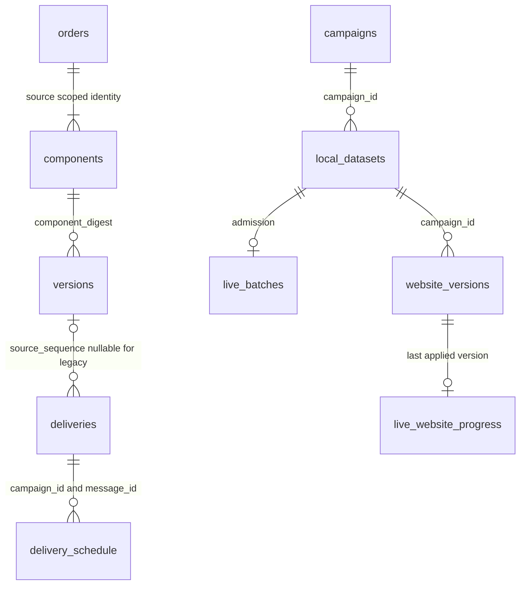

Các đường này là quan hệ FK chính để đọc sơ đồ; không có đường FK từ
website_versions sang deliveries vì website không phát Etsy webhook.

#### I.1. Các bảng source chính giữ nguyên: schema hiện có để bạn đối chiếu

Đây là bản trích cấu trúc quan trọng từ migrations hiện tại, không phải lệnh
để chạy lại CREATE trên DB đã có. Mọi cột trong block này đều NOT NULL.

```text
s02.orders
  campaign_id TEXT         part of the source-scoped primary key
  source TEXT              internal allowed pairs: ebay_sim/seller_sim_01,
  account_id TEXT                                  etsy_sim/7001
  order_id TEXT            nonblank
  base JSONB               object
  PK (campaign_id, source, account_id, order_id)

s02.components
  campaign_id TEXT, source TEXT, account_id TEXT, order_id TEXT
  digest TEXT              64 lowercase hex
  body JSONB               object
  PK (campaign_id, source, account_id, order_id, digest)
  FK (campaign_id, source, account_id, order_id) → orders

s02.versions
  campaign_id TEXT, source TEXT, account_id TEXT, order_id TEXT
  sequence INTEGER         > 0
  visible_at TIMESTAMPTZ
  source_updated_at TIMESTAMPTZ
  header JSONB             object
  component_digest TEXT
  PK (campaign_id, source, account_id, order_id, sequence)
  UNIQUE (campaign_id, source, account_id, order_id, visible_at)
  UNIQUE (campaign_id, source, account_id, order_id, source_updated_at)
  FK (campaign_id, source, account_id, order_id, component_digest) → components

s02.website_versions
  campaign_id TEXT         FK → local_datasets(campaign_id)
  order_id TEXT
  sequence INTEGER         > 0
  visible_at TIMESTAMPTZ
  payload JSONB            object containing source tables
  PK (campaign_id, order_id, sequence)
  UNIQUE (campaign_id, order_id, visible_at)
```

Website không có bảng order-base riêng trong marketplace_sim: các version chứa
source payload; bảng order thật nằm trong website_source. Không hợp nhất website
vào marketplace source tables trong thay đổi này. Full DDL của các bảng giữ nguyên:
[001](../migrations/marketplace_sim/001_s02_temporal.sql),
[002](../migrations/marketplace_sim/002_local_playback.sql),
[003](../migrations/marketplace_sim/003_live_batches.sql).

#### I.2. `s02.deliveries`: giữ parent hiện có, thêm provenance version

Schema đích của parent: cột cũ giữ nguyên tên/type/default; ba cột mới là
`source`, `account_id`, `source_sequence`. SQL dưới là đặc tả target, **chưa phải
migration đã kiểm chứng**, không copy chạy CREATE thay bảng hiện tại.

```sql
CREATE TABLE s02.deliveries (
    campaign_id TEXT NOT NULL REFERENCES s02.campaigns(id),
    message_id TEXT NOT NULL,
    receipt_id TEXT NOT NULL,
    due_at TIMESTAMPTZ NOT NULL,
    event_type TEXT NOT NULL
        CHECK (event_type IN ('order.paid', 'order.shipped')),
    omitted BOOLEAN NOT NULL,
    attempts INTEGER NOT NULL DEFAULT 0 CHECK (attempts >= 0),
    delivered_at TIMESTAMPTZ,
    last_status INTEGER CHECK (last_status BETWEEN 100 AND 599),
    source TEXT NOT NULL DEFAULT 'etsy_sim' CHECK (source = 'etsy_sim'),
    account_id TEXT NOT NULL DEFAULT '7001' CHECK (account_id = '7001'),
    source_sequence INTEGER CHECK (source_sequence > 0),
    PRIMARY KEY (campaign_id, message_id),
    FOREIGN KEY (campaign_id, source, account_id, receipt_id, source_sequence)
        REFERENCES s02.versions
            (campaign_id, source, account_id, order_id, sequence)
);
```

Giải thích cột và compatibility:

- `source/account_id` phản ánh đúng phạm vi Etsy shop hiện tại của SIM; không mở
  rộng account/source contract trong milestone này.
- `source_sequence` liên kết notification tới version phát sinh. Cho NULL với
  dữ liệu legacy không thể xác minh; FK mặc định MATCH SIMPLE chấp nhận NULL.
  Generator plan mới bắt buộc điền sequence hợp lệ trước seal, không tự đoán
  provenance của record cũ từ tên message ID.
- `due_at` parent giữ nghĩa mốc notification gốc như hiện tại; **giờ gửi thực tế
  theo kế hoạch mới lấy từ bảng con**, không còn dùng parent due_at để quyết định
  mọi lần gửi. Query UI nên phân biệt original event/due time với send due time.
- `omitted=true`: notification có trong plan để đối chiếu, không có child send.
- `attempts`: tổng số lần sender đã bắt đầu HTTP send cho message, gồm repeat và
  retry thực tế. `delivered_at`: thời điểm ACK thành công đầu tiên được sender lưu;
  không đồng nghĩa tất cả child send đã xong. `last_status`: HTTP result mới nhất
  được lưu, NULL nếu lần gần nhất không có HTTP response.

Migration thật dự kiến **ALTER ADD COLUMN/CONSTRAINT**, không DROP/recreate.
Không backfill schedule hoặc reset progress cho dataset legacy/sealed. Worker
phân nhánh bằng metadata delivery-plan version trong manifest: legacy giữ hành
vi cũ; plan mới đọc child rows và không chạy thêm vòng duplicate cũ lần nữa.

#### I.3. Bảng mới duy nhất: `s02.delivery_schedule`

```sql
CREATE TABLE s02.delivery_schedule (
    campaign_id TEXT NOT NULL,
    message_id TEXT NOT NULL,
    attempt_no INTEGER NOT NULL CHECK (attempt_no > 0),
    due_at TIMESTAMPTZ NOT NULL,
    send_count INTEGER NOT NULL DEFAULT 0 CHECK (send_count >= 0),
    last_attempt_at TIMESTAMPTZ,
    next_retry_at TIMESTAMPTZ,
    completed_at TIMESTAMPTZ,
    last_http_status INTEGER CHECK (last_http_status BETWEEN 100 AND 599),
    last_error_code TEXT CHECK (last_error_code IN
        ('TIMEOUT', 'CONNECT', 'HTTP', 'TRANSPORT')),
    PRIMARY KEY (campaign_id, message_id, attempt_no),
    FOREIGN KEY (campaign_id, message_id)
        REFERENCES s02.deliveries(campaign_id, message_id),
    CHECK ((send_count = 0 AND last_attempt_at IS NULL)
        OR (send_count > 0 AND last_attempt_at IS NOT NULL)),
    CHECK (completed_at IS NULL OR
        (send_count > 0 AND last_http_status IS NOT NULL
         AND last_http_status BETWEEN 200 AND 299
         AND last_error_code IS NULL AND next_retry_at IS NULL))
);

CREATE INDEX delivery_schedule_pending
    ON s02.delivery_schedule(due_at, campaign_id, message_id, attempt_no)
    WHERE completed_at IS NULL;
```

`attempt_no` là số thứ tự **lần gửi trong plan**, không phải số lần network retry.
Ví dụ child attempt2 gửi trùng bị timeout rồi retry: vẫn row attempt2, nhưng
send_count tăng2. completed_at chỉ ghi sau ACK2xx, không ghi trước HTTP. Giờ
due_at là timeline đã chuẩn bị; last_attempt/next_retry/completed là UTC thực tế.
Live mode so sánh due_at + live_batches.shift_seconds với DB clock; không shift
các mốc progress. Replay dùng logical clock hiện có nhưng ký bằng wall clock.

Điều kiện `last_http_status IS NOT NULL` ngăn SQL CHECK bị NULL logic vô tình vượt
qua khi row completed mà chưa có HTTP status. Không thêm cột status kế hoạch dư
thừa: pending = completed_at NULL; gửi lại dùng next_retry_at.

#### I.4. Quy tắc DB và quyền bắt buộc đi kèm, không chỉ CREATE TABLE

- Tạo child plan trước seal; FK đúng version/message, không cho child của omitted
  message, message có source_sequence NULL hoặc child due_at sớm hơn version
  visible_at. Cross-table rules dùng trigger/validation trước seal; CHECK đơn
  bảng không tự kiểm được các điều kiện này.
- Với cùng message, attempt_no liên tiếp từ1; due_at tăng theo attempt, được
  phép cùng thời điểm nếu gap0. Không ép due_at tăng giữa paid và shipped: đây
  là nơi cần cho phép reorder. Validation trước seal xác nhận quotas/coverage.
- Sau seal: cấm INSERT/DELETE/đổi identity/due_at; chỉ progress được cập nhật.
  Dùng trigger tương tự delivery_progress_only, allowlist đúng sáu progress
  fields: send_count, last_attempt_at, next_retry_at, completed_at,
  last_http_status, last_error_code. Cấm giảm counter hoặc sửa completed row.
- Child progress và parent summary cập nhật cùng transaction khi có thể; không
  có transaction nguyên tử giữa HTTP receiver và SIM DB, nên crash có thể tạo
  thêm delivery thực tế. Receiver audit là bằng chứng phía nhận; không dựng một
  bảng log HTTP thứ hai chứa bản sao body chỉ để nói là exactly-once.
- Worker giữ advisory lock một sender như hiện tại. Trước HTTP commit counters/
  last_attempt; sau response commit result/progress. Crash sẽ retry row chưa
  completed, có thể redeliver cùng message ID; bảo toàn dedupe phía receiver.
- Owner là marketplace_owner; không cấp quyền schedule cho pipeline/API readers.
  Sender dùng role marketplace_writer hiện có, được SELECT plan và UPDATE
  progress theo quyền/trigger; generator chạy đường load có quyền owner hiện có.
  REVOKE PUBLIC, không thêm grants vào core/raw/ops cho sender.

Migration dự kiến `004_delivery_schedule.sql`, đăng ký schema_migrations, bổ sung
vào bootstrap/migrate loader hiện có. Đó là công việc implementation sau review,
**file này hiện chưa tồn tại**. Không sửa migrations001–003 đã áp dụng để giả vờ
DB cũ tự có schema mới.

### II. Thuật toán gen và chạy: không random lúc collector GET

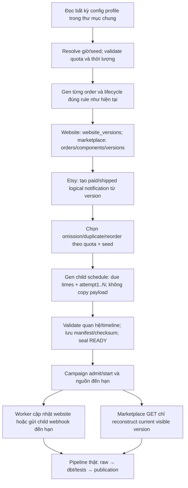

Các bước cụ thể:

1. Seed order điều khiển thời điểm tạo, basket/customer; seed lifecycle điều
   khiển branch/delay đúng causal order. Giữ cách tạo references/catalog hiện có.
2. Delivery seed riêng chọn order thuộc các nhóm fault một cách tái hiện được;
   giữ quota omit/duplicate theo số order hiện có. Omit và duplicate vẫn disjoint;
   reorder có thể áp lên order duplicate không omitted. Record selection trong
   manifest; không chỉ dựa vào xác suất để hy vọng có coverage.
3. Normal notification có một child, due = version.visible_at + delay không âm.
   Duplicate có N child cùng message ID, due tăng theo gap được lấy từ range.
   Omitted vẫn giữ parent và source version nhưng không có child.
4. Muốn bảo đảm reorder: chọn order thật sự có paid và shipped; đặt paid due sau
   shipped first-send due với một khoảng dương. Không đổi source visible_at hay
   version payload. Nếu quota nhiều hơn eligible orders thì reject trước write.
5. Tính delivery tail sau source end; không âm thầm cắt các child gửi muộn. Campaign
   phải chờ hết tail rồi đợi drain. Preview in số order, version, message, planned
   send, omission và mốc cuối để bạn biết sẽ phải đợi bao lâu.
6. Gen theo từng order, ghi batch giới hạn như loader hiện có; không giữ toàn bộ
   payload/ngày trong RAM. Selection có thể cần danh sách order key nhỏ; không
   sort toàn bộ payload. Lưu config resolved và checksum, không gen lại khi GET.
7. Worker mỗi tick lấy tối đa100 child chưa completed, đến hạn và hết retry wait,
   ORDER BY effective_due/campaign/message/attempt. HTTP ngoài transaction dài;
   timeout/failure của một row ghi next_retry_at (mặc định5s sau lần lỗi) rồi xử
   lý row khác trong batch, không để một lỗi chặn hết các campaign. Không cam kết
   strict serial network completion khi có timeout; log actual times để đối chiếu.
8. API vẫn một current visible version/order theo query hiện tại; không UNION
   child schedules vào API output. Website cũng giữ latest/progress behavior.
9. Campaign đo **kết quả thực tế**, không dùng plan để điền raw/history còn thiếu.
   Lịch plan chỉ dùng cho coverage/đối chiếu nguồn; collector không đọc plan DB.

Ví dụ nhỏ: order A có V1 paid10:00 và V2 shipped10:02. Có P gắnV1, S gắnV2;
child S1=10:02:10, P1=10:04:00, P2=10:04:20. API mọi lần GET sau10:02 đều có thể
trảV2. Đây là hai source versions, hai messages, ba planned sends, không phải ba
orders hoặc ba history snapshots. Nếu network retry thì physical attempts có
thể lớn hơn ba mà logical messages vẫn hai.

### III. SIM mới cover chính xác case nào trong 18 case M08C?

Ký hiệu: **D** = gen dữ liệu/lịch giúp tạo tình huống trực tiếp; **H** = cần thêm
hook HTTP/controller/operator, SIM chỉ cấp workload; **R** = giữ regression
boundary riêng. Mọi hàng đều cần assertion runtime; generate thành công không
được gọi là case PASS.

| Case M08C | Mức | SIM mới làm được / phần còn thiếu |
| --- | --- | --- |
| `late_reordered_webhooks` | D | Tạo late/reorder/duplicate/omitted trong PG-backed live. Cần chứng minh receiver/raw/work và API recovery thật; không chỉ nhìn plan |
| `receiver_audit` | D + H | Duplicate hợp lệ làm bằng schedule; invalid/stale signature cần sender fault mode. V1 mới không bật signature fault mặc định |
| `data_quality` | D một phần + R | Profile UNMAPPED riêng dự kiến cho phase sau; unknown status opt-in cần generator/source validation và gate assertions; equal-time conflict vẫn regression riêng. Bảng schedule không tự tạo các lỗi này |
| `api_failures` | H | Workload có sẵn; 429/500/timeout/malformed/repeated/hostile page cần HTTP controls, không suy ra từ source rows |
| `stage_resume` | R | Cần đúng hook sau durable raw/freeze và retry identity; không tạo được chỉ bằng delivery due time |
| `abrupt_raw_inbox` | R | Kill sau raw/inbox commit trước ACK cần barrier/process control |
| `lease_fencing` | R | Cần token/expiry/reclaim/budget assertions trong operational state |
| `abrupt_lease_owner` | R | Cần owner process độc lập cũ quay lại sau reclaim |
| `failed_gate` | H/R | Negative status có thể kích hoạt gate lỗi ở phase sau; còn abort/recovery/last-good phải assert bằng workflow, không phải gen tự đạt |
| `abrupt_freeze_dbt` | R | Freeze orphan/dbt process kill cần barrier/controller và operator outcome |
| `publish_atomicity` | R | Kill trong transaction hoặc sau commit trước ACK cần instrumentation; không random wall-clock rồi coi là trúng |
| `task_clear_budget` | H/R | Cần lỗi lặp + budget exhaustion + real Airflow clear; gen duplicate không tương đương |
| `postgres_restart` | H | Controller/operator restart DB thật và đối chiếu persistence |
| `other_service_restarts` | H | Controller/operator restart service; SIM cấp dữ liệu trước/trong/sau |
| `abrupt_service_loss` | H/R | Controller SIGKILL target opt-in; busy-boundary assertions vẫn R |
| `scheduled_pause_resume` | H | Gen nguồn tiếp tục thay đổi; pause/resume phải thực hiện trên DAG thật, kiểm tra catch-up/observed-only history |
| `maintenance_drain` | H/R | Workload tạo in-flight work; actual drain/timeout/release cần workflow thật |
| `outage_visibility` | H | Dừng source/observer/scheduler và chờ freshness thật; timeline row không làm heartbeat tự ngừng |

**Kết luận coverage:** mở rộng generator chủ yếu thay cách chuẩn bị case webhook
bằng source data có thể nhìn thấy trong DB. Nó không thay cả18 probes. M08D demo
đầu gồm baseline ba nguồn + webhook faults + một eBay outage bằng hook hiện có;
những lỗi kill/atomicity/budget không tự bật. Negative-data profile là gói test
riêng, không biến một lỗi dữ liệu thành “pipeline xử lý thành công”.

### IV. Điều kiện xác nhận thiết kế này đã triển khai đúng

- Migration giữ dataset/volume legacy; source normal/S01 behavior không đổi.
- Một message repeat tạo nhiều child, một inbox logical và đủ receiver audits.
- Reorder có planned/actual timestamp đối chiếu; API không bị tua ngược bởi message.
- Crash/restart sender không bỏ child chưa ACK, có thể redeliver nhưng dedupe đúng.
- Omitted source receipt vẫn có thể được API recovery quan sát và publish theo
  policy; không bắt history phải chứa mọi planned state.
- Query DBeaver đủ xem order→version→message→send plan/progress, không copy payload
  theo mỗi lần gửi. Chỉ SELECT, không sửa sealed plan để demo.
- Khối lượng đo tách generation, HTTP/worker và pipeline; không hứa schema thêm
  một bảng tự chữa bottleneck dbt/publication. Latest C catch-up failure vẫn cần
  fix/rerun trước acceptance campaign; không sửa trong lượt viết đặc tả này.

Nếu bạn đồng ý, implementation sẽ theo schema và thuật toán ở phần này; khi có
điểm buộc phải đổi mình sẽ báo trước, không âm thầm phát triển thêm một SIM engine.

---

## Làm rõ config, bảng event và `visible_at` — review bổ sung 2026-11-05

**Phần này làm rõ đề xuất trước M08D; chưa viết migration/code.** Config chung
nghĩa là cùng cấu trúc và cùng thư mục `tools/s02_data/config/`, không phải duy
nhất `local_now.json`. Có thể có `demo.json`, `load.json`, `recovery.json` hoặc tên
bạn chọn, truyền bằng `--config <path>`. `local_now.json` chỉ là ví dụ của bạn;
không hardcode đường dẫn/tên này và không tự sửa file config local hiện có.

### 1. Có thể thêm một bảng event để bạn quản lý từng dòng không?

**Có.** Đề xuất thêm đúng phần còn thiếu: bảng kế hoạch **từng lần delivery**,
không tạo thêm order và không nhân bản source version chỉ để gửi lại thông báo.
Tận dụng `s02.deliveries` hiện có làm logical notification; thêm bảng con ở
`marketplace_sim`, tên dự kiến `s02.delivery_schedule`. Tên và constraints dưới
đây là thiết kế review, chưa phải schema đã tồn tại.

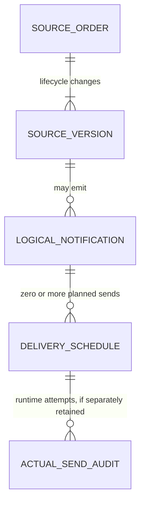

Trong diagram, order/version là các entity nghiệp vụ, không khẳng định mọi nguồn
đã dùng cùng một bảng. Website đang có `s02.website_versions`; eBay/Etsy dùng
`s02.orders/components/versions`. `ACTUAL_SEND_AUDIT` là khái niệm để phân biệt
kế hoạch với thực thi, không phải quyết định thêm ngay một bảng thứ hai.

Ví dụ order A có hai lifecycle version, hai logical notification và ba lần gửi:

| Logical message | Version/event nghiệp vụ | Attempt trong plan | `due_at` dự kiến |
| --- | --- | --- | --- |
| A-paid | V1 paid lúc10:00 | 1 | 10:04:00 |
| A-shipped | V2 shipped lúc10:02 | 1 | 10:02:10 |
| A-paid | V1 paid lúc10:00 | 2 | 10:04:20 |

Worker lấy schedule đến hạn theo `due_at` và tie-breaker ổn định: gửi shipped,
sau đó paid, rồi paid cùng ID lần nữa. Bạn thấy từng dòng planned send trong DB.
Body paid/resource không đổi; chữ ký/timestamp được tính đúng lúc gửi. Receipt
API tại10:04 vẫn lấy current visible receipt, không đọc V1 chỉ vì message là paid.

Các field tối thiểu dự kiến của bảng con:

| Field | Grain / constraint dự kiến |
| --- | --- |
| `campaign_id`, `message_id` | FK đến một logical notification hiện có; không FK đến warehouse |
| `attempt_no` | Integer >0, unique trong campaign/message; PK gồm ba field trên |
| `due_at` | TIMESTAMPTZ NOT NULL, thời điểm dự kiến gửi theo timeline nguồn đã chốt; live shift áp dụng nhất quán |
| Progress | Trạng thái/thời điểm thực gửi/HTTP result để resume; field và claim/retry semantics cần chốt trước DDL |

Kế hoạch immutable sau seal; progress là phần được phép cập nhật riêng. Planned
attempt không bảo đảm chỉ có đúng một network send: crash sau nhận ACK nhưng
trước lưu progress có thể gửi lại. Receiver vẫn dedupe cùng logical message ID.
Không gọi hệ thống exactly-once delivery và không dùng `delivered_at` dự kiến làm
bằng chứng thật. Omitted message giữ provenance ở logical plan nhưng không có
send được thực hiện; cần phân biệt không lên lịch gửi với gửi thất bại.

Đây chỉ là plan cho webhook **push**. API **pull** do collector quyết định lúc
GET, không phải mỗi dòng schedule đến hạn là pipeline tự nhận một response.
Nếu muốn một API response có record lặp trong cùng page phải dùng paging control
riêng; nếu GET hai lần cùng receipt chưa đổi thì đã là đọc lại cùng version.
Không làm API thường trả toàn bộ lịch sử thay cho current-state contract.

### 2. `visible_at` đang có nghĩa gì? Dùng nó tạo duplicate/reorder có đủ không?

Hiện `visible_at` = **từ lúc nào một source version đủ điều kiện xuất hiện**,
không phải “đến giờ bắt buộc gửi một event cho pipeline”. Trong live mode có áp
`shift_seconds` khi map timeline đã chuẩn bị sang clock hiện tại.

- Marketplace: `simulator/s02_temporal.py` lọc version đã visible rồi dùng
  `DISTINCT ON(order_id)` chọn một version mới nhất theo `visible_at DESC,
  sequence DESC`, sau đó mới lọc cửa sổ source_updated_at.
- Website: `simulator/live_worker.py` cũng chọn version đến hạn mới nhất mỗi
  order, chỉ xét sequence vượt progress; khi ghi còn so sánh `updated_at` với DB
  website. `website_versions` là kế hoạch source update; collector đọc bảng thật
  ở `website_source`, **không đọc trực tiếp website_versions**.
- Generator bình thường bảo đảm timeline version tăng; marketplace còn có
  unique constraint cho source_updated_at mỗi order. Không thể chỉ copy row rồi
  đổi một field bất kỳ là luôn insert/được phát như mong muốn.

Ý tưởng hai payload giống nhau khác visible_at **có thể mô phỏng nguồn cho phép
nhìn thấy lại cùng nội dung**, nhưng với code hiện tại không bảo đảm có hai lần
quan sát:

1. Nếu hai version đã đến hạn trước cùng một lần polling/tick, code chọn latest
   nên version đầu có thể không bao giờ được đọc.
2. Website có thể bỏ lần ghi thứ hai vì payload.updated_at không mới hơn; sequence
   thấp xuất hiện trễ có thể bị progress chặn hẳn.
3. Đổi cả payload.updated_at để buộc ghi sẽ không còn là cùng source version;
   fingerprint/version identity có thể đổi. Không dùng cách này để test dedupe
   delivery mà lại kỳ vọng một history version vô điều kiện.
4. Cho version seq2 visible trước seq1 có thể làm API chọn lại state cũ theo
   visible_at hoặc khiến website bỏ seq1; đó là source availability/regression
   fault, **không tương đương notification paid đến sau shipped**.

Vì vậy: giữ `visible_at` của **source versions** cho source visibility. Trên bảng
delivery mới dùng `due_at` (bạn có thể hiểu là visible_at của lần gửi, nhưng đặt
tên khác để không nhầm). Đặt các due_at khác nhau cho cùng message ID sẽ biểu diễn
đúng duplicate/reorder bạn muốn mà không sửa order hay lifecycle. Delay source
visibility vẫn là một loại test riêng nếu thật sự muốn kiểm tra late source data.

### 3. Negative business data là gì và mình đề xuất làm gì?

Đây là **payload có vấn đề về nghiệp vụ/chất lượng dữ liệu**, khác timeout hay
webhook trùng. Không phải cứ “có lỗi” thì mọi thứ phải bị loại: thiếu mapping có
thể giữ dòng UNMAPPED để vận hành xử lý, còn status trái policy phải chặn gate.

| Case đề xuất | Cách chuẩn bị data | Kỳ vọng cần chứng minh / mức ưu tiên |
| --- | --- | --- |
| Source variant/SKU chưa có mapping | SKU hợp lệ ở nguồn, không có mapping tương ứng trong mapping version của campaign | Giữ raw và dòng UNMAPPED, canonical ID không bị đoán; visibility/exception đúng policy. Nên làm đầu tiên; không xoá mapping dùng chung |
| Status nguồn không được hỗ trợ | Negative order riêng có status test rõ ràng, nguồn cho phép phục vụ nó | Raw giữ được; actual dbt constraints phát hiện và gate chặn publication theo phạm vi batch, last-good giữ nguyên. Nên làm thứ hai, opt-in |
| Line amount không khớp quantity × unit price | Một record được gắn fault provenance, sai đúng một quy tắc tiền | Phải xác minh source schema có nhận record đó không và test dbt đúng channel có bắt không; không bỏ validator chung để nạp. Phase sau |
| Hai payload khác nhau cùng source_updated_at | Negative response fixture/control riêng | Policy conflict phải phát hiện; bảng version hiện có constraint chặn trường hợp này nên không nới constraint normal dataset chỉ để nhét lỗi. Giữ regression C trước |

Mặc định normal/demo vẫn toàn dữ liệu hợp lệ. Negative profile là opt-in riêng vì
**một record xấu có thể làm cả batch/channel không publish**, khiến bạn tưởng
mọi pipeline hỏng hoặc sai đo tải. Không mặc định row-level quarantine nếu chưa
có policy/code. Không tự động sửa status, thêm mapping hoặc reset gate để kết quả
xanh; sửa nguồn/mapping là operator action cần ghi lại rõ ràng.

Generator hiện validate invariants và loader nạp catalog/mapping; chưa thể thêm
`missing_mapping`/`unknown_status` vào JSON rồi chạy ngay. Khi triển khai cần một
fault-plan rõ ràng áp cho order được chọn, validation negative chuyên biệt chỉ
cho phép đúng lỗi chủ đích, và expectation/provenance riêng cho test. Pipeline
vẫn chỉ đọc source interface, tuyệt đối không đọc expected ledger.

**Đề xuất chốt:** đợt demo đầu ưu tiên delivery faults và API outage; thêm profile
UNMAPPED để xem chất lượng dữ liệu. Unknown-status/gate-block là profile demo
riêng, không trộn vào baseline performance. Tên config nào cũng được trong thư
mục chung. Nếu bạn muốn API thật sự trả old snapshot theo từng request, đó là
một fault mode khác cần xác nhận riêng, không đánh đồng với webhook reorder.

---

## Review trước M08D — đưa tình huống lỗi vào kế hoạch sinh dữ liệu

**Ngày review: 2026-11-05, sau commit `4c12bc2`. Đây là đề xuất để bạn duyệt,
chưa triển khai generator/campaign mới.** Không sửa `local_now.json`, không bật
service, không inject lỗi và không chạy lại runtime trong lượt review tài liệu.
Trạng thái kiểm thử mới nhất vẫn17 PASS/1 FAIL; xem mục M08C bên dưới.

### A. Bạn hiểu đúng điểm nào, cần phân biệt điểm nào?

Đúng: nên chuẩn bị trước dữ liệu và lịch giao notification, rồi SIM chỉ đọc bản
ghi đến hạn để gửi. Không cần viết một script sửa source state riêng cho mỗi lượt
demo, không cần random liên tục khi đang đo tải. Code hỗ trợ đọc lịch phải viết
một lần, sau đó thay config là đủ cho các kiểu tình huống đã hỗ trợ.

Nhưng có **hai timeline độc lập**, không phải một chuỗi event dùng chung cho mọi
thứ:

1. **Trạng thái nguồn:** order paid lúc nào, shipped lúc nào; API trả trạng thái
   mới nhất đã visible tại thời điểm đọc theo clock đang dùng.
2. **Delivery notification:** thông báo về việc đó được gửi lúc nào, gửi mấy lần,
   có bị bỏ hay không. Delivery đến trễ không làm order quay về trạng thái cũ.

Ví dụ: order shipped rồi nhưng thông báo paid đến sau. Pipeline nhận webhook chỉ
chứa tham chiếu receipt, GET API lúc đó vẫn thấy **paid + shipped**. Không đổi
receipt thành paid-only để diễn đạt paid notification. Không sinh thêm order hay
source version chỉ vì delivery bị lặp.

### B. Case `late_reordered_webhooks` hiện tại đã test như thế nào?

File thực thi: `test_support/m08c_webhook_probe.py`, hàm `main()`.

1. Gọi control endpoint test của Etsy SIM để chọn fixture state `0905` — receipt
   đã shipped — và bật một receipt phụ `9001002` cho tình huống omitted.
2. Gửi ba request HTTP thật vào receiver, ký bằng secret test và thời gian gửi
   hiện tại: `order.shipped` → `order.paid` → `order.paid` lần hai.
3. Lần shipped có một webhook ID riêng; hai lần paid dùng **cùng webhook ID**.
   Sau mỗi lần, gọi collector `drain` thật để xử lý work và GET receipt API.
4. Không gửi notification cho receipt phụ; gọi collector recovery list với một
   checkpoint stream test riêng và cửa sổ thời gian chứa receipt đó.
5. SELECT DB kiểm tra: hai logical inbox, ba delivery audits; receipt phụ có raw
   do API recovery dù không có inbox; tất cả receipt đọc qua notification đều
   `is_shipped=true`, không có paid-only snapshot bị dựng lại.
6. Cuối probe trả SIM về state mặc định `0905`, tắt extra receipt.

**Giới hạn quan trọng:** đây là fixture-mode HTTP probe, có gửi/thu thập thật nhưng
không dùng generator PG timeline của M08B, không đợi một paid notification trễ
ngoài đời nhiều phút, và không chứng minh cả tình huống đã publish vào core/history.
Nó chứng minh thứ tự giao khác thứ tự nghiệp vụ, logical dedupe, raw/work và omitted
recovery trong phạm vi đó. Đây cũng là lý do cần campaign dễ quan sát hơn cho bạn.

### C. Generator/SIM hiện tại có gì sẵn?

| Thành phần | Đã có trong code | Chưa có / không nên hiểu nhầm |
| --- | --- | --- |
| `tools/s02_data/generate.py` | Sinh lifecycle hợp lệ theo order/event seed, source version `visible_at`, lựa chọn branch và khoảng delay | Chưa có notification delivery delay/reorder cấu hình độc lập |
| `tools/s02_data/config.py` | Etsy `notifications.omit` và `duplicate`, chỉ bật nonzero trong `profile: faults` | Đây là quota **số order**, không phải tỷ lệ hay số event; unknown key bị reject |
| `test_support/s02_plan.py::prepare_sql` | Lưu version và logical delivery; hiện `due_at` notification bằng `visible_at` của version | Không có kế hoạch riêng nhiều delivery-attempt row theo các thời điểm khác nhau |
| `marketplace_sim.s02.deliveries` | Message ID, receipt ID, event type, due_at, omitted và progress | Primary key campaign/message; không insert hai row cùng ID chỉ để tạo duplicate |
| `simulator/live_worker.py` | Đọc delivery đến hạn, ký HTTP hiện tại, gửi receiver; quota duplicate gửi lại cùng ID | Duplicate đang gửi liền trong vòng lặp, chưa random khoảng cách giữa các lần gửi |
| Receipt API PG-backed | Đọc trạng thái visible hiện tại qua HTTP | Notification cũ không yêu cầu API trả source state cũ |

Hiện `omit:1, duplicate:1` nghĩa là order Etsy đầu bỏ các notification đã lên kế
hoạch, order kế tiếp gửi lặp notification. Hai nhóm order không chồng nhau. Các
tham số có sẵn được ghi ở [CONFIG.md](../tools/s02_data/CONFIG.md#notification-faults).
Không sửa nghĩa quota cũ một cách âm thầm khi thêm chức năng mới.

### D. Phương án đơn giản cho campaign: gen cả lifecycle và delivery plan

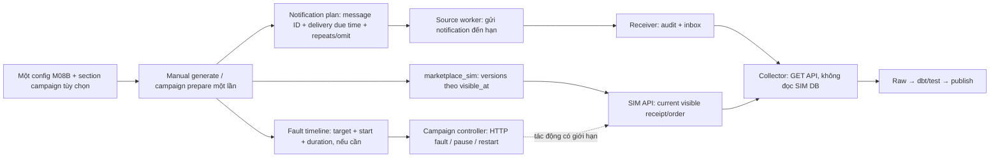

Ví dụ kế hoạch **đề xuất** cho một receipt, không phải cú pháp config đã hỗ trợ:

| Giờ mô phỏng | Dữ liệu / hành động |
| --- | --- |
| 10:00 | Version1 paid visible; tạo logical notification P nhưng lên lịch gửi10:04 |
| 10:02 | Version2 shipped visible; notification S lên lịch gửi10:02:10 |
| 10:02:10 | Gửi S; API lúc collector đọc trả version2 |
| 10:04 | Gửi P đến trễ; API vẫn trả version2 hoặc version mới hơn nếu có |
| 10:04:20 | Gửi lại P, cùng message ID và body; timestamp/signature của lần giao được tạo lúc thực gửi |
| Cùng khoảng thời gian | Receipt khác vẫn có version visible nhưng không gửi notification; polling recovery phải tự tìm thấy |

Mong đợi cho receipt đầu: hai logical notification, ba physical deliveries
nếu tất cả được gửi/nhận một lần như kế hoạch. Network retry có thể làm physical
attempt nhiều hơn ba; phải đối chiếu audit thực tế, không hardcode ba trong mọi
campaign. Số history không mặc định bằng số notification/source transition.
Receipt bỏ notification chỉ được tính recovery thành công khi có bằng chứng API
polling thật thu thập được, không phải chỉ thấy nó trong SIM DB.

**Các mốc thời gian phải ghi riêng:** source event/updated time; source visibility;
planned delivery due time; actual send/receive time; actual API observation time.
Clock giả có thể phục vụ nguồn/replay nhưng chữ ký webhook hợp lệ dùng delivery
clock hiện tại theo contract. Không dùng ngày nghiệp vụ giả cũ để ký rồi vô tình
bị receiver từ chối như một replay attack.

Thêm delay vào delivery plan **trước khi seal dataset**; không update schedule
dataset đã seal để tạo fault giữa chừng. Không copy toàn receipt cho từng delivery:
giữ resource/message identity và tham chiếu version nghiệp vụ, giảm dữ liệu dư.
Source worker chỉ lấy batch đến hạn có giới hạn và ghi progress; không load toàn
bộ campaign vào RAM. Bổ sung index/column chỉ sau khi chốt dictionary/constraints;
chưa có DDL được quyết định trong tài liệu này.

Chuẩn bị trước giúp chuyển chi phí random ra khỏi lúc đo và giảm thao tác tay,
không có nghĩa mọi thứ chắc chắn nhanh hơn: delivery trùng vẫn tạo HTTP/audit thật,
plan còn tốn storage và DB queries. Bottleneck dbt/publication phải được đo riêng;
không khẳng định chuyển fault vào generator tự giải quyết độ trễ pipeline.

### E. Lỗi nào làm bằng data plan, lỗi nào không?

| Tình huống | Ưu tiên xử lý | Phạm vi / lưu ý |
| --- | --- | --- |
| Webhook đến trễ, đảo thứ tự | Gen delivery due time riêng | Giữ source lifecycle đúng; đảo thứ tự giao bằng delay, không đảo causal order paid/shipped |
| Webhook trùng | Gen repeat count và khoảng cách gửi cho cùng logical ID | Không tạo order trùng; cần progress từng attempt nếu muốn resume không gửi bù sai |
| Omitted notification | Gen omission plan có provenance | API source state vẫn tồn tại và visible; không bỏ cả receipt vì sẽ không còn gì để recover |
| Source update muộn nhưng hợp lệ | Gen visible/update timestamps đúng semantics | Khác delayed webhook; không backdate bừa khiến update lọt ngoài checkpoint rồi gọi đó là recovery thành công |
| Thiếu mapping / status lạ | Có thể gen **profile negative riêng** sau khi chốt policy | Generator hiện kiểm tra invariants và loader nạp mapping; cần thiết kế mapping version/input lỗi riêng, không xoá mapping dùng chung hoặc bỏ validation cho mọi data |
| eBay page có record lặp / đọc lại cùng snapshot | Tái sử dụng HTTP paging control hoặc lập lịch response | Không insert duplicate cùng PK vào source; hai order khác ID là hai đơn thật, không phải test dedupe |
| HTTP429/500, timeout, malformed JSON | SIM transport/control chạy theo fault timeline | Bản ghi DB không tự tạo mã HTTP hay làm hỏng đường truyền. Dùng hooks có sẵn thay vì sửa riêng API code cho từng campaign |
| Chữ ký sai / stale | Sender có mode lỗi rõ ràng, lên lịch bằng config nếu cần | Không thể chỉ đổi order payload; cần cách ký/header sai. Mặc định luôn ký đúng |
| Pause/resume, restart, SIGKILL, scheduler/observer outage | Controller tác động thật vào target được phép | Data không làm container chết; không cấp Docker quyền cho SIM/collector |
| Lease fencing, hết budget, crash đúng raw/freeze/publish boundary | Giữ regression M08C; chỉ chọn vài case tích hợp khi có cơ chế đồng bộ | Timeline wall-clock đơn thuần không bảo đảm kill trúng transaction; nếu không chạm boundary phải NOT_EXERCISED, không PASS giả |

Không cần đưa toàn bộ18 case vào generator. Mục tiêu là **tái sử dụng dữ liệu và
timeline**, không xây simulator thành một fault framework lớn. Negative input và
transport/runtime fault vẫn phải phân biệt trong báo cáo.

### F. Dự kiến config và tương thích

Tiếp tục dùng một file như `tools/s02_data/config/local_now.json`, không buộc bạn
chọn config/campaign ở pipeline. Các section dự kiến, tên cuối cùng cần chốt trước
khi code:

- Data config cũ giữ nguyên: orders mỗi channel, seed, peak hours, branch,
  basket, lifecycle delay, duration và notification quotas đã có.
- Phần delivery mở rộng: delay range, duplicate gap, các quota tối thiểu để chắc
  chắn có một số order reorder/omit/duplicate; các trường này **chưa được parser nhận**.
- `campaign`: warm-up, fault windows/durations, runtime target consent, drain
  timeout, giữ service sau demo và các ngưỡng đánh giá.
- Seed cho delivery/fault tách khỏi seed order: đổi lịch gửi không làm thay giỏ
  hàng/identity; config resolved, kế hoạch và checksum được lưu trước khi chạy.

Reorder ngẫu nhiên không bảo đảm có reorder; campaign coverage cần quota/bounded
construction để chắc chắn paid được giao sau shipped ở một số order được chọn.
Phải validate đủ thời gian cho các delivery muộn: source generation end không
đồng nghĩa campaign kết thúc. Sau source end còn delivery tail rồi mới drain
pipeline; nếu vượt timeout thì báo rõ phần chưa xử lý, không âm thầm cắt plan.

Lệnh generate hiện tại vẫn chỉ chuẩn bị dữ liệu và không restart/pause/inject
transport fault. Campaign entrypoint riêng mới được phép điều phối runtime.
Hiện parser dùng allowlist nghiêm ngặt; **đừng thêm `campaign` vào config đang dùng
ngay lúc này** vì sẽ bị reject. Khi triển khai sẽ phải tách/validate đúng section
và test compatibility cho generate-only, không bắt bạn giữ hai file config.

### G. Trình tự mình sẽ làm tiếp sau khi bạn duyệt

1. **Sửa điều kiện lặp lại của C trước:** xác minh marker `polling-drain` còn lại
   có làm test DAG ngừng schedule hay không; fix đúng scope, thêm regression
   “drain xong chạy scheduled case lần nữa”, rồi rerun catch-up thật. Không tự xoá
   marker maintenance của main để ép pipeline chạy.
2. Chốt config/dictionary của logical notification và delivery attempts/progress.
   Tận dụng bảng hiện có; chỉ thêm storage tối thiểu nếu cần lịch gửi trùng cách
   nhau và resume chính xác. Không đổi warehouse/source contract.
3. Mở rộng generator cho delivery delay/reorder, duplicate gap và omitted plan;
   dùng seed/quota, validate trước khi ghi và giữ immutable source plans.
4. Điều chỉnh worker đọc plan chung thay cho hardcode gửi duplicate liền; API vẫn
   phục vụ state visible hiện tại. Không viết campaign-specific branch vào collector.
5. Thêm campaign controller nhỏ: tái sử dụng live startup, SIM hooks và assert/
   measurement có sẵn; in URL/DB access và timeline ngay đầu. Không chạy thêm stack
   Airflow thứ hai mặc định; giữ target local đã opt-in rõ ràng, không reset data.
6. Profile demo đầu: ba nguồn, Etsy late/reorder/duplicate/omit, eBay outage ngắn,
   rồi recovery/drain. Pause/restart là profile opt-in tiếp, không bật mọi fault
   chồng nhau trong lần đầu. Đo baseline cùng workload không fault để so sánh.
7. Ghi actual event log và số đo stage/backlog/freshness/drain; kiểm tra riêng
   correctness/recovery/performance. In NOT_EXERCISED khi không tạo được fault;
   dữ liệu đã gen không tự là bằng chứng pipeline đã xử lý.
8. Chạy regression và campaign nhỏ có giới hạn; ghi exact results. Cập nhật guide
   một lệnh, query đối chiếu source→raw→core, ảnh/địa chỉ UI thực tế và restore.

Đây là dự định, không phải tuyên bố code campaign đã hoạt động. Không stage/commit
trong lượt review này. Plan/strategy English được đồng bộ ngắn để không quên các
ranh giới; file tạm này giữ giải thích chi tiết bằng tiếng Việt cho bạn duyệt.

### H. Những điểm cần bạn duyệt / mặc định mình đề xuất

- **Duplicate:** giữ nghĩa quota order cũ, cùng logical ID; thêm khoảng cách gửi.
  Không mặc định duplicate nghĩa là tạo ID khác vì đó là tình huống khác.
- **Reorder:** ưu tiên delay delivery để đổi thứ tự, không làm sai lifecycle;
  ít nhất một order bảo đảm có case, phần còn lại theo phân phối có seed.
- **Profile đầu:** các lỗi delivery + một API outage, không có SIGKILL/PG restart
  mặc định. Những thao tác disruptive chỉ chạy khi opt-in và target đã xác minh.
- **Negative business data:** để opt-in phase sau khi thống nhất policy cụ thể;
  không âm thầm trộn status không hỗ trợ/thiếu mapping vào normal workload.
- **Khôi phục:** bỏ các fault do campaign tạo ra và giữ môi trường để xem; các
  service/DAG có sẵn không được tự đổi trạng thái ngoài consent của campaign.
- **Quy mô và ngưỡng PASS:** chưa có số order/phút, latency/drain SLA nào được
  chứng minh. Đo baseline nhỏ trên máy bạn trước, chốt ngưỡng trước lượt đo chính;
  duration6 phút là thời gian nguồn, không bảo đảm cả fault tail/drain cũng6 phút.

Nếu bạn muốn khác ở sáu điểm này, mình cần làm rõ trước khi code; còn lại mình
đề xuất đi theo các mặc định trên để không tăng độ phức tạp simulator.

---

## M08C — Bản giải thích và hướng dẫn kiểm tra hiện hành, 2026-11-05

**Cập nhật khi review để commit:** phát hiện lượt bạn chạy lại
`scheduled_pause_resume` bị timeout ở bước catch-up, cleanup PASS; evidence có
đuôi `d6dc5866662a4db38d588943b4a48cf3`. Report mới nhất là **17 PASS / 1 FAIL**.
Kết quả18/18 bên dưới là lượt trước, không được dùng để che lần FAIL mới. Commit
lần này là checkpoint có ghi rõ vấn đề, không phải chứng nhận mọi rerun đều đạt.
Cần chẩn đoán và chạy lại case này trước khi kết luận campaign tiếp theo PASS.

Hướng M08D bạn đã chốt: dùng chung config M08B (như `local_now.json`), một lệnh
campaign chuẩn bị dữ liệu, bật môi trường quan sát ổn định, gây lỗi/khôi phục theo
timeline có seed, cho xem Airflow/DB và xuất kết quả correctness/recovery/performance
riêng. Các bài regression M08C vẫn giữ. Đây là kế hoạch tiếp theo, chưa có lệnh
campaign mới; lệnh generate cũ không tự nhiên được quyền gây lỗi hay dừng service.

**Đọc phần này trước.** Những mục từ ngày 2026-11-01 phía dưới được giữ để bạn
đối chiếu lịch sử, không phải trạng thái hiện tại. M08C đã đạt **18/18 case runtime
local**, **88 test component** và **14 test report/UI sau recovery**. M08D chưa làm.
Các câu cũ như “M08C đang dừng”, “chỉ ba case PASS” hay “failed_gate thiếu quyền”
đã được thay thế bởi kết quả mới, nhưng log lỗi cũ không bị xoá.

### 1. M08C giải quyết việc gì? Có thay M08B không?

M08B chứng minh đường đi bình thường: sinh dữ liệu nguồn, pipeline tự thu thập,
dbt xử lý, publish và dashboard đọc được. M08C hỏi tiếp: **nếu lỗi xảy ra ở giữa
đường thì hệ thống có giữ dữ liệu/audit, không publish dở dang, retry đúng và biết
khi nào phải nhờ người vận hành không?** Đây là kiểm thử đúng/sai khi có lỗi,
không phải đo được bao nhiêu đơn/giây; tải/burst/soak thuộc M08D.

Không yêu cầu bạn chọn campaign mỗi lần chạy pipeline hằng ngày. Luồng sử dụng
thường vẫn là `live-up` rồi tự chạy `generate --config ...`; pipeline tự xử lý dữ
liệu đến hạn. Riêng **test có chủ đích kill/restart/inject lỗi** phải chọn case và
scope disposable để tránh phá stack đang demo. S01 ở đây chỉ là bộ dữ liệu đối
chiếu cố định cho regression, không phải bộ lọc bắt pipeline thật chỉ nhận S01.

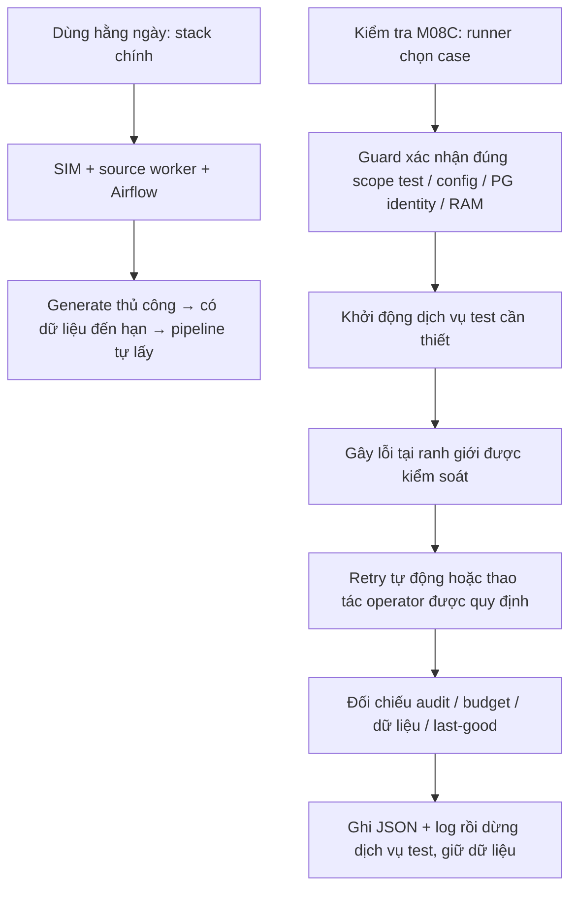

Stack test không phải môi trường thứ hai phải chạy suốt ngày. Nó dùng cùng
Docker Engine nhưng có project/volume/database riêng, chỉ bật khi kiểm tra.
Test không chuyển dữ liệu test sang DB chính sau khi chạy. **DBeaver đang nối
DB chính không tự thấy dữ liệu của scope test.** Việc tách này là để có thể kill
PostgreSQL, Airflow hay receiver mà không làm mất buổi demo/dữ liệu của bạn.

### 2. Những gì đã làm và đã sửa

Phần M08C gồm runner, inventory, safety guards, các probe HTTP/SQL/process/lifecycle,
DAG test riêng và regression. Những code có từ checkpoint trước vẫn được dùng;
lượt tiếp tục này hoàn thiện bằng chứng và sửa các vấn đề phát hiện lúc chạy.

| Phần | File nên đọc | Ý nghĩa / thay đổi |
| --- | --- | --- |
| Inventory 18 case | `test_support/m08c_cases.json` | ID, runner và phạm vi từng case; không suy ra PASS chỉ vì có code |
| Điều phối và evidence | `test_support/m08c.py` | Xác nhận scope, kiểm tra RAM đúng topology, chọn probe, ghi kết quả và dừng dịch vụ trong finally |
| Guard môi trường | `test_support/m08a.py` | Kiểm tra marker/config/labels/mounts/PG identity; không nhận stack chính làm test target |
| Chữ ký publication | `test_support/m08c_pipeline_probe.py` | Dùng quyền publisher sẵn có trong transaction read-only, repeatable-read; không cấp thêm SELECT cho transform role |
| HTTP | `test_support/m08c_http_probe.py`, `simulator/http_faults.py` | Lỗi timeout/JSON/page/retry có số lần và phạm vi cụ thể |
| Process loss / atomicity | `test_support/m08c_loss_probe.py` | Chết sau raw commit, khi dbt đang chạy, trong transaction publish và sau commit trước ACK |
| Worker / notification / chất lượng | `test_support/m08c_worker_probe.py`, `test_support/m08c_webhook_probe.py`, `test_support/m08c_quality_probe.py` | Fencing owner cũ, thông báo sai thứ tự/bị bỏ sót, policy dữ liệu |
| Lifecycle thật | `test_support/m08c_lifecycle.py`, `test_support/airflow/m08c_recovery.py` | Lịch thật, pause/resume, drain, clear task, service restart và outage |
| Source worker | `simulator/live_worker.py`, `test_support/m08c_source_worker_probe.py` | Worker hỗ trợ kết thúc tick khi SIGTERM; probe chờ heartbeat thật trước khi gửi signal, tránh lỗi do giết interpreter quá sớm |
| Drain dùng chung | `tools/s02_data/live.py` | Test gọi cùng thuật toán drain thật, nhưng chỉ chọn DAG test; mặc định live vẫn là bốn DAG periodic ban đầu |
| Offline regression | `tests/test_m08c.py`, `tests/test_m08c_probes.py`, `tests/test_m08c_http.py`, `infra/scripts/check_m08c_offline.ps1` | Guards/assertion/HTTP local; CLI container không bị nhầm là Airflow chính do label kế thừa từ image |

Các sửa quan trọng khi chạy Airflow 3:

- Copy DAG test vào container đang dừng **trước** khi start. Copy sau startup có
  thể lỡ lần scan đầu và đợi refresh 300 giây, vượt deadline discovery 180 giây.
- Kiểm tra bản serialized DAG mới nhất, không đòi metadata chỉ được có một row.
- CLI task-clear ban đầu exit0 nhưng không chọn được task do cách xử lý
  `--task-regex` ở bản cài đặt này. Bản sửa kiểm tra đúng run đã failed, đúng hai
  task test và logical date duy nhất rồi mới clear bằng CLI thật. Không viết SQL
  ép task thành success, không reset durable retry budget. Đã chạy lại tự động PASS.
- Drain trước đây dùng chờ giả để tạo timeout trong prototype; nay kiểm tra timeout
  của thuật toán drain thật, giải phóng barrier rõ ràng rồi để retry chạy hết.

**Không thay source contract, fingerprint, schema core/marts hay business SQL**
trong lượt hoàn thiện này. Không dựng history từ lịch generator; không đưa quyền
admin vào collector; marketplace vẫn chỉ đi HTTP, website ingestion vẫn read-only.

### 3. Đầy đủ 18 test case: gây lỗi gì, mong đợi gì?

Mỗi hàng dưới đã có evidence runtime PASS trong scope `563f55c17bab`. PASS có
nghĩa là assertion của hàng đó đạt, không đồng nghĩa mọi kiểu sự cố đều được thử.

| Case | Tình huống mô phỏng / mong đợi PASS |
| --- | --- |
| `api_failures` | API trả 429/500, timeout, HTTP200 nhưng JSON hỏng, lỗi giữa các trang, next URL không an toàn hoặc lặp trang. Giữ audit, không đẩy checkpoint vượt phần chưa thu thập an toàn; hồi phục đúng khi nguồn hết lỗi. Không phải test tải API. |
| `receiver_audit` | Gửi HTTP chữ ký sai/cũ và delivery trùng. Từ chối request không hợp lệ; delivery hợp lệ trùng vẫn giữ audit vật lý nhưng không tạo nhiều logical work cho cùng thông báo. |
| `late_reordered_webhooks` | Gửi shipped trước rồi thông báo paid đến trễ, gửi trùng, và bỏ một notification. Inbox/audit/work/raw đúng; polling receipt API tìm được phần bị bỏ sót. Không khẳng định mọi trạng thái đó đã được publish thành history. |
| `stage_resume` | Ngắt có kiểm soát sau raw và sau freeze rồi chạy lại cùng identity/config. Giữ raw/manifest đã commit, chạy tiếp đúng stage, không nhân đôi kết quả; dbt/test/publish thật đạt và rerun idempotent. Đây là hook interruption, không phải SIGKILL. |
| `abrupt_raw_inbox` | Process chết sau raw commit; receiver chết sau DB commit trước ACK. Chạy lại không mất raw/inbox; retry delivery vẫn một inbox logical và giữ đủ delivery audits. |
| `lease_fencing` | Probe SQL/HTTP kiểm tra token hết hạn, budget năm lần và replay được liên kết rõ ràng. Owner/token cũ không được ghi thành công. Probe rollback-only; không thay thế case process owner độc lập dưới đây. |
| `abrupt_lease_owner` | Owner cũ quay lại sau khi lease đã được owner mới reclaim và commit. Token cũ bị fence; không ghi đè kết quả owner mới. |
| `failed_gate` | Cố ý làm dbt test fail. Không đổi core/marts/publication pointer last-good; batch lỗi không tự thành TESTED. Abort lỗi rõ ràng rồi execution mới có thể recovery thành công. |
| `data_quality` | Chạy compiled SQL thật với input literal: thiếu product mapping, status lạ, hai version cùng timestamp nhưng xung đột. Áp dụng đúng UNMAPPED/reject/conflict, không đoán mapping. Đây không phải campaign dữ liệu lỗi đi toàn bộ từ source đến warehouse. |
| `abrupt_freeze_dbt` | Process mất sau freeze hoặc dbt bị SIGKILL. Manifest không mất; batch orphan cần thao tác operator có kiểm soát, không giả vờ tự recovery mọi trường hợp. Sau xử lý được quy định, pipeline chạy lại đúng. |
| `publish_atomicity` | Kill giữa transaction thay stable tables phải rollback, không thấy nửa dữ liệu mới. Nếu commit đã xong nhưng ACK mất, retry phải idempotent; đối chiếu đầy đủ core/marts/pointer. |
| `task_clear_budget` | Làm collect hết năm durable attempts, rồi clear task bằng Airflow CLI thật. Task thử lại có thể lên try6 nhưng durable budget vẫn5; DAG tiếp tục failed đúng thiết kế. Test PASS dù DAG đỏ vì nó chứng minh không bypass budget bằng clear. |
| `postgres_restart` | Restart PostgreSQL test nhẹ nhàng. PG system identity và chữ ký dữ liệu bền vững giữ nguyên; không chứng minh phục hồi mất ổ cứng/host. |
| `other_service_restarts` | Restart nhẹ nhàng API/receiver/Airflow; kiểm tra source-worker commit/progress recovery và SIGTERM sau tick. Dữ liệu bền vững giữ đúng, worker không nhân đôi order. |
| `abrupt_service_loss` | SIGKILL API/receiver/Airflow/PostgreSQL test và source worker rồi khởi động lại. Kiểm tra persistence/recovery theo assertion. Đây là mất service ở trạng thái kiểm soát; các điểm raw/dbt/publish đang bận có case riêng. |
| `scheduled_pause_resume` | Pause consumer trong khi nguồn đi qua các trạng thái rồi resume. Có ít nhất hai run scheduled thành công thật và bắt kịp snapshot quan sát được; lần đã chạy chỉ thêm một history version được quan sát, không bịa ba transition. |
| `maintenance_drain` | Giữ một task thật ở barrier, drain hết timeout phải báo lỗi rõ ràng và để retry còn chạy được. Operator release barrier, drain hoàn tất rồi mới idle; không clear task/reset budget để ép PASS. |
| `outage_visibility` | Làm source/observer/scheduler không sẵn sàng. Giữ last-good; checkpoint không chạy vượt lỗi nguồn; monitoring chuyển Unknown/stale đúng lý do. Đợi tuổi sample/heartbeat thật, không sửa timestamp để giả outage. |

### 4. Hiểu recovery trong thực tế

```mermaid
sequenceDiagram
    participant S as Source API / Website
    participant C as Collector
    participant R as Raw + operational DB
    participant D as dbt + tests
    participant P as Publisher
    participant U as Dashboard
    C->>S: Lấy dữ liệu
    C->>R: Commit raw + thông tin acquisition
    Note over C,R: Nếu chết sau commit, retry dùng trạng thái bền vững
    R->>D: Manifest input đã freeze
    alt Test dữ liệu fail
        D-->>P: Không đủ điều kiện publish
        Note over P,U: Giữ bản last-good; operator xem lỗi / abort đúng quy trình
    else Test đạt
        D->>P: Artifacts hợp lệ
        P->>R: Transaction đổi stable data + pointer
        Note over P,R: Chết giữa transaction: rollback; mất ACK sau commit: retry idempotent
        U->>R: Đọc publication đã commit
    end
```

Trong vận hành, API có thể chập chờn nên retry; webhook có thể gửi trùng/đến trễ
nên giữ audit và dedupe; scheduler có thể dừng nên resume rồi thu thập tiếp.
Không phải lỗi nào cũng tự chữa: hết budget, dữ liệu không hợp lệ hay batch orphan
cần người xem evidence và xử lý theo quy trình. Dashboard không nên hiển thị
“healthy” chỉ vì vẫn còn số liệu cũ; khi thiếu bằng chứng mới phải Unknown/stale.

Ví dụ nguồn đổi paid → shipped → cancelled giữa hai lần polling: pipeline có thể
chỉ thấy cancelled. Đó không tự động là mất raw. Nó không được quan sát hai trạng
thái đầu nên không được tạo history cho chúng. Muốn đủ mọi transition cần interface
event/change-log phù hợp, không thể lấy lịch giả lập để vá history production.

### 5. Bạn tự check local: từ nhẹ đến đầy đủ

Các lệnh PowerShell chạy tại thư mục gốc repository. Không cần generate thêm đơn
để xem lại evidence M08C. **Không bật live-up hay tự kill stack chính để chạy C.**

#### Bước A — Xem inventory và bằng chứng đã có, không bật dịch vụ

```powershell
git status --short
python --version
docker version
docker compose version
docker ps
python -m test_support.m08c plan

# ID này là scope đã chạy trên máy hiện tại, không phải ID mẫu dùng ở mọi máy.
$testId = '563f55c17bab'
Test-Path "runtime/isolated/m08a-$testId/evidence"
python -m test_support.m08c report --id $testId
if ($LASTEXITCODE -ne 0) { throw 'Cannot read M08C evidence' }
```

Mong đợi report: đủ18 case, mỗi case `status: PASS`,
`all_required_cases_passed: true`. `plan` chỉ liệt kê khả năng chạy, luôn có
`evidence_status: NOT_RUN`; nó không đọc kết quả cũ, nên **không dùng plan để chấm
PASS**. `milestone_complete: false` trong từng evidence/plan là nhãn không tự
sign-off milestone; phải xem report, cleanup, regression và giới hạn nữa.

Nếu đường dẫn không tồn tại, runtime bị xoá hoặc bạn clone trên máy khác thì chưa
có evidence local này. Đọc STATUS không tương đương đã chạy test trên máy mới.
Không tạo thủ công marker hay đổi ID trong identity.json để bỏ qua guard.

#### Bước B — Chạy bộ component không đụng DB chính

```powershell
powershell -NoProfile -ExecutionPolicy Bypass -File infra/scripts/check_m08c_offline.ps1
if ($LASTEXITCODE -ne 0) { throw 'Offline regression failed' }

Push-Location fixtures/s01
try {
    python verify.py
    if ($LASTEXITCODE -ne 0) { throw 'Fixture checks failed' }
    python -m unittest -v test_tools.py
    if ($LASTEXITCODE -ne 0) { throw 'Fixture utility tests failed' }
} finally { Pop-Location }
```

Wrapper cần Airflow image đã build theo repo; nó chạy CLI container giới hạn
256MiB/0.5 CPU, không bật scheduler, không mount `.env` hay Docker socket,
không nối warehouse network. Mong đợi88 test PASS; S01 có10 checks +10 tests PASS.
Nếu thiếu image/dependencies thì sửa prerequisite, không gọi đó là runtime PASS.
Host chỉ có Python cơ bản vẫn chạy được `python tests/test_m08c.py` (19 guard tests),
nhưng19 test đó **không thay thế** suite88 hay18 runtime case.

#### Bước C — Chạy lại một case thật đơn giản

Chỉ dùng scope **M08A S01 đã accept thành công**, còn nguyên config/volume/marker.
Lệnh có `--confirm-disposable` vì ghi dữ liệu và gây lỗi trên target test.

```powershell
$testId = '563f55c17bab'  # chỉ khi scope này vẫn còn và guard chấp nhận
python -m test_support.m08c run --id $testId --case postgres_restart --confirm-disposable
if ($LASTEXITCODE -ne 0) { throw 'PostgreSQL restart case failed or was refused' }
python -m test_support.m08c report --id $testId
```

Mong đợi dòng cuối case `M08C case PASS; evidence=...`, exit0, JSON có
`status: PASS`, `cleanup: PASS`; dữ liệu/PG identity trước-sau khớp. Đây là restart
DB **test**, không phải DB chính của bạn. Sau case dịch vụ được runner bật sẽ dừng;
volume/log/evidence vẫn còn. Một case PASS chỉ xác nhận một case, không đủ ký M08C.

Nếu scope bị từ chối do config hash, engine, RAM, marker hay identity khác:
**dừng và đọc lỗi**, không xoá volume hoặc sửa guard. Nếu cần baseline mới, đi theo
[M08A prerequisites và init/check/accept](../test_support/README.md#prerequisites--safety).
Baseline mới cần stack chính running/idle để kiểm tra bảo vệ dữ liệu, khác với
việc tái sử dụng baseline đã accept khi stack chính đang dừng. Máy4GB không nên
tự bật hai Airflow; tăng tài nguyên hoặc sắp maintenance window được đồng ý trước.
Runner không tự dừng Airflow chính giúp bạn.

#### Bước D — Chạy case có Airflow thật, rồi mới chạy toàn bộ

```powershell
python -m test_support.m08c run --id $testId --case scheduled_pause_resume --confirm-disposable
if ($LASTEXITCODE -ne 0) { throw 'Scheduled case failed or was refused' }
```

Case lifecycle tự bật Airflow test và cài DAG `m08c_recovery`; bạn không phải bật
SIM/source generator thủ công. Các case HTTP/CLI khác có thể không bật scheduler.
Case có thể mất nhiều phút vì phải đợi schedule/retry/service health thật, không
phải lúc nào thấy lâu cũng là treo. `outage_visibility` còn cố ý đợi freshness hết hạn.

Muốn xem web trong lúc lifecycle đang chạy, mở terminal khác và chỉ đọc binding:

```powershell
docker ps --filter "label=com.docker.compose.project=m08a-$testId" --format 'table {{.Names}}\t{{.Ports}}\t{{.Status}}'
```

Dùng địa chỉ localhost/port published của Airflow **test** nếu có, không mặc định
8080 (có thể là stack chính). Credential test nằm trong file runtime riêng của
scope; không gửi file đó lên chat/Git. Chỉ quan sát, không trigger/pause/clear tay
trong khi runner đang chạy. UI không phải điều kiện bắt buộc để case PASS và có
thể không kịp mở trước khi cleanup dừng container. DAG đỏ trong case budget hoặc
gate lỗi có thể đúng kỳ vọng; kết luận từ assertion/evidence, không chỉ màu UI.

Để chạy đủ18 case theo inventory, **tuần tự, dừng ngay nếu có lỗi**:

```powershell
$cases = Get-Content test_support/m08c_cases.json -Raw | ConvertFrom-Json
foreach ($case in $cases) {
    python -m test_support.m08c run --id $testId --case $case.id --confirm-disposable
    if ($LASTEXITCODE -ne 0) { throw "M08C stopped at $($case.id); inspect evidence before retry" }
}
python -m test_support.m08c report --id $testId
```

Không chạy hai case cùng target song song. Không clear budget hoặc reset DB giữa
các case để làm số đẹp. Các case tự chuẩn bị input/identity cần thiết trong scope.
Nếu host bị Ctrl+C/crash, finally có thể không chạy; kiểm tra đúng project/log rồi
dùng `python -m test_support.m08a stop --id $testId` khi không còn runner đang làm
việc. Không dùng `down -v`, prune hoặc xoá latch khi chưa xác minh tiến trình cũ.

#### Bước E — Đọc JSON và kiểm tra DB ở đâu?

File chính nằm tại `runtime/isolated/m08a-ID/evidence/m08c-CASE-UUID.json`.
Report in đường dẫn evidence mới nhất cho từng case. Ví dụ:

```powershell
$file = Get-ChildItem "runtime/isolated/m08a-$testId/evidence/m08c-postgres_restart-*.json" |
    Sort-Object LastWriteTime -Descending | Select-Object -First 1
$result = Get-Content -LiteralPath $file.FullName -Raw | ConvertFrom-Json
$result | Select-Object case,status,cleanup,started_at,finished_at,id,db_system_id,failure
$result.steps | Select-Object -Last 5
```

Xem status/cleanup, scope, hashes, probe summary và các command log được tham chiếu.
Log/raw có thể chứa secret hoặc dữ liệu chi tiết nên không publish nguyên file.
Evidence là file ignored, không mất đi khi container dừng; commit code không kèm
runtime credentials hay JSON private. Lỗi cũ được giữ, không xoá để che FAIL.

Trong test PostgreSQL, `data_platform` giữ raw/ops/core/marts; `website_source`
giữ nguồn website; `airflow_meta` giữ DAG/run/task metadata; `marketplace_sim`
phục vụ các probe dùng nguồn PG-backed. Không phải mọi case đều cần/generate
dữ liệu vào marketplace_sim: nhiều case dùng fixture HTTP hoặc input SQL nhỏ để
kiểm tra đúng một ranh giới. Xem cả ba DB không tự chứng minh mọi case đã PASS.

Các bảng hữu ích ở `data_platform`: `ops.pipeline_runs`, `ops.task_attempts`,
`ops.publication_state`, `core.orders_current`, `core.order_snapshot_history`.
Chỉ SELECT khi tự inspect. Đừng kỳ vọng các tổng count luôn trở về đúng baseline
vì case mới giữ thêm audits/test orders; cần đối chiếu identity/cohort của case.
Nếu muốn DBeaver vào scope test đang dừng, cần một phiên inspection riêng được
chuẩn bị đúng target/credential/port, không vừa sửa hoặc bật dịch vụ vừa chạy runner.
Hướng dẫn ở đây ưu tiên evidence để không vô tình restart sai stack.

### 6. Khi nào được coi là PASS M08C?

1. Đúng scope disposable, guards hợp lệ, không tác động trái phép stack chính.
2. Đủ18 case hiện hành, mỗi case có evidence runtime mới nhất PASS, cleanup PASS;
   lỗi được inject đúng ranh giới chứ không phải “bất kỳ exception nào cũng đạt”.
3. Raw/audits không bị bỏ; logical retry không nhân đôi; lease và budget vẫn đúng.
4. Gate fail không đổi last-good; publish không tạo stable data/pointer nửa cũ nửa mới.
5. Resume/recovery có kết quả tự động hoặc operator outcome được quy định, không
   reset budget, ép success, hay tự dựng history để đạt assertion.
6. Regression liên quan đạt: component, S01 utilities và report/publication bị ảnh
   hưởng; giữ bằng chứng lệnh/kết quả/phạm vi, không chỉ ảnh UI màu xanh.
7. Dịch vụ test được dừng, dữ liệu/evidence giữ lại; nếu có maintenance trên main
   thì phải xác minh restore theo trạng thái ban đầu. Lượt Nov5 không cần đụng main.

**Bằng chứng lượt đã làm:** scope563f55c17bab, PG identity7703125723137740838,
18/18 runtime PASS; offline88 PASS; thêm52 host regression tests PASS;
S01 utilities10 checks +10 tests PASS; sau recovery10 SQL/report UI tests +4 mocked
layout tests PASS. Không cộng19 guard tests vào88 lần nữa vì đã nằm trong suite.
S01 cohort giữ3 orders/4 lines/6 units/USD124 và6 observed versions; không áp tổng
này cho tất cả test orders phát sinh thêm. Exact command, filename từng case và
các lần FAIL đã sửa nằm ở [STATUS — final acceptance](STATUS.md#final-m08c-local-acceptance--2026-11-05).

Lượt này không khởi động/dừng main vì main đã dừng sẵn; các container chính giữ
nguyên ID. Không có so sánh SQL signature main mới hay xác nhận health main mới.
Chưa test tải/soak M08D, chưa chạy CI remote/fresh machine, chưa chứng minh mất
disk/host hay API vendor thật. **PASS local M08C không đồng nghĩa production-ready.**

### 7. Trình tự đọc code và bước tiếp theo

Đọc `m08c_cases.json` → `m08c.py` → chọn đúng probe theo case → xem command/log
runtime → đọc DAG test/lifecycle nếu có scheduler → đối chiếu STATUS. Đọc
`transformation/publish.py`, `transformation/batch.py`, `orchestration/polling.py`
khi muốn hiểu cơ chế production được probe gọi, thay vì chỉ đọc assertion test.

Bạn có thể bắt đầu bằng report → offline → postgres_restart; không cần chạy lại
18 case chỉ để hiểu project. Muốn tự xác nhận toàn milestone trên revision/máy
mới thì chạy đủ runtime và regression tương ứng. Sau bạn review mới quyết định
commit hoặc sang M08D. Phần cập nhật tài liệu này không chạy lại các fault test,
không stage/commit/push và không xoá nội dung lịch sử bên dưới.

---

## Các checkpoint lịch sử — không dùng làm trạng thái hiện tại

## Tạm dừng M08C và chuyển ưu tiên — 2026-11-01

Theo yêu cầu mới của bạn, không chạy thêm campaign lỗi/load. Các container test
đã dừng; stack chính và dữ liệu giữ nguyên. Airflow chính đang unhealthy, chưa
được coi là xử lý xong. Lượt baseline cô lập mới PASS61 bước và đã khôi phục đúng
Airflow/pause state/dữ liệu chính sau maintenance window được bạn cho phép.

Ba case C có PASS riêng: lease_fencing, receiver_audit, stage_resume. failed_gate
FAIL vì probe thiếu quyền SELECT core.orders_current, chưa tới bước inject dbt.
Các probe còn lại có code nhưng chưa có bằng chứng runtime PASS. Vì vậy **M08C
chưa hoàn thành, M08D chưa chạy**, không phải toàn bộ phần còn lại chỉ là tối ưu.

Bạn đã yêu cầu review và commit checkpoint local, rồi làm M09 để giới thiệu CV.
M09 sẽ đóng gói kiến trúc, demo, bằng chứng và nội dung CV đúng phạm vi đã làm;
không ghi production-ready, chịu tải lớn hay recovery toàn diện. Không push.
Kết quả chính xác và những lần FAIL giữ trong STATUS; các mục dưới là lịch sử.

## Cập nhật dọn tài liệu và bắt đầu M08C — 2026-11-01

- Giữ file này theo yêu cầu của bạn. Các mục phía dưới là diễn tiến lịch sử,
  không phải tất cả đều là bước phải chạy hôm nay.
- Luồng dùng hằng ngày duy nhất: `live-up` một lần, sau đó `generate --config`
  theo nhu cầu. Không chọn campaign, không chạy replay/play cho từng batch.
- Tài liệu hiện hành: `tools/s02_data/README.md`, `tools/s02_data/CONFIG.md`,
  `docs/16_M08_LIVE_LOCAL.md`. Nhật ký STATUS cũ chuyển sang
  `docs/history/STATUS_2026-11-01.md`; STATUS mới là checkpoint ngắn để đọc trước.
- Đã bắt đầu runner, guard và một số probe M08C; phạm vi/case chưa có bằng chứng
  được ghi rõ trong `docs/17_M08C_RECOVERY.md` và `test_support/m08c_cases.json`.
  **Chưa hoàn thành M08C**, không suy ra PASS từ các bài test component.
- Không đổi schema core, thuật toán sinh đơn, source contract hay dữ liệu đang
  có. Không xoá code regression cũ vì các test vẫn phụ thuộc vào chúng.
- Kiểm tra hiện tại phát hiện Airflow unhealthy dù vẫn có heartbeat và có run
  Etsy lỗi. Đây là vấn đề còn mở, không bị xoá khỏi báo cáo vì lượt B trước PASS.


## Revision live ngày 2026-11-01 — đã PASS local, chờ bạn review

**Kết quả cuối:** lệnh kiểm tra strict đã exit0, evidence
runtime/m08b-live-check-20261101T050453Z.json.72 đơn mới/4 lô, core tổng75
(giữ3 đơn cũ); observed changes Website5/eBay6/Etsy10; omitted1 được recovery,
hai message ID gửi trùng vẫn một inbox mỗi ID. Lượt lịch bổ sung làm raw950->954,
facts/history không đổi. Không có collector/dbt chạy tay để trợ giúp lấy kết quả.

**Cách dùng hằng ngày:** live-up một lần, sau đó chỉ generate bằng config
observe_6min.json. Không chọn campaign, không chạy play riêng, không xóa dữ liệu
hay tạo stack mới. Phần bên dưới giữ lại diễn tiến kiểm chứng/giới hạn lịch sử;
các câu đang chờ ở checkpoint trước không có nghĩa lượt cuối vẫn chạy.

Chưa chạy CI remote, dashboard browser/visual, full S01 runtime rebuild mới,
toàn bộ fault matrix M08C hay load/soak M08D. Không tuyên bố pipeline production
hay SLA6 phút. Còn bottleneck full rebuild/queue đã đo; cần xử lý trong M08D.

Cập nhật thực tế mới nhất: đã nạp4 lô qua generator,72 đơn mới; core tổng75
bao gồm3 đơn S01 cũ. Đối chiếu cuối đã khớp nguồn/API với core và có observed
changes ở Website5/eBay6/Etsy10 đơn. Có phát hiện/sửa lỗi cửa sổ đọc dùng mốc
lịch Airflow cũ khi job bị trễ: live mới chốt UTC lúc cycle bắt đầu, retry giữ
mốc đã lưu. Lượt trước sửa được giữ NOT_PASS, không bịa lại history đã bỏ lỡ.
Đang chờ kiểm tra đọc lại tự nhiên cuối; chưa gán kết quả đó là PASS.

Giới hạn phải biết: máy4GB Docker đang có độ trễ queue/dbt/publication lớn,
lô thứ4 cần khoảng19m37s từ lúc công bố đến publication cuối cần cho đối chiếu.
6 phút là khoảng nguồn phát dữ liệu, không phải SLA xử lý6 phút. M08D còn phải
đo/tối ưu full rebuild và hàng đợi; hiện không tuyên bố đạt test tải.

Yêu cầu đã chốt lại: bật SIM, source worker, Airflow và reporting **một lần**;
sau đó chỉ gọi generator thủ công. Có dữ liệu mới thì pipeline tự lấy. Không
chọn campaign cho collector/SIM, không chạy play theo từng dataset, không yêu
cầu DB trống hay giữ các đơn S01. Giữ fixtures/contracts S01 để regression.

- Đã thêm live-up/generate/live-status. generate tự tạo mã lô nội bộ, nạp xong
  mới công bố; lô trước và checkpoint không bị xóa. Một worker nguồn chạy nền
  cập nhật Website và gửi webhook Etsy; API eBay/Etsy tự đọc các lô đã công bố.
- Timeline input được dịch đồng loạt sang lúc lô sẵn sàng +2 giây. Khoảng cách
  các event giữ nguyên; ngày giả lập cũ không làm collector bỏ sót vì checkpoint.
  Đọc lịch sử đúng ngày giờ cũ vẫn dùng replay riêng, không bắt daily workflow dùng nó.
- Mapping local-live-v1 hợp nhất rõ hai bộ mapping S01 và catalog S02 để dữ liệu
  cũ còn được xử lý đúng. Không đổi fingerprint hay business SQL sang Python.
- Đã khởi động được dịch vụ live trên cùng stack/port; đang kiểm tra gen và
  đối chiếu về core. Chưa coi revision này hoàn tất. Có sửa lỗi drain khi pause
  làm chặn retry; không clear task, reset checkpoint hay xóa volume để cho PASS.
- Toàn bộ A/B/C/D được rà lại: A dùng cho test cô lập, không bắt người dùng daily
  chạy môi trường khác; B chứng minh nguồn thay đổi và pipeline tự xử lý; C mới
  nghiệm thu lỗi/restart/pause/lease/dbt/publish; D mới đo tải. Case data và lỗi
  hạ tầng không phải một thứ; config coverage không đồng nghĩa đã chạy fault test.

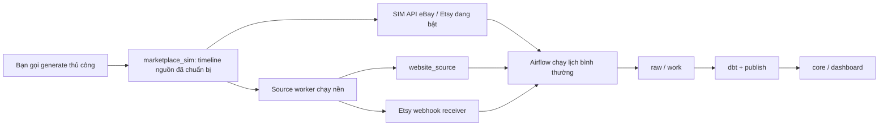

Chi tiết schema, fault matrix và giới hạn: docs/16_M08_LIVE_LOCAL.md.
Lệnh từng bước: tools/s02_data/README.md. Kết quả thực tế: docs/STATUS.md.

## Bổ sung ngày 2026-11-01: cấu hình demo ngắn

- Giữ đúng mục tiêu **một môi trường local dùng hằng ngày**, không thêm stack hay
  chuyển volume trong thay đổi này. Đề xuất thêm volume trong hội thoại trước
  không phải yêu cầu đã chốt và chưa được thực hiện.
- Đã thêm `duration_minutes`: bỏ trống `start_at` thì lấy lúc prepare; bỏ trống
  `end_at` thì lấy start cộng số phút này. Mặc định300 phút để giữ hành vi cũ;
  đặt5 hoặc6 để gen khoảng ngắn. `end_at` cụ thể luôn được ưu tiên.
- Mẫu `tools/s02_data/config/quick_6min.json` có6 phút,6 đơn mỗi nguồn,
  `delay_seconds: [15, 30]` để các bước request/cancel/partial/shipped có đủ thời gian.
  Không sửa `local_now.json`, không ghi đè dataset READY cũ, không gen hay bật
  pipeline tự động. Khoảng nguồn6 phút không cam kết pipeline xử lý xong trong6 phút.
- Đã chạy44 tests offline liên quan, S01 verify10 checks và10 utility tests,
  compileall và kiểm tra whitespace: PASS. Chưa chạy prepare vào DB hay Airflow
  runtime cho tham số mới; không gán kết quả runtime cũ cho code mới.
- Việc bật S02 trên main đang có S01 vẫn bị guard chặn; chưa giải quyết bằng cách
  xóa dữ liệu, tạo môi trường mới hoặc âm thầm bỏ guard. Cần chốt riêng cách giữ
  dữ liệu cũ khi chuyển sang demo S02 trên cùng stack.

Ngày lập/cập nhật: 2026-10-31. Ngôn ngữ tiếng Việt theo yêu cầu riêng của chủ dự án.

**Chủ dự án đã đồng ý triển khai hướng mục0 vào2026-10-31; tài liệu được giữ lại theo yêu cầu và sẽ ghi trạng thái thực hiện ở mục0.13/14.3.** Đây không phải lệnh tiếp tục M08C. Các ví dụ ID/port lịch sử không phải cấu hình cố định. Không có password trong tài liệu; chưa xóa tài liệu này.

## 0. Hiểu lại yêu cầu mới — đọc phần này trước

**Phần này ghi thiết kế đã thống nhất. Trạng thái code/test mới ở mục0.13 và14.3; không coi mọi đề xuất bên dưới tự động đã nghiệm thu. Mục1–13 giữ lại để giải trình code/DB/evidence cũ; mục14 là thứ tự thực hiện và các cổng kiểm tra.**

### 0.1 Điều bạn thực sự cần

Mình hiểu mục tiêu của bạn là xây pipeline DE nhiều nguồn, không phải xây một hệ thống simulator phức tạp. Bạn muốn:

1. DBeaver kết nối ổn định, biết rõ DB nào chứa dữ liệu; không đổi port/password mỗi lần gen.
2. Chạy generator **thủ công một lần trước khi mô phỏng** để nạp sẵn product/customer/mapping, orders và các event hợp lệ.
3. Chọn khoảng thời gian dữ liệu, ví dụ `2026-10-20 01:00:00` đến `2026-10-31 00:00:00`, kèm múi giờ rõ ràng. Business timestamps do generator tạo theo khoảng đó, không bắt buộc là ngày giờ thật lúc chạy.
4. Sau khi gen, mở DB kiểm tra trước, rồi mới chủ động chạy source playback/pipeline. Không bắt buộc chạy acceptance tự động gộp33phút để xem dữ liệu nguồn.
5. Simulator chỉ lấy dữ liệu chuẩn bị sẵn để trả qua interface nguồn/gửi webhook; không random lại khi GET, không chứa business logic warehouse.
6. Sinh liên tục cũng dùng cùng generator. Với một khoảng chạy hữu hạn, dữ liệu được chuẩn bị trước rồi lần lượt lộ ra theo thời gian, nhìn như nguồn sinh liên tục. **Không cần generator chạy random nền sau mỗi chu kỳ.** Muốn thêm khoảng khác thì bạn chủ động chuẩn bị thêm dataset, không tự âm thầm gen.
7. Giữ được chuẩn bị dữ liệu tải lớn, nhưng việc đo tải thật là bước riêng; simulator đơn giản không có nghĩa bỏ qua correctness của pipeline.
8. Có thể sửa/bỏ code cũ không còn phù hợp sau khi kiểm tra regression, thay vì chồng thêm nhiều runner khác nhau.

### 0.2 Môi trường mục tiêu: một local stack dùng hằng ngày

**Không yêu cầu hai PostgreSQL hoặc hai Airflow chạy song song. Không có bước cuối M08 chuyển dữ liệu test sang DB chính.**

Đề xuất dùng Compose local ổn định, một PostgreSQL container và một Airflow, với các database theo trách nhiệm:

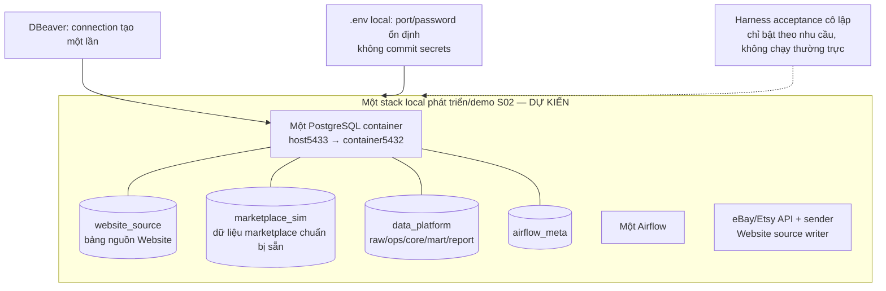

Mũi tên nét đứt của harness chỉ có nghĩa kiểm tra cùng code/config được khai báo, **không phải** cho phép harness reset local stack hay dùng DB local làm disposable target. Acceptance reset/fault/cold bootstrap vẫn cần storage test đã xác minh là disposable.

- Port/password local cấu hình qua `.env`, giữ5433 nếu tiếp tục stack hiện tại. `.env.example` chỉ giá trị mẫu; không đưa secret vào Git.
- Đổi dataset không cần đổi credential/port. Dataset ID là định danh dữ liệu, không nhất thiết là Compose project mới.
- Acceptance cô lập được giữ làm công cụ an toàn; lúc cần mới chạy. Chỉ khởi chạy song song nếu đủ tài nguyên và được chọn rõ; không mặc định tạo hai scheduler.
- Không phải “gen xong migrate data từ môi trường test qua chính”. Triển khai cùng code vào stack local rồi gen dataset tại đúng nơi đã chọn.
- Dữ liệu local hiện có không tự bị xóa. Cách chuyển từ S01 sang S02 phải kiểm kê/checkpoint/backup và thống nhất trước; không seed chồng S01/S02 hoặc reset để tiện làm.
- Việc `.env` đổi password không tự đổi password của role trong volume PG cũ; nếu cần rotation thì làm bước riêng, không xóa volume.

### 0.3 Workflow mục tiêu: tách gen, quan sát, playback và pipeline

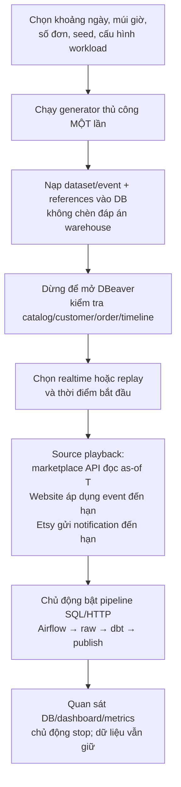

Các tên hành động dự kiến là `prepare / inspect / start / status / stop`; **chưa phải command CLI đã có để copy chạy**. Chuẩn bị phải nạp DB, không chỉ ghi một file JSON rồi báo đã xong. File manifest/checksum có thể giữ để tái lập, nhưng không được bắt bạn đọc file mới biết nguồn đã được nạp chưa.

Một generator dùng cho correctness nhỏ và bộ tải lớn: khác workload config/count, không có engine random riêng trong simulator. Không tự nhân bản full stack sau mỗi lần chuẩn bị.

### 0.4 Khoảng ngày và event được hiểu như thế nào?

Ví dụ cấu hình **minh họa dự kiến, chưa phải file/CLI hiện có**:

```yaml
dataset: local-s02-demo
order_seed: 17
event_seed: 91
start_at: "2026-10-20T01:00:00+07:00"
end_at: "2026-10-31T00:00:00+07:00"
orders_per_channel: 1000
```

- Đề xuất dùng khoảng `[start_at,end_at)`: gồm đầu, không gồm cuối; parse ISO8601 có offset, lưu UTC trong DB.
- Sinh created time của đơn trong khoảng đó, rồi sinh event theo lifecycle hợp lệ và thứ tự thời gian. Đây là business time được mô phỏng, không phải giả mạo giờ ghi log vận hành.
- Đề xuất mặc định các event cũng nằm trong khoảng. Đơn không đủ thời gian đi đến bước cuối thì giữ pending; không nhét các bước sai thứ tự hoặc ép hoàn thành sát cuối.
- Không giữ bắt buộc quy tắc cũ “đơn đầu created trước7ngày” cho mọi workload mới; chỉ có initial backlog nếu workload chọn rõ. Sentinel phục vụ acceptance có thể là profile nhỏ riêng, không áp đặt cho bộ demo/load thông thường.
- Các tỷ lệ/độ trễ/line/quantity nên ở một cấu hình workload nhỏ có validate; không tạo quá nhiều cờ riêng lẻ, không bắt bạn chỉnh code.
- Product/customer vẫn synthetic; giữ catalog30/customer100 hiện có làm default nếu bạn chưa cần số khác. Không bịa thêm field marketplace ngoài contract.

### 0.5 Đồng hồ mô phỏng: chỉ hai chế độ đơn giản trước

| Chế độ dự kiến | T dùng để nhìn nguồn và chọn cửa sổ dữ liệu |
| --- | --- |
| `realtime` | T bằng UTC thực hiện tại |
| `replay` | T bằng thời điểm bạn chọn cộng thời gian thực đã trôi qua kể từ lúc start; tốc độ1× |

Ví dụ replay: máy đang31/10 nhưng bạn chọn T0=`20/10 01:00+07:00`; sau10phút thật, T=`20/10 01:10+07:00`. Không cần đổi clock Windows/Docker/PostgreSQL server. Realtime với dataset đã hoàn toàn ở quá khứ sẽ thấy final state, không tự phát lại các bước cũ như thể còn tương lai.

**Phải có một quy ước T nhất quán cho API marketplace, Website due events, Etsy notification schedule và cửa sổ polling/recovery.** Airflow vẫn được scheduler thật trigger; không giả Airflow execution clock. Source-cycle upper bound phải lấy từ T đã chốt cho cycle thay vì lấy wall-clock interval_end không cùng timeline.

Timeout, retry, lease, heartbeat, started/finished log, observation/acquisition time và webhook signing freshness dùng giờ thực. Dữ liệu `created_at/source_updated_at` dùng business time. Không đánh tráo hai loại clock để làm đẹp latency chart; metric phải được đặt tên/phân biệt đúng.

Vòng đầu không làm fast-forward/tốc độ tùy ý/clock pause controller. Chọn lại mốc replay lùi về trước trong khi còn checkpoint/raw cũ **không được tự coi là chạy mới**; phải từ chối hoặc có dataset/reset scope được phê duyệt, không quay ngược checkpoint âm thầm. Replay recovery/pause-resume rộng vẫn thuộc M08C.

### 0.6 Simulator giữ đơn giản ở mức nào?

| Nguồn | Dự kiến giữ/làm | Không làm thêm |
| --- | --- | --- |
| eBay | Đọc source versions đã nạp từ `marketplace_sim` tại T, ghép JSON list/detail/shipping như contract | Không dựng DB e-commerce đầy đủ, không random lúc GET, collector không đọc backing DB |
| Etsy | API đọc as-of T; sender riêng đọc notification đến hạn và ký bằng giờ thật | Không đưa webhook receiver vào DAG, không phát đáp án warehouse qua webhook |
| Website | Giữ bảng nghiệp vụ và writer transaction; áp dụng event chuẩn bị sẵn tại T; collector SQL read-only | Không đổi interface Website sang event feed hoặc temporal view âm thầm |

Đề xuất tái sử dụng5bảng PG temporal đang có, không tách thêm hàng loạt bảng payment/shipment nếu chỉ phục vụ gen. Tuy nhiên cần chốt nơi lưu timeline Website và references để thao tác `prepare` nạp đủ kế hoạch vào DB và sau đó không phụ thuộc file-only. **Tên bảng/field/constraint bổ sung chưa chốt**, sẽ hoàn thiện trước migration; sơ đồ mục7–8 vẫn chỉ mô tả schema hiện có.

Code RAM/two-wave cũ chỉ gỡ khi đã kiểm kê caller/tests và có đường thay thế. Không tiếp tục đưa hai backend khác nhau vào hướng dẫn hằng ngày. Không xóa fixtures S01, evidence hoặc volume giữ lại để “dọn cho đơn giản”.

### 0.7 Định hướng đã thống nhất và ranh giới không tự vượt qua

1. Một stack local ổn định để dev/demo; acceptance cô lập chỉ theo nhu cầu, không chạy song song mặc định.
2. `.env` cho connection/secrets local, một workload config cho generation và replay; không đổi DBeaver theo dataset.
3. Gen thủ công một lần theo khoảng `[start,end)`, default event không vượt end; đơn cuối kỳ có thể pending.
4. Realtime hoặc replay1×, một logical business clock nhất quán, operational/security clocks vẫn thực.
5. Giữ JSONB temporal marketplace và Website writer để giảm scope; có thể thêm storage tối thiểu cho Website plan thay vì full simulator redesign.
6. Bổ sung config/lifecycle/case coverage theo từng channel như mục0.8–0.12; không hứa “đủ mọi lỗi” bằng random. Nhánh nằm ngoài contract phải ghi unsupported/proposed, không âm thầm bịa field/state mới.
7. Không reset hay trộn dữ liệu S01 hiện có khi chuyển local stack sang S02; phương án giữ lại dữ liệu phải được xác nhận trước thao tác có tác động.

### 0.8 Bổ sung theo yêu cầu: config riêng từng channel và giờ cao điểm

**Hợp lý, không dư thừa nếu giữ gọn.** Đặc tính nguồn khác nhau nên số đơn, giờ mua hàng, basket và nhịp lifecycle có thể khác. Không cần xây engine mô phỏng hành vi người dùng hay tự học phân phối.

Đề xuất một file workload chung, có defaults và ba block `internal_web / ebay_sim / etsy_sim`. Mỗi channel override độc lập:

- Tổng số **đơn mới**, khoảng ngày (mặc định kế thừa khoảng chung), múi giờ.
- Một vài khung giờ cao điểm và hệ số trọng số; ngoài peak mặc định weight1.
- Khoảng số line/quantity, phân phối chọn product/customer nếu cần.
- Tỷ lệ nhánh lifecycle hợp lệ, khoảng delay từng bước.
- Case bắt buộc theo số lượng và lỗi có chủ đích; không chỉ tỷ lệ xác suất.

Ví dụ **thiết kế minh họa, chưa phải config có thể chạy**; tên folder/field sẽ chốt trước implement:

```yaml
dataset: local-s02-demo
timezone: Asia/Bangkok
start_at: "2026-10-20T01:00:00+07:00"
end_at: "2026-10-31T00:00:00+07:00"
order_seed: 17
event_seed: 91
profile: normal
channels:
  internal_web:
    orders: 1000
    peak_hours:
      - {start: "19:00", end: "22:00", weight: 3}
    basket: {lines_min: 1, lines_max: 8, quantity_min: 1, quantity_max: 5}
  ebay_sim:
    orders: 600
    peak_hours:
      - {start: "09:00", end: "12:00", weight: 2}
    basket: {lines_min: 1, lines_max: 4, quantity_min: 1, quantity_max: 3}
  etsy_sim:
    orders: 400
    peak_hours:
      - {start: "20:00", end: "23:00", weight: 4}
    basket: {lines_min: 1, lines_max: 3, quantity_min: 1, quantity_max: 2}
```

Weight3 có nghĩa **mật độ đơn mỗi đơn vị thời gian** gấp3 lần bình thường, không có nghĩa chính xác75% tổng đơn trong peak hay số đơn tăng gấp3. Tổng đơn mỗi channel vẫn đúng số `orders` đã chọn. Cùng múi giờ chỉ là default, không ép traffic các kênh giống nhau. Khung qua nửa đêm được tách thành hai đoạn; khung overlap bị từ chối để tránh double-count; weight phải hữu hạn và>0.

Giờ cao điểm mặc định điều khiển **created time của đơn**, không ép mọi shipment/cancel xảy ra cùng khung mua hàng. Event delay sinh từ lifecycle sau đó; nếu sau này muốn mô phỏng ca xử lý vận hành thì thêm một setting rõ ràng, không tự gộp hai khái niệm.

### 0.9 Seed không phải order hoặc event — tách số lượng và random stream

Trong thuật toán random, **seed là số khởi tạo để tái lập kết quả, không phải một đơn hàng, số đơn hay event**. Mình hiểu ý bạn là cấu hình khối lượng theo **số đơn**, còn số event được sinh từ quá trình sống của những đơn đó.

Thiết kế dễ hiểu hơn:

| Tham số dự kiến | Ý nghĩa |
| --- | --- |
| `channels.<source>.orders` | Số đơn mới chính xác;1000 nghĩa1000đơn, không phải1000event |
| `order_seed` | Tái lập chọn created time, buyer, product, basket, giá từ catalog và identity theo namespace dataset |
| `event_seed` | Tái lập lựa chọn nhánh/delay/shipment allocation/notification; thay event_seed để giữ đơn nhưng có timeline khác hợp lệ |

Nếu bạn không nhập seed, **lệnh prepare thủ công** chọn seed rồi lưu vào manifest/DB để lần lỗi có thể replay. Không chọn seed mới mỗi lần API GET hoặc mỗi lần start playback.

Mình hiểu “event thì tự random” là **generator tự chọn event theo rule khi prepare**, không phải bạn phải liệt kê event bằng tay và cũng không phải runtime mới random. Đây là điểm cần bạn kiểm tra xem đúng ý chưa.

Một đơn có thể có1,2,3hoặc nhiều event tùy nhánh; tổng event là **đầu ra thống kê**, không phải lấy orders làm event count. Lệnh inspect sẽ hiển thị riêng orders, source versions, planned notifications và planned fault cases.

Để đổi số đơn eBay không làm xáo đơn Website, đề xuất stream tách theo `(seed,channel,order_index,purpose)` bằng hash ổn định (không dùng Python `hash()` phụ thuộc process). Order stream và event stream tách nhau. Tái lập cần cùng config/catalog/code version/dataset namespace, không chỉ cùng seed.

### 0.10 Thuật toán random dự kiến: sinh theo state machine, không chọn status độc lập

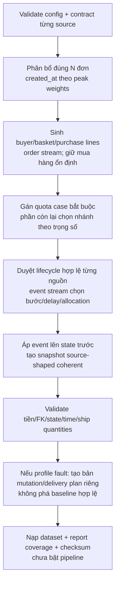

**Bước A — chọn created time có peak mà không materialize mỗi giây:**

1. Chia khoảng ngày mỗi channel thành các đoạn giờ địa phương normal/peak, cắt theo `[start,end)` rồi chuyển UTC đúng múi giờ.
2. Mỗi đoạn có trọng lượng `duration × weight`. Với từng đơn, lấy mẫu đoạn theo trọng lượng tích lũy, rồi chọn timestamp trong đoạn. Tổng vẫn đúng N; timestamp có thể trùng giữa hai đơn khác nhau.
3. Với workload nhỏ, tỷ lệ quan sát có thể dao động. Test kiểm tra xác định với seed và phân phối trên sample đủ lớn/tolerance khai báo, không ép mọi case nhỏ ra đúng tỷ lệ kỳ vọng.

**Bước B — sinh đơn trước:** chọn customer/product/line/quantity trong range hợp lệ; tính tổng bằng cents/Decimal theo currency; stable ID trong dataset. Giá và purchased quantity không random lại mỗi event. Các source IDs khác nhau vẫn map về cùng catalog như contract; không merge order/customer xuyên nguồn.

**Bước C — gán nhánh có kiểm soát:** một bảng rule nhỏ mỗi nguồn, không một framework workflow tổng quát. Chọn nhánh từ nhánh được source contract hỗ trợ; giữ payment, fulfillment, cancellation độc lập nhưng áp các điều kiện ràng buộc trước khi đi tiếp. Không chọn ngẫu nhiên một bộ ba status rồi cố sửa cho hợp lệ.

- Website: có thể giữ paid/not-started, request→approve cancel hoặc paid→shipment nếu nhánh đó đã được adapter/contract chứng minh; không cho cancel rồi tùy tiện ship tiếp. Cần code generator hỗ trợ shipping nếu chọn case này, không ghi đã có sẵn.
- eBay: chưa giao→giao một phần→giao hết với allocation đúng line/quantity. Partial chỉ khi có thể giao một phần thật; đơn1line quantity>1 có thể về mặt nghiệp vụ chia quantity, nhưng chỉ thêm khi contract/adapter và tests hiện có hỗ trợ, không tự đổi rule cũ một cách ngầm định.
- Etsy: paid/unshipped→shipped hiện đã hỗ trợ; paid/shipped notification là delivery plan riêng. Không tự phát refund/cancel nếu source subset hiện tại chưa cung cấp đủ bằng chứng.

**Bước D — tạo event theo quan hệ nhân quả:** `next_time = previous_time + sampled_delay`, delay>0 theo config. Không random timestamp độc lập rồi sort để che quan hệ sai. Một bước không còn nằm trong `[start,end)` thì dừng nhánh, giữ trạng thái hiện tại; không clamp các event vào cùng end-time. Event shipment phải có shipment/line allocation tương ứng, request approval phải có request trước đó.

Mỗi event áp lên state trước để dựng snapshot đầy đủ: parent updated time tăng, collection chỉ gồm dữ liệu đã có hiệu lực, shipment trước giữ nguyên trong collection tích lũy, tiền và purchase identity nhất quán. Tổng số lượng đã ship không vượt ordered; không có event delivery/refund thiếu bằng chứng. Dataset validator kiểm tra trước seal/load.

**Bước E — coverage thay vì hy vọng random đủ:** reserve trước những đơn/cấu hình cần cho case bắt buộc (ví dụ multiline để partial shipping, đủ khoảng thời gian cho request→approve). Phần còn lại mới random theo branch weights. Nếu N/quãng thời gian/range basket không đủ cho mandatory cases thì báo rõ config không đáp ứng; không im lặng bỏ case hoặc tạo flow sai. Một số case có thể cùng một đơn, nhưng không ép các nhánh loại trừ nhau vào cùng đơn.

**Bước F — kiểm soát tài nguyên:** generate theo đơn/chunk và nạp staging dataset, chỉ đánh dấu ready sau khi tất cả nguồn được validate/load; cross-database không giả vờ có một transaction nguyên tử chung. Case chưa ready không được playback. Không cần giữ tất cả đơn/event của bộ tải lớn trong RAM; index as-of và batch insert dùng cấu trúc hiện có ở mức tối thiểu. Cách staging/ready/cleanup phải chốt field/constraint trước DDL và không tự xóa dataset cũ khi lỗi.

### 0.11 “Đầy đủ case, gây lỗi” phải có ma trận rõ, không random phá mọi thứ

Mình ghi nhận yêu cầu phải bao phủ cả bình thường, edge và lỗi có chủ đích. **Không thể hứa mọi lỗi đều sinh được chỉ bằng data generator**, và không thể cam kết mọi source có cùng lifecycle khi contract khác nhau.

Đề xuất ba profile, dùng cùng code prepare thủ công:

| Profile dự kiến | Nội dung | Mặc định |
| --- | --- | --- |
| `normal` | Dữ liệu hợp lệ, lifecycle đa dạng, peak khác nhau, pending và progressed | Không cố ý làm pipeline lỗi |
| `coverage` | Dữ liệu hợp lệ + quota case bắt buộc/boundary/replay scenarios | Có coverage report, không dựa vào xác suất có trúng |
| `faults` | Gắn lỗi nguồn/payload/delivery/runtime plan có tên, scope, kết quả mong đợi và cách phục hồi | Opt-in; không tự inject khi chạy normal/load |

Ma trận dự kiến phải phân loại tối thiểu:

| Nhóm | Case cần có trong danh mục | Thực hiện ở đâu? |
| --- | --- | --- |
| Dữ liệu bình thường | Pending, completed trong phạm vi source, cancellation hợp lệ, partial/full allocation, nhiều line/customer/product | Generator/state machine; unsupported branch ghi rõ thay vì bịa |
| Boundary | Start/end, không đổi qua nhiều polling, old backlog khi chọn rõ, empty window, nhiều trang, trùng timestamp giữa các đơn | Generator + API/window checks |
| Dedupe/delivery | Duplicate notification cùng ID, event IDs khác cùng receipt, bỏ webhook, notification đến muộn/out-of-order | Prepared delivery schedule; source version chronology vẫn đúng |
| Data quality | Missing mapping, invalid money/quantity, field thiếu hoặc kiểu sai | Fault overlay trên payload/mapping riêng; chỉ field/endpoint được phép; validation expected-failure/quarantine rõ |
| API/security |429/500/timeout/malformed response, signature sai/stale, origin không hợp lệ | Thin test fault hooks/sender fixture; không thể chỉ insert một order là gây timeout thật |
| Recovery | Restart/crash/pause/resume, interrupted work/dbt/publish/lease, retry exhaustion | Operator/harness steps của M08C; không đặt random kill process trong generator |

Fault payload phải tách khỏi dữ liệu chuẩn để không làm sai baseline và không phá constraints của Website bằng cách bypass DB validation. Ví dụ Website quantity0 bị CHECK từ chối thì case kiểm tra rejection ở writer; không giả đã nạp thành công để mong collector đọc nó. Malformed HTTP là lỗi ở API response hook, không buộc backing store lưu dữ liệu mất cấu trúc.

Mỗi case có `case_id`, channel/target, điều kiện kích hoạt, loại lỗi, outcome/recovery mong đợi. Chi tiết vật lý chưa chốt, không thêm table bừa bãi. Fault schedule được chuẩn bị trước; kích hoạt theo request/attempt hoặc thời điểm playback đã định, **không random tại runtime**. Retry logic vẫn dùng thời gian thật. Server chỉ có hook tối thiểu phục vụ các case đã chọn, không phát triển thành fault engine tổng quát.

Prepare tạo **coverage manifest**: case nào required, được gán cho order nào, planned count, supported/unsupported và lý do. Khi test chạy mới ghi observed result. `planned` không có nghĩa `PASS`. Lỗi retryable mong đợi tự recover; malformed/unmapped có thể phải quarantine/giữ last-good và phục hồi có thao tác riêng, không mặc định mọi case kết thúc pipeline xanh.

M08B chuẩn bị data/case plan và các hook tối thiểu cần thiết; chạy đủ fault/recovery matrix vẫn là cổng M08C, load/soak là M08D. Không bỏ yêu cầu lỗi, nhưng không âm thầm làm tất cả C/D trong một lần sửa generator.

### 0.12 Code và config chung một folder, chỉ generate bằng lệnh manual

Cấu trúc code đã tạo trong lượt triển khai; dùng JSON thay YAML để Python stdlib đọc được, không cần cài thư viện trên host:

```text
tools/s02_data/
  README.md                 một hướng dẫn gen/inspect
  __main__.py               entry point manual
  config/
    demo.json               ba block channel + giờ cao điểm
    coverage.json           case quota nhỏ
    load.json               khối lượng lớn, không tự bật faults
    faults.json             omitted/duplicate notification opt-in
  references.py             catalog/customer/payload helper dùng chung
  config.py                 validation + weighted-time sampling
  generate.py               order-first + lifecycle causal
  load.py                   DB loading và invariant checks
  playback.py               activation + source-only tick/stop/resume
```

Đây là một folder sở hữu config và generator; catalog input gốc vẫn ở `fixtures/s02/catalog.json` để không tạo hai bản catalog lệch nhau. Cùng config có block source riêng, không nhân bản ba engine. Secrets lấy từ `.env` local, không chép vào workload JSON. Compatibility import `test_support/s02_diverse.py` trỏ về implementation duy nhất `references.py`; chưa xóa runner RAM hay evidence cũ.

CLI đã có (mức kiểm chứng thực tế xem mục0.13; đây không phải chỉ dẫn reset dữ liệu hiện có):

```text
python -m tools.s02_data prepare --config tools/s02_data/config/demo.json
python -m tools.s02_data inspect --dataset local-s02-demo
```

Không thêm cron/DAG/Docker entrypoint tự gen, không chạy gen khi API GET, không tự gen lại khi restart container. **Auto playback dữ liệu đã có** vẫn cần để nhìn thấy liên tục, nhưng khác hoàn toàn **auto generation**; Airflow chỉ orchestrate pipeline, không chạy generator. Không nạp đè dataset hiện có; operator chọn dataset mới hoặc explicit replacement có scope/approval.

Các helper cũ trong `test_support/` sẽ được consolidate/reuse vào folder này sau kiểm kê imports/tests, không vừa copy vừa giữ hai generator không đồng nhất. Harness và assertion tests vẫn có thể ở thư mục test riêng; chúng gọi generator cùng nguồn, không để test truth nhập vào pipeline.

### 0.13 Trạng thái triển khai mới — không gộp với PASS cũ

**M08B đã hoàn tất nghiệm thu kỹ thuật local, chờ chủ dự án review.** Realtime/default-date case `167c0411490a` PASS468steps/28scheduled runs;18đơn,87line,256units,USD5182,history39 có raw evidence. Airflow chính đã khôi phục HEALTHY đúng container cũ; protected hash/pause state/PG identity trước–sau khớp. Lượt trước `4b082af2312e` bị abort vì runner bật polling trước khi nạp nguồn; đã sửa warmup và chạy lại ID mới, không lùi watermark hay bù warehouse. Chi tiết mới nhất ở14.4. Không chuyển main sang S02, không reset PostgreSQL, không sửa config cá nhân/local_now.json; chưa làm M08C.

**Bổ sung config theo yêu cầu mới:** bỏ/null/chuỗi rỗng `start_at` toàn cục thì lấy giờ hiện tại lúc manual prepare; `end_at` tương tự thì lấy start đã chọn +5giờ. Mốc giờ được chốt/lưu, không đổi theo mỗi lần GET/playback. Ngày nhập rõ vẫn ưu tiên; file mẫu cũ không bị sửa. Channel bỏ ngày thì kế thừa từng ngày global. Tham số đầy đủ ở [CONFIG.md](../tools/s02_data/CONFIG.md), gồm required theo số đơn riêng cho từng nhánh (không phải số event). Sau checkpoint73unit tests đã chạy thêm runtime realtime với PG/Airflow thật ở14.4; tổng hồi quy cuối78tests PASS. Không lấy evidence replay cũ thay cho option mới.

**Lượt mới sau khi chủ dự án cho phép maintenance: PASS.** Scheduled replay case cô lập `31cf3196a802` đã hoàn tất. Chỉ Airflow chính `bb4bb1194e57` được tạm dừng sau kiểm tra idle/healthy và đã khôi phục HEALTHY đúng container cũ; PostgreSQL, chữ ký dữ liệu main, pause state của7DAG và system identity không đổi. Kết quả chi tiết ở14.3; không suy rộng thành realtime/load hay chuyển main sang S02.

Contract/schema được chốt trước migration ở [15_S02_LOCAL_WORKFLOW.md](15_S02_LOCAL_WORKFLOW.md). Hướng dẫn mới ở [tools/s02_data/README.md](../tools/s02_data/README.md).

| Hạng mục | Trạng thái hiện tại |
| --- | --- |
| Config/code chung folder, manual CLI | Đã tạo tools/s02_data; không có DAG/entrypoint tự gen |
| Theo channel/peak/order_seed/event_seed/quota | Đã code;16 unit test local generator/parser/activation guard PASS, runtime default-date READY/5h/counts PASS |
| Clock client chỉ HTTP, default S01 không gọi clock | Đã code;3 unit test clock PASS |
| Schema kế hoạch Website/references/playback | Migration002 tạo3bảng mới và view clock; probe PG/HTTP PASS trên case cô lập |
| Prepare | Hai lượt streaming generate/validate rồi nạp theo chunk; READY sau source/mapping/ref load; LOADING giữ lại nếu lỗi |
| Source references | Code nạp100customer/30product/30variant Website ngay prepare; không nạp trước future final orders |
| Stable local stack | Overlay giữ port5433 và credentials.env; Compose config check PASS, không thêm stack mặc định |
| Data-flow runtime | CLI/replay giữ evidence riêng. Realtime167c0411490a PASS468steps/28runs;18đơn/87line/256units/USD5182, history39 có raw evidence; reread không nhân đôi business/history |
| Faults | Đã code omitted/duplicate Etsy; API/security/crash/malformed/missing-mapping chưa có injection mới, manifest ghi excluded rõ |
| Chuyển main S01 sang S02 | Chưa thực hiện. Start từ chối nguồn/warehouse/checkpoint không rỗng; cần quyết định giữ dữ liệu riêng trước khi chuyển |
| Evidence cũ | Giữ nguyên; case4c1d2b1719eb không được dùng làm bằng chứng đường logical-clock mới |

DDL mới (sơ đồ logic khóa chính, schema cũ mục7 không bị giả vờ thay bằng bảng khác):

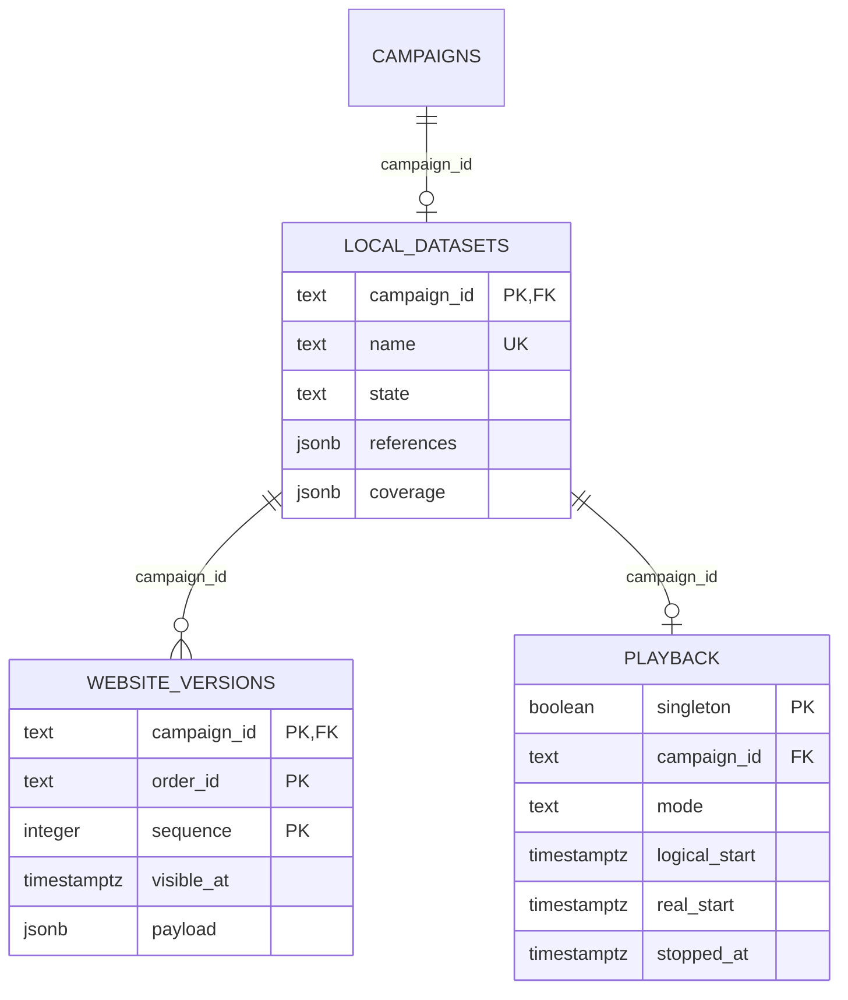

PLAYBACK chỉ có tối đa1row toàn stack (singleton=true); mỗi dataset có thể chưa được activate. View `s02.playback_clock` tính T; source reader chỉ được đọc metadata cần thiết, không Website plans/references. Chi tiết constraints/index/immutability trong DDL002. Không có cross-database FK/transaction chung; READY là cổng phục vụ sau tất cả bước load.

## Mục lục và cách đọc

0. [Hướng dự định sửa — đọc trước](#0-hiểu-lại-yêu-cầu-mới--đọc-phần-này-trước)
1. [Kết luận và những điểm chưa ổn](#1-kết-luận-và-những-điểm-chưa-ổn)
2. [Toàn bộ phạm vi M08](#2-toàn-bộ-phạm-vi-m08)
3. [Môi trường, port và nơi lưu dữ liệu](#3-môi-trường-port-và-nơi-lưu-dữ-liệu)
4. [Ba phiên bản mô phỏng cùng tồn tại](#4-ba-phiên-bản-mô-phỏng-cùng-tồn-tại)
5. [Product, customer và mapping](#5-product-customer-và-mapping)
6. [Thuật toán sinh đơn và lifecycle](#6-thuật-toán-sinh-đơn-và-lifecycle)
7. [Schema vật lý marketplace_sim: đầy đủ phần M08 mới](#7-schema-vật-lý-marketplace_sim-đầy-đủ-phần-m08-mới)
8. [Schema Website: đủ chín bảng nghiệp vụ](#8-schema-website-đủ-chín-bảng-nghiệp-vụ)
9. [Data platform: M08 sử dụng gì, không tạo gì](#9-data-platform-m08-sử-dụng-gì-không-tạo-gì)
10. [Luồng thực thi và cấu hình](#10-luồng-thực-thi-và-cấu-hình)
11. [Bằng chứng đã chạy, lỗi đã sửa và giới hạn](#11-bằng-chứng-đã-chạy-lỗi-đã-sửa-và-giới-hạn)
12. [Cách kiểm tra không chạy lại acceptance](#12-cách-kiểm-tra-không-chạy-lại-acceptance)
13. [Danh sách code/doc thay đổi và thứ tự review](#13-danh-sách-codedoc-thay-đổi-và-thứ-tự-review)
14. [Dự định làm tiếp và tiêu chí bàn giao](#14-dự-định-làm-tiếp-và-tiêu-chí-bàn-giao)

## 1. Kết luận và những điểm chưa ổn

Mình đã làm **harness môi trường test cô lập (M08A)** và **generator + kiểm tra pipeline liên tục (M08B)**. Sau các vòng trao đổi, M08B có thêm catalog đa dạng và backend PostgreSQL temporal cho eBay/Etsy. M08C/D chưa triển khai thành chiến dịch nghiệm thu.

Những điều đã có:

- Sinh đơn có nhiều dòng/số lượng, customer tổng hợp, 30 sản phẩm và mapping ba nguồn.
- Chuẩn bị trước dữ liệu và các thời điểm đổi trạng thái. Marketplace lưu trong PostgreSQL, API đọc trạng thái có hiệu lực theo thời gian.
- Website vẫn dùng writer áp dụng thay đổi đến hạn vào bảng nguồn thật; collector chỉ đọc.
- Chạy qua HTTP/SQL nguồn, raw audit, dbt, publication và Airflow thật; không chèn đáp án vào warehouse.
- Có bằng chứng local cho bootstrap, continuous correctness, recovery webhook bị bỏ và replay/dedupe trong phạm vi nhỏ.

Những điểm mình đã làm chưa tốt hoặc chưa hoàn thiện:

1. Hướng dẫn trước tập trung vào PASS/FAIL pipeline, không đưa ngay bản đồ DB/schema/port cho chủ dự án.
2. Có cả RAM cũ và PostgreSQL mới; một số docstring/đoạn doc còn giọng điệu checkpoint cũ, dễ tưởng phần mới chưa tích hợp.
3. Mỗi case có port/credential riêng và tự teardown: phù hợp automation nhưng bất tiện cho DBeaver và review thủ công.
4. Chưa có chế độ S02 dev/review cố định, chủ động prepare/start/inspect/stop với port cấu hình ổn định. Đây mới là đề xuất, **chưa code**.
5. Nhiều quy tắc generator còn hardcode, không phải tất cả đều chỉnh được qua `.env`.
6. Schema marketplace hiện là base/header/collection JSONB, **không phải** các bảng nghiệp vụ riêng `payments`, `shipments`, `status_table` như một lựa chọn bạn từng nêu.
7. Chưa có bộ lifecycle phong phú cho mọi nghiệp vụ: Website hiện thiên về hủy, marketplace thiên về shipment; không sinh tùy ý refund/delivered hay unpaid→paid.
8. “Prepare một ngày” đã có, nhưng **không đồng nghĩa** có driver load/soak chạy trọn ngày đã được kiểm chứng.
9. Đã có code/DB-backed source, nhưng nhận định “trải nghiệm local đã hoàn chỉnh, dễ tự review” là chưa đúng. PASS nhỏ không thay cho sự đồng thuận của bạn về workflow.

Lượt làm tài liệu này chỉ đọc code/evidence và Docker trạng thái. Không sửa code runtime, không bật/tắt container, không nạp/reset DB, không stage/commit/push.

## 2. Toàn bộ phạm vi M08

| Phần | Mục tiêu | Hiện trạng và ranh giới |
| --- | --- | --- |
| M08A | Tạo môi trường cô lập, guard an toàn, cold bootstrap và chạy lại S01 | Đã có local acceptance; mỗi ID có Compose project/volume/network/runtime/port/password riêng |
| M08B RAM ban đầu | Sinh một lượng nhỏ đơn theo hai wave, tự chạy lịch và đối soát | Đã chạy local; giữ lại để regression, không phải backend PostgreSQL mới |
| M08B diversity | 30 sản phẩm, 100 customer, nhiều line/quantity, mapping độc lập | Đã tích hợp vào temporal runner; không tự bật khi chạy Compose chính |
| M08B temporal | Chuẩn bị phiên bản marketplace trước, đọc as-of qua API, Website writer, signed webhook | Đã có storage/CLI/scheduled/replay evidence riêng |
| M08C | Fault/restart/pause/resume/recovery matrix | Chưa làm toàn bộ; không được suy ra PASS từ một vài probe B |
| M08D | Load/burst/soak, resource/backlog/latency và stabilization | Chưa đo capacity; giới hạn tham số nhập không phải tải được chứng nhận |
| M09 | Đóng gói portfolio/reproducibility | Sau M08D, chưa làm |

M08 không thay thế dbt/Airflow. Python sinh/acquire/điều phối; dbt vẫn sở hữu business SQL; Airflow chạy các command dùng lại được.

## 3. Môi trường, port và nơi lưu dữ liệu

### 3.1 Hai PostgreSQL khác nhau, không phải chỉ hai database

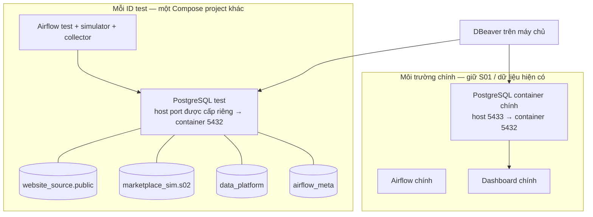

- `5432` trong container/network vẫn đúng; DBeaver dùng **host port**.
- `.env` chính cấu hình Compose chính. Harness tạo `test.env` + `compose.json` riêng cho từng case; không dùng password/host port chính để nối DB test.
- Tên DB giống nhau ở hai PostgreSQL không có nghĩa dữ liệu giống nhau.
- Schema `marketplace_sim.s02` chỉ được migration opt-in của temporal runner tạo; không tự thêm vào bootstrap chính.
- Mỗi ID mới tạo volume mới. Một ID giữ volume khi container teardown; không tự xóa dữ liệu.
- Thư mục có tiền tố `m08a-` vẫn được dùng cho B vì B tái sử dụng harness A. Tiền tố không có nghĩa case đó đang chạy S01.

### 3.2 Ảnh chụp local khi lập tài liệu

Docker read-only lúc lập tài liệu cho thấy:

| Project / ID | PostgreSQL host port | Trạng thái quan sát |
| --- | --- | --- |
| Chính `multi-channel-order-platform` | 5433 | PostgreSQL healthy; Airflow chính đang dừng trong lúc case test mới chạy |
| Test `e00cdf2177e8` | 62972 | PostgreSQL/Airflow/simulator/receiver test đang healthy |
| Test cũ `4c1d2b1719eb` | 60519 trong model cũ | Không có container case này đang chạy; volume/evidence trước đó được giữ |

Port 60519 không phải port thay thế 5433 của môi trường chính. Ở lần kiểm tra trước, case cũ đã teardown; **không có bằng chứng kết luận lỗi đó là do xung đột port**. Không mặc định các port snapshot còn chạy khi bạn đọc tài liệu sau này.

Mình không khởi động lại Airflow chính trong lúc bạn đang chạy test mới. Wrapper của lần test có trách nhiệm khôi phục sau teardown; ảnh chụp “đang dừng” không phải kết luận restoration đã lỗi hoặc đã hoàn tất.

### 3.3 File local của một case

```text
runtime/isolated/m08a-<test-id>/
  identity.json                marker/hash/identity do harness quản lý
  compose.json                 model riêng; có secrets, không chia sẻ toàn bộ
  test.env                     environment riêng; không commit
  binds/                       logs/state/dbt artifacts riêng
  evidence/
    prepared-source.json       kế hoạch nguồn, references và events của 3 nguồn
    prepared-source.sha256     checksum kế hoạch
    s02-ledger.jsonl            audit driver thực sự áp dụng/gửi gì
    result.json                acceptance pipeline
    temporal-result.json       probe storage nếu chạy chế độ storage
    *.log                      từng command đã chạy

runtime/isolated/window-<uuid>/owner-window.json
  snapshot + kết quả bảo vệ/khôi phục Airflow chính của maintenance wrapper
```

`prepared-source.json` là đầu vào simulator/test driver, không phải warehouse expected output. Pipeline không đọc file này. `s02-ledger.jsonl` không được dùng làm source interface của collector.

## 4. Ba phiên bản mô phỏng cùng tồn tại

| Chế độ | Store marketplace | Command/đường dùng | Vai trò |
| --- | --- | --- | --- |
| S01 mặc định | Source-state fixtures cố định | Compose chính và M08A baseline | Bảo toàn golden behavior đã duyệt |
| `SIMULATOR_MODE=s02` | Dictionary RAM | `test_support.m08b`; `simulator/s02_store.py` | B v1 cũ: nhỏ, hai wave; không có persistence marketplace qua restart |
| `SIMULATOR_MODE=s02-pg` | PostgreSQL `marketplace_sim.s02` | `test_support.m08b_temporal`; `simulator/s02_temporal.py` | B temporal mới: chuẩn bị trước, seal, API chọn phiên bản đến hạn |

`simulator/s02_temporal.py:make_store()` chọn backend. Backend PG không nhận runtime `/s02/upsert` như RAM. Marketplace collector vẫn chỉ gọi HTTP, không được đọc backing DB.

Docstring đầu `s02_diverse.py` còn ghi “NOT wired into runtime acceptance”: đây là mô tả cũ, không đúng với temporal runner hiện đã gọi helper này qua `s02_plan.py`. Không sửa code trong lượt giải trình này; ghi nhận để bạn không bị đánh lừa bởi comment cũ.

## 5. Product, customer và mapping

### 5.1 Sinh gì, ở đâu?

| Dữ liệu | Cách sinh | Nơi nạp |
| --- | --- | --- |
| 30 sản phẩm | `fixtures/s02/catalog.json`: số thứ tự, tên, category, giá cents, USD | Website `products` và `product_variants`; marketplace giữ thông tin cần thiết trong source payload |
| 100 customer | `references()` tạo `S02-C001..100`, tên tổng hợp, email `example.test` | Website `public.customers` khi writer áp dụng đơn đầu tiên |
| 90 mapping | 30 variant × 3 nguồn, ID mapping UUID5, source ID/SKU riêng | `data_platform.config.product_mapping`, version `s02-catalog-v1` |
| Đơn/line | Seed chọn buyer, 1..8 sản phẩm khác nhau, quantity 1..5 | Bảng Website hoặc base/components/versions marketplace |

Không có file customer riêng: customer đang được tạo bằng code. Mỗi sản phẩm hiện có **một variant**, không phải 30 sản phẩm với nhiều size/color mỗi sản phẩm. 100 customer là tập tham chiếu, không có nghĩa 12 đơn phải dùng đủ 100 người.

Customer Website có bảng riêng. Etsy dùng `buyer_user_id=900000+buyer`; eBay không bịa trường customer ngoài contract. Không có customer dimension/đồng nhất khách hàng xuyên kênh được thêm vào platform trong M08.

### 5.2 Mapping nhiều kênh

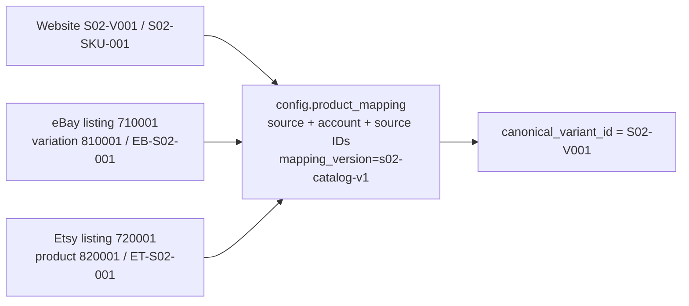

Đây là mapping logic, không phải FK vật lý nối PostgreSQL nguồn vào warehouse. Mapping S01 giữ nguyên; B dùng mapping version mới. Nguồn version/fingerprint và mapping/transformation version là các khái niệm riêng.

### 5.3 Bằng chứng dữ liệu đã nạp

Truy vấn read-only ở lượt hỗ trợ ngay trước tài liệu này, trên case đang chạy `e00cdf2177e8`, trả về:

- Website: customers100, products30, variants30, orders4.
- Platform: mapping S02 90, mapping S01 4; orders Website4/eBay4/Etsy4.
- Marketplace: orders eBay4/Etsy4, prepared versions eBay7/Etsy7.

Đây là snapshot lúc case còn chạy, **chưa phải kết luận acceptance cuối cho case e00cdf2177e8**. Không dùng nó để thay evidence của case PASS cũ. DB chính không có thêm những dòng này vì test cô lập.

## 6. Thuật toán sinh đơn và lifecycle

### 6.1 Hai bước riêng biệt

1. `s02_diverse.diverse_inputs()` dựng source-shaped payload từ lifecycle template, chọn sản phẩm/customer/quantity và tính tiền.
2. `s02_plan.plan()` quyết định đơn nào tiến triển, thời điểm từng phiên bản, rồi sắp xếp toàn bộ events theo thời gian.

Không gọi random trong marketplace GET. Với cùng seed **và cùng test ID, start, count, duration, code/catalog**, kế hoạch tái lập được. Chỉ cùng seed nhưng ID/start khác thì ID và timestamp/checksum không giống nhau.

Nguồn template là utility/source-shaped fixtures S01, **không phải** `fixtures/s01/expected`. B không tự sáng tạo thêm API payment/refund ngoài source contract.

### 6.2 Chọn nội dung đơn

- `random.Random(seed)` là PRNG local, không đổi global random state.
- Mỗi đơn chọn customer trong 1..100; chọn 1..8 sản phẩm bằng sample không trùng trong đơn.
- Quantity mỗi dòng 1..5; giá catalog ở cents, tổng cộng bằng số nguyên trước khi định dạng tiền. Không cộng tiền bằng float.
- Purchase lines, quantity, giá và creation time giữ ổn định giữa các phiên bản hiện hỗ trợ.
- Danh tính có source/account scope. Hai nguồn có ID giống chữ không tự động là cùng đơn.
- Đơn index0 là đơn cũ (created trước start7 ngày), luôn giữ trạng thái ban đầu; các đơn còn lại có created theo arrival.

### 6.3 Chọn nhánh và thời gian

Gọi `D=duration_seconds`, `S=start`, index tính riêng theo thứ tự đơn mỗi nguồn:

| Quy tắc | Code hiện tại |
| --- | --- |
| Đơn index0 | Arrival tại S, không tiến triển |
| Đơn index1 | Bắt buộc tiến triển; arrival trong đầu D/20, thay đổi muộn khoảng 2D/3 và 5D/6 cộng jitter D/12 |
| Đơn khác | Arrival trong đầu D/3; nếu tiến triển, hai khoảng chờ độc lập 1..D/4 |
| Xác suất tiến triển của đơn khác | `rng.random() >= 0.25`, khoảng75%; chưa phải config CLI |
| Thứ tự trong đơn | sequence tăng, source_updated_at tăng, các collection coherent |
| Thứ tự toàn kế hoạch | Sort visible_at, source, order_id, sequence |

Đơn index1 là sentinel cố ý đổi trạng thái muộn để Airflow cold startup có cơ hội quan sát trước/sau. Vì vậy generator này **có cấu trúc phục vụ correctness**, chưa phải phân phối lưu lượng thực tế đã hiệu chỉnh.

Không có quy tắc “wave sau phải update hết wave trước”. Một đơn có thể đứng yên qua nhiều chu kỳ. Tuy nhiên khi driver Website bị chậm qua nhiều phiên bản, `latest()` chỉ áp dụng phiên bản mới nhất đến hạn, không đảm bảo materialize mọi trạng thái đã trôi qua. Điều này được phản ánh bằng history quan sát, không bù snapshot giả.

### 6.4 Lifecycle hiện có và chưa có

```mermaid
flowchart TB
    subgraph WEB["Website: payment giữ PAID; fulfillment NOT_STARTED"]
        W0["NOT_REQUESTED"] --> W1["REQUESTED<br/>cancellation request PENDING"]
        W1 --> W2["CANCELED<br/>request APPROVED"]
    end
    subgraph EB["eBay: payment giữ PAID; cancellation không yêu cầu"]
        E0["NOT_STARTED"] --> E1["PARTIALLY_SHIPPED<br/>chỉ nếu nhiều line"]
        E1 --> E2["SHIPPED<br/>tập fulfillment tích lũy"]
        E0 -->|"một line"| E2
    end
    subgraph ET["Etsy: receipt đã PAID"]
        T0["chưa shipped"] --> T1["shipped"]
    end
```

Các trạng thái trong sơ đồ là diễn giải nghiệp vụ/canonical; JSON nguồn vẫn dùng vocabulary riêng (`FULFILLED`, `IN_PROGRESS`, `is_shipped`...). Một số đơn ở lại node đầu do lựa chọn pending.

Chưa có: unpaid→paid đa dạng, hủy eBay/Etsy, shipment Website trong generator mới, rejected cancellation, refund thật, delivered có bằng chứng, thay line/giá sau mua, nhiều currency. DB Website có thể hỗ trợ nhiều trạng thái hơn nhưng **schema hỗ trợ không có nghĩa generator đã sinh tất cả**.

Etsy: `notify = index % 2 == 0`; các đơn xen kẽ bỏ webhook có chủ đích. Timeline message được chuẩn bị trước; host driver gửi signed notification đến receiver khi đến hạn. Recovery HTTP phải tìm được nhóm bị bỏ.

### 6.5 “Wave” thực chất đang là gì?

`diverse_inputs(wave=1/2)` còn dùng để dựng template đầu/cuối. `plan()` chuyển template thành timeline riêng từng đơn, có thể thêm intermediate/full-shipment. **Không có wave scheduler toàn cục được cấu hình trong .env của backend temporal.**

```mermaid
sequenceDiagram
    participant G as Generator trước test
    participant DB as marketplace_sim
    participant API as eBay/Etsy simulator
    participant C as Collector
    G->>DB: Nạp base + collections + mọi phiên bản rồi seal
    Note over DB: Ví dụ một đơn: 10h initial, 11h intermediate, 12h final
    C->>API: GET lúc 10h30
    API->>DB: Chọn latest visible_at <= 10h30
    DB-->>API: Phiên bản 10h + collection nó tham chiếu
    API-->>C: JSON source hiện tại
    Note over DB: Đến 11h không UPDATE status trong DB
    C->>API: GET lúc 12h30
    API->>DB: Chọn latest visible_at <= 12h30
    DB-->>API: Phiên bản 12h
    API-->>C: JSON source final; không trả history 11h nếu không từng đọc
```

## 7. Schema vật lý marketplace_sim: đầy đủ phần M08 mới

Nguồn kiểm chứng: [DDL thực tế](../migrations/marketplace_sim/001_s02_temporal.sql). Đây là **đủ năm bảng mới của schema s02**, không vẽ những bảng payment/shipment tưởng tượng. `public.schema_migrations` là metadata migration có sẵn, không phải nguồn nghiệp vụ.

Ký hiệu: PK khóa chính; FK khóa ngoại; UK duy nhất. Khóa order luôn gồm `(campaign_id,source,account_id,order_id)`.

```mermaid
erDiagram
    CAMPAIGNS ||--o{ ORDERS : "id = campaign_id"
    CAMPAIGNS ||--o{ DELIVERIES : "id = campaign_id"
    ORDERS ||--o{ COMPONENTS : "composite order key"
    COMPONENTS ||--o{ VERSIONS : "order key + digest"
    CAMPAIGNS {
        text id PK
        integer seed
        jsonb config
        text checksum
        boolean sealed
    }
    ORDERS {
        text campaign_id PK,FK
        text source PK
        text account_id PK
        text order_id PK
        jsonb base
    }
    COMPONENTS {
        text campaign_id PK,FK
        text source PK,FK
        text account_id PK,FK
        text order_id PK,FK
        text digest PK
        jsonb body
    }
    VERSIONS {
        text campaign_id PK,FK
        text source PK,FK
        text account_id PK,FK
        text order_id PK,FK
        integer sequence PK
        timestamptz visible_at
        timestamptz source_updated_at
        jsonb header
        text component_digest FK
    }
    DELIVERIES {
        text campaign_id PK,FK
        text message_id PK
        text receipt_id
        timestamptz due_at
        text event_type
        boolean omitted
        integer attempts
        timestamptz delivered_at
        integer last_status
    }
```

### 7.1 Ràng buộc và giới hạn quan hệ

- Campaign ID 12 hex; checksum/digest 64 hex; seed không âm.
- `orders` chỉ nhận eBay/account `seller_sim_01` hoặc Etsy/account `7001`, không chứa Website.
- `versions`: sequence>0, UK thời gian visible và UK source_updated theo scoped order; index `(campaign_id,source,account_id,order_id,visible_at DESC)`.
- Version tham chiếu component bằng **đủ khóa order + digest**, không chỉ digest; component có FK về order.
- `deliveries.receipt_id` hiện **không có FK về orders**; chỉ campaign_id có FK. Quan hệ receipt→order là logic của generator/driver. Không được vẽ nó như FK đã tồn tại.
- `config`, `base`, `header`, `body` bắt buộc object JSONB. Nhiều quy tắc business bên trong JSON được code/test kiểm tra, không phải tất cả là CHECK SQL.
- Seal bằng transaction insert rồi `campaigns.sealed=TRUE`; trigger chặn thay đổi source rows đã seal. Delivery chỉ được update attempts/delivered_at/last_status sau seal.
- Hai role reader eBay/Etsy chỉ SELECT, RLS phân nguồn trên orders/components/versions. Collector không nhận các credential này.

### 7.2 JSON được tách ra sao?

| Nguồn | `orders.base` | `versions.header` | `components.body` |
| --- | --- | --- | --- |
| eBay | Order fields còn lại: identity/creation/pricing và header cố định | lastModifiedDate, orderPaymentStatus, orderFulfillmentStatus, cancelStatus, fulfillmentHrefs | lineItems và fulfillments |
| Etsy | Receipt fields còn lại, buyer/totals/creation và trường cố định | updated_timestamp, status, is_paid, is_shipped | transactions, shipments, refunds |

`split_document()` chia; `assemble()` ghép lại JSON đúng interface nguồn. Collection được hash và reuse nếu toàn bộ body giống nhau **trong cùng order**. Không dedup xuyên order. Nếu chỉ fulfillment đổi thì body mới có thể vẫn lặp lại lineItems; đây chưa phải chuẩn hóa từng line/payment/shipment row để tối ưu tối đa dung lượng.

### 7.3 API chọn phiên bản

`PostgresStore.query()` lấy một `statement_timestamp()` UTC làm T cho request; chọn latest version có visible_at<=T của campaign đã seal; **sau đó** mới lọc cửa sổ source_updated_at. Join đúng component của version, không ghép shipment tương lai.

Từng page/detail HTTP là request khác, T có thể khác. Không có cam kết snapshot toàn bộ vendor API xuyên nhiều request. Current clock là1x thực; chưa có clock pause/fast-forward controller được nghiệm thu.

## 8. Schema Website: đủ chín bảng nghiệp vụ

Nguồn: [DDL Website](../migrations/website_source/001_schema.sql). Đây là schema từ M01, **không phải chín bảng mới do M08 tạo**. Sơ đồ liệt kê đủ cột nghiệp vụ của chín bảng; `schema_migrations` không đưa vào ER nghiệp vụ.

```mermaid
erDiagram
    CUSTOMERS ||--o{ ORDERS : customer_id
    PRODUCTS ||--o{ PRODUCT_VARIANTS : product_id
    PRODUCT_VARIANTS ||--o{ ORDER_ITEMS : variant_id
    ORDERS ||--o{ ORDER_ITEMS : order_id
    ORDERS ||--o{ PAYMENT_TRANSACTIONS : order_id
    ORDERS ||--o{ SHIPMENTS : order_id
    ORDERS ||--o{ CANCELLATION_REQUESTS : order_id
    SHIPMENTS ||--o{ SHIPMENT_ITEMS : shipment_id
    ORDER_ITEMS ||--o{ SHIPMENT_ITEMS : order_item_id
    CUSTOMERS {
        text customer_id PK
        text display_name
        text email
        timestamptz created_at
        timestamptz updated_at
    }
    PRODUCTS {
        text product_id PK
        text product_name
        text category
        boolean is_active
        timestamptz created_at
        timestamptz updated_at
    }
    PRODUCT_VARIANTS {
        text variant_id PK
        text product_id FK
        text sku UK
        jsonb attributes
        numeric current_price
        text currency
        boolean is_active
        timestamptz updated_at
    }
    ORDERS {
        text order_id PK
        text order_number UK
        text customer_id FK
        timestamptz created_at
        timestamptz updated_at
        text currency
        text payment_status
        text fulfillment_status
        text cancellation_status
        numeric items_gross_amount
        numeric discount_amount
        numeric shipping_amount
        numeric tax_amount
        numeric order_total_amount
    }
    ORDER_ITEMS {
        text order_item_id PK
        text order_id FK
        text variant_id FK
        text sku_at_purchase
        text title_at_purchase
        integer quantity
        numeric unit_price
        numeric line_discount_amount
        numeric line_tax_amount
        timestamptz created_at
        timestamptz updated_at
    }
    PAYMENT_TRANSACTIONS {
        text payment_transaction_id PK
        text order_id FK
        text transaction_type
        text status
        numeric amount
        text currency
        text provider_reference
        timestamptz occurred_at
        timestamptz updated_at
    }
    SHIPMENTS {
        text shipment_id PK
        text order_id FK
        text carrier
        text tracking_number
        text status
        timestamptz shipped_at
        timestamptz delivered_at
        timestamptz updated_at
    }
    SHIPMENT_ITEMS {
        text shipment_id PK,FK
        text order_item_id PK,FK
        integer quantity
    }
    CANCELLATION_REQUESTS {
        text cancellation_id PK
        text order_id FK
        text reason_code
        text status
        timestamptz requested_at
        timestamptz resolved_at
        timestamptz updated_at
    }
```

Tiền Website numeric(18,2); quantity>0; timestamps/total/state có CHECK trong DDL. Tổng đơn = items-discount+shipping+tax. Shipment delivered phải có delivered_at hợp lệ; cancellation PENDING thì chưa có resolved_at.

`website_s02.py` thực hiện transaction/upsert theo PK, giữ advisory lock writer và yêu cầu updated_at của đơn tăng. Đầu tiên nạp đủ references; sau đó chỉ payload tham chiếu. Schema có shipments/shipment_items nhưng generator temporal hiện không sinh nhánh Website shipping; writer còn từ chối shipment allocation nếu không có handler riêng. Đừng kỳ vọng bảng có schema là chắc đã có dữ liệu.

## 9. Data platform: M08 sử dụng gì, không tạo gì

**M08 không thêm DDL warehouse.** Chỉ nạp mapping mới và chạy lại pipeline hiện hữu trên nguồn đa dạng. Không thêm bảng customer master hay product dimension mới. Từ metadata vào raw đến mart/report vẫn là schema M01–M07.

Sơ đồ sau là **đường dữ liệu/nhóm bảng liên quan**, không phải ER toàn bộ platform và mũi tên không mặc định là FK. DDL đầy đủ của platform nằm trong `migrations/platform/`; dictionary ở [05_TARGET_SCHEMA.md](05_TARGET_SCHEMA.md).

```mermaid
flowchart TD
    A["SQL Website / HTTP eBay / HTTP Etsy"] --> R["raw.raw_records<br/>mọi acquisition/delivery audit"]
    W["Receiver webhook"] --> I["ops.webhook_inbox<br/>ops.webhook_delivery_attempts"]
    I --> P["ops.processing_work<br/>ops.etsy_work_context<br/>ops.etsy_http_attempts"]
    R --> P
    R --> B["ops.transform_batches + ops.batch_inputs<br/>freeze đầu vào"]
    P --> B
    M["config.product_mapping<br/>90 dòng S02"] --> D["dbt staging/intermediate/candidates + tests"]
    B --> D
    D --> U["Publication transaction"]
    U --> H["core.order_snapshot_history<br/>core.order_line_snapshot_history"]
    R --> E["core.snapshot_evidence"]
    H --> E
    U --> C["core.orders_current<br/>core.order_lines_current"]
    U --> T["mart.order_activity_daily<br/>mart.product_activity_daily<br/>mart.order_status_current<br/>mart.source_health"]
    U --> S["ops.publication_state"]
    C --> V["report views / functions"]
    T --> V
    V --> UI["Dashboard nếu chạy trong đúng môi trường"]
    O["ops.pipeline_runs / task_attempts<br/>polling_cycles / extraction_checkpoints<br/>data_exceptions / execution_measurements<br/>scheduler_observations"] -.-> U
```

Quan hệ vật lý cốt lõi để kiểm tra lịch sử và current:

```mermaid
erDiagram
    PIPELINE_RUNS ||--o{ TRANSFORM_BATCHES : run_id
    TRANSFORM_BATCHES ||--o{ BATCH_INPUTS : batch_id
    RAW_RECORDS ||--o{ BATCH_INPUTS : raw_record_id
    TRANSFORM_BATCHES ||--o{ ORDER_SNAPSHOT_HISTORY : batch_id
    ORDER_SNAPSHOT_HISTORY ||--o{ ORDER_LINE_SNAPSHOT_HISTORY : snapshot_id
    ORDER_SNAPSHOT_HISTORY ||--o{ SNAPSHOT_EVIDENCE : snapshot_id
    RAW_RECORDS ||--o{ SNAPSHOT_EVIDENCE : raw_record_id
    ORDER_SNAPSHOT_HISTORY ||--o| ORDERS_CURRENT : snapshot_id
    ORDERS_CURRENT ||--o{ ORDER_LINES_CURRENT : scoped_order_key
```

Identity của current là source_system + source_account_id + source_order_id; line thêm source_line_id. Source snapshot identity không bị thay bằng mapping_version. Không vẽ FK product_mapping→line vì mapping là phép resolve của dbt, không có FK trực tiếp đó trong DDL.

History chỉ giữ phiên bản **được quan sát** qua raw. Ví dụ nguồn có24 phiên bản mà warehouse có20 snapshot là có thể đúng nếu collector không quan sát bốn trạng thái trung gian. Không synthesize bốn snapshot còn thiếu từ kế hoạch test.

## 10. Luồng thực thi và cấu hình

### 10.1 Continuous acceptance mới thực sự làm gì?

```mermaid
flowchart TD
    S["init ID mới + check guards/resources"] --> B["Build/bootstrap PostgreSQL test<br/>rerun migrations + M01 checks"]
    B --> P["Prepare file hoặc đọc file đã bound checksum"]
    P --> I["Nạp/seal marketplace_sim.s02<br/>nạp90 mapping vào platform"]
    I --> API["Bật source APIs + receiver<br/>Website writer và webhook tick đến hạn"]
    API --> AF["Bật Airflow TEST; kiểm tra imports +7 DAG"]
    AF --> EN["Unpause website_polling / ebay_polling / etsy_inbox một lần"]
    EN --> OM["Chứng minh nhóm bị bỏ webhook chưa xuất hiện"]
    OM --> RE["Unpause etsy_recovery một lần"]
    RE --> WAIT["Chờ nguồn cuối khớp warehouse<br/>ít nhất2 success mỗi4 đường DAG"]
    WAIT --> DR["Drain: NullTimetable<br/>để run đang chạy kết thúc rồi mới pause"]
    DR --> CK["Nguồn SQL/HTTP, report totals,<br/>history/raw evidence, pending/exceptions"]
    CK --> RP["Đọc lại nguồn + duplicate webhook<br/>CLI release; logical facts không đổi"]
    RP --> END["Legacy HTTP/security checks<br/>teardown test containers, giữ volume/evidence"]
```

Lịch source và lịch Airflow là hai việc khác nhau. Tick của host driver xử lý Website/webhook; marketplace GET chỉ đọc theo T. Airflow không đọc kế hoạch để nhận đáp án.

### 10.2 Mỗi command làm được gì?

| Command | Tác dụng | Không có nghĩa là |
| --- | --- | --- |
| `m08b_temporal init` | Cấp ID/model/env/private paths | Đã có dữ liệu trong DB |
| `check --id` | Kiểm tra model/resources/target | Runtime acceptance PASS |
| `prepare --id ...` | Tạo file kế hoạch/checksum và bind marker | Đã nạp PostgreSQL hoặc chạy một ngày |
| `storage --id` | Nạp test PG, kiểm tra storage/HTTP/role/seal/restart | Warehouse/scheduled đã PASS |
| `accept --profile baseline` | Initial-load toàn bộ đã đến hạn, CLI transform/release/replay | Scheduled Airflow đã chạy |
| `accept --profile continuous` | Nguồn thay đổi tương lai và scheduler thật | Tải lớn/24h đã được chứng nhận |
| `stop --id` | Down container/network test, giữ volume | Xóa dataset hoặc reset thời gian |
| `verify-retained` | Bổ sung đọc/đối chiếu case PASS giữ lại | Cold acceptance lần hai |
| `replay-retained` / `notification-retained` | Có ghi thêm raw/work/audit trong test scope | Chỉ đọc hoặc không đổi gì trong DB |

`storage` và `accept` dùng ID mới riêng; không nạp lại/reset source đã seal trên ID đã dùng. Case lỗi giữ evidence, lần retry mới dùng ID mới.

### 10.3 Config hiện có, chỗ còn hardcode

| Tham số | Hiện ở đâu? | Mặc định / giới hạn |
| --- | --- | --- |
| Host port chính | `.env`/Compose chính | Local đang dùng5433 |
| Host port test | Harness cấp port loopback riêng lúc init | Không có fixed S02 dev port trong .env chính |
| Test credentials | Model/env riêng, random mỗi case | Không dùng password chính |
| Seed | CLI `--seed` | 17 |
| Orders/channel | CLI `--orders-per-channel` | 4; cho nhập2..10000, không phải capacity guarantee |
| Prepare duration | CLI prepare `--duration-seconds` | 86400; cho30..86400 |
| Prepare start | CLI `--start-delay-seconds` |0 so với lúc prepare |
| Auto-prepare baseline | `TemporalCampaign.run()` |30s schedule đã ở quá khứ |
| Auto-prepare continuous | `TemporalCampaign.run()` |1200s schedule, start khoảng now-60s |
| B polling interval | Model B của harness |180s, không lấy từ interval .env chính để ghi đè tùy ý |
| Coordinator slot wait | `POLLING_SLOT_WAIT_SECONDS` | Chính default15s; B override300s |
| Continuous wait budget | `TemporalCampaign` |3600s, command timeout riêng; không phải hard kill mọi process sau1h |
| Catalog size/customer count | JSON + `references()` |30 sản phẩm/100customer; code validation đang cố định |
| Lines/quantity | `diverse_inputs()` |1..8 / 1..5, hardcode |
| Nhánh/tỷ lệ/jitter/sentinel | `plan()` | Hardcode như mục6 |
| Wave toàn cục / clock acceleration | Không có config temporal hiện tại | Không giả vờ đã có |

`m08b_window` hiện chỉ expose cờ xác nhận maintenance ở CLI; chạy mặc định seed17/count4/continuous auto1200s. Nó không cho truyền đủ tham số generator qua CLI riêng. Cờ `--duration-seconds` của temporal parser dùng cho action prepare; **không tự thay auto-duration của accept**.

Muốn gen trước một ngày: prepare làm được, nhưng future24h schedule không nằm trong budget correctness ngắn nên continuous acceptance từ chối. Một kế hoạch đã hoàn toàn ở quá khứ có thể làm initial-load đầu vào, vẫn không phải load/soak certificate. Không tự chạy10000đơn chỉ vì parser cho phép.

### 10.4 Vì sao cần tạm dừng Airflow chính?

Docker VM local khoảng4GB; hai Airflow standalone cùng chạy đã gây vấn đề Engine/resource. Harness không nới guard để ép PASS. Scheduled test yêu cầu RAM phù hợp hoặc maintenance được chủ dự án cho phép.

`m08b_window.py` kiểm tra owner idle/healthy, chụp exact container ID + protected signature + DAG pause state + PG system ID; chỉ stop Airflow chính; chạy test mới; `finally` start lại **cùng container** và xác minh. Không stop PostgreSQL, không xóa volume, không tự restart Docker. Nếu restoration không healthy thì window FAIL dù test PASS.

Quyền maintenance của một lượt không phải quyền dừng dịch vụ tùy ý trong mọi task sau. Đang làm doc không được phép can thiệp test bạn đang chạy.

## 11. Bằng chứng đã chạy, lỗi đã sửa và giới hạn

### 11.1 Các checkpoint tiêu biểu (không trộn số liệu các phiên bản)

| Case | Phạm vi | Kết quả đã ghi nhận |
| --- | --- | --- |
| `49a6b80472b1` | M08A cold S01 | PASS61 steps:3đơn/4line/6units/USD124/6observed versions; bootstrap/restart/migrate, dbt, Airflow discovery, report checks |
| `4ef4b2b2a92d` | B RAM baseline ban đầu | FAIL24 steps vì runner chỉ recovery, chưa drain inbox Etsy nên còn pending2; sửa runner gọi drain riêng |
| `ac9779fac6c1` | B RAM continuous | PASS170 steps;6đơn,12line,12observed versions; separate evidence trong STATUS |
| `8c951c922502` | Temporal storage | PASS23; role/visibility/seal/migration/restart; không phải pipeline acceptance |
| `0f0ac6cbe7c2` | Temporal CLI thử đầu | FAIL14 do log keyword sequence trùng; sửa source_sequence |
| `ef9cbc714cf6` | Temporal CLI baseline mới | PASS45;12đơn/52line/152units/USD2883, replay raw34→67; không tự nhận là scheduler |
| `4c1d2b1719eb` | Temporal continuous + replay | PASS227;25 real scheduled successes;12đơn/52line/152units/USD2883;24prepared→20observed |
| `e00cdf2177e8` | Case đang chạy của chủ dự án lúc chụp | Có dữ liệu trong DB như mục5; tài liệu này chưa xác nhận final acceptance |

Danh sách lịch sử đầy đủ, các retry/supplemental case, code hash và timestamp nằm trong [STATUS](STATUS.md). Các đoạn “pending/not run” bên dưới STATUS là checkpoint cũ; phải đọc mục mới nhất trước, không coi mọi đoạn lịch sử đồng thời là hiện trạng.

### 11.2 Kết quả temporal continuous đã hoàn tất của mình

Evidence: `runtime/isolated/m08a-4c1d2b1719eb/evidence/result.json`.

- Seed17,4 đơn/nguồn,180s intervals,300s coordinator wait.
- 25 scheduled runs đều success: Website7, eBay7, Etsy inbox6, recovery5.
- Chứng minh đơn Etsy bỏ notification chưa xuất hiện trước recovery, cuối cùng recovery lấy đủ.
- Final facts khớp qua scheduled **trước** bước CLI replay.
- History20 có raw evidence: Website8/eBay6/Etsy6; không lấy24prepared làm golden history count.
- Replay raw70→103, logical business/history unchanged.
- Gửi trùng message đã nhận: inbox3→3, accepted deliveries3→5.
- Teardown/protected_check PASS, owner Airflow restored healthy, pause states và PG ID giữ nguyên.
- Dataset checksum `ed41e25a90f2d23d54f50c714d2d0f63b222e4614749ae4a17d398696b060bc9`.

Evidence owner window: `runtime/isolated/window-3f60710c635d4ea7834687dad2744a11/owner-window.json`.

Số observed versions/raw/scheduled runs phụ thuộc thời điểm thực thi, không phải mọi case phải đúng20/103/25. Purchase totals của default seed17/count4/catalog hiện tại là số đối soát nhỏ, không phải giá trị dùng để chèn warehouse.

### 11.3 Những lỗi đã gặp và thay đổi kỹ thuật đi kèm

- M08A: health tạm trong bootstrap có thể báo sớm; chuyển health test PostgreSQL sang TCP final listener.
- Docker/dual-Airflow resource failure: thêm kiểm tra resource và maintenance explicit, không tự restart Engine.
- Log từng invocation từng bị ghi đè khi counter quay lại0: đổi sang UUID filename/exclusive create.
- B RAM baseline: thiếu inbox drain dù recovery đã xong khiến pending2; sửa harness, không gán lỗi này cho pipeline. Diversity/temporal bổ sung oracle theo catalog và shipment allocation thay vì dùng giả định line/variant cố định của bộ nhỏ.
- B scheduled: contention/retry/drain có thể để run cuối fail; thêm bounded configurable coordinator wait và drain signal/NullTimetable, đợi terminal trước pause.
- B test mount: thu hẹp mount read-only, không đưa credentials/runtime/truth vào pipeline.
- Temporal: log field sequence collision; actual delivery status phải202 thay vì hardcoded200; sửa replay từ empty incremental-window audit thành full reread và duplicate message thật.
- Sentinel timing/single-line eBay shipment: sửa lịch để có cơ hội quan sát thay đổi, không giả partial shipment cho đơn một line.

Từng fix có regression/evidence theo checkpoint trong STATUS; không khẳng định mọi fix đều có một full cold test riêng nếu chỉ unit/supplemental test đã chạy.

### 11.4 Chưa kiểm chứng / chưa làm

- Chưa có measured load envelope, benchmark ingestion triệu đơn, soak24h/burst certification.
- Chưa chạy broad M08C fault/restart/pause-resume matrix; probe restart simulator/PG không thay thế C.
- Chưa rerun full M08A cold S01 trên toàn bộ code temporal cuối; đã có S01 offline và legacy HTTP/security regression, phạm vi khác nhau.
- Remote GitHub Actions chưa chạy. Workflow YAML có không nghĩa CI xanh.
- Day plan offline3000orders/6681versions chỉ chứng minh preparation, không throughput DB/pipeline.
- Chưa có persistent dev/review workflow/config ổn định, UI quản lý generator, config tỷ lệ/lifecycle đầy đủ.

## 12. Cách kiểm tra không chạy lại acceptance

Mục này chỉ cần đọc DB hiện đang chạy. Không yêu cầu dừng Airflow chính, reset DB hoặc chạy lại33phút.

### 12.1 Tìm connection đúng

```powershell
# Read-only: xem container nào thực sự đang chạy và port nào được publish.
docker ps --format "{{.Names}} {{.Status}} {{.Ports}}"

# Dùng ID đang chạy của chính bạn, không chép ID cũ theo thói quen.
$testId = 'e00cdf2177e8'
$model = Get-Content "runtime/isolated/m08a-$testId/compose.json" -Raw | ConvertFrom-Json
$model.services.postgres.ports | Select-Object host_ip,published,target
```

DBeaver: host127.0.0.1, port lấy từ published, user postgres, password lấy riêng từ `services.postgres.environment.POSTGRES_PASSWORD` trong file local của **đúng ID**. Không chụp/gửi cả compose.json. Tạo ba connection khác database, đặt tên có test ID để không nhầm main.

Nếu container không chạy thì connect không được, không đồng nghĩa mất volume. Để tránh tài liệu kiểm tra vô tình điều khiển môi trường, ở đây không đưa lệnh start/stop tự chạy; trao đổi riêng nếu cần mở lại case giữ lại. Không sửa port/password trong compose.json đã hash-bound vì guard sẽ từ chối.

### 12.2 Website: đọc đủ references và dữ liệu hiện tại

Trong DB `website_source` của TEST:

```sql
SELECT 'customers' AS entity, count(*) FROM public.customers
UNION ALL SELECT 'products', count(*) FROM public.products
UNION ALL SELECT 'variants', count(*) FROM public.product_variants
UNION ALL SELECT 'orders', count(*) FROM public.orders;

SELECT * FROM public.customers ORDER BY customer_id LIMIT 10;
SELECT * FROM public.products ORDER BY product_id;
SELECT * FROM public.product_variants ORDER BY variant_id;
SELECT * FROM public.orders ORDER BY order_id;
SELECT * FROM public.order_items ORDER BY order_id, order_item_id;
SELECT * FROM public.payment_transactions ORDER BY order_id;
SELECT * FROM public.cancellation_requests ORDER BY order_id;
SELECT * FROM public.shipments;
SELECT * FROM public.shipment_items;
```

Mong đợi default temporal có100/30/30/4; shipments có thể rỗng vì nhánh hiện không sinh shipping Website. DB hiện tại chỉ thấy state mới nhất; lịch Website trước/tương lai xem prepared file và driver ledger, không có bảng status timeline riêng trong website_source.

### 12.3 Marketplace: xem kế hoạch, phiên bản, payload và notification

Trong DB `marketplace_sim` của TEST:

```sql
SELECT id, seed, sealed, checksum, config FROM s02.campaigns;
SELECT source, count(*) FROM s02.orders GROUP BY source;
SELECT source, count(*) FROM s02.versions GROUP BY source;

SELECT source, order_id, sequence, visible_at, source_updated_at, header
FROM s02.versions ORDER BY source, order_id, sequence;

SELECT v.source, v.order_id, v.sequence, v.visible_at,
       o.base, v.header, c.body AS collections
FROM s02.versions v
JOIN s02.orders o USING (campaign_id, source, account_id, order_id)
JOIN s02.components c
 ON c.campaign_id=v.campaign_id AND c.source=v.source
 AND c.account_id=v.account_id AND c.order_id=v.order_id
 AND c.digest=v.component_digest
ORDER BY v.source, v.order_id, v.sequence;

SELECT receipt_id, message_id, event_type, due_at, omitted,
       attempts, delivered_at, last_status
FROM s02.deliveries ORDER BY receipt_id, due_at;
```

Chọn một order_id và xem đủ sequence. DB cho thấy cả tương lai vì bạn đang audit bằng postgres; API không được expose tương lai. `omitted=true` không gửi là chủ ý, khác gửi lỗi. JSON viewer trong DBeaver dùng để mở base/header/collections.

### 12.4 Platform: xem mapping, current và observed history

Trong DB `data_platform` của TEST:

```sql
SELECT mapping_version, source_system, count(*)
FROM config.product_mapping GROUP BY mapping_version, source_system;

SELECT * FROM config.product_mapping
WHERE mapping_version='s02-catalog-v1'
ORDER BY source_system, canonical_variant_id;

SELECT source_system, count(*) FROM core.orders_current GROUP BY source_system;
SELECT * FROM core.orders_current ORDER BY source_system, source_order_id;
SELECT * FROM core.order_lines_current
ORDER BY source_system, source_order_id, source_line_id;

SELECT source_system, source_order_id, source_updated_at,
       payment_state, fulfillment_state, cancellation_state
FROM core.order_snapshot_history
ORDER BY source_system, source_order_id, source_updated_at;
```

Ba nguồn phải cùng resolve được về catalog canonical nhưng không merge order identity. Đừng so prepared-version count với history bằng phép bằng tuyệt đối. Đừng mong thấy một bảng100customer mới ở platform vì M08 không thêm dimension đó.

## 13. Danh sách code/doc thay đổi và thứ tự review

### 13.1 Các nhóm đã làm trong M08 (đều chưa commit ở checkpoint này)

| Nhóm | File/đường dẫn | Trách nhiệm |
| --- | --- | --- |
| Guard M08A | `test_support/m08a.py`, `m08a_baseline.py`, `tests/test_m08a_guards.py` | Isolation/model/identity/resource guard, cold baseline, preservation |
| B RAM | `s02_inputs.py`, `m08b.py`, `m08b_drain_probe.py`, `simulator/s02_store.py` | Template, finite two-wave driver, oracle checks/drain; chế độ cũ |
| Diversity | `fixtures/s02/catalog.json`, `s02_diverse.py`, `s02_oracle.py` | References/đơn đa dạng và đối soát độc lập |
| Temporal | `s02_plan.py`, `m08b_temporal.py`, `simulator/s02_temporal.py`, migration marketplace | Prepare/seal/as-of storage, runner và verification |
| Website | `simulator/website_s02.py` | Transaction writer source-only; không warehouse writes |
| HTTP adapters simulator | `simulator/ebay_api.py`, `etsy_api.py` | Chọn backend, list/detail/shipping source-shaped response |
| Images | `infra/python/Dockerfile.ebay`, `Dockerfile.etsy` | Copy modules mới, cài pinned psycopg qua requirements hiện có |
| Scheduling | `orchestration/scheduling.py`, `dags/polling_orders.py`, `dags/etsy_orders.py` | Bounded slot wait, explicit mapping version, drain mode giữ default cũ |
| Config chính nhỏ | `.env.example`, `infra/compose.yaml` | Expose slot wait default15; không tự bật S02 hoặc đổi host port chính |
| Maintenance | `m08b_window.py`, `tests/test_m08b_window.py` | Owner-authorized stop/finally restore + evidence |
| Tests | `test_m08b_sources.py`, `test_s02_diverse.py`, `test_s02_temporal.py` | Seed/payload/oracle/guard/replay/timing regressions |
| CI | `.github/workflows/offline-smoke.yml`, `s02-integration.yml` | Offline gates và finite matrix RAM/PG × baseline/continuous; chưa có remote result |
| Docs | docs10–14, test_support README/M08B/TEMPORAL, STATUS/plan/architecture/source/provenance, README và operation guides | Quyết định, cách chạy, evidence, giới hạn |

Không sửa fixture S01/expected/fingerprint contract. Không tự stage/commit/push; HEAD đang là M07 `7f459ab`. Untracked `HANDOFF_SHA256SUMS.txt` là file ngoài task, giữ nguyên.

### 13.2 Nên đọc code theo thứ tự này

1. `fixtures/s02/catalog.json`: input sản phẩm có gì.
2. `test_support/s02_diverse.py:references/diverse_inputs`: customer/mapping/đơn được tạo thế nào.
3. `test_support/s02_plan.py:plan`: lifecycle/timestamps và các quy tắc hardcode.
4. `migrations/marketplace_sim/001_s02_temporal.sql`: nơi dữ liệu marketplace thực sự lưu.
5. `simulator/s02_temporal.py:split_document/assemble/PostgresStore.query`: JSON chia/ghép và visibility.
6. `test_support/m08b_temporal.py:install/tick/run`: lúc nào nạp DB, lúc nào Website update/webhook gửi.
7. `simulator/website_s02.py`: Website transaction thật.
8. `test_support/s02_oracle.py` và các test: đối soát có kiểm tra tiền/state/line/mapping đúng không.
9. `test_support/m08a.py` và `m08b_window.py`: port/password/isolation/cleanup/restore.

Không cần bắt đầu ở `s02_store.py` nếu đang review backend PostgreSQL mới. Nó là RAM implementation cũ.

## 14. Dự định làm tiếp và tiêu chí bàn giao

**Đã bắt đầu các bước sau theo đồng ý của chủ dự án; trạng thái thực tế ở mục0.13/14.3.** Đây là chỉnh lại workflow M08B, không tự chuyển sang M08C hoặc tuyên bố tất cả M08 hoàn thành.

| Bước | Công việc dự định | Đầu ra kiểm tra được |
| --- | --- | --- |
| 1. Chốt thiết kế nhỏ | Đồng bộ docs10–14/plan/architecture theo local stable + prepare-once; config riêng channel/peak, order/event seeds, lifecycle/case matrix; chốt timezone/clock/checkpoint và storage Website plan/reference trước DDL | Một cách dùng chính, fields/keys/constraints rõ; case supported/unsupported và proposed tách code đã có |
| 2. Local config ổn định | Reuse stack local, env port/password ổn định; workload config riêng; status in DB/port/dataset/mode an toàn, không in secrets | DBeaver không đổi sau mỗi gen; không tự tạo Airflow/PG thứ hai |
| 3. Prepare độc lập | Gom config/code vào một folder, manual entry point; sampling theo peak từng channel, order-first + lifecycle event stream, quota coverage/fault plan opt-in; validate rồi nạp DB và mark ready | Đúng số đơn mỗi channel, coverage manifest, xem DB trước pipeline; dataset chưa hoàn chỉnh không được serve, không ghi expected warehouse |
| 4. Playback mỏng | Đọc state đến hạn tại T, Website writer/API/sender tái sử dụng; clock realtime/replay1×; cùng cycle bound cho polling/recovery | Không random trong GET; không tương lai bị lộ; Etsy signatures vẫn hợp lệ giờ thật |
| 5. Quyền chủ động | Tách prepare/inspect/start/status/stop; chạy xong không tự teardown local; refuse overwrite/backward rewind nếu chưa có explicit scope | Xem DB trước/trong/sau chạy; stop không xóa volume; không cần sửa model đã hash-bound |
| 6. Thu gọn code cũ | Sửa lại runner/config cũ nếu không phù hợp; bỏ đường thừa sau kiểm tra caller/regression; giữ S01 và harness an toàn | Hướng dẫn dev chỉ còn một luồng; RAM cũ không còn là lựa chọn gây nhầm nếu đã có thể gỡ an toàn |
| 7. Kiểm chứng và bàn giao | Chạy offline/regression, source DB/HTTP, clock-boundary/realtime/replay, pipeline scheduled và dedupe phù hợp; cập nhật STATUS | Lệnh và kết quả thật, fail/not-run minh bạch; không suy rộng thành capacity24h |

### 14.1 Các bài kiểm tra cho thay đổi dự định

- Config/timezone sai bị từ chối trước khi ghi DB; khoảng `[start,end)` và event order được kiểm tra.
- Config từng channel/peak được validate, đúng N orders; phân phối weight được test trên sample đủ lớn; đổi eBay count không xáo random stream Website.
- Giữ order_seed/config purchase thì basket/customer/created ổn định khi đổi event_seed; event vẫn obey lifecycle/invariants. Seed được auto-chọn chỉ lúc manual prepare phải được lưu để tái lập.
- Coverage quota không khả thi bị từ chối với lý do; fault profiles không tự bật; planned cases không bị báo là runtime PASS. Kiểm tra duplicate delivery không tạo version mới chỉ vì attempt mới.
- Cùng toàn bộ input tạo cùng source dataset nội dung; prepare không thay source payload khi chỉ start/stop playback.
- References/mapping nạp đủ và transaction hoàn chỉnh; Website plan cũng xem được qua SQL, không chỉ JSON file.
- Tạo đơn/phiên bản tương lai không lộ trước T; đúng boundary hiển thị; source SQL/HTTP giữ contract.
- Replay ngày20 khi máy ngày31: collector chọn đúng logical window; history chỉ chứa quan sát thật, không fabricate event bị bỏ lỡ.
- Real operational clocks cho signature/timeout/lease; không dùng logical date cũ để làm webhook hết hạn hoặc lease sai.
- DBeaver connection/port/password giữ nguyên qua nhiều dataset; local containers không tự down khi simulation xong.
- Repeated reads/notification giữ physical audit nhưng không duplicate logical snapshots; không thay fingerprint/mapping contracts S01.
- Giữ dữ liệu hiện có: trước khi chuyển mode/seed cần xác minh scope, không tự delete/truncate hay migrate test data vào local.

Nếu clock hỗ trợ thêm buộc phải sửa source/ops schema hay metric, phải mô tả rõ và chốt field/constraint trước migration; không nhét redesign đó vào simulator vì tiện làm. Nếu gặp vật cản cần đổi hành vi đã duyệt, báo lại trước.

### 14.2 Chưa làm trong vòng này

Không làm simulator nghiệp vụ đầy đủ, engine event phức tạp, nhiều API mới, UI generator, fast-forward/acceleration hay automatic random nền. Không chạy broad recovery matrix M08C hoặc đo load24h M08D dưới tên “simplification”. Chuẩn bị sẵn dữ liệu lớn không phải chứng nhận pipeline xử lý nổi mức tải đó.

### 14.3 Checkpoint thực hiện

Đã sửa code runtime/config mẫu và thêm migration opt-in sau khi chốt contract. Không nạp/chuyển/xóa dữ liệu main, không sửa `.env` thật. Các probe CLI ban đầu không dừng Airflow chính; riêng lượt scheduled mới đã tạm dừng và khôi phục đúng container theo quyền chủ dự án cho phép. Tất cả thay đổi để unstaged; chưa commit/push; giữ file tiếng Việt này theo yêu cầu.

Kết quả thực tế của revision local mới:

- `python tests/test_s02_local.py`: PASS10. `python tests/test_s02_clock.py`: PASS3. Bộ cũ diverse4/temporal10/guards15/source12/window2/scheduling4 đều PASS; tổng60unit test host. S01 offline10checks +10utility tests PASS. Compileall/diff check PASS.
- `python tests/m08b_local_probe.py`: case đầu e65618ac2dbc source-storage-only PASS198steps; là bản loader ban đầu, không dùng để nhận đã test CLI mới.
- Case343cb0daa278 FAIL29steps tại helper đọc JSON SQL nhiều dòng; source/reference/clock trước đó PASS. Đã sửa parse full JSON và thêm regression. Volume/evidence giữ nguyên, không reset.
- Retry bằng ID mới7bd055e54de0 PASS71steps, UTC12:21:27–12:30:09 ngày31/10. References100/30/30, marketplace replay clock/future boundary/frozen state,6Website source transactions,11notification và bốn CLI cycle (Website/eBay/Etsy drain/Etsy recovery) chạy qua acquisition/dbt/publish. Persist logical dataset/mode/bounds,18current orders. Evidence `runtime/isolated/m08a-7bd055e54de0/evidence/local-probe.json`.
- `python tests/m08b_local_verify.py 7bd055e54de0`: supplemental read-only PASS10steps;18đơn,87line,256units,USD5182. So source-shaped final state với core current: state/created/updated/money/mapping/line/published-snapshot coherence đúng; không còn pending work/unresolved exceptions, history có raw evidence. File `local-final-readonly.json` cùng evidence folder. Đây không phải cold/scheduled test lần hai.
- Cả test và verify đều teardown container/network test, giữ volume; owner signature unchanged. Airflow/PostgreSQL/report/API/receiver chính healthy, không có test container còn chạy ở lần kiểm tra cuối.
- Offline `load.json`: gen/validate2000đơn (1000Website/600eBay/400Etsy),4562source versions,23.89s; không phải capacity pipeline. Sau tối ưu quota và zero-count metadata có unit rerun; hash code trong cold evidence phản ánh đúng bản lúc chạy, không sửa retroactive.
- Compose overlay config PASS giữ projectlocal/port5433 và không đưa backing DB password vào Airflow; chỉ dùng dummy values khi check cấu hình, không sửa secret.env.
- Rà cuối:5doc/33local links/fences và compile/diff check PASS; Mermaid chưa render bằng CLI, remote CI chưa chạy. Sau cold probe có refinement nhỏ về quota/metadata/reference checksum/default notification counters/host project pinning; unit/compile/config được kiểm tra, không tự gán cold PASS cũ cho mọi dòng code sửa sau đó.

Lượt scheduled replay mới, sau khi nhận quyền maintenance:

- Lệnh: `python -m test_support.m08b_window --confirm-owner-airflow-window --local-replay`, exit0. Case `31cf3196a802` PASS426steps; acceptance UTC13:20:54–13:59:44 ngày31/10; cả cửa sổ dừng/khôi phục khoảng40phút. Dữ liệu chỉ được gen/nạp một lần bằng cùng tools/s02_data; replay1×, không random nền/tua nhanh. Test correctness nhỏ, không phải đo tải.
- Có2đơn/nguồn: một pending, một tiến triển theo lifecycle hợp lệ. Thay đổi nguồn cuối đến logical+1216s; pipeline tự lấy/publish cuối trước bất cứ CLI trợ giúp nào. Etsy pending bỏ webhook chưa có trong platform trước recovery; sau bật recovery thì lấy đủ.
- Sau drain,29scheduled runs đều success: Website8/eBay8/Etsy inbox7/recovery6. Không clear task, ép success hay pause giữa chừng; mỗi đường được enable một lần. Cả29cycle trước replay có logical dataset/mode/bounds và DAG/run lineage.
- Source authority, state/time/money/mapping/line/publication và report-role totals PASS:6đơn,20line,48units,USD1066. History11 (Website4/eBay4/Etsy3) đúng các version thực sự có trong raw, không lấy số event đã gen làm lịch sử mặc định. Không còn pending work/unresolved exceptions.
- Sau full reread và4CLI cycle release: raw54→74, business/history giữ nguyên. Gửi lại cùng webhook: logical inbox2→2, accepted audit2→4. Evidence: `runtime/isolated/m08a-31cf3196a802/evidence/result.json`.
- Window `runtime/isolated/window-99d8bba0eacf4213829f9e2b0e4a924d/owner-window.json` PASS: Airflow chính `bb4bb1194e57` HEALTHY trở lại; Website manual DAG vẫn unpaused,6DAG còn lại vẫn paused. Protected data hash và PG systemID7700550531765104677 giữ nguyên. Chỉ container/network test được teardown, volume/evidence giữ lại; kiểm tra cuối chỉ còn stack chính chạy, PG5433/Airflow8080.
- Rerun offline cuối:67unit tests PASS (thêm3guard và4workload test); S01 offline10checks+10utility tests PASS; compile, tracked diff và whitespace55file mới PASS.11hash code runtime local-path vẫn khớp sau test.6guide/14local links/fences PASS; không render Mermaid hay chạy remote CI.

**Giới hạn tại checkpoint14.3:** lúc đó realtime chưa kiểm chứng; nay đã PASS riêng ở14.4. Activation main vẫn chưa thực hiện: main chứa S01 nên `start` sẽ từ chối; cần quyết định giữ/backup dữ liệu trước chuyển mode, không xóa volume để bypass guard. Full fault matrix M08C và load/soak M08D chưa làm. Chưa stage/commit/push. Khi xem dữ liệu replay ngày20/10 trên dashboard, phải chọn đúng khoảng ngày nghiệp vụ; monitor vận hành vẫn dùng giờ thật ngày31/10.

### 14.4 Nghiệm thu cuối M08B — realtime và ngày mặc định

- Lệnh: `python -m test_support.m08b_window --confirm-owner-airflow-window --local-realtime`. Chủ dự án cho phép tạm dừng/khôi phục riêng Airflow chính cho lượt này; không dừng PostgreSQL chính hay xóa volume.
- Lượt đầu `4b082af2312e` xác nhận default storage READY/5h nhưng phát hiện runner bật DAG trước khi Website writer nạp xong nguồn: raw đọc0/0/1đơn trong khi source có6, watermark đã vượt timestamp ban đầu. Đã abort, không nhận PASS hay sửa dữ liệu để test xanh. Ngắt process từ tool không chạy `finally`; stop CLI từ chối interrupted latch. Sau xác nhận process đã kết thúc, teardown đúng target bằng Harness guards và khôi phục Airflow chính healthy. Original snapshot chưa ghi xuống đĩa nên so chữ ký cả cửa sổ lỗi là INCONCLUSIVE; có `operator-abort.json`, không giả vờ PASS. Volume/audit giữ nguyên.
- Sửa harness: source warmup khi DAG vẫn paused, đủ initial rows/notifications rồi mới enable; warmup quá muộn thì fail. Thêm snapshot `owner-window-start.json` trước khi stop main để không mất bằng chứng nếu process bị kill. Không sửa logic nghiệp vụ/overlap/fingerprint hay bù warehouse.78unit tests (profile8/window3 và các suite cũ) +S01 offline10checks/10utility tests PASS.
- Retry ID mới `167c0411490a`: PASS468steps, UTC15:55:10–16:34:07 ngày31/10. Global start/end thật được lưu là15:57:30Z–20:57:30Z, đúng5giờ;18đơn READY, seed17/91. Clock realtime so với PG lệch0.003221s. Source warmup xong16:01:18Z trước enable; lần đọc Website đầu thấy đủ6đơn. Không tua clock, không random khi GET/DAG.
- 28scheduled runs đều SUCCESS sau drain: Website8/eBay7/Etsy inbox7/recovery6. Đơn Etsy bỏ webhook vắng trước recovery và có sau recovery. Final-state reconciliation PASS trước CLI reread. Source authority/report-role totals/state/time/money/mapping/line/publication PASS:18đơn,87line,256units,USD5182. History39 đúng raw observations: Website15/eBay13/Etsy11; không còn pending/unresolved exceptions.28cycle lưu logical mode/campaign/bounds và DAG/run lineage.
- Reread/release4CLI cycle: raw142→191 nhưng business/history giữ nguyên. Webhook duplicate: logical10→10, accepted audit10→12. Đây là kiểm tra sau scheduled, không trợ giúp giai đoạn scheduled. Dataset SHA256 `326f8ecc7e261814cb8ce50d60138d7ce8e634d12da8b306b1924fe2f85e6084`; result ở `runtime/isolated/m08a-167c0411490a/evidence/result.json`.
- Window `2a289b5e8c3e44eb8731360addfe608e` PASS, UTC15:55:05–16:35:21: Airflow `bb4bb1194e57` khôi phục HEALTHY đúng container;7pause states giữ nguyên. Protected hash trước/sau đều `52f95678d28d92ddead3f9a999c6399c6b396f151d67a705752668c30cd38b0d`; PGsystem7700550531765104677 giữ nguyên. MainPG5433/Airflow8080, chỉ còn stack main chạy. Test down container/network, giữ volume/evidence.30hash runtime/harness khớp code cuối; compile/diff PASS.
- **Đã đủ cổng kỹ thuật M08B local; chờ bạn review/nghiệm thu.** Main vẫn S01, chưa tự kích hoạt S02 trên main; đây là quyết định retention riêng, không bắt bạn xóa dữ liệu để PASS. CI có thêm local-replay/local-realtime trong matrix nhưng chưa chạy remote. Không suy ra test tải24h/capacity hay toàn bộ recovery từ case này. Chưa làm M08C/M08D, chưa stage/commit/push; giữ tài liệu tiếng Việt này theo yêu cầu.
