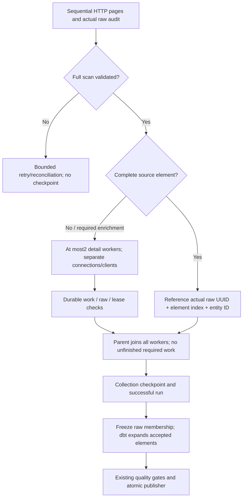

# Opt-in marketplace page reuse

M08D code checkpoint, 2026-11-14. Focused checks only; NOT deployed or a load/SLA
verdict. The existing main image/config/data is not changed by editing this code.
See [design](../docs/22_M08D_EBAY_ACQUISITION.md),
[dictionary](../docs/05_TARGET_SCHEMA.md) and [actual results](../docs/STATUS.md).

## What changes

| Source | Acquisition behavior in page-reuse mode |
| --- | --- |
| Website | Unchanged: consistent read-only, set-based SQL. No second worker. |
| eBay | Finish sequential discovery first; reuse complete Order objects with NONE_REQUESTED cancellation state. Up to2 workers fetch required shipping/cancellation/missing-field details. Complete shipping collections avoid redundant individual fulfillment GETs. |
| Etsy recovery | Validate the entire bounded scan, accept complete receipt elements directly. Missing fields use existing receipt-work GET/lease machinery. |
| Etsy inbox/replay | Webhooks remain notifications; up to2 workers still GET actual receipts with separate DB connections/HTTP clients and existing lease-token fencing. |

`orderIds` supports1..50 unique IDs in eBay SIM and the explicit client helper;
other query parameters are ignored, list cancellation requests remain empty.
The ordinary collector does NOT refetch every discovered order by ID batch.
Unknown/cancellation-bearing data still requires authoritative detail.
Etsy SIM, generation and backing storage are unchanged. Pipeline marketplace
access remains HTTP only.



## Durability and identity

- Each CLI collector holds one account-scoped HTTP collection session lock. The
  existing orchestration source-owner fence remains; two workers are not two DAG
  owners. eBay work IDs derive from retained collection/scan/order; Etsy retains
  SKIP LOCKED and per-work expiring lease tokens. Worker failure stops new jobs
  and joins in-flight work before returning; a failed worker cannot advance the
  parent checkpoint. An empty eBay page starts no enrichment connections.
- eBay page-reuse collection UUID derives from execution ID. Page/detail raw is
  reused only for matching scan/parent metadata; five actual attempts per URL
  span retries/scans. Discovery inconsistencies allocate another bounded scan.
  Enrichment version conflicts append a restart marker rather than rewriting a
  validated scan; the next invocation may allocate the next scan (maximum5).
- Shared429/503 Retry-After checks honor every still-active cooldown, not merely
  the latest shorter response. Already in-flight requests cannot be revoked.
  Concurrency never raises the source quota or HTTP-attempt ceiling.
- `ops.acquisition_elements` stores no copied receipt/order JSON. Its DB trigger
  checks the actual successful page element and validated scan. eBay shipping
  joins by raw UUID AND order ID. Old single-order records without redundant
  order_id metadata remain readable; that fallback is forbidden for array pages.
- `cache.etsy_payloads` remains the legacy byte-keyed computation cache. The new
  `cache.etsy_elements` key includes source/account/receipt ID/element content hash/
  normalization version. Parent response bytes/hash and acquisition time remain
  physical evidence, separate from the canonical source-version fingerprint.
- Missing fields may be filled by one actual authoritative detail object, never
  by constructing a fictional order response. Conflicting observed values refuse
  the version. Invalid business money remains for dbt to reject, not silently
  filtered or repaired by Python.
- Offset pagination still cannot guarantee provider snapshot isolation. Duplicate,
  count, bounds and next-link checks detect observed inconsistencies, not every
  possible unseen skip during a mutable same-count crawl. Malformed responses or
  exhausted budgets remain operator-visible failures; no automatic budget reset.
  Existing per-collection discovery ceilings remain eBay1000 and Etsy10000.
  New eBay worker connections have5s connect,15s statement and10s lock timeouts;
  Etsy retains its existing bounded DB settings. No main DB configuration changes.

## Configuration (do not activate before qualification)

The live overlay maps these settings into Airflow; the base/S01 default is
`legacy` and1worker. Page sizes remain independent (eBay1..200, Etsy1..100).

```dotenv
# Intended opt-in AFTER migration014 and explicit new-plan qualification/bootstrap.
LIVE_EBAY_ACQUISITION_MODE=page-reuse
LIVE_EBAY_DETAIL_WORKERS=2
LIVE_ETSY_ACQUISITION_MODE=page-reuse
LIVE_ETSY_DETAIL_WORKERS=2
```

Modes: `legacy` or `page-reuse`; worker counts:1 or2. Legacy requires1worker.
New cycles persist both settings. Retries use their saved options even if .env
changes; old cycles without options remain legacy/1. Direct collector commands
expose `--acquisition-mode page-reuse --detail-workers 2`; existing required
window/execution/account settings still apply. Do not switch a retained cycle.

Migration014 is included in fresh/ordinary migration and guarded deployment
lists, but was NOT applied to main in this coding task. It requires existing
Etsy scan/cache foundations009/010. Models now reference the new tables even when
they contain no elements. Do not run a newly built image against an unmigrated DB.
Changing the graph invalidates old compiled plans; the old correctness evidence
does not automatically qualify the new acquired-envelope path. Ask the owner
before running full parity/bootstrap/scheduler or load gates, never bypass guards.

## Focused checks

With project dependencies installed, these are independent unit/loopback checks,
not a request to start the main stack or a warehouse integration test:

```powershell
python -m unittest -v tests.test_acquisition_reuse tests.test_ebay_reuse_sim tests.test_acquisition_sql
```

`test_acquisition_reuse`: reuse vs cancellation/missing-field fallback, version
conflicts, retained HTTP budget/cache scan scope, bounded worker failure/overlap,
separate Etsy connections, recovery page references and pinned cycle retries.
`test_ebay_reuse_sim`:1/50/over-limit/duplicate/missing IDs, query precedence,
cancellation gap and shared fault-counter overlap on loopback HTTP only.
`test_acquisition_sql`: offline Jinja rendering, raw+entity parent scoping,
element cache identity and routing. It does NOT execute PostgreSQL SQL.

## Collect-only database probe

Explicitly start this check from the repository root with Docker Engine running:

```powershell
python tests/acquisition_db_probe.py
```

It uses existing `postgres:16.15-bookworm` and
`multi-channel-order-platform-airflow` images, current ingestion code mounted
read-only, a fresh labelled PostgreSQL tmpfs container and a small client sharing
only that container's network namespace. No published ports, owner .env, owner
volume, Compose services, Airflow scheduler, dbt, simulator backing storage or
load campaign. Synthetic HTTP responses test the actual collector CLI/DB path;
this is not a new production-SIM integration or business-SQL parity test.

The probe applies real platform prerequisites001..011 and014 (not delta012/013),
then reapplies014 to check idempotence. Four orders per source cover complete-page
reuse, cancellation/missing-field fallback, two concurrent detail requests,
successful retry without extra HTTP and a403 failure leaving the prior checkpoint.
Additional checks cover actual byte hashes, raw/element/scan references, immutable
audit, role permissions, rejected JSON-null options and stale-token response
auditing without receipt eligibility. Expected rejections check SQLSTATE, not just
any SQL exception. These few fixtures do not establish large-volume performance.

Success ends with `Collect DB probe PASS`; the printed `runtime/collect-db-*.json`
records commands, test output and cleanup. Only the fresh labelled test containers
and their tmpfs data are removed, including runner cleanup on failure/timeout.
No owner data is deleted. Actual run results/fixes remain in STATUS.

## dbt input parity probe

Owner-authorized ordinary dbt input parity PASS on2026-11-18; exact results and
failed harness attempts in STATUS. Repeat explicitly (not after every edit):

```powershell
python tests/dbt_acquisition_probe.py
```

This starts only fresh labelled tmpfs PostgreSQL and a project-venv dbt client,
not Airflow/main services. Two test-owned manifests use equivalent source-shaped
singleton vs page+accepted-element raw. Both complete runtime dbt builds60nodes
PASS;21multiset business comparisons (7outputs x3sources), independent marketplace
fingerprints, raw/role/hash evidence and Etsy element cache checks PASS. dbt
artifacts stay in client /tmp; exact commands/statuses persist in the printed
runtime/dbt-acquisition-*.json. This fixture does not invoke production collect,
freeze, publish or compiled delta execution. No main rollout or SLA is implied.

Pending separate approval: broader real lease/crash/cooldown races,
compiled delta routing/runtime qualification, explicit retained-plan
release/bootstrap and scheduled activation. Unchanged900, burst/soak and latency
measurements are separate future work, not needed for each small code edit.
