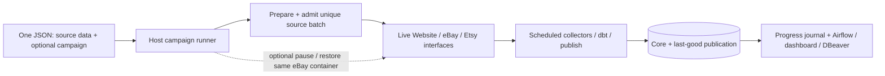

# Observable campaigns and bounded rate checks

Use any compatible JSON profile under tools/s02_data/config/. The optional
`campaign` section controls the host-side runner; generate/prepare still only
prepare source data and never pause a service. No Airflow dataset selector.
Review profiles do not grade performance. Optional measurement/load profiles
grade only their predeclared finite envelope, never full M08D certification.

## Current calibrated load path

Latest local result (2026-11-07): after the Etsy recovery fix and Website
staging/intermediate table materialization, the unchanged 144- and 600-order
envelopes PASS, including correctness and scheduled-cycle gates. The 900-order
step still FAILS after the drain fix (Website/eBay/inbox/recovery: 2/1/1/1 eligible
successes versus 2 each). Independent 900-order final-data reconciliation PASS
does not override that failure. Escalation stopped; profile bounded collection/
workflow cadence before rerunning the SAME limits. Earlier failed reports remain
failed. These are finite warm-history checks, not sustained capacity.

Subsequent page50/50 experiment also FAILS scheduled cadence1/1/1/1. It retains
900-order correctness PASS and751.877s observed drain; real recovery used6list
pages for300receipts, with detail requests unchanged. Configurable batching is
verified but NOT a complete cadence fix. See STATUS for the newer exact report;
do not increase load or relabel previous failures.
See [STATUS](../../docs/STATUS.md) for exact reports and remaining work.

Narrow follow-up: Etsy drain now bounds claims by its invocation work-set size,
not 100. This does not alter HTTP/work/stage retry limits or the rate envelope.
Focused unit/rollback checks are documented in [Etsy operation](../../orchestration/ETSY.md).
They do not regrade the failed 900 case. The SAME profile was rerun with the
deployed fix: one inbox collection completed 390 receipt works and recovery
completed 300, all at work attempt 1; no 100-claim failure. All 900 final orders
reconciled, observed drain843.241s, but scheduled cadence still FAILS. Further
HTTP/paging/queue/build profiling is required before another escalation.
Normal campaign startup rebuilds/deploys collector code through its guarded
drain. A standalone one-off test does NOT update the main Airflow image.

The short mixed72/6min gate failed on the recorded2CPU/4GB VM; the4-slot trial
reduced queue but did not pass the whole envelope. Keep those failures. Local
LIVE_AIRFLOW_PARALLELISM has been returned to2. The longer qualification keeps
the same offered rate and all latency/resource/cycle criteria; actual acceptance
is in STATUS, not inferred from these commands:

```powershell
python -m tools.s02_data campaign --config tools/s02_data/config/campaign_rate_144.json --confirm-local
if ($LASTEXITCODE -ne 0) { throw 'Qualification failed; stop and inspect its report' }
python -m tools.s02_data campaign --config tools/s02_data/config/campaign_rate_600.json --confirm-local
if ($LASTEXITCODE -ne 0) { throw '600-order step failed; do not increase load' }
python -m tools.s02_data campaign --config tools/s02_data/config/campaign_rate_900.json --confirm-local
if ($LASTEXITCODE -ne 0) { throw '900-order envelope failed; retain evidence' }
```

144/12min offers0.2orders/s;600/12min offers0.8333/s;900/10min offers1.5/s. These
are offered source eligibility rates, NOT measured commit or processed rates.
Generation/preparation happens before admission. Startup/drain and post-source
catch-up take additional time; do not expect a12-minute source range to equal
12minutes for the whole command. No repeated window inflation after this single
calibration: any failed qualification/escalation stops the path. This is not soak.

## Before running

Current bounded list-page experiment: LIVE_EBAY_PAGE_SIZE and
LIVE_ETSY_RECOVERY_PAGE_SIZE in `.env` override live defaults50 (bounds1..200
and1..100 respectively). Base/S01 defaults stay1. New cycles pin page size in
immutable settings; old retries keep their original size, including legacy1.
Same900 acceptance limits remain fixed; page batching alone is not proof of a
pipeline speedup because detail HTTP/DB/build work remains. Frozen reports include
the effective container page settings and collector/helper hashes.

- Docker Desktop, existing M01-M07 databases/credentials and initialized live
  environment are required. Existing data, checkpoints and budgets are retained.
- Do not run concurrently with C/disposable schedulers on a4GB Docker VM. Stop
  the test scope normally first; do not delete volumes or bypass RAM guards.
- `--confirm-local` permits starting dependencies, resuming an already-configured
  stopped live scheduler, draining old runs and enabling the four live DAGs.
  Other profile/source configurations are refused rather than silently switched.
- A previously stopped scheduler can have RUNNING metadata. The runner creates
  the existing parse-time drain flag before resuming that retained live scheduler,
  then lets normal live-up drain/retry without forcing task states or budgets.
- These commands may build/update local service images via existing live-up.
  Services remain running afterward for UI/DB inspection; no automatic data reset.
- Live-standalone Airflow readiness uses a lightweight monitor-API probe requiring
  healthy database, scheduler and DAG processor. The full CLI probe could exceed
  its15s budget while real processing continued on a small VM. HTTP200 alone
  never means ready. Base/disposable Compose health checks are unchanged.
- Optional non-secret `.env` LIVE_AIRFLOW_PARALLELISM defaults2; the host live-up
  supports2 or4 for this bounded envelope. A4-slot tuning run is allowed only
  with the same resource/correctness/cycle limits and measured memory; more
  executor slots do not bypass source/global publication locks. Base/disposable
  parallelism remains2. Normal startup drains before changing the live container.
- An active frozen/building/tested batch whose owning DAG is terminal or absent
  is refused with its exact ID. Inspect locks/run ownership first; a separately
  approved official workflow abort can retain its raw/manifest/last-good. The
  campaign never aborts such a batch automatically or resets its retry budget.
  Ownership is rechecked during campaign drain too: a restart can mark an old
  owner failed after initial preflight. Refusal requires operator direction,
  not repeating the load command or clearing tasks until it appears green.

## Original short rate diagnostics (retained for reproduction)

Run sequentially; never admit the second automatically after a failed first:

```powershell
python -m tools.s02_data campaign --config tools/s02_data/config/campaign_rate_website.json --confirm-local
if ($LASTEXITCODE -ne 0) { throw 'Website rate step failed; inspect its report before more load' }
python -m tools.s02_data campaign --config tools/s02_data/config/campaign_rate_mixed.json --confirm-local
if ($LASTEXITCODE -ne 0) { throw 'Mixed rate step failed; inspect its report' }
```

These add24 Website orders and72 mixed orders, respectively, on six-minute source
ranges. Other schedules stay active; all history is retained. Startup/drain and
post-source catch-up take additional time. Watch printed Airflow/report URLs or
the existing DBeaver connection. Reports require measurement.status BASELINE_PASS
AND measurement.load_assessment.status PASS, not just READY_FOR_REVIEW. Inspect
minute buckets, final_progress, observed_drain_seconds and scheduled_successes.
No reset, campaign dataset selection inside a DAG or manual collect/publish is
needed. No new tables. These are short low-rate steps, NOT burst/soak or final
M08D certification; see [the envelope](../../docs/19_M08D_MEASUREMENT.md).

After BOTH low steps PASS, follow the same command with
`config/campaign_rate_300.json`, check its exit/report, then
`config/campaign_rate_900.json`. Do not jump to the900 profile after a failed300
run. These intentionally retain prior orders/history and all live schedules;
elapsed time includes startup drain, not only their6/10-minute source interval.
Higher finite PASS is still not a genuine soak or an exact commit-latency result.

Exposure calibration after the short mixed failure: preserve the72/6min FAIL,
do not relabel it. The predeclared longer qualification is
`config/campaign_rate_144.json` (144/12min, same0.2 offered orders/s). Only on
qualification PASS run `config/campaign_rate_600.json` (600/12min, same offered
rate as300/6min), then original900/10min. All gates/resource/delay budgets remain
unchanged; this is longer exposure, not a measured software speedup. Stop on
failure rather than keep extending windows. See STATUS for which path actually
ran; the shorter300 profile remains a diagnostic template, not accepted capacity.

## Normal campaign first

```powershell
python -m tools.s02_data campaign --config tools/s02_data/config/campaign_normal.json --confirm-local
```

The runner starts dependencies, prepares/adopts a uniquely suffixed source batch,
prints UI URLs and periodically shows per-source expected/found/current order
counts. SIM/collectors/dbt/publication run normally, not through manually triggered
collection/build commands. Current means final prepared source_updated_at reached
core for this batch; not a full business reconciliation or capacity verdict.

Open Airflow tasks/logs and the operations dashboard using printed URLs; use the
existing DBeaver connection. If source rows advance while core does not, inspect
collect/build/test/publish and retained attempts, not merely the SIM plan.
Read-only examples: [inspect_campaign.sql](inspect_campaign.sql), with explicit
database labels. For Etsy logical-message/physical-send progress, use
[inspect_delivery.sql](inspect_delivery.sql), replacing its chosen dataset prefix
with the exact campaign dataset printed at ADMITTED.



The end state is `READY_FOR_REVIEW`, NOT milestone/performance PASS. It requires
no future source versions, no pending sends and final timestamp coverage for all
campaign orders. Historical data from other batches is not counted as this batch.

## Then one visible outage

```powershell
python -m tools.s02_data campaign --config tools/s02_data/config/campaign_recovery.json --confirm-local --allow-faults
```

This profile also prepares Etsy late/reordered/repeated/omitted deliveries. The
example uses a four-minute source interval and a180-second pause, with its start
seeded within180..210 seconds after admission. This wider observation window was
chosen because serialized builds can postpone the next collector request; it is
not an SLA or a guarantee of request overlap. The controller pauses only the
exact currently-running eBay SIM container, while PG,
Website/Etsy emission and Airflow continue. eBay HTTP may timeout; source state
continues advancing in PG. After the configured interval it unpauses the same
container and observes catch-up. It never stops PostgreSQL, rewinds checkpoints,
resets retry budgets or kills a process at an assumed transaction boundary.

The seeded relative fault plan is recorded before execution. Actual OUTAGE_INTENT,
OUTAGE_STARTED and OUTAGE_RESTORED events have UTC times. If the pipeline did not
make a failing eBay request during the pause, error-audit count can remain zero:
do not claim a collection-failure scenario was exercised just because pause worked.
Observation polling/command time can delay the actual start/end beyond planned
seconds; the journal records actual times rather than pretending exact timing.
For precise request correlation inspect raw.metadata.fetched_at. Multiple raw
attempts can share acquired_at because that field uses the collection observation
clock; it is not a separate physical finish time per retry. The terminal's error
counter is a coarse raw-audit count filtered on that observation clock, not a
complete request-latency measurement or exclusive attribution to this campaign.
In this pause scenario, response_status NULL means no HTTP response was received;
it must not be described as a simulated HTTP500 response.

## Config.campaign fields

| Field | Default | Constraint / meaning |
| --- | --- | --- |
| `seed` | 42 | Integer0..2147483647, selects fault start within its window |
| `timeout_seconds` | 1200 | Integer30..3600, operational wait budget after admission, not an SLA |
| `poll_seconds` | 10 | Integer2..60, observation polling |
| `fault` | null | No infrastructure fault by default |
| `fault.kind` | required | Only `ebay_pause` in this slice |
| `fault.start_window_seconds` | `[45,75]` | Two ordered integers10..600, relative to admission |
| `fault.duration_seconds` | 75 | Integer15..180; window end + duration must be below timeout |

Campaign demo currently permits1..1000 total source orders, deliberately not a load
profile. Source durations/lifecycle/delivery settings stay in the existing data
fields. Selected normal/recovery examples have two/four-minute source intervals;
pipeline drain may take longer. Startup/drain of old work precedes admission.

## Evidence, interruption and restoration

Report: ignored runtime/campaign-UUID/report.json. It contains resolved source
manifest, actual events, latest progress and `performance_assessment: DEFERRED`.
Atomic file replacement protects the outage-intent journal from partial writes.
It contains no model passwords/tokens or raw customer payloads.

Ctrl+C/error runs fault cleanup in finally, leaving services/data available for
inspection. Host/process death may skip finally. After inspecting the saved
report, restore only its exact paused eBay container:

```powershell
python -m tools.s02_data campaign-restore --report runtime/campaign-YOUR_ID/report.json --confirm-local
```

Restoration refuses a different/replaced container, foreign service/project or
another active startup/campaign lock. It never unpauses a replacement automatically.
Reports with no active campaign fault perform no action. No Docker prune/down-v.

Owner reviewed these demos. An optional bounded baseline is now available through
`campaign.measurement`; see [the measurement contract](../../docs/19_M08D_MEASUREMENT.md).
Profiles without it remain review-only. Full load/burst/soak, exact publication
latency and final capacity certification are separate remaining M08D gates.

## What to review manually

1. Start Docker Desktop, then run the normal command above from repository root.
   No separate SIM/start/gen/collect command is missing: this runner starts the
   existing live services and prepares/adopts one new source batch itself.
2. Open the printed Airflow/dashboard URLs; use your existing local credentials.
   The four live DAGs are website_polling, ebay_polling, etsy_inbox and
   etsy_recovery. Replay/manual DAGs need not be enabled.
3. In DBeaver keep `127.0.0.1:5433` (or your configured port). Inspect source plans in
   marketplace_sim, emitted Website rows in website_source, and raw/ops/core in
   data_platform. Use inspect_campaign.sql section by section in its named DB.
   Select the printed dataset, not all historic batches mixed together.
4. At READY_FOR_REVIEW, each channel's expected/found/current counts should match;
   future source versions and pending sends should be zero. Inspect order money,
   lines and independent business states separately. Review-only profiles do not
   grade them; measurement profiles also run the independent test-only reconciler.
5. Run the recovery command. During OUTAGE_STARTED, Docker shows eBay paused;
   Airflow can show a running request or up_for_retry task, not necessarily a
   failed DAG. Inspect cycle logs and new eBay raw error audits. API timeouts are
   not simulated by adding duplicate business orders to the DB.
6. At OUTAGE_RESTORED the same eBay container must run again; normal retries/polls
   should eventually populate the campaign's final source timestamps in core.
   Etsy's omitted-notification order still needs API recovery. Preserve all raw
   attempts and only actually observed history; three planned source states do
   not require three warehouse history snapshots. Keep the report for review.

The campaign driver is a host command, not a new Airflow DAG. The four live DAGs
use a cycle task for the reusable collect/freeze/build_and_test/publish workflow.
For sub-stage progress use its task log and ops.task_attempts; do not expect four
separate stage boxes in the polling DAG. No new warehouse table or business
transformation is introduced by this review runner.
